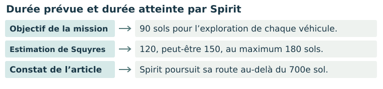
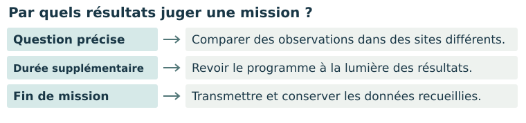

# ENS · MP-PC · Anglais (LE2) 2006 — Corrigé guidé

*Corrigé rédigé par IA, non officiel. Signalez toute erreur.*

**Rédaction** · GPT-6.2 Astra Ultra · vitesse non renseignée

Le cahier commun aux ENS de Paris et de Cachan dure deux heures. Dictionnaire et calculatrice interdits pour l’anglais. La version vaut 15 points, la question 5. La réponse doit compter au moins 100 mots.

## V. Version française

Ne pas confondre les deux engins. Le foret usé appartient à Spirit, l’articulation récalcitrante à Opportunity. Le rapport relève les difficultés de temps et de vocabulaire. *By a year and a half ago* prend pour repère la date où parle Squyres. *Tantalizing* dit l’attrait de ce qui reste hors de portée.

**Au-delà de leurs rêves martiens, deux robots renseignent toujours les spécialistes deux ans plus tard**

Il y a deux ans jour pour jour, le robot d’exploration Spirit descendait sous parachute dans l’atmosphère martienne puis, enveloppé de coussins gonflables protecteurs, rebondissait avant de rouler jusqu’à son point d’arrêt.

Au Jet Propulsion Laboratory de la NASA, ce furent des cris de joie et des embrassades quand Spirit signala par radio qu’il était arrivé sain et sauf. Trois semaines plus tard, nouvelles réjouissances quand un second robot, Opportunity, se posa sans encombre de l’autre côté de Mars.

Le programme prévoyait que chaque engin explorerait la planète durant 90 jours martiens. Un jour martien, appelé sol, dure près de quarante minutes de plus qu’un jour terrestre. Mais dès que les deux véhicules eurent quitté leur plateforme en roulant et se furent mis au travail, les responsables de mission comprirent qu’ils pourraient tenir plus de 90 jours.

« Je pensais vraiment qu’on arriverait à 120, a déclaré Steven W. Squyres, professeur d’astronomie à Cornell et responsable scientifique de la mission. Peut-être 150, et tout au plus 180. »

Autrement dit, le professeur Squyres s’attendait à consacrer déjà, il y a un an et demi, la totalité de son temps à analyser le trésor de données recueillies. Or Spirit a poursuivi sa promenade au-delà de son sept centième jour martien. Opportunity se porte bien lui aussi. Et le professeur Squyres passe toujours une bonne partie de son temps à déterminer où les envoyer.

Tous deux portent quelques traces d’usure. Spirit a usé les pointes diamantées de sa foreuse. Sur Opportunity, l’articulation d’épaule du bras qui porte la plupart des instruments fonctionne mal, et l’un des moteurs qui lui permettent de tourner est tombé en panne. Aucun des deux, pourtant, ne semble près de rendre l’âme. […]

« D’un côté, nous sommes fatigués, dit le professeur Squyres. De l’autre, rien dans la vie d’un scientifique n’égale le plaisir de faire des découvertes chaque jour. Et voilà deux ans que cela dure. » […]

Si deux années de pérégrinations ont montré quelque chose, c’est bien que l’exploration ne s’achèvera jamais. « Que les robots rendent l’âme demain ou dans deux ans, dit le professeur Squyres, il y aura toujours, juste hors de notre portée, quelque chose de merveilleux et de terriblement tentant que nous n’atteindrons jamais. »

## 1. Space exploration: how useful is this field of research?

Donner un exemple de gain scientifique propre à l’exploration et une condition de financement. La longévité des véhicules martiens augmente la valeur d’une mission déjà lancée. Elle ne garantit pas que tout nouveau projet soit prioritaire.

Space exploration is particularly useful when an observation cannot be made from Earth. A rover can examine different rocks in their surroundings and return evidence that helps researchers reconstruct a planet's past. Following up an unexpected finding is part of that value. Spirit and Opportunity could revisit the scientific programme because they continued working long after their planned missions. It would nevertheless be difficult to justify every expensive launch by promising unspecified benefits for future generations. I would ask what question the mission can answer, whether a cheaper instrument could answer it and how its results will be shared. Public access to the observations lets many teams use a single investment. Even a mission that rules out an attractive hypothesis can then contribute lasting knowledge, while leaving room in the budget for urgent work on Earth.

*136 mots.*

Version intégrale du passage du New York Times du 3 janvier 2006, avec ses coupes, et réponse à la question de la page 3. Le rapport sur l’anglais LE2 a été consulté.

[Version et consignes](https://banques-ecoles.fr/cms/wp-content/data/filiere-pc/annales-de-la-banque-pc/session-2006/sujet-2006-ecrit-mp_pc_langue_etrangere_2.pdf#page=3) · [Rapport du jury](https://banques-ecoles.fr/cms/wp-content/data/filiere-pc/rapports-des-jurys-de-la-banque-pc/session-2006/rapport-2006-pc_ecrit_langue_etrangere_2_anglais.pdf)
