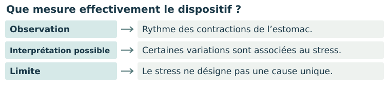
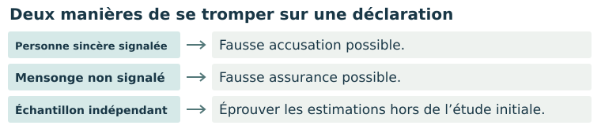

# ENS · MP-PC · Anglais (LV1) 2006 — Corrigé brut

*Corrigé rédigé par IA, non officiel. Signalez toute erreur.*

**Rédaction** · GPT-6.2 Astra Ultra · vitesse non renseignée

Le cahier commun aux ENS de Paris, de Lyon et de Cachan dure deux heures. Dictionnaire et calculatrice interdits pour l’anglais. La version vaut 12 points, les deux questions 8 points au total.

## V. Version française

**Quand l’estomac risque de trahir le menteur**

Selon les premiers résultats de recherches menées à l’université du Texas, aux États-Unis, la réaction de l’estomac lorsqu’on dit quelque chose de faux pourrait permettre de démasquer les menteurs. L’équipe pense que cette technique encore balbutiante pourrait un jour améliorer la précision des tests au détecteur de mensonges, qui reposent principalement sur la surveillance de l’activité cardiaque.

« Le cœur n’est pas fiable, parce qu’il subit l’influence du cerveau mais aussi de nombreux autres facteurs, comme les hormones », explique Pankaj Pasricha, qui dirige l’équipe. « L’intestin n’en fait qu’à sa tête, au sens littéral. Il possède son propre système nerveux, très développé, qui fonctionne indépendamment de presque tout, sauf de la partie inconsciente du cerveau. »

Le test utilise un dispositif d’électrogastrographie pour déterminer à quel moment les « battements » de l’estomac dépassent leur fréquence habituelle de trois par minute. Le rythme cardiaque peut s’accélérer aussi bien chez une personne qui ment que chez une personne qui dit la vérité. En revanche, les premiers résultats obtenus par l’équipe sur seize sujets indiquent qu’en général le rythme gastrique ne s’accélère pas lorsque la personne dit la vérité, quel que soit son degré de nervosité.

« Il se peut fort bien qu’il en soit ainsi », déclare Kevin Murphy, psychologue à l’université d’État de Pennsylvanie, aux États-Unis. Il a récemment dirigé, pour l’Académie américaine des sciences, un groupe d’experts chargé d’examiner les fondements scientifiques des détecteurs de mensonges. « Mais, quel que soit leur modèle, les polygraphes mesurent le stress et ne détectent pas le mensonge. Ce nouveau test pourrait apporter des données supplémentaires, éventuellement très utiles. Mais il ne vous livrera pas la vérité de manière définitive. »

Murphy fait remarquer qu’il n’existe aucun modèle scientifique reconnu qui relie les réactions du corps au stress et le fait de mentir. Aussi, même si des données expérimentales laissent entrevoir une corrélation entre les deux, l’absence de lien de causalité connu laisse subsister une incertitude. […]

L’étude initiale ne comptait que seize participants parce qu’elle avait débuté en mai 2005 dans le cadre d’un projet présenté par la fille de Pasricha à l’exposition scientifique de son lycée. Elle y a obtenu le deuxième prix. Une analyse plus poussée de ces travaux a été présentée lundi au congrès scientifique annuel du Collège américain de gastroentérologie, à Honolulu, à Hawaï.

## 1. What makes a lie detector reliable?

A reliable detector would have to distinguish a false statement from a truthful one under conditions resembling those in which it would be used. Recording a heartbeat accurately is only the first step. A frightened witness may have a rapid pulse while giving an entirely accurate account. The stomach measurements described in the article may supply an additional clue, but sixteen participants are too few to establish how often the inference would be wrong. Independent trials would need statements whose truth was already known, a varied group of speakers and a record of both missed lies and false accusations. Even a useful association would warrant a qualified judgement, especially where treating an innocent person's anxiety as evidence of dishonesty could have serious consequences.

*123 mots.*

## 2. Can science provide us with the truth in all cases?

Science can establish some claims with remarkable confidence because other people can repeat the measurements and try to disprove the explanation. Astronomers can predict an eclipse accurately enough for observers far apart to test the prediction. Yet a successful model always has conditions of use. Newtonian mechanics remains extremely useful for calculating an ordinary trajectory, although measurements at very high speeds require a different account. A theory can therefore become more precise without making every earlier result worthless. Other questions require judgements about what ought to be done. Knowing the error rate of a detector would help a court understand its evidence, but no experiment alone decides how much risk of wrongly accusing a witness society should accept. Scientific truth is strongest when the claim being tested and its limits are made explicit.

*133 mots.*

Version de l’article de Stu Hutson publié dans New Scientist le 31 octobre 2005 et réponses aux deux questions du cahier. Le rapport du jury traite séparément la reformulation scientifique et la réflexion sur la vérité.

[Version et consignes](https://banques-ecoles.fr/cms/wp-content/data/filiere-pc/annales-de-la-banque-pc/session-2006/sujet-2006-ecrit-mp_pc_langue_vivante_1.pdf#page=3) · [Rapport du jury](https://banques-ecoles.fr/cms/wp-content/data/filiere-pc/rapports-des-jurys-de-la-banque-pc/session-2006/rapport-2006-pc_ecrit_langue_vivante_1_anglais.pdf)
