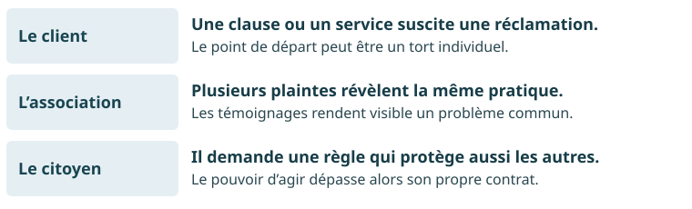

# ENS · MP-PC · Espagnol (LE2) 2006 — corrigé brut

*Corrigé rédigé par IA, non officiel. Signalez toute erreur.*

**Rédaction** · GPT-6.2 Astra Ultra · vitesse non renseignée · 25 novembre 2026

Épreuve de deux heures, sans dictionnaire, commune aux ENS de Paris et de Cachan. La version vaut 15 points et l’expression 5 points. Longueur indiquée pour l’expression : 100 mots au minimum.

## 1. Version française

**La révolte du consommateur**

En un clin d’œil, l’Espagne a connu une croissance économique spectaculaire. Son PIB par habitant est passé de 4 910 dollars en 1981 à quelque 20 000 en 2004. Les habitudes de consommation de ses habitants ont changé. On n’achète plus uniquement des produits de première nécessité, mais aussi des produits de luxe, des loisirs, des services… Aujourd’hui, les Espagnols dépensent leur argent, par ordre d’importance, pour le logement, l’alimentation et les boissons, les transports, les hôtels, les cafés ou les restaurants, et enfin les loisirs et la culture. Nous sommes plus de 30 millions d’Espagnols à appartenir à la catégorie des consommateurs au sens strict, contre 350 millions dans toute l’Europe et 1 milliard 750 millions dans le monde. On estime que, dans les pays riches, nous dépensons chaque jour 20 euros en biens ou en services. Et nous ne semblons pas toujours penser que cet argent est bien employé. Les banques, le logement, la téléphonie, les assurances et, l’été, les voyages sont les secteurs qui suscitent le plus de critiques en Espagne. Pour diverses raisons, énumérées ici dans l’ordre : défauts du service, publicité trompeuse, prix et clauses abusifs…

Un réseau d’associations de consommateurs et d’institutions publiques, à l’échelle locale, régionale, nationale ou européenne, tente de nous aider ou de nous protéger en tant que clients. Beaucoup de leurs représentants ont été à la fois témoins et acteurs du timide réveil du citoyen qui revendique sa place.

*D’après El País Semanal, septembre 2004.*

## 2. Expression en espagnol

### 1. Según usted, ¿cómo puede la defensa del consumidor convertirse en una forma de ciudadanía?

La defensa del consumidor se convierte en una forma de ciudadanía cuando una persona descubre que su reclamación puede servir también a quienes nunca tendrán tiempo de presentarla. Pensemos en una compañía que anuncia una tarifa sencilla y añade después gastos difíciles de identificar. Un cliente puede pedir la devolución de su dinero. Si varios comparan sus facturas y acuden a una asociación, ya tienen elementos para solicitar que todos los precios se publiquen de manera comprensible. Esta acción colectiva exige escuchar experiencias distintas, aportar pruebas y discutir una norma común. No hace falta definir a las personas solo por lo que compran. Precisamente se trata de defender derechos que no deberían depender de la capacidad de cada uno para negociar.

*121 mots.*

## Sources

ENS de Paris et de Cachan. Le rapport écrit de cette option reste à retrouver.

[Sujet, p. 6](https://banques-ecoles.fr/cms/wp-content/data/filiere-pc/annales-de-la-banque-pc/session-2006/sujet-2006-ecrit-mp_pc_langue_etrangere_2.pdf#page=6)
