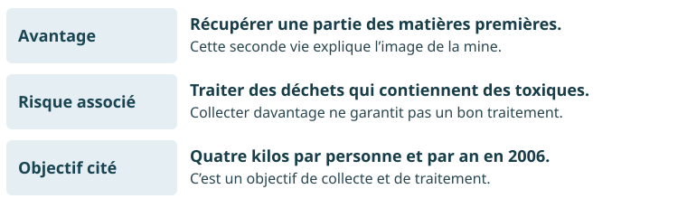

# ENS · MP-PC · Espagnol (LV1) 2006 — corrigé brut

*Corrigé rédigé par IA, non officiel. Signalez toute erreur.*

**Rédaction** · GPT-6.2 Astra Ultra · vitesse non renseignée · 25 novembre 2026

Épreuve de deux heures, sans dictionnaire, commune aux ENS de Paris, de Lyon et de Cachan. La version vaut 12 points et l’expression 8 points. Longueur indiquée pour l’expression : 100 mots au minimum.

## 1. Version française

**Machines réincarnées**

Ce n’est pas une histoire de science-fiction. C’est un parcours qui commence par un tas de vieilleries, les 160 000 tonnes de déchets d’équipements électriques et électroniques que nous produisons chaque année en Espagne. Mais, du moins pour les ordinateurs, les lave-linge ou les réfrigérateurs, il y a une vie après la fin de la vie utile.

Depuis la création du premier microprocesseur en 1971, le rythme du progrès technique donne le vertige. Aujourd’hui, chaque fois que nous achetons un ordinateur, un autre devient obsolète. Dans deux ans, il y aura deux milliards d’ordinateurs personnels sur Terre. Leur durée de vie moyenne est de 3,4 ans et elle diminue. Rien qu’en Californie, on en jette 6 000 par jour. Plus il y a de technologie, plus il y a de déchets. Un ordinateur n’a rien d’inoffensif, et les téléphones portables ou les jeux vidéo non plus. Sa fabrication consomme beaucoup d’énergie et sa durée de vie est courte. En outre, il contient notamment du plomb, du phosphore et du chrome, des substances toxiques qui doivent être traitées comme il convient. L’objectif pour 2006 est de collecter et de traiter convenablement quatre kilos de déchets d’équipements électriques et électroniques par habitant et par an, moins de la moitié de la quantité que l’on estime que nous produisons. « Convenablement », cela veut dire qu’en recyclant davantage on ne doit pas polluer davantage.

De nombreux appareils pourront ainsi se réincarner, par exemple sous forme d’appareils électroménagers neufs. C’est ce que permet la magie du recyclage, que beaucoup appellent déjà « la mine du XXIᵉ siècle ».

*D’après El País Semanal, novembre 2005.*

## 2. Expression en espagnol

### 1. ¿Por qué el reciclaje aparece en el artículo como una necesidad?

El artículo parte de una contradicción. Compramos máquinas cada vez más recientes, pero cada compra deja un aparato que ya no se usa y que no desaparece por sí solo. La rápida renovación de los ordenadores multiplica por tanto la cantidad de residuos. Además, fabricarlos exige energía y algunos de sus componentes contienen sustancias que requieren un tratamiento adecuado. Tirarlos sin más supone perder materiales aprovechables y exponerse a una contaminación evitable. Reciclar permite recuperar parte de esos recursos y utilizarlos en otros productos. La meta de cuatro kilos por habitante ilustra tanto la voluntad de organizar la recogida como la distancia que todavía separa ese objetivo de la cantidad real de residuos.

*113 mots.*

### 2. ¿Cuáles son las ventajas y los peligros del reciclaje en nuestras sociedades?

Reciclar un electrodoméstico permite aprovechar materiales que, de otro modo, habría que extraer otra vez. También obliga a crear puntos de recogida y a distinguir entre aparatos reparables y residuos que necesitan un tratamiento especializado. El peligro aparece cuando damos por resuelto el problema en cuanto dejamos una máquina en un contenedor. Si luego se transporta muy lejos o se desmonta en condiciones inadecuadas, parte del daño simplemente cambia de lugar. Además, la promesa de reciclar puede animarnos a sustituir antes de tiempo un aparato que todavía funciona. Por eso me parece importante facilitar la reparación, dar información sobre el destino de los residuos y reservar el reciclaje para lo que realmente ha terminado su vida útil.

*117 mots.*

## Sources

ENS de Paris, de Lyon et de Cachan. Le rapport écrit de cette option reste à retrouver.

[Sujet, p. 4](https://banques-ecoles.fr/cms/wp-content/data/filiere-pc/annales-de-la-banque-pc/session-2006/sujet-2006-ecrit-mp_pc_langue_vivante_1.pdf#page=4)
