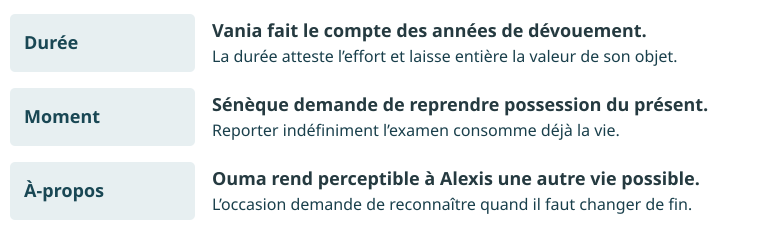

# ENS · MP-PC · Français 2006 — corrigé guidé

*Corrigé rédigé par IA, non officiel. Signalez toute erreur.*

**Rédaction** · GPT-6.2 Astra Ultra · vitesse non renseignée · 25 novembre 2026

## Sujet et œuvres

Dans *Dominique* (1862), Eugène Fromentin déplace la question du bonheur présent vers celle de savoir « si l’on a tout fait pour le devenir ». Le cahier ajoute que c’est « une affaire de temps, de moment et d’à propos ». Comment comprendre ce déplacement en lisant Sénèque, Tchékhov et Le Clézio ?

## Quel est l’antécédent de « c’est » ?

Le premier sens porte sur *savoir si*. À quelle heure de sa vie Vania peut-il évaluer ce qu’il a fait pour devenir heureux ? Le second porte, plus largement, sur *tout faire pour devenir heureux*. Alexis sait-il reconnaître l’occasion que lui ouvre sa rencontre avec Ouma ? Le rapport accepte les deux lectures. Pour éviter de les juxtaposer, partir de l’examen puis se demander quelle action reste possible à partir de ce que l’examen apprend.

## Trois distinctions à vérifier dans les œuvres

**Temps et moment.** Les années de travail de Vania ne changent pas de longueur à l’arrivée de Sérébriakov. C’est leur signification qui bascule. L’exemple permet de distinguer la durée nécessaire à une œuvre et l’instant où l’on juge ce qu’elle valait.

**Moment et à-propos.** Une circonstance favorable peut survenir sans être reconnue. À Rodrigues, le dessin des lieux qu’Alexis cherche à déchiffrer n’a pas la même valeur pour le chercheur de trésor et pour celui qui commence à écouter Ouma. L’à-propos demande un jugement sur ce qu’il vaut la peine d’accueillir.

**Effort et direction.** Dans *La Vie heureuse*, Sénèque rend imaginable une hâte qui aggrave l’erreur de destination. Avant de faire du « tout » une exigence de quantité, vérifier la fin qui donne à l’effort sa direction.

## Donner une conséquence à l’examen

Vania peut découvrir la fausseté d’une admiration sans démontrer qu’une autre vie aurait nécessairement été heureuse. Relever ce que le retour en arrière établit, puis ce qu’il laisse impossible à prouver, empêche de transformer la question de Fromentin en tribunal qui condamnerait tout homme déçu. Le dernier mouvement doit reprendre le terme « savoir » et préciser en quoi la connaissance acquise modifie la conduite présente.

## Dissertation rédigée

Pendant des années, Vania a administré un domaine afin de permettre à Sérébriakov de se consacrer à son œuvre savante. Son jugement sur le professeur vient à changer. Du même coup, une longue suite de gestes accomplis de bon gré lui apparaît comme un immense gaspillage. Si on lui demandait seulement s’il est heureux, la réponse ne ferait guère de doute. Mais que répondrait-il à la question de Fromentin, qui veut savoir si l’on a tout fait pour le devenir ? L’énoncé déplace le jugement du résultat vers nos actes et du présent vers l’examen d’un passé. Il ajoute une difficulté. Le moment où nous posons la question change peut-être la réponse que nous pouvons lui donner. Il faut donc chercher quelle liberté demeure dans le rapport au bonheur si l’état éprouvé ne dépend pas entièrement de nous et si l’examen que nous faisons de nos actes dépend lui-même du temps.

### Examiner la direction d’une vie

Une mauvaise journée ne suffit pas à établir qu’un homme a mal conduit sa vie. La perte du domaine familial, dans *Le Chercheur d’or*, met fin pour Alexis à une manière de vivre que son enfance lui donnait pour évidente. L’épreuve a des causes matérielles et familiales qui ne dépendent pas de l’application d’un enfant à devenir heureux. À l’inverse, un plaisir éprouvé aujourd’hui peut couronner une démarche qui ne nous rendra nullement capables de vivre demain. Le déplacement de Fromentin a donc d’abord une justesse morale. Se demander ce que l’on a fait ouvre un domaine de responsabilité que la simple interrogation sur un sentiment du moment ne permettait pas d’isoler.

Sénèque rend toutefois plus précise la règle de cet examen. Au commencement de *La Vie heureuse*, les hommes se hâtent vers le bonheur et s’en éloignent d’autant plus vite qu’ils se sont trompés de chemin. On ne peut donc mesurer un effort d’après la seule énergie qu’il a coûtée. À supposer que Vania ait fourni au professeur toutes les conditions d’une brillante carrière, il reste à savoir pourquoi la gloire de cet homme aurait dû rendre heureuse la personne qui lui consacrait son existence. La soumission à une opinion longtemps partagée par la famille a tenu lieu d’examen du bien. Un stoïcien lui demanderait moins s’il a fait assez que s’il a pu reconnaître dans ce qu’il a fait une activité conforme à un jugement libre. Si « tout » désigne indistinctement toutes les actions possibles, l’exigence de Fromentin est intenable. Elle devient intelligible si elle invite à vérifier les raisons qui ont orienté ce qu’il était en notre pouvoir de faire.

La recherche d’Alexis donne à cette nuance un autre relief. Héritier des cartes et du rêve de son père, il quitte Maurice, rejoint Rodrigues et travaille avec persévérance sur les traces du trésor. Il y a bien là décision et patience. Si le bonheur devait se confondre avec la découverte d’un dépôt caché, on pourrait dresser la liste des recherches, des déplacements et des reprises. Pourtant l’histoire la plus importante de ces années se passe peut-être ailleurs, notamment dans la rencontre d’Ouma. Tout faire pour une fin peut avoir pour effet très exact de nous rendre indisponibles à un bien dont on ignorait le nom. Comment un homme engagé dans cette recherche saurait-il à quel moment il doit en réexaminer la direction ?

### Ce que le temps donne à voir, ce qu’il rend irréparable

Dans la phrase de Fromentin, « c’est » peut reprendre le fait de *savoir si* l’on a tout fait. Voici une difficulté plus originale qu’un simple éloge de l’occasion. Un homme jeune, un homme dont le projet traverse une crise et un homme qui revient longtemps après sur une perte ne portent pas nécessairement le même jugement sur des actes pourtant achevés. *Oncle Vania* confie cette variation aux conditions concrètes d’une réunion de famille. Tant que le professeur vivait au loin, son autorité pouvait donner du prix à chaque journée de travail accomplie sur le domaine. Sa présence, son caractère et le projet de vendre la propriété rendent possible une autre lecture. Ce que Vania comprend tardivement est bien réel. Mais son idée qu’il aurait pu devenir un grand homme s’il n’avait pas consacré sa vie à une idole demeure une hypothèse impossible à mettre à l’épreuve. Le retour sur le passé donne de la lucidité et peut fabriquer, dans le même mouvement, une autre illusion.

*De la brièveté de la vie* fait de cette difficulté une objection à la manie du report. Celui qui promet de commencer à vivre lorsque ses occupations lui en laisseront enfin le loisir dispose du lendemain comme s’il lui appartenait. Il a pourtant donné à d’autres les jours qui étaient réellement disponibles. Sénèque voudrait faire entrer l’examen au cœur même de l’existence en train de se mener. La durée vécue change de qualité lorsque les moments cessent de n’être que les acomptes versés sur un bonheur futur. Le passé lui-même peut redevenir présent à celui qui a le loisir de le reprendre. On saisit en quoi le moment pour juger compte. Attendre une vue absolument complète risque de remettre l’examen à une heure où il n’aurait plus de prise pratique.

La fin d’*Oncle Vania* donne à cette exigence du présent sa plus forte objection. Sonia et Vania reviennent aux comptes. Leur travail de ce soir ressemble matériellement à celui des jours anciens. La consolation que Sonia offre à son oncle prend la forme d’un repos promis au-delà de cette vie. Serait-il juste de condamner cette espérance comme un simple manquement à la règle stoïcienne ? Elle permet aussi à deux êtres déçus de se tenir compagnie et de ne pas abandonner ceux qui comptent sur eux. Le moment de tirer un enseignement d’une vie ne se choisit pas à la façon d’un rendez-vous. Il arrive qu’une parole sur le futur soit la seule manière de soutenir quelqu’un *maintenant*. Le critère de l’à-propos commence à se dégager. Il engage une attention à la situation singulière de personnes capables de se nuire ou de s’aider.

### Faire place à ce qui ne dépend pas de l’effort

Si l’on comprend enfin « affaire de temps » comme une indication sur la recherche elle-même, il faut encore distinguer l’attente passive du discernement d’une occasion. Ouma connaît un milieu que la carte du trésor ne décrit pas. Elle oriente l’attention d’Alexis vers les gestes, les chemins et les êtres qui rendent ce lieu habitable. Le voyageur pourrait considérer ces moments comme des interruptions de son travail, au sens où chaque heure passée avec elle est soustraite à l’enquête. Le récit nous apprend au contraire à nous demander ce qu’il perdait pendant les heures consacrées à son seul projet. L’à-propos ne consiste plus à saisir plus vite le moyen d’arriver au même but. Il peut consister à reconnaître à temps qu’un autre bien est effectivement offert.

Une semblable modification est possible dans le jugement sur le domaine de Vania. La plantation d’arbres par Astrov ne lui garantit aucun bonheur futur personnel. Elle témoigne d’une façon de se rapporter à des hommes éloignés dans le temps, auxquels quelque chose sera peut-être un jour donné. La scène permet de séparer agir en vue d’une récompense et agir de telle manière que le présent ne se ferme pas sur la déception actuelle. Chez Sénèque, la vertu ne gagne pas sa valeur d’une récompense ultérieure. L’activité raisonnable constitue déjà une manière heureuse de se tenir dans le monde. Les trois œuvres s’accordent ici sur une restriction qu’il faut apporter à la formule initiale. Le bonheur ne résulte pas d’un compte où l’on échangerait une quantité suffisante d’efforts contre une certitude. La manière de choisir, d’agir et parfois de consentir à interrompre une recherche engage déjà la qualité de la vie que l’on mène.

La question de Fromentin est plus féconde que le constat d’un état dès qu’elle rend les actes à celui qui en répond. Elle deviendrait cruelle si elle faisait de chaque malheur la preuve d’une faute passée. Il faut du temps pour comprendre ce que l’on poursuivait, mais cette compréhension doit pouvoir agir dans le présent et se laisser instruire par une rencontre. À la question de savoir si l’on a tout fait, on ne répondra donc pas par une addition. La meilleure réponse pourrait être la capacité, au moment venu, de ne plus faire sous un autre nom ce qui a déjà rempli toute une existence.

## Sources

Le cahier 61.11PM émane des ENS de Paris, Lyon et Cachan. Il donne « une affaire de temps » ; le rapport du jury reformule « une question de temps ». À la p. 2, le rapport présente deux lectures de l’antécédent de « c’est » et indique les avoir admises. La copie adopte d’abord l’examen rétrospectif et éprouve ensuite la lecture pratique.

[Sujet](https://banques-ecoles.fr/cms/wp-content/data/filiere-pc/annales-de-la-banque-pc/session-2006/sujet-2006-ecrit-mp-pc_francais.pdf) · [Rapport](https://banques-ecoles.fr/cms/wp-content/data/filiere-pc/rapports-des-jurys-de-la-banque-pc/session-2006/rapport-2006-pc_ecrit_francais.pdf)
