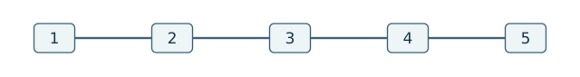
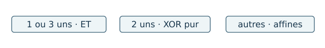
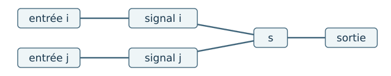

# ENS · MP-PC · Informatique 2006 — corrigé brut

*Corrigé rédigé par IA, non officiel. Signalez toute erreur.*

**Rédaction** · GPT-6.2 Astra Ultra · vitesse non renseignée · 25 novembre 2026

**Révision (tour 1)** · GPT-6.2 Astra Ultra · vitesse non renseignée · 26 novembre 2026

Soit n le nombre de sommets d’un graphe et m son nombre d’arcs. Dans les circuits, toutes les portes ont une arité positive et un même parent ne peut figurer deux fois à la même porte. Cette convention intervient dans le critère de complétude.

## Partie 1. Ordre topologique et fermeture

### Question 1.1.1 · Deux exemples

Un ordre de lecture du premier graphe est $3,2,4,1$, soit le tableau des rangs $[4,2,1,3]$. Sur le second, l’ordre numérique convient et le tableau est $[1,2,3,4,5,6,7]$.

### Question 1.1.2 · Caractérisation

Les rangs augmentent strictement le long d’un chemin, ce qui exclut tout cycle. Réciproquement un graphe fini acyclique non vide contient une entrée : sinon remonter des prédécesseurs ferait répéter un sommet. Enlever une entrée, ordonner le graphe restant par récurrence puis préfixer par l’entrée.

### Question 1.1.3 · Inverser la permutation

```text
créer inv de taille n
pour s = 1,…,n : inv[o[s]] ← s
renvoyer inv
```

Chaque rang est utilisé exactement une fois. Temps et espace de sortie $\Theta(n)$.

### Question 1.2.1 · Parents

```text
P[1..n] ← listes vides
pour s = 1,…,n :
    pour t dans Succ[s] : P[t] ← concat(s,P[t])
renvoyer P
```

Un arc $s\to t$ produit exactement une occurrence de $s$ dans $P[t]$. Coût $\Theta(n+m)$.

### Question 1.2.2 · Degrés et entrées

Initialiser $d[1..n]$ à zéro ; pour chaque arc $s\to t$ incrémenter $d[t]$. Rassembler les sommets vérifiant $d[t]=0$. Coût global $\Theta(n+m)$ ; si les degrés sont déjà calculés, la liste des entrées coûte $\Theta(n)$.

### Question 1.2.3 · Tri topologique linéaire

Initialiser la file des entrées et les degrés. Retirer un sommet $s$, lui attribuer le prochain rang, décrémenter le degré de chacun de ses fils et enfiler tout fils dont le degré tombe à zéro. L’invariant est le degré dans le sous-graphe non numéroté. Si moins de $n$ rangs ont été attribués à la fin, ce sous-graphe non vide est sans entrée et contient un cycle. Sinon tous les arcs respectent l’ordre. Temps $O(n+m)$.

### Question 1.3 · Ordonner toutes les listes

```text
inv ← Inverse(o) ; P ← Parents(Succ) ; T ← n listes vides
pour r de n à 1 :
    v ← inv[r]
    pour u dans P[v] : T[u] ← concat(v,T[u])
renvoyer T
```

Chaque liste reçoit ses fils par rang décroissant mais en tête, donc est finalement croissante. Coût $O(n+m)$.

### Question 1.4.1 · Trace de R et Q

À chaque entrée dans la boucle extérieure et à la fin, $Q=(0,0,0,0,0)$. Les lignes de $R$ non encore traitées sont vides. Le tableau indique la nouvelle liste déjà disponible à chaque entrée ; toutes les listes des entrées précédentes restent en place.

| Moment | Nouvelle liste disponible |
|---|---|
| Entrée $i=5$ | Aucune |
| Entrée $i=4$ | $R[5]=[5]$ |
| Entrée $i=3$ | $R[4]=[5,4]$ |
| Entrée $i=2$ | $R[3]=[4,5,3]$ |
| Entrée $i=1$ | $R[2]=[3,5,4,2]$ |
| Fin | $R[1]=[2,4,5,3,1]$ |

### Question 1.4.2 · Invariant

Par récurrence descendante, chaque $R[j]$ déjà calculée est l’ensemble des sommets accessibles de $j$, lui compris. En traitant $i$, la liste courante et les marques représentent $i$ et l’union des fermetures des fils déjà lus. Si $j$ est déjà marqué, il est atteint par un de ces fils et toute sa fermeture est déjà incluse. Sinon on parcourt $R[j]$ et ajoute exactement les éléments absents. La réunion finale donne la fermeture de $i$ et le nettoyage efface toutes ses marques.



### Question 1.4.3 · Arcs irréductibles

Noter $A^-$ les arcs sans détour. Un sommet interne $v$ reçoit un tel arc depuis son parent de plus grand numéro : un détour passerait par un dernier parent encore plus grand. Ainsi il y a au plus $|A^-|$ sommets internes. Une paire accessible non diagonale finit en un sommet interne, d’où $|A^*|\le n+n|A^-|$. Le test de la ligne 9 déclenche le parcours de $R[j]$ exactement lorsque $(i,j)\in A^-$ : un détour commence par un fils de $i$ d’indice inférieur à $j$, donc déjà traité. Au plus $n$ lectures par arc irréductible, $O(m)$ tests et $O(|A^*|)$ remises à zéro. Comme $A\subseteq A^*$, la complexité est $O(n(1+|A^-|))$.

### Question 1.4.4 · Exemple quadratique

Prendre deux couches de tailles $\lfloor n/2\rfloor$ et $\lceil n/2\rceil$, tous les arcs de la première vers la seconde et aucun autre. Aucun trajet de longueur deux n’existe. Donc $|A^-|=\lfloor n^2/4\rfloor$, ce qui exclut toute borne $O(n^\alpha)$ avec $\alpha<2$.

### Question 1.5.1 · Partition en chaînes

```text
marquer tous les sommets libres
pour i croissant :
    si i est libre :
        ouvrir une chaîne au sommet i
        tant qu’un sommet v est sélectionné :
            marquer v occupé et l’ajouter en queue à la chaîne
            sélectionner le premier fils libre de v, ou arrêter la chaîne
renvoyer les chaînes
```

Les listes sont triées. La première chaîne construite parmi deux ne peut recevoir aucun sommet de l’autre avant son début, ni après sa fin. Entre deux sommets consécutifs $u,v$, le premier sommet intercalé devrait être un fils libre de $u$ plus petit que $v$, impossible. L’ordre numérique étant imposé à tout chemin, leur réunion ne peut donc être une chaîne. Coût $O(n+m)$ avec une queue de construction ou un renversement final.

### Question 1.5.2.a · Premier sommet accessible

Si $i\in S_h$, il est lui-même atteint et aucun sommet plus petit ne peut l’être, donc $R(h,i)=i$. Sinon tout chemin vers $S_h$ peut se décomposer en arcs de $A^-$ : remplacer un arc réductible par un détour, ce qui termine par décroissance des écarts de numéros des arcs. Ainsi $R(h,i)=\min_{(i,j)\in A^-} R(h,j)$, avec la sentinelle $n+1$ pour le minimum vide.

### Question 1.5.2.b · Tester un arc

Un détour de $i$ vers $j$ commence, après décomposition en arcs irréductibles, par $\ell<j$ dans $B$, puis atteint $j$. Comme $j$ appartient à la chaîne $C[j]$, cela équivaut à $R(C[j],\ell)\le j$ pour un $\ell\in B$ : tout sommet de cette chaîne antérieur à $j$ le rejoint. Donc $(i,j)\in A^-$ exactement lorsque $j<r$, y compris si $B$ est vide.

### Question 1.5.2.c · Calcul des minima par chaîne

```text
pour i de n à 1 :
    initialiser R[1..k,i] à n+1
    pour j dans Succ[i] en ordre croissant :
        si j < R[C[j],i] :
            pour h = 1,…,k : R[h,i] ← min(R[h,i],R[h,j])
    R[C[i],i] ← i
renvoyer R
```

Avant chaque $j$, la colonne courante contient les minima sur les fils irréductibles précédents ; 1.5.2.b justifie le test. Inclure $i$ seulement après le balayage. Les colonnes des fils sont déjà calculées. Temps $O(m+k(n+|A^-|))$.

### Question 1.5.3 · Développer les suffixes

Pour chaque sommet, mémoriser un pointeur sur sa position dans sa chaîne. Pour chaque couple $(i,h)$ tel que $R(h,i)\le n$, copier dans la liste résultat de $i$ le suffixe de $S_h$ commençant en $R(h,i)$. Ces suffixes disjoints énumèrent chaque paire de $A^*$ exactement une fois. Partition, calcul et développement coûtent ensemble $O(m+k(n+|A^-|)+|A^*|)$.

## Partie 2. Fonctions et circuits booléens

### Question 2.1.1 · Types binaires

Les quatre conjonctions de littéraux valent 1 sur une seule des quatre entrées ; leurs quatre négations ont trois valeurs 1. Ce sont les huit fonctions de type ET. Les deux fonctions de type XOR sont la parité et sa négation, valant 1 sur deux points en diagonale. Les deux classes sont disjointes.



### Question 2.1.2 · Fonctions affines

Les deux XOR s’écrivent $c\oplus x_1\oplus x_2$, $c\in\{0,1\}$. Les six autres fonctions affines sont les deux constantes, $x_1,\neg x_1,x_2,\neg x_2$. Cela épuise les quatre choix de supports et les deux constantes additives.

### Question 2.1.3 · Deux substitutions

Si $x_1=\neg a$, le premier littéral $x_1^a$ vaut 0. La sortie est $0^c=1-c$. Si $x_1=x_2$, le XOR vaut 0, donc $(x_1\oplus x_2)^a=1-a$.

### Question 2.2.1 · Extraire une porte ET

Pour deux variables, toute table non affine est de type ET d’après 2.1. Pour $n>2$, poser $f_b=f(\cdot,b)$. Si l’une des tranches est non affine, appliquer l’induction. Sinon, les deux sont affines. Si leurs supports sont égaux, elles diffèrent au plus d’une constante et $f=f_0\oplus x_n(f_0\oplus f_1)$ est affine. Il existe donc une variable $x_i$ présente dans un seul support. Fixer les autres variables à zéro : sur l’une des lignes $x_n=b$, la sortie varie avec $x_i$, sur l’autre elle est constante. La table binaire a un nombre impair de uns et est de type ET.

### Question 2.2.2 · Extraire une négation

Une violation de monotonie fournit $u\le v$ avec $f(u)=1$, $f(v)=0$. Transformer $u$ en $v$ en faisant passer de 0 à 1 une seule coordonnée à chaque pas. À un pas la valeur tombe de 1 à 0. Fixer les autres coordonnées à leurs valeurs communes : la fonction restante est la négation.

### Question 2.3.1 · Lire le circuit

La sortie vaut $(x_1\land x_2)\lor((x_1\lor x_2)\land x_3)$, soit la majorité de trois bits : elle vaut 1 exactement si au moins deux sont vrais.

### Question 2.3.2 · Reconnaître un mot

Pour le mot $x$, former $n$ littéraux $L_i=x'_i$ si $x_i=1$, $L_i=\neg x'_i$ sinon. Leur conjonction reconnaît exactement $x$. Diviser la liste en deux moitiés, construire récursivement leurs conjonctions puis les réunir par une porte ET. Au plus $2n-1$ portes en comptant les négations et profondeur au plus $1+\lceil\log_2 n\rceil$.

### Question 2.3.3 · Table de vérité arbitraire

Si $q$ mots sont acceptés, construire leurs indicatrices, puis leur disjonction par arbre équilibré. Pour $q>0$, taille $O(nq)\subseteq O(n2^n)$, profondeur $O(1+\log n+\log q)\subseteq O(n)$. Pour $q=0$, une porte constante unaire sur une entrée fournit 0.

### Question 2.4.1 · Une base minimale

La famille de 2.3.3 est complète. La sous-famille $\{\land,\neg\}$ suffit : De Morgan fournit OU ; $x\land\neg x$ et sa négation donnent les constantes. Au besoin deux négations successives copient un signal pour donner des parents distincts. En retirant ET, toutes les fonctions obtenues sont essentiellement unaires ; en retirant NON, elles sont monotones. Cette base est donc minimale pour l’inclusion.

### Question 2.4.2.a · Nécessité des six conditions

Les projections préservent 0 et 1, sont monotones, auto-adjointes et affines. Chacune de ces cinq propriétés se conserve par composition : pour l’auto-adjonction, la complémentation traverse chaque étage ; pour l’affinité, substituer des sommes affines reste affine. Si une famille entière avait l’une de ces propriétés, elle ne pourrait calculer toutes les fonctions (témoins 1, 0, NON, 0 et ET, respectivement). Enfin la complétude donne un circuit unaire calculant NON ; composer deux copies donne une identité calculée en un sommet interne, d’où (vi).

### Question 2.4.2.b · Suffisance

Grâce à (vi), itérer des copies crée autant de parents distincts d’un signal que voulu. Pour prescrire un ordre d’arguments, produire les copies finales dans cet ordre ; la numérotation topologique respecte ainsi la convention du sujet.

**Négation.** La diagonale d’un témoin de (i) est NON ou la constante 1 ; celle de (ii) est NON ou la constante 0. Si NON n’est pas apparu, on dispose donc des deux constantes. Spécialiser un témoin de (iii) selon 2.2.2 fournit NON.

**Constantes.** Un témoin $g$ de (iv) possède un mot $u$ avec $g(u)=g(\neg u)=b$. Lui envoyer, selon les coordonnées, le signal $x$ ou $\neg x$, de façon à obtenir $u$ pour $x=0$ et $\neg u$ pour $x=1$. La sortie est $b$, puis sa négation fournit $1-b$.

**Conjonction.** Spécialiser un témoin de (v) avec ces constantes selon 2.2.1. Les négations disponibles défont les éventuelles négations des entrées et de la sortie de la porte de type ET obtenue. On dispose de la base complète de 2.4.1.

## Partie 3. Bornes de complexité

### Question 3.1.1 · Puissances booléennes

La case $(i,j)$ de $(I_n+X)^m$ vaut 1 exactement s’il existe une marche de $i$ à $j$ de longueur au plus $m$ (longueur nulle comprise). Pour $m=0$ c’est l’identité. Multiplier une fois de plus prend la disjonction sur un sommet intermédiaire, avec au choix un arc réel ou une attente diagonale.

### Question 3.1.2 · Circuit d’accessibilité

Partir de $I_n+X$ et prendre $\lceil\log_2(\max(1,n-1))\rceil$ carrés successifs. Les chemins simples suffisent pour l’accessibilité et ont longueur au plus $n-1$. Un produit de matrices utilise $O(n^3)$ portes : pour chaque case, $n$ ET puis un arbre de OU de profondeur $\lceil\log_2 n\rceil$. Les $n^2$ cases se calculent en parallèle. Taille totale $O(n^3\log n)$, profondeur $O((\log n)^2)$ pour $n\ge2$ ; aux diagonales une constante 1 suffit. Un produit d’un signal avec lui-même reprend directement ce signal.

### Question 3.2.1 · Compter les arcs

Avec $q$ sommets internes, la somme des degrés entrants donne $|A|\le2q$. Parmi les $n+q$ sommets, $n+q-m$ ne sont pas des sorties ; chacun fournit un arc au moins et $p$ d’entre eux un arc supplémentaire. Donc $2q\ge n+q-m+p$, soit $q\ge n-m+p$.

### Question 3.2.2.a · Forme d’un circuit optimal

Deux sommets distincts ne peuvent calculer la même fonction. Dans ce cas garder le premier, recâbler vers lui les consommateurs du second et enlever le second. Deux entrées distinctes étant des projections distinctes, le sommet enlevé est interne. Si deux broches deviennent identiques, remplacer la porte par sa diagonale unaire ; réordonner sa table si l’ordre des parents change. Tous ces types figurent dans $\Omega$. Le sommet du résultat est donc unique. Supprimer toutes les portes non ancêtres de ce sommet : l’optimalité implique qu’il était une sortie et qu’aucune autre sortie interne n’existait.

### Question 3.2.2.b · Absorber les portes dégénérées

Les portes binaires hors des types ET et XOR sont constantes, projections ou projections niées. Les portes unaires ont les mêmes formes. Parcourir le circuit dans l’ordre et représenter chaque signal par une constante ou un fil éventuellement complémenté. Aux portes dégénérées, transmettre cette représentation sans créer de porte. Aux autres, absorber les signes et constantes dans la table et ne créer une porte que si deux signaux distincts sont réellement nécessaires. Si la sortie est le complément d’une porte, inverser sa table de sortie ; si c’est une projection, aucune porte n’est nécessaire. Les exclusions sur $f$ évitent une constante ou une entrée niée à matérialiser. D’où $L_\Omega(f)\le |C|-k$.

### Question 3.3 · Adressage et élimination de deux portes

Pour $z\ge2$, la fonction dépend des $z$ données sélectionnables. Dans un circuit optimal, leurs portes utiles sont binaires de type ET ou XOR par 3.2.2.b. Si $x_i$ a au moins deux fils, lui donner une constante rend au moins deux portes dégénérées. Sur les $z-1$ autres adresses, la restriction donne toujours la donnée désignée.

Si $x_i$ a un seul fils $s$ de type ET, fixer $x_i$ à la valeur qui annule son littéral. Si $s$ est de type XOR, remplacer $x_i$ par le signal de son autre parent : celui-ci est indépendant de $x_i$, car tout chemin quittant $x_i$ commence par $s$. Cette fixation fonctionnelle est permise dans la construction de $f'$ : sur les autres adresses, l’égalité à la donnée sélectionnée vaut pour **toute** valeur de $x_i$, donc aussi pour ce choix. Dans les deux cas, la sortie de $s$ devient constante. Il y a au moins un fils de $s$, car un résultat constant après substitution ne pourrait appartenir à $A_{z-1}$. La porte $s$ et l’un de ses fils sont ainsi éliminables. Concrètement on remplace $s$ par une porte constante unaire, puis on absorbe sa valeur dans ses fils. De même dans le premier cas on absorbe la constante directement dans les fils de $x_i$.

La fonction obtenue appartient à $A_{z-1}$ et n’est ni constante ni une projection niée (elle reproduit librement une donnée sur au moins une adresse). Les simplifications de 3.2.2.b donnent $L_\Omega(f')\le L_\Omega(f)-2$. Partant de $f_k\in A_n$ et itérant $n-1$ fois jusqu’à la borne triviale zéro, on obtient $L_\Omega(f_k)\ge2n-2$.

### Question 3.4.1 · Une bifurcation précède la rencontre

Supposons tous les sommets des deux chemins avant $s$ de degré sortant 1. Toute influence de $x_i$ ou $x_j$ passe alors d’abord par sa branche propre et ensuite par $s$. Les deux parents de $s$ sont distincts, et chacun ne dépend que d’une des deux variables après fixation des autres. Après $s$, la sortie est une fonction unaire du résultat de $s$ sous cette fixation. Pour obtenir une table dépendant des deux variables, les deux fonctions de branche et la fonction de sortie doivent toutes être des identités ou négations. Les spécialisations de pleine dépendance sont donc toutes du type de la même porte $s$, à négations près. Le type ET (poids impair) et le type XOR (poids deux) sont incompatibles. Contradiction.



### Question 3.4.2 · Bifurcations distinctes et borne

Depuis une entrée de $Z$, suivre la succession forcée tant que le degré sortant est 1. Au plus une telle entrée peut arriver à la sortie sans bifurcation : deux chemins de ce genre contrediraient 3.4.1. Pour chacune des autres, sa première bifurcation est commune à tous ses chemins. Deux entrées ne peuvent avoir la même première bifurcation, car leurs tronçons forcés se rencontreraient au plus tard à cette bifurcation, sans bifurcation strictement antérieure. On a donc $p\ge|Z|-1$. Dans le circuit utile, supprimer les entrées isolées pour le seul comptage ; il reste $n'\ge|Z|$ entrées actives et une sortie interne. La question 3.2.1 donne $L_\Omega(f)\ge n'-1+p\ge2|Z|-2$.

### Question 3.4.3 · Exactement c bits à un

Pour chaque paire $(i,j)$, fixer les autres entrées avec $c-1$ uns ; le résultat est XOR. Si $c\ge2$, fixer $c-2$ uns donne ET. Si $c=1$, fixer un des $n-2$ autres bits à 1 et les autres à 0 donne $\neg x_i\land\neg x_j$. Les hypothèses sont donc satisfaites avec $Z=\{1,\ldots,n\}$ pour tout $1\le c<n$, et $L_\Omega(f_c)\ge2n-2$.

### Question 3.5 · Compter tous les circuits courts

Il existe $2^{2^n}$ tables à $n$ variables. Poser $L=\lfloor 2^{n-1}/n\rfloor$. Pour une taille $\ell\le L$, numéroter topologiquement les portes. À chacune, au plus $20(n+L)^2$ descriptions suffisent (4 tables unaires, 16 binaires, parents antérieurs). Choisir aussi le sommet de résultat. Le nombre total de descriptions est majoré par
$$(L+1)(n+L)\,[20(n+L)^2]^L.$$
Pour $n$ assez grand, $n+L\le2^n/n$. Le logarithme en base 2 de cette borne est au plus
$$O(n)+\frac{2^{n-1}}n(2n-2\log_2 n+\log_2 20)<2^n.$$
Le gain de l’ordre de $2^n\log n/n$ domine le terme $O(n)$. Il manque donc une table, dont tout circuit a plus de $2^{n-1}/n$ portes.
