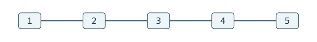
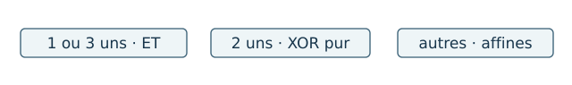
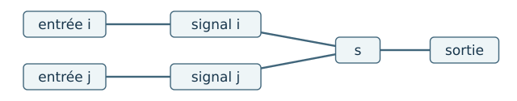

# ENS · MP-PC · Informatique 2006 — corrigé guidé

*Corrigé rédigé par IA, non officiel. Signalez toute erreur.*

**Rédaction** · GPT-6.2 Astra Ultra · vitesse non renseignée · 25 novembre 2026

**Révision (tour 1)** · GPT-6.2 Astra Ultra · vitesse non renseignée · 26 novembre 2026

Un ordre topologique permet d’organiser deux calculs : découvrir les sommets accessibles et évaluer des portes logiques. Pour les bornes inférieures, on cherchera ensuite les portes que l’on peut supprimer en choisissant des entrées particulières.

## Partie 1. Ordre topologique et fermeture

### Question 1.1.1 · Deux exemples

Dans le premier dessin, il faut lire notamment les arcs $3\to2$, $2\to4$ et $4\to1$. Écrire le rang à la position du sommet, ce qui donne $[4,2,1,3]$. Dans l’arbre, les quatre feuilles précèdent leurs parents 5 et 6, qui précèdent 7 ; on peut attribuer à chaque sommet son propre numéro.

### Question 1.1.2 · Caractérisation

Sur un circuit fermé de flèches, un rang finirait par être strictement supérieur à lui-même. Dans l’autre sens, choisir un sommet sans flèche entrante et lui donner le premier rang. Tant que des sommets restent, l’absence de cycle garantit qu’on peut recommencer. Chaque arc va alors d’un rang plus petit vers un rang plus grand.

### Question 1.1.3 · Inverser la permutation

Le tableau initial répond « quel rang pour ce sommet ? ». Pour répondre « quel sommet à ce rang ? », parcourir une fois les sommets $s$ et écrire $s$ dans la case numéro $o[s]$ du nouveau tableau. La bijectivité garantit qu’aucune case ne sera perdue ou écrasée. Temps $\Theta(n)$ et $n$ cases pour le résultat.

```text
Inverse(o)
créer inv de taille n
pour s = 1,…,n : inv[o[s]] ← s
renvoyer inv
```

### Question 1.2.1 · Parents

Inverser les flèches en une lecture des listes. À la lecture du fils $t$ de $s$, ajouter $s$ en tête de la liste des parents de $t$. Les listes initiales sans répétition empêchent les doublons, et les insertions en tête prennent un temps constant. L’initialisation visite les $n$ sommets, la double boucle les $m$ arcs, soit $\Theta(n+m)$.

```text
Parents(Succ)
P[1..n] ← listes vides
pour s = 1,…,n :
    pour t dans Succ[s] : P[t] ← concat(s,P[t])
renvoyer P
```

### Question 1.2.2 · Degrés et entrées

La longueur de la liste des parents donne le degré entrant. Les calculer toutes consomme un travail proportionnel au nombre total d’éléments, plus l’initialisation des $n$ cases. Un dernier parcours des degrés repère les entrées.

### Question 1.2.3 · Tri topologique linéaire

Un sommet devient disponible précisément quand son dernier parent a reçu un rang. Plutôt que de recalculer les degrés après chaque suppression, modifier une seule fois le compteur correspondant à chaque arc sortant du sommet extrait. La file vide signifie que tout est terminé ou que les sommets encore présents se bloquent sur un cycle ; le compteur de rangs distingue les cas.

### Question 1.3 · Ordonner toutes les listes

Pour éviter de trier chaque liste par comparaisons, traiter globalement les destinations dans l’ordre voulu. Prendre d’abord la destination de plus grand rang et la distribuer à ses parents, puis les suivantes. L’insertion en tête inverse ce parcours, et chaque arc est distribué une fois. Former les deux tableaux auxiliaires et distribuer les arcs coûte $O(n+m)$.

```text
TriSuccesseurs(o,Succ)
inv ← Inverse(o) ; P ← Parents(Succ) ; T ← n listes vides
pour r de n à 1 :
    v ← inv[r]
    pour u dans P[v] : T[u] ← concat(v,T[u])
renvoyer T
```

### Question 1.4.1 · Trace de R et Q

Utiliser les listes de fils $[2,3,4]$, $[3,4]$, $[4,5]$, $[5]$, $[]$. Au départ toutes les listes sont vides. Le traitement de 5 donne $[5]$, celui de 4 donne $[5,4]$. Pour 3, on lit $R[4]$ dans son ordre et on insère en tête, d’où $[4,5,3]$ ; le fils 5 est déjà marqué. Aux tours suivants on obtient $[3,5,4,2]$ pour 2 et $[2,4,5,3,1]$ pour 1. À l’entrée de chaque tour, seules les lignes de numéro supérieur sont remplies de ces valeurs ; à la sortie finale elles le sont toutes. Le nettoyage rend tous les booléens faux entre deux tours et à la fin.

### Question 1.4.2 · Invariant

Une marche non vide partant de $i$ commence par l’un de ses fils. Ces fils sont de numéro plus grand, leurs réponses sont donc prêtes. Une marque signifie « déjà joignable par un fils traité ». Si le nouveau fils est marqué, tous ses descendants sont eux aussi déjà joignables par ce même détour. En sautant sa liste on conserve alors la réponse et on évite des lectures inutiles.



### Question 1.4.3 · Arcs irréductibles

La numérotation croît strictement sur les chemins. Pour chaque sommet ayant des parents, le parent de dernier rang n’a donc aucun moyen de le rejoindre indirectement. Cela borne le nombre de destinations possibles d’une paire accessible non triviale par $|A^-|$, et chaque destination a au plus $n$ origines. Au cours du calcul, l’arc $i\to j$ est redondant exactement si un fils déjà considéré atteint $j$ ; l’ordre croissant de la liste de fils est ici essentiel. Seules les $|A^-|$ exceptions imposent une lecture de liste de longueur au plus $n$. Ajouter initialisation, lecture des arcs et nettoyage des marques donne la borne annoncée.

### Question 1.4.4 · Exemple quadratique

Multiplier le nombre de flèches tout en empêchant les détours : relier chaque source à chaque puits. Avec $r$ sommets de chaque type, les $r^2$ arcs sont tous conservés pour $n=2r$. Ce rapport à $n^\alpha$ tend vers l’infini dès que $\alpha<2$.

### Question 1.5.1 · Partition en chaînes

Une partition minimale au sens demandé exige qu’aucune paire de chaînes ne fusionne, même en entrelaçant leurs sommets. Partir du plus petit sommet libre et toujours suivre le premier fils encore libre. Aucun sommet d’une chaîne ultérieure ne peut précéder le départ, suivre le dernier sommet, ni s’insérer entre deux choix consécutifs : sa première insertion aurait offert un plus petit fils au moment du choix. Une liste d’adjacence n’est examinée qu’au passage sur son sommet, donc temps linéaire.

```text
Chaines(Succ)
marquer tous les sommets libres
pour i croissant :
    si i est libre :
        ouvrir une chaîne au sommet i
        tant qu’un sommet v est sélectionné :
            marquer v occupé et l’ajouter en queue à la chaîne
            sélectionner le premier fils libre de v, ou arrêter la chaîne
renvoyer les chaînes
```

### Question 1.5.2.a · Premier sommet accessible

Les sommets atteints sur une chaîne forment un suffixe. Pour en trouver le premier, il suffit de connaître les suffixes atteints par les fils indispensables. En effet, chaque arc supprimable peut être remplacé par un chemin de même origine et même arrivée ne comportant finalement que des arcs indispensables. Lorsque la position de départ appartient déjà à la chaîne, elle est le premier élément atteignable.

### Question 1.5.2.b · Tester un arc

Le numéro $r$ résume ce que les fils indispensables déjà lus savent atteindre sur la chaîne de $j$. Si $r\le j$, suivre cette chaîne depuis $r$ fournit le détour voulu. Sinon, aucun de ces fils ne rejoint $j$. Tout éventuel détour utiliserait un tel fils au premier pas de sa décomposition, d’où le test strict.

### Question 1.5.2.c · Calcul des minima par chaîne

Tenir pour chaque chaîne le meilleur point d’entrée trouvé pendant le traitement des fils. Tous les minima partent de la sentinelle. Un test sur une seule case élimine un arc redondant ; seul un nouveau fils indispensable entraîne la fusion de ses $k$ minima. À la toute fin, rendre au sommet $i$ sa propre place dans sa chaîne. Remplir cette case trop tôt ferait paraître redondant un véritable arc vers la même chaîne.

```text
PremiersAccessibles(Succ,C,k)
pour i de n à 1 :
    initialiser R[1..k,i] à n+1
    pour j dans Succ[i] en ordre croissant :
        si j < R[C[j],i] :
            pour h = 1,…,k : R[h,i] ← min(R[h,i],R[h,j])
    R[C[i],i] ← i
renvoyer R
```

Chaque arc subit un test, chaque colonne exige $O(k)$ initialisations et seuls les $|A^-|$ arcs indispensables déclenchent une fusion de $k$ cases. Le coût total est $O(|A|+k(|S|+|A^-|))$.

### Question 1.5.3 · Développer les suffixes

Les minima codent déjà toute la réponse : atteindre un élément d’une chaîne permet d’en suivre la fin. Un tableau de positions donne immédiatement le début de chaque suffixe non vide. En parcourant les chaînes séparément pour un même départ, on n’écrit aucun doublon. Le décodage ajoute $O(nk+|A^*|)$ au coût de 1.5.2.c.

## Partie 2. Fonctions et circuits booléens

### Question 2.1.1 · Types binaires

Écrire la table dans l’ordre $00,01,10,11$. Une conjonction reconnaît un point choisi ; nier la sortie reconnaît son complément. Pour XOR, les seules colonnes possibles sont $0110$ et $1001$. Aucune n’a le poids 1 ou 3 des tables de type ET. Les autres colonnes à deux uns sont des projections ou leurs négations.



### Question 2.1.2 · Fonctions affines

Une expression affine conserve chaque variable zéro ou une fois dans une somme modulo deux. Avec deux variables on peut donc garder les deux, une seule, ou aucune. Les huit fonctions obtenues sont distinctes et la première possibilité est exactement le type XOR.

### Question 2.1.3 · Deux substitutions

L’exposant 1 conserve le bit, l’exposant 0 le complémente. Pour une conjonction avec un littéral nul, le second littéral devient indifférent. De même, deux bits égaux s’annulent dans une somme modulo deux. Appliquer la dernière éventuelle négation donne respectivement $\neg c$ et $\neg a$.

### Question 2.2.1 · Extraire une porte ET

Observer deux tranches du cube obtenues en fixant la dernière coordonnée. Une tranche déjà non affine fournit la réponse par récurrence. Si les deux sont affines, comparer la liste des variables qui influencent chacune. Une même liste rendrait la fonction totale affine, la dernière coordonnée ajoutant au plus son bit. Choisir donc une variable qui varie sur une seule tranche et figer toutes les autres. La table obtenue a une ligne constante et une ligne équilibrée, c’est une conjonction de littéraux éventuellement niée.

### Question 2.2.2 · Extraire une négation

La non-monotonie fournit deux points $x\le y$ avec $f(x)=1$ et $f(y)=0$. De $x$ à $y$, retourner les bits différents un à un, de zéro à un. Choisir la première chute. Les deux tests qui l’encadrent ne diffèrent que par le bit libre, et leur table unaire est exactement $1,0$.

### Question 2.3.1 · Lire le circuit

La porte de gauche teste le couple $1,2$. La porte de droite teste si l’un de $1,2$ est présent ; sa voisine vérifie en plus le bit 3. La sortie prend le « ou » des deux scénarios, qui couvrent toutes les manières d’avoir deux ou trois bits à 1.

### Question 2.3.2 · Reconnaître un mot

Chaque feuille donne une égalité à un bit de référence. Une feuille à tester contre 0 reçoit un inverseur. Au-dessus des feuilles, associer par paires les résultats sans attendre séquentiellement les $n$ tests. L’arbre binaire a $n-1$ nœuds internes et une hauteur logarithmique, même si $n$ n’est pas une puissance de deux. Avec au plus $n$ inverseurs, la taille est au plus $2n-1$ et la profondeur au plus $1+\lceil\log_2 n\rceil$.

### Question 2.3.3 · Table de vérité arbitraire

Une fonction vaut 1 exactement sur l’union des mots marqués 1 dans sa table. Un reconnaisseur par mot, puis un arbre de « ou », réalisent cette union. Il y a au plus $2^n$ mots et l’arbre final ajoute au plus $n$ étages. Pour un seul mot cet arbre est inutile ; pour aucun mot utiliser directement zéro. Chaque reconnaisseur ayant une taille $O(n)$, la taille totale est $O(n2^n)$. La profondeur vaut $O(\log n)+O(n)=O(n)$.

### Question 2.4.1 · Une base minimale

Reprendre la construction par table de vérité en remplaçant les portes OU par des négations d’ET. Une entrée et son inverse suffisent à fabriquer la constante fausse, puis vraie. Chacune des deux opérations conservées joue un rôle indispensable : les inverseurs seuls ne combinent jamais deux entrées, et les conjonctions seules ne savent pas renverser un bit.

### Question 2.4.2.a · Nécessité des six conditions

Pour les cinq premières conditions, raisonner par induction sur les sommets du circuit. Une propriété commune aux entrées et à toutes les portes atteint la sortie. Or le catalogue des fonctions booléennes contient des contre-exemples à chacune des propriétés. Pour la sixième condition, il faut bien une vraie porte de copie : l’entrée seule calcule l’identité, mais deux circuits de négation placés en série la calculent à un sommet différent de l’entrée.

### Question 2.4.2.b · Suffisance

Commencer par résoudre le problème des fils identiques : le graphe ne permet qu’un seul arc entre deux sommets. Le circuit de (vi) fournit des copies distinctes et on peut ordonner ces copies avant de brancher une porte. Alimenter un témoin de (i) puis un témoin de (ii) par une seule variable copiée sur toutes leurs broches. Leurs tables unaires donnent directement NON ou donnent ensemble les deux constantes. Dans ce dernier cas la chute de monotonie de 2.2.2 permet de réaliser NON.

Pour produire une constante indépendamment de ce premier cas, prendre deux entrées complémentaires sur lesquelles le témoin non auto-adjoint donne la même valeur. Une variable et ses inverses sélectionnent exactement ces deux configurations, donc la sortie est constante. Inverser cette sortie fournit l’autre constante. Enfin, fixer toutes les variables sauf deux d’un témoin non affine : le résultat reconnaît un point ou son complément. En inversant les bits nécessaires on reconnaît $11$, c’est-à-dire ET. ET et NON calculent toute table.

## Partie 3. Bornes de complexité

### Question 3.1.1 · Puissances booléennes

Le produit booléen remplace « multiplier et sommer » par « et puis ou ». Un témoin pour une case d’une puissance décrit une succession de $m$ étapes. Grâce aux uns diagonaux on peut compléter un trajet plus court par des pauses, et, inversement, éliminer ces pauses donne une marche du graphe initial.

### Question 3.1.2 · Circuit d’accessibilité

Doubler la longueur maximale reconnue réclame un étage de multiplication matricielle, donc un nombre logarithmique d’étages pour couvrir $n-1$ arcs. À l’intérieur d’un tel étage, les $n$ possibilités de raccordement d’une case sont testées simultanément et réunies par un arbre binaire. Le coût en portes est cubique par étage, mais un chemin dans le circuit ne traverse qu’une hauteur logarithmique par étage. Lire enfin la case $i,j$. La taille est $O(n^3\log n)$ et la profondeur $O((\log n)^2)$.

### Question 3.2.1 · Compter les arcs

Compter d’abord les places de réception : seuls les sommets internes ont une ou deux places. Compter ensuite les départs : une sortie ne fournit rien, toute autre position fournit au moins un départ et une bifurcation en fournit au moins deux. Comparer la borne supérieure $2q$ à la borne inférieure $n+q-m+p$ fait apparaître le terme recherché.

### Question 3.2.2.a · Forme d’un circuit optimal

Une porte qui reproduit un signal existant est inutile quand toutes les tables unaires ou binaires sont autorisées. La rediriger vers le premier signal peut rendre un calcul unaire ; la table de ce calcul est toujours disponible. On gagne une porte, contradiction. De même, une porte placée après le résultat ou sur une branche qui ne mène pas au résultat peut être retirée. Seules des entrées inutilisées peuvent rester comme autres sorties.

### Question 3.2.2.b · Absorber les portes dégénérées

Une fonction binaire dépendant réellement de ses deux arguments est l’une des huit tables ET ou l’une des deux tables XOR. Pour les autres, propager le nom d’un fil, son signe, ou une valeur fixe. La prochaine vraie porte intègre cette information à sa table, puisque toutes les tables sont autorisées. Au dernier fil, une négation peut s’intégrer à la dernière vraie porte. Si le dernier fil est directement une entrée, l’hypothèse garantit qu’une projection suffit. Les $k$ portes signalées disparaissent chacune du décompte.

### Question 3.3 · Adressage et élimination de deux portes

L’entrée $x_i$ ne peut être isolée : à l’adresse $i$, elle est exactement la sortie. Si plusieurs portes la lisent, supprimer la donnée $x_i$ en lui donnant zéro retire au moins deux portes binaires devenues au plus unaires. Si une seule porte la lit, chercher à forcer cette porte à une constante. Une porte ET possède une valeur bloquante sur cette broche. Pour une porte XOR, la bonne idée est de rendre ses deux arguments égaux. L’autre argument est calculé en amont sans $x_i$, ce qui autorise la substitution sans boucle.

Sur toute adresse encore retenue, la sortie prescrite ne dépendait pas de $x_i$ : la substitution conserve donc $z-1$ adresses valides. La porte forcée ne peut être la sortie, qui doit encore recopier une donnée libre. Son fils perd aussi un véritable argument. Propager les constantes et les signes comme à la question précédente laisse un circuit plus court d’au moins deux portes, sans coût de copie. Le paramètre $z$ peut donc descendre de $n$ à 1 avec une économie de deux portes par cran, d’où $2(n-1)$.

### Question 3.4.1 · Une bifurcation précède la rencontre

Prendre les premiers tronçons des chemins choisis. S’ils n’ont pas de sortie latérale, aucune des deux informations ne peut les quitter avant la rencontre. Après gel des autres entrées, chaque branche transporte un bit, et la suite du calcul ne voit plus que leur combinaison en $s$. Une branche ou une sortie constante détruirait une dépendance. Les seuls changements possibles sont donc des inversions des bits ou de la sortie. Ils ne transforment jamais une conjonction de littéraux en parité. L’existence des deux spécialisations impose une bifurcation avant $s$.



### Question 3.4.2 · Bifurcations distinctes et borne

Tant qu’on n’a pas trouvé de bifurcation, on n’a aucun choix de chemin. La première bifurcation rencontrée est ainsi un témoin qui fonctionne pour tous les chemins de cette entrée. Une seule entrée au plus peut en être privée ; deux témoins ne peuvent coïncider, car leur première rencontre arriverait trop tôt pour satisfaire 3.4.1. Compter maintenant les arcs avec une seule sortie utile et ces $|Z|-1$ bifurcations distinctes. Chaque entrée de $Z$ est active puisque les deux spécialisations dépendent d’elle. Le calcul donne au moins $|Z|-1+|Z|-1$ portes.

### Question 3.4.3 · Exactement c bits à un

Laisser deux places libres et choisir combien de uns manquent encore. S’il en manque un, on teste la parité des deux bits. S’il en manque deux, on teste leur conjonction. Pour $c=1$, on peut au contraire avoir déjà le nombre souhaité de uns : les deux bits doivent alors être nuls, une autre porte de type ET. Comme chaque paire admet ces deux tests, la borne s’applique aux $n$ variables.

### Question 3.5 · Compter tous les circuits courts

Coder les portes dans leur ordre de calcul évite de nommer des graphes arbitraires. Deux indices de parents et une table choisie parmi vingt suffisent pour chaque porte, puis il faut indiquer la sortie et la longueur du code. Avec $L=\lfloor2^{n-1}/n\rfloor$, chaque indice utilise au plus $\log_2(n+L)\le n-\log_2 n$ bits dans l’estimation logarithmique du nombre de choix. Ainsi le logarithme du nombre de codes est au plus $L(2n-2\log_2 n+\log_2 20)+O(n)$, strictement inférieur à $2^n$ pour $n$ grand. Or une table de vérité possède $2^n$ bits indépendants. Certaines tables échappent à tous ces codes ; leur taille minimale entière dépasse le seuil réel demandé.
