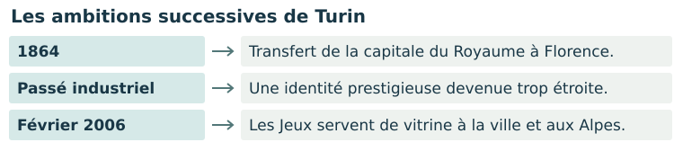
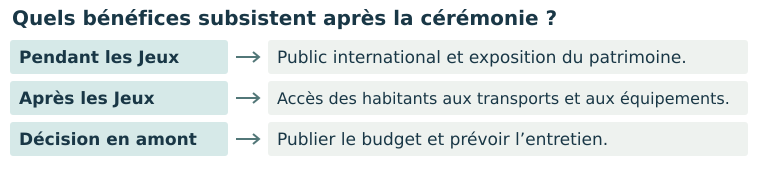

# ENS · MP-PC · Italien (LE2) 2006 — Corrigé guidé

*Corrigé rédigé par IA, non officiel. Signalez toute erreur.*

**Rédaction** · GPT-6.2 Astra Ultra · vitesse non renseignée

Le cahier commun aux ENS de Paris et de Cachan dure deux heures. Dictionnaire et calculatrice interdits pour l’italien. La page d’italien demande une version française et une réponse en italien, sans longueur chiffrée. La garde prévoit 15 points pour la version et 5 pour la question.

## V. Version française

*Il gotha* désigne le cercle très fermé de l’élite. *Ribalta*, *cono di luce* et *rifarsi il belletto* installent les images de la scène et de la parure. Préserver le jeu sur *gioielli* et *gioie*. Les deux milliards sont un public potentiel de téléspectateurs, non des visiteurs attendus en ville.

« Si les Jeux olympiques nous réussissent, nous retrouverons notre place dans le gotha des grandes capitales », avait prédit l’avvocato Giovanni Agnelli. Il exprimait ainsi en toutes lettres l’ambition discrète mais tenace que nourrit Turin depuis 1864, année du transfert de la capitale du Royaume à Florence, celle de retrouver le cercle des métropoles qui comptent vraiment. Ayant fait à regret ses adieux à son rôle de capitale politique, puis industrielle, Turin a décidé de prendre sa revanche en tournant le regard vers les montagnes négligées qui l’entourent, les Alpes. Et, sur les traces de Barcelone et de Salt Lake City, de profiter des dix-sept jours sous les projecteurs des vingtièmes Jeux olympiques d’hiver, du 10 au 26 février, pour devenir la « capitale des montagnes » et du grand « cirque blanc ».

Blessée dans son orgueil et lasse de n’être qu’une ville grise, Turin a donc décidé de se réapproprier tout son patrimoine artistique, culturel, gastronomique, viticole et postindustriel et, chose inattendue, de le montrer au monde. Vaincre la réticence et la réserve bien établies de ses habitants n’a pas été facile, mais cette ville semble aimer les défis. « La passion vit ici » est la devise de ces Jeux, qui peuvent compter sur un investissement vertigineux de trois milliards et demi d’euros et sur un public mondial de deux milliards de téléspectateurs. Voilà donc que la grise Turin se refait une beauté et exhibe, avec son éternelle élégance aristocratique, ses bijoux de famille. Et quels bijoux ! Ce n’est pas que le majestueux palais royal de Castellamonte ou le palais Madame, avec sa splendide façade de Filippo Juvarra, aient besoin d’être mis en valeur, eux qui comptent depuis toujours parmi les résidences royales les plus belles et les plus connues d’Europe. Mais le coup de projecteur des Jeux leur fait du bien et cela se voit. Sur la place devant le château arrivent désormais des groupes de touristes japonais qui découvrent une ville injustement snobée par bon nombre des guides internationaux les plus prestigieux.

## 1. Fino a che punto è giusto che un grande evento internazionale incida sul destino di una città?

*Fino a che punto* appelle des conditions, pas seulement une liste de bénéfices. Déplacer le regard du téléspectateur vers l’habitant qui reste après les Jeux. *A patto che* s’emploie ici avec le subjonctif.

Un grande evento può cambiare legittimamente una città a patto che gli abitanti abbiano voce nelle scelte che dureranno più dello spettacolo. A Torino i Giochi offrono l’occasione di mostrare un patrimonio spesso oscurato dall’immagine della fabbrica. Una linea di trasporto migliorata per i visitatori può continuare a servire chi va al lavoro ogni giorno. In questo caso l’attenzione internazionale accelera un progetto che possiede già una ragione locale.

La valutazione cambia se un impianto costa molto da mantenere, rimane chiuso per mesi o sottrae risorse a un quartiere che non compare nelle riprese televisive. Il numero degli spettatori nel mondo dice poco su questi effetti. Prima di costruire chiederei dunque chi userà l’edificio fra dieci anni, chi sosterrà le spese e quali alternative siano state discusse. Un’amministrazione dovrebbe pubblicare le risposte e poi rendere conto delle differenze tra le promesse e i risultati. La città può sfruttare il momento per reinventarsi, ma il calendario della competizione non dovrebbe diventare il calendario obbligatorio dei suoi cittadini.

*166 mots.*

La page 7 donne l’article de Stefano Biolchini publié dans Il Sole 24 Ore le 2 février 2006, avant les Jeux. Le rapport spécifique à l’italien LE2 n’a pas été retrouvé.

[Version et consignes](https://banques-ecoles.fr/cms/wp-content/data/filiere-pc/annales-de-la-banque-pc/session-2006/sujet-2006-ecrit-mp_pc_langue_etrangere_2.pdf#page=7)
