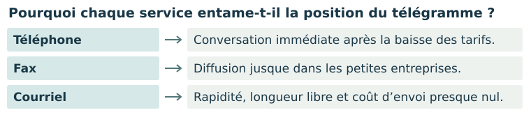
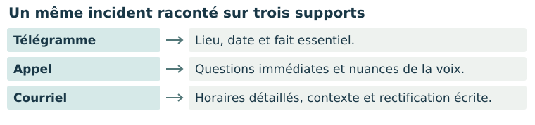

# ENS · MP-PC · Italien (LV1) 2006 — Corrigé guidé

*Corrigé rédigé par IA, non officiel. Signalez toute erreur.*

**Rédaction** · GPT-6.2 Astra Ultra · vitesse non renseignée

Le cahier commun aux ENS de Paris, de Lyon et de Cachan dure deux heures. Dictionnaire et calculatrice interdits pour l’italien. La page d’italien demande une version française et une réponse en italien, sans longueur chiffrée.

## V. Version française

*Gestore* désigne l’entreprise qui exploite le service. *Realtà aziendali* signifie ici « entreprises », non « réalités entrepreneuriales ». L’article joue sur *archivia un’epoca* et *un’altra se ne è già aperta*. Le transfert d’argent est distinct de l’acheminement de messages.

New York. Western Union met fin à son service de télégrammes après 145 ans. Terrassée par la diffusion des nouvelles techniques. Par le téléphone d’abord, puis par le fax et enfin par le courrier électronique. L’Amérique dit adieu au premier et au plus célèbre exploitant de ce service. Western Union tourne la page d’une époque, car une autre s’est déjà ouverte.

Depuis le 27 janvier, il n’est plus possible d’expédier de télégrammes ni de messages commerciaux, même depuis le site de la compagnie. « Nous vous prions de nous excuser pour les désagréments occasionnés et remercions notre fidèle clientèle », annonce le message, clair et courtois, qui s’affiche quand on clique sur la page « Télégrammes ».

Le déclin du télégramme a commencé dans les années quatre-vingt. Après l’effondrement des tarifs, un coup de téléphone, immédiat et beaucoup moins cher, permettait d’abolir les distances. Le fax est ensuite arrivé. Son utilisation très répandue, jusque dans les plus petites entreprises, n’a certes pas joué en faveur du géant du télégramme. Mais c’est le courriel, extrêmement rapide, suffisamment formel, sans limite de longueur et pratiquement gratuit, qui a porté le coup de grâce à son vieil ancêtre.

La décision de la société américaine prend une valeur symbolique et marque la fin d’une époque. Celle-ci s’était ouverte en 1851, sept ans après l’envoi du premier télégramme par son inventeur, Samuel Morse, lorsque Western Union avait fait ses débuts comme exploitant télégraphique. Ce service avait uni l’Amérique en rapprochant ses deux côtes.

De la nostalgie, peut-être, mais aucun regret pour la société qui a réorienté depuis longtemps ses activités vers les transferts d’argent pour les particuliers et les entreprises. Au point qu’elle a pris le nom de Western Union Financial Services et qu’elle est aujourd’hui en tête du marché des transferts de fonds avec un chiffre d’affaires supérieur à trois milliards de dollars.

## 1. In che modo le modalità di trasmissione dell’informazione possono influire sul contenuto dell’informazione?

Prendre une même nouvelle et la faire varier selon trois supports. Expliquer ce qui entre dans le texte, ce qui en disparaît et qui peut demander une précision. Le support crée des contraintes sans déterminer entièrement le choix de l’auteur.

Il mezzo di trasmissione modifica le scelte di chi scrive o parla. Immaginiamo che un viaggiatore debba avvertire la famiglia di un’interruzione ferroviaria. In un telegramma a pagamento selezionerà il luogo, l’ora prevista e forse una breve rassicurazione. Al telefono potrà cogliere la preoccupazione di chi ascolta e spiegare subito che sta bene. In un messaggio di posta elettronica potrà allegare l’orario del treno successivo, ma non saprà necessariamente quando il destinatario lo leggerà. Il fatto iniziale rimane lo stesso, mentre cambiano i particolari che sembrano indispensabili.

Anche il pubblico conta. Una notizia pensata per un amico può arrivare, se inoltrata, a lettori che non conoscono la situazione e interpretano diversamente una battuta. D’altra parte, conservare una copia permette di correggere un equivoco e confrontare le versioni successive. La tecnologia non decide al nostro posto che cosa sia vero. Stabilisce però quanto costa spiegarsi, quale traccia rimane e se l’interlocutore può porre una domanda prima che il messaggio continui il suo viaggio.

*162 mots.*

Le cahier donne en page 5 l’article du 1er février 2006 sur Western Union et une question en italien. Le rapport spécifique à l’italien LV1 n’a pas été retrouvé.

[Version et consignes](https://banques-ecoles.fr/cms/wp-content/data/filiere-pc/annales-de-la-banque-pc/session-2006/sujet-2006-ecrit-mp_pc_langue_vivante_1.pdf#page=5)
