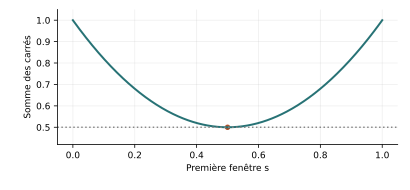
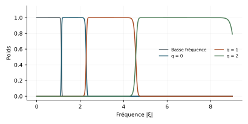

# ENS — Mathématiques MPI 2, 2006 · Corrigé guidé

*Corrigé rédigé par IA, non officiel. Signalez toute erreur.*

**Rédaction** · GPT-6.2 Astra Ultra · vitesse non renseignée

**Révision** · GPT-6.2 Astra Ultra · vitesse non renseignée

La garde 60.22M porte une durée de quatre heures. L’épreuve est commune aux ENS de Paris, Lyon et Cachan pour les groupes MP/MPI et I de la filière MP. Pour le groupe I des filières MP et PC, elle est aussi proposée en option commune à Paris et Lyon. Une calculatrice de poche autonome, non imprimante et sans document d’accompagnement est autorisée. [Sujet officiel](https://banques-ecoles.fr/cms/wp-content/data/filiere-mp/annales-de-la-banque-mp/session-2006/sujet-2006-ecrit-mp_mathematiques_2.pdf) · [Rapport du jury](https://banques-ecoles.fr/cms/wp-content/data/filiere-mp/rapports-des-jurys-de-la-banque-mp/rapport-de-jury-session-2006/rapport-2006-mp_ecrit_mathematiques_2.pdf).

La décomposition dyadique partage les fréquences entre un bloc bas et des bandes d’échelles successives. La décroissance des blocs mesure la régularité de Hölder et, à l’exposant critique, celle des différences secondes.

## I. Partition des fréquences et noyaux de convolution

### Question 1.1

> [!INDICATION]
> Montrer par récurrence que les dérivées sont l’exponentielle multipliée par un polynôme en 1/x.

#### Solution

Sur $x>0$, écrivons $\phi_0^{(k)}(x)=P_k(1/x)e^{-1/x^2}$, avec $P_0=1$. La dérivation donne $P_{k+1}(t)=-t^2P_k'(t)+2t^3P_k(t)$ : les facteurs sont bien rationnels en $x$. L’exponentielle domine toute puissance de $1/x$. Chaque expression et son quotient par $x$ tendent donc vers zéro en $0^+$. En les prolongeant par zéro pour $x\le0$, la récurrence sur les quotients de différences assure que toutes les dérivées sont continues et nulles en zéro.

### Question 1.2

> [!INDICATION]
> Prendre le produit de deux fonctions qui s’annulent à des extrémités opposées.

#### Solution

Le produit $\phi_0(x)\phi_0(1-x)$ est lisse et strictement positif exactement pour $0<x<1$. Pour $a<b$, $\phi_0(x-a)\phi_0(b-x)$ a de même les propriétés voulues sur $(a,b)$.

### Question 1.3.a

> [!INDICATION]
> Comparer le rapport des bornes de l’intervalle à quatre et normaliser par toutes les dilatées.

#### Solution

Un terme non nul impose $3/4<2^{-q}|x|<8/3$. Le rapport des bornes vaut $32/9<4$, donc au plus deux indices consécutifs conviennent. Pour $r>0$, la somme bilatère $D(r)=\sum_{j\in\mathbb Z}\psi(2^jr)$ est positive, car les intervalles dilatés se recouvrent et couvrent $\mathbb R_+^*$. Elle est invariante par doublement. Quand $\psi(r)\ne0$, seuls $j=-1,0,1$ sont possibles, donc la formule du sujet est $\phi(r)=\psi(r)/D(r)$ (et vaut zéro pour $\psi(r)=0$). La somme de ces quotients sur toutes les échelles vaut un. Pour $r\ge3/2$, les échelles manquantes du côté $q<0$ ont $2^{-q}r\ge3>8/3$ ; la somme sur $q\ge0$ vaut donc déjà un.

Pour détailler le recouvrement, les intervalles ouverts $I_j=(2^j\,3/4,2^j\,8/3)$ et $I_{j+1}$ se chevauchent puisque $3/2<8/3$. Leurs extrémités tendent vers zéro à gauche et l’infini à droite. De plus $I_j$ et $I_{j+2}$ sont disjoints puisque $8/3<3$. Cela justifie à la fois la positivité du dénominateur, le nombre maximal de termes et la réindexation de la somme.

### Question 1.3.b

> [!INDICATION]
> Choisir un numérateur lisse et définir la basse fréquence par complément.

#### Solution

Choisissons $\psi$ comme en 1.2 pour $(3/4,8/3)$. La somme définissant $D$ est localement finie, lisse et positive sur $r>0$. Posons $\phi(r)=\psi(r)/D(r)$ pour $r>0$ et zéro pour $r\le0$. C’est une fonction lisse à support dans $[3/4,8/3]$. Posons $\chi(x)=1-\sum_{q\ge0}\phi(2^{-q}|x|)$. Cette somme est finie localement et nulle près de zéro : $\chi$ est lisse et paire. Par 1.3.a, elle est nulle pour $|x|\ge3/2$, donc en particulier hors de $[-2,2]$.

### Question 1.3.c

> [!INDICATION]
> Compter les termes potentiellement non nuls dans la partition de l’unité.

#### Solution

En chaque point au plus trois termes interviennent en comptant $\chi$. Cauchy–Schwarz dans $\mathbb R^3$ donne $1=(\chi+\sum_q\phi_q)^2\le3(\chi^2+\sum_q\phi_q^2)$ avec $\phi_q(x)=\phi(2^{-q}|x|)$. Le minorant $1/3$ convient.

Pour la partition construite en 1.3.b, on peut affiner le minorant. Si la coupure basse $\chi(x)$ est non nulle, $|x|<3/2$ et seule la bande $q=0$ peut s’y superposer. Ailleurs il y a au plus deux bandes. En notant $s$ et $1-s$ les deux contributions, la somme des carrés est $s^2+(1-s)^2=1/2+2(s-1/2)^2\ge1/2$. De $|x|=3/4$ à $|x|=3/2$, la première bande passe continûment de zéro à un, donc le minimum $1/2$ est atteint. Le rapport annonce $1/4$ comme minimum ; c’est un minorant valable mais non optimal pour la somme de carrés demandée.

### Question 1.4

> [!INDICATION]
> Vérifier que toutes les puissances de la fréquence restent intégrables après localisation.

#### Solution

Comme $u$ est continue à support compact, $\mathcal Fu$ est continue bornée par $\|u\|_1/\sqrt{2\pi}$. Chaque multiplicateur $m=\phi_q$ ou $\chi$ est lisse à support compact. Dans l’intégrale inverse de $m\mathcal Fu$, toute dérivée en $x$ introduit $(i\xi)^k$ ; la majorante $|\xi|^k|m(\xi)\mathcal Fu(\xi)|$ est intégrable. Par dérivation sous le signe intégral, tous les blocs sont $C^\infty$.

### Question 1.5

> [!INDICATION]
> Remplacer la transformée de u par son intégrale avant d’intervertir les variables.

#### Solution

Le produit de $|u(y)|$ et de $|\phi_q(\xi)|$ est intégrable sur le plan. En substituant l’intégrale de Fourier et en utilisant Fubini, on obtient $\Delta_qu(x)=\int h_q(x-y)u(y)\,dy$ avec $h_q(z)=(2\pi)^{-1}\int\phi_q(\xi)e^{iz\xi}\,d\xi$. Le facteur $1/(2\pi)$ est le produit des deux normalisations.

### Question 1.6

> [!INDICATION]
> Utiliser les intégrations par parties pour les grandes abscisses, puis une dilatation pour la norme.

#### Solution

La fonction $h_q$ est lisse par dérivation de l’intégrale à support compact. Pour $k=0,1,2$ (et en fait tout $k$), l’intégration par parties $k$ fois donne $|z^kh_q(z)|\le(2\pi)^{-1}\|\phi_q^{(k)}\|_1$. En particulier $h_q\in L^1\cap L^2$. Par l’inversion admise, $\mathcal Fh_q=\phi_q/\sqrt{2\pi}$ ; en zéro, $\int h_q=\phi_q(0)=0$. Le changement $\xi=2^q\eta$ donne $h_q(z)=2^qh_0(2^qz)$ et $\|h_q\|_1=\|h_0\|_1$.

### Question 1.7

> [!INDICATION]
> Répéter le calcul pour la fenêtre basse.

#### Solution

En posant $g(z)=(2\pi)^{-1}\int\chi(\xi)e^{iz\xi}\,d\xi$, Fubini donne $\Delta_{-1}u=g*u$. La même domination et les mêmes intégrations par parties qu’en 1.6 donnent $g\in C^\infty$ et $\|z^kg(z)\|_\infty\le\|\chi^{(k)}\|_1/(2\pi)$ pour $k=0,1,2$.

### Question 1.8

> [!INDICATION]
> Dériver le noyau et suivre son échelle dans la norme intégrale.

#### Solution

La borne de convolution donne $\|\Delta_qu\|_\infty\le\|h_0\|_1\|u\|_\infty$. Le noyau $h_0'$ est intégrable par deux intégrations par parties appliquées au symbole $i\xi\phi(|\xi|)$. On a $h_q'=2^{2q}h_0'(2^q\cdot)$, donc $\|h_q'\|_1=2^q\|h_0'\|_1$. La dérivée est $h_q'*u$ par la formule intégrale, ce qui donne la deuxième borne avec une constante commune.

## II. Caractériser les espaces de Hölder

### Question 2.1

> [!INDICATION]
> Séparer la convergence uniforme du contrôle de tous les quotients d’accroissement.

#### Solution

Notons $[u]_\alpha=\sup_{x\ne y}|u(x)-u(y)|/|x-y|^\alpha$. Homogénéité et inégalité triangulaire valent pour les deux termes de la norme et $\|u\|_\infty=0$ entraîne $u=0$. Pour une suite de Cauchy $(u_j)$, la convergence uniforme donne une limite continue bornée $u$. Pour $j,k$ assez grands, $[u_j-u_k]_\alpha\le\varepsilon$. En laissant $k\to\infty$ dans chaque quotient à $x,y$ fixés, puis en prenant le supremum, $[u_j-u]_\alpha\le\varepsilon$. Ainsi $u$ appartient à l’espace et $u_j\to u$ dans sa norme, qui est complète.

### Question 2.2

> [!INDICATION]
> Introduire un produit intermédiaire dans la différence aux deux points.

#### Solution

L’identité $u(y)v(y)-u(x)v(x)=u(y)(v(y)-v(x))+v(x)(u(y)-u(x))$ donne $[uv]_\alpha\le\|u\|_\infty[v]_\alpha+\|v\|_\infty[u]_\alpha$. En ajoutant la borne $\|uv\|_\infty\le\|u\|_\infty\|v\|_\infty$, on obtient l’inégalité demandée, par exemple avec $C=1$.

### Question 2.3

> [!INDICATION]
> Tester une fonction non bornée et une fonction ayant un angle.

#### Solution

La condition de droite définit les fonctions bornées et lipschitziennes. La fonction $x\mapsto x$ est $C^1$ mais non bornée. Réciproquement $x\mapsto\min(|x|,1)$ est bornée et lipschitzienne mais non dérivable en zéro. Les deux ensembles sont distincts.

### Question 2.4

> [!INDICATION]
> Subdiviser le segment en un nombre arbitraire de parties égales.

#### Solution

Si $[u]_\alpha=M<\infty$, la subdivision de $[x,y]$ en $N$ parties donne $|u(y)-u(x)|\le NM(|y-x|/N)^\alpha=M|y-x|^\alpha N^{1-\alpha}$. Pour $\alpha>1$ cette quantité tend vers zéro ; $u$ est constante. Les constantes satisfont bien la condition.

### Question 2.5

> [!INDICATION]
> Utiliser le moment nul du noyau et mettre à l’échelle son moment absolu pondéré.

#### Solution

Les convolutions sont bien définies et bornées pour $u$ bornée car tous les noyaux sont intégrables. Pour $q\ge0$, $\int h_q=0$ donne $\Delta_qu(x)=\int (u(x-z)-u(x))h_q(z)\,dz$. Le module est au plus $[u]_\alpha 2^{-q\alpha}\int |w|^\alpha|h_0(w)|\,dw$. Le moment converge par 1.6 puisque $\alpha<1$. Pour $q=-1$, la norme est au plus $\|g\|_1\|u\|_\infty$. On obtient le supremum fini.

### Question 2.6.1

> [!INDICATION]
> Sommer les majorants géométriques de toutes les hautes fréquences.

#### Solution

Posons $M=\sup_{q\ge-1}2^{q\alpha}\|\Delta_qu\|_\infty$. La série des blocs de $q\ge p$ converge normalement et sa somme est continue bornée. De plus $\|R_pu\|_\infty\le M2^{-p\alpha}/(1-2^{-\alpha})$.

### Question 2.6.2

> [!INDICATION]
> En fréquence, la somme partielle multiplie la transformée par une fonction tendant vers un.

#### Solution

Notons $m_p=\chi+\sum_{q=0}^{p-1}\phi_q$. Ces fonctions sont bornées uniformément (elles sont positives, de somme totale un) et $m_p\to1$ ponctuellement. Les blocs sont intégrables par leur formule de convolution, et dans $L^2$ car ils sont aussi bornés. Par inversion, $\mathcal F(S_pu)=m_p\mathcal Fu$. Plancherel donne $\|u-S_pu\|_2^2=\int|1-m_p|^2|\mathcal Fu|^2\to0$ par convergence dominée. D’autre part les sommes partielles convergent uniformément par 2.6.1. Sur chaque compact ces deux convergences identifient la limite uniforme à $u$ presque partout et donc partout par continuité. Ainsi $u=S_pu+R_pu$.

Plus explicitement, Young donne $\|\Delta_q u\|_1\le\|h_q\|_1\|u\|_1$ (avec $g$ au rang $-1$). Fubini, avec la convention unitaire, donne $\mathcal F(h_q*u)=\sqrt{2\pi}\,\mathcal Fh_q\,\mathcal Fu=\phi_q\mathcal Fu$. Pour tout segment $J$, la limite uniforme $S$ vérifie alors $\|u-S\|_{L^2(J)}\le\|u-S_pu\|_2+|J|^{1/2}\|S_pu-S\|_\infty\to0$, ce qui explicite l’identification des limites.

### Question 2.6.3

> [!INDICATION]
> Construire une nouvelle fenêtre valant un sur tout le support du bloc.

#### Solution

Prenons une fonction lisse à support compact $b$ égale à un sur $[-8/3,8/3]$, par exemple la convolution de l’indicatrice de $[-4,4]$ avec une petite bosse lisse de masse un et de support $[-1,1]$. Si $K(z)=(2\pi)^{-1}\int b(\xi)e^{iz\xi}\,d\xi$, posons $K_q=2^qK(2^q\cdot)$. Pour $v=\Delta_qu$, on a $v=K_q*v$ car $b(2^{-q}\xi)\phi_q(\xi)=\phi_q(\xi)$, par Fubini et inversion. Dès lors $\|v'\|_\infty\le2^q\|K'\|_1\|v\|_\infty$. Les dérivées de $K$ sont intégrables par intégrations par parties. De même $\|v''\|_\infty\le 2^{2q}\|K''\|_1\|v\|_\infty$. Pour le bloc bas le même raisonnement vaut à échelle fixe.

### Question 2.6.4

> [!INDICATION]
> Sommer les bornes des dérivées jusqu’à la coupure.

#### Solution

Pour $q\ge0$, la norme de la dérivée est au plus $C_0 M2^{q(1-\alpha)}$ par 2.6.3. Le terme $q=-1$ a une dérivée bornée à échelle fixe. La somme de la progression géométrique jusqu’à $p-1$ donne $\|(S_pu)'\|_\infty\le C_1 2^{p(1-\alpha)}$ pour tout $p\ge0$.

### Question 2.6.5

> [!INDICATION]
> Utiliser deux fois la borne uniforme pour la queue.

#### Solution

L’identité de 2.6.2 donne $u(x)-u(y)=S_pu(x)-S_pu(y)+R_pu(x)-R_pu(y)$. Pour la partie lisse, intégrer sa dérivée entre $y$ et $x$, ce qui vaut aussi en complexe. Par inégalité triangulaire, $|u(x)-u(y)|\le |x-y|\|(S_pu)'\|_\infty+2\|R_pu\|_\infty$.

### Question 2.6.6

> [!INDICATION]
> Équilibrer les deux bornes à la longueur du déplacement.

#### Solution

Pour $0<d=|x-y|\le1$, choisissons $p\ge0$ tel que $2^{-p-1}<d\le2^{-p}$. Par 2.6.1 et 2.6.4, $|u(x)-u(y)|\le C(d2^{p(1-\alpha)}+2^{-p\alpha})\le C(1+2^\alpha)d^\alpha$. Pour $d>1$, $2\|u\|_\infty$ suffit. La fonction appartient donc à $C^{0,\alpha}$.

## III. L’exposant critique et la classe de Zygmund

### Question 3.1

> [!INDICATION]
> Dans la différence seconde, estimer deux dérivées des basses fréquences et le seul module des hautes.

#### Solution

Soit $M=\sup_q 2^q\|\Delta_qu\|_\infty$. La reconstruction de 2.6.2 reste valable (on peut d’ailleurs utiliser un exposant $1/2$). Pour une fonction $v$ de classe $C^2$, sa différence seconde centrée est majorée par $|y|^2\|v''\|_\infty$ par double intégration, et par $4\|v\|_\infty$ sans dériver. Cela donne exactement l’inégalité imprimée en séparant $q<p$ et $q\ge p$. Par 2.6.3 les basses dérivées secondes ont une somme $O(1+M2^p)$, et les hautes normes une somme $O(M2^{-p})$. Pour $0<|y|\le1$, le choix $2^{-p-1}<|y|\le2^{-p}$ donne une borne $C|y|$. Pour $|y|>1$, la borne $4\|u\|_\infty$ suffit ; le cas nul est immédiat.

En effet, pour $d=|y|$, la formule exacte est $v(x+y)+v(x-y)-2v(x)=\int_{-d}^d(d-|s|)v''(x+s)\,ds$. Le noyau triangulaire a pour masse $d^2$. En appliquant cette identité aux blocs de rang $-1$ à $p-1$, on obtient la première somme $d^2\sum_{q<p}\|(\Delta_q u)''\|_\infty$ ; la seconde est $4\sum_{q\ge p}\|\Delta_q u\|_\infty$.

### Question 3.2

> [!INDICATION]
> Exploiter la parité et le moment nul du noyau pour créer une différence seconde.

#### Solution

Réciproquement, supposons $u$ continue à support compact et $|u(x+y)+u(x-y)-2u(x)|\le C|y|$. Le noyau $h_q$ est pair car son symbole l’est. Comme son intégrale est nulle,
$$\Delta_qu(x)=\tfrac12\int h_q(y)[u(x+y)+u(x-y)-2u(x)]\,dy.$$
Sa norme est donc au plus $(C/2)2^{-q}\int|y h_0(y)|\,dy$. Ce moment est fini grâce à **trois** intégrations par parties dans 1.6. Le bloc bas est borné par 1.7. Ainsi $u\in C_*^1$, ce qui établit la réciproque.

### Question 3.3

> [!INDICATION]
> À l’exposant critique, chaque basse fréquence apporte une constante à la dérivée.

#### Solution

La borne de 2.6.3 devient $\|(\Delta_qu)'\|_\infty\le C_0 M$ pour $q\ge0$. En incluant le bloc bas, $\|(S_pu)'\|_\infty\le C(p+1)$. De plus $\|R_pu\|_\infty\le2M2^{-p}$. Pour $0<d=|x-y|<1$, choisir $2^{-p-1}<d\le2^{-p}$. Par 2.6.5 on obtient $|u(x)-u(y)|\le C'd(p+1)\le C''d(1-\log d)$. En $d=0$, la limite du majorant est zéro.

### Question 3.4

> [!INDICATION]
> Tester une fonction lipschitzienne à support compact qui a un angle.

#### Solution

Toute fonction $C^1$ à support compact a dérivée bornée, donc est lipschitzienne et sa différence seconde a module au plus $2\|u'\|_\infty|y|$. D’après 3.2 elle appartient à $C_*^1$. L’inclusion est stricte : le chapeau $u(x)=\max(1-|x|,0)$ est continu à support compact, lipschitzien et donc dans $C_*^1$, mais il n’est pas dérivable en zéro.
