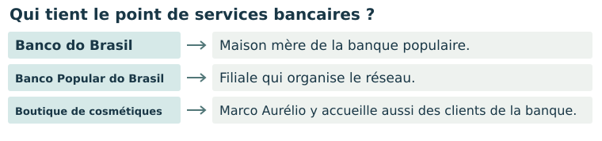
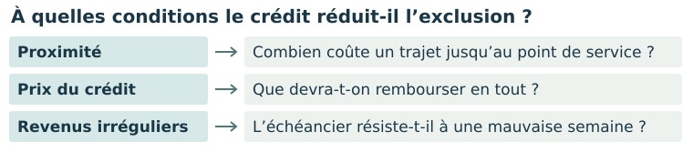

# ENS · MP-PC · Portugais (LE2) 2006 — Corrigé brut

*Corrigé rédigé par IA, non officiel. Signalez toute erreur.*

**Rédaction** · GPT-6.2 Astra Ultra · vitesse non renseignée

Le cahier commun aux ENS de Paris et de Cachan dure deux heures, sans dictionnaire ni calculatrice pour le portugais. La garde prévoit une version française sur 15 et une question en portugais sur 5. La page de portugais ne fixe pas de longueur chiffrée.

## V. Version française

**Une agence pour les pauvres**

À trente kilomètres du palais du Planalto, dans un petit magasin de produits de beauté pour femmes de la périphérie de Brasília, Marco Aurélio Batista se réjouit de voir son commerce de quartier plus fréquenté. Depuis le mois d’août dernier, il est l’un des 5 500 correspondants bancaires de la Banco Popular do Brasil, filiale de la Banco do Brasil. Créée il y a un an dans le cadre d’un vaste programme destiné à ouvrir les services bancaires à la population à faibles revenus et à élargir son accès au crédit, la « banque des pauvres », comme s’est mise à l’appeler sa clientèle, est un succès. […]

Les personnes des catégories C et D, même si elles ne peuvent justifier de leurs revenus, appartiennent à une fraction de la population qui aspire à obtenir du crédit et d’autres produits bancaires, aujourd’hui réservés aux personnes qui ont un emploi, un domicile fixe et un bulletin de salaire. Mais les choses changent. Les initiatives qui commencent à voir le jour dans le secteur bancaire visent toutes à conquérir cette partie de la population encore à l’écart du marché et susceptible de constituer une clientèle fidèle. La principale difficulté reste d’atteindre une rentabilité comparable à celle des opérations sur les comptes ordinaires, qui, avec les taux d’intérêt actuels, ont assuré des bénéfices records aux établissements financiers.

*Lino Rodrigues, IstoÉ, São Paulo, 13 mai 2005.*

## 1. O autor deste artigo aponta para a experiência dos «bancos dos pobres» e do microcrédito na luta contra a desigualdade. Que pensa dessas experiências, no Brasil ou noutras sociedades de difícil acesso aos produtos financeiros por parte da população?

Para quem precisa pegar dois ônibus e faltar ao trabalho para pagar uma conta, a chegada de um correspondente bancário ao bairro já representa uma economia. Também pode ser mais seguro guardar pequenas quantias numa conta do que em casa. Esses ganhos existem mesmo que a pessoa nunca peça dinheiro emprestado.

O microcrédito atende a outra necessidade. Uma costureira pode aceitar uma encomenda maior se conseguir comprar o tecido antes de receber da cliente. Um empréstimo pequeno, com parcelas compatíveis com a data da entrega, pode aumentar sua renda. Se a mesma costureira precisa de crédito todo mês para pagar o aluguel, a dívida tende a agravar uma dificuldade que não vem da falta de iniciativa. E o dinheiro que entra no caixa depois da venda ainda precisa cobrir o tecido e o transporte.

Eu avaliaria o programa pelo custo total do empréstimo, pelas condições oferecidas quando uma venda atrasa e pela possibilidade real de reclamar. Abrir contas é importante. Para saber se a desigualdade diminuiu, interessa conhecer também a situação das famílias depois que termina o prazo de pagamento.

*180 mots.*

L’article de Lino Rodrigues a paru à São Paulo dans IstoÉ le 13 mai 2005. Les chiffres et les conditions décrites sont ceux de l’article. La réponse emploie le portugais du Brésil. Le rapport spécifique de la session n’a pas été retrouvé.

[Version et consignes](https://banques-ecoles.fr/cms/wp-content/data/filiere-pc/annales-de-la-banque-pc/session-2006/sujet-2006-ecrit-mp_pc_langue_etrangere_2.pdf#page=9)
