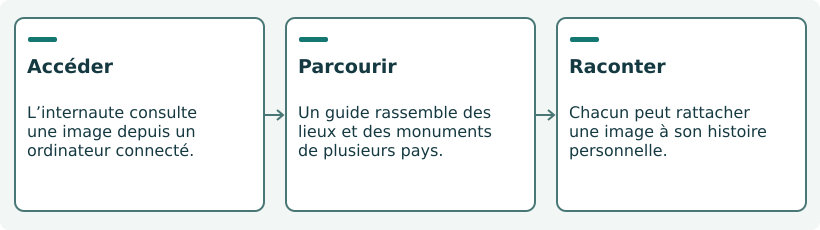

# ENS · MP-PC · Russe (LE2) 2006 — Corrigé brut

*Corrigé rédigé par IA, non officiel. Signalez toute erreur.*

**Rédaction** · GPT-6.2 Astra Ultra · vitesse non renseignée

Le sujet porte sur le lancement de Google Earth en 2005 et demande au candidat à quelle fréquence et dans quel but il se sert d’Internet. La question vaut 5 points et appelle au moins 100 mots. Le registre fournit le sujet. La réponse russe compte 110 mots.

## I. Version française

**Google Earth (earth.google.com)**

Il y a quelque temps, aux tout débuts de l’Internet russophone, circulaient sur la Toile des liens vers un site où, en indiquant les coordonnées d’un point du globe, on pouvait en obtenir une photographie prise de l’espace. Pour l’obtenir, il fallait attendre qu’un satellite spécialement prévu à cet effet survole le lieu en question et le photographie. Or, en 2005, Google lance un nouveau service qui permet de consulter et de rechercher des clichés satellitaires de n’importe quel endroit de la planète. Et tout cela est possible en temps réel depuis n’importe quel ordinateur connecté à Internet. La qualité des clichés est telle que certains États, dont l’Australie et les Pays-Bas, ont demandé l’arrêt de ce service. Son existence menace, selon eux, la sécurité de leur pays en renseignant les terroristes sur la localisation exacte de sites stratégiques.

Presque aussitôt après l’ouverture du service, des passionnés ont créé Google Sightseeing (www.googlesightseeing.com), un guide de la planète illustré de photographies satellitaires fournies, naturellement, par Google Earth. Parmi les dernières nouveautés figurent l’usine Coca-Cola des environs de Saint-Pétersbourg, le lieu de la chute de la météorite de la Toungouska, le mémorial des soldats soviétiques à Berlin et le parc de la villa Borghèse à Rome. On devine aisément que les pyramides d’Égypte comptaient parmi les toutes premières curiosités présentées.

L’engouement pour les images satellitaires de Google a été si massif sur l’Internet russe et au-delà que les médias se sont mis à les utiliser pour illustrer leurs articles. Les gens s’en servaient pour se montrer mutuellement par où passer pour se rendre chez eux. Et sur l’Internet russophone, impossible d’échapper aux vues satellitaires assorties de la mention « je suis né ici », ou, variante, « c’est là que j’ai eu mon premier rendez-vous ».

*Ekspert*, « Vechtch » (« Objet »), nº 11, décembre 2005.

## II. Question en russe

Я пользуюсь интернетом почти каждый день, но время за экраном зависит от того, что мне нужно сделать. Утром я могу за минуту проверить расписание автобуса. Когда готовлю доклад, поиск занимает дольше: сначала я подбираю несколько источников, затем смотрю, кто написал текст и когда появились приведённые в нём сведения. Однажды так выяснилось, что красивый снимок города был сделан задолго до строительства нового вокзала. Пришлось найти карту другого года. Интернет помогает мне и поддерживать связь с родственниками, которые живут далеко. Мы обмениваемся фотографиями, а иногда вместе рассматриваем на карте знакомые места. Однако для чтения длинного рассказа я обычно беру бумажную книгу: на её страницах легче вернуться к детали, не отвлекаясь на сообщения.

[Sujet](https://banques-ecoles.fr/cms/wp-content/data/filiere-pc/annales-de-la-banque-pc/session-2006/sujet-2006-ecrit-mp_pc_langue_etrangere_2.pdf#page=10)
