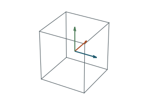

# ENS Paris, Lyon et Cachan — Mathématiques MPI 1, 2006 · Corrigé guidé

*Corrigé rédigé par IA, non officiel. Signalez toute erreur.*

**Rédaction** · GPT-6.2 Astra Ultra · vitesse non renseignée

**Révision** · GPT-6.2 Astra Ultra · vitesse non renseignée

Les transvections entières servent à engendrer le groupe spécial linéaire. La trace de ses éléments d’ordre fini fournit ensuite des divisibilités sur le cardinal de ses sous-groupes et la réduction modulo un nombre premier distingue les matrices.

## I. Générateurs de SLₙ(ℤ)

### Question 1

> [!INDICATION]
> Exprimer l’inverse à l’aide de mineurs.

#### Solution

L’identité a des coefficients entiers et un déterminant un. Les produits préservent ces propriétés. Si $A$ les vérifie, $A^{-1}=\operatorname{adj}(A)/\det A=\operatorname{adj}(A)$ est encore entière et de déterminant un. On a donc un sous-groupe de $\mathrm{SL}_n(\mathbb Q)$.

### Question 2

> [!INDICATION]
> Exploiter la nullité du carré de la matrice élémentaire.

#### Solution

Puisque $i\ne j$, $E_{ij}^2=0$, donc $(I+E_{ij})^m=I+mE_{ij}$ pour $m\ge0$ par le binôme. L’inverse étant $I-E_{ij}$, la même formule vaut pour tout $m\in\mathbb Z$.

### Question 3

> [!INDICATION]
> Lire colonne par colonne le produit à droite.

#### Solution

Le produit $M(I+mE_{ij})$ remplace la colonne $C_j$ par $C_j+mC_i$ ; toutes les autres colonnes sont conservées.

### Question 4

> [!INDICATION]
> Réaliser une permutation signée à deux colonnes et appliquer l’algorithme d’Euclide.

#### Solution

Les opérations $(a,b)\to(a+b,b)\to(a+b,-a)\to(b,-a)$ sont autorisées. Elles permettent l’échange à un signe près et, en répétant, le changement simultané des deux signes. Sur une paire, la division euclidienne $a=qb+r$ et l’opération $a\leftarrow a-qb$ remplacent un terme par un reste plus petit. Après échanges signés, on termine en $(\pm\gcd(a,b),0)$, avec correction du signe au besoin à l’aide du zéro. Réunissons ensuite ce premier coefficient avec chacun des suivants. Il reste au premier rang le pgcd positif et aux autres des zéros. Pour la ligne nulle, le pgcd conventionnel est zéro.

### Question 5

> [!INDICATION]
> Réduire d’abord la première ligne, puis le bloc inférieur droit et la première colonne.

#### Solution

Toute première ligne d’une matrice entière de déterminant un est primitive : son pgcd divise le déterminant par développement. Par 4, des opérations à droite la rendent $(1,0,\ldots,0)$. Le bloc inférieur droit appartient à $\mathrm{SL}_{n-1}(\mathbb Z)$ ; par récurrence on le réduit à l’identité en n’agissant que sur les colonnes $2,\ldots,n$. On annule alors les coefficients de la première colonne sous le pivot en lui soustrayant les multiples convenables des autres colonnes. La matrice devient l’identité. Toutes les opérations, ainsi que leurs inverses, appartiennent au groupe engendré par les $M_{ij}$. Le cas $n=1$ est le groupe trivial.

### Question 6.a

> [!INDICATION]
> Vérifier que chaque opération matricielle commute avec la réduction.

#### Solution

La réduction coefficient par coefficient commute aux sommes et aux produits, donc au produit matriciel et au déterminant donné par sa formule polynomiale. Elle envoie les matrices de déterminant un sur des matrices de déterminant un, et l’identité sur l’identité. C’est le morphisme $\varphi_{n,p}$.

### Question 6.b

> [!INDICATION]
> Engendrer le groupe sur le corps par les mêmes additions de colonnes.

#### Solution

Dans $\mathbb F_p$, si $n\ge2$, une première ligne non nulle peut être changée en $(1,0,\dots,0)$ par additions de multiples de colonnes. En effet, plaçons un coefficient non nul $a$ en premier par échange signé. Annulons les suivants avec ce pivot, puis transformons $(a,0)$ en $(a,1)$ par ajout de $a^{-1}$ fois la première entrée à la deuxième, ensuite en $(1,1)$ en ajoutant $(1-a)$ fois la deuxième à la première, et enfin en $(1,0)$. La réduction par blocs de 5 s’applique alors sur le corps. Chaque transvection $I+cE_{ij}$ se relève en $M_{ij}^m$ avec $m\equiv c\pmod p$. On relève tout produit, donc l’application est surjective, également pour le groupe trivial en dimension un.

## II. Sous-groupes finis

### Question 7.a

> [!INDICATION]
> Faire agir un polynôme annulateur à racines simples et contrôler la somme des valeurs propres.

#### Solution

Chaque $M$ a un ordre fini $k$ et est annulée par $X^k-1$, scindé à racines simples sur $\mathbb C$. Elle est diagonalisable, ses valeurs propres $z_j$ sont de module un. Donc $\operatorname{Tr}(M^{-1})=\sum_j\bar z_j=\overline{\operatorname{Tr}M}=\operatorname{Tr}M$ car la matrice est réelle, et $|\operatorname{Tr}M|\le n$. Une trace $n$ exige toutes les parties réelles égales à un, donc $M=I$. Une trace $-n$ implique de même $M=-I$, si ce dernier appartient au groupe.

### Question 7.b

> [!INDICATION]
> Évaluer la forme quadratique de la somme.

#### Solution

Chaque $M^TM$ est symétrique et $x^TUx=\sum_{M\in G}\|Mx\|^2\ge\|x\|^2$ grâce au terme identité. La matrice $U$ est donc symétrique définie positive.

### Question 7.c

> [!INDICATION]
> Réindexer la somme après multiplication par un élément fixé du groupe.

#### Solution

Pour $N\in G$, $N^TUN=\sum_{M\in G}(MN)^T(MN)=U$ puisque $M\mapsto MN$ permute $G$. C’est la condition d’orthogonalité pour le produit scalaire de matrice $U$.

### Question 8.a

> [!INDICATION]
> Choisir une base orthonormée pour le produit invariant et identifier le groupe des rotations.

#### Solution

Dans la base adaptée de 7.c, les éléments sont orthogonaux de déterminant un. Le groupe s’identifie donc à un sous-groupe du cercle des rotations du plan. Si son cardinal est $g$, chaque rotation vérifie $z^g=1$ ; le sous-groupe a $g$ éléments parmi les $g$ racines de l’unité correspondantes, donc les contient toutes. Il est cyclique.

### Question 8.b

> [!INDICATION]
> La trace entière du générateur restreint les angles possibles.

#### Solution

Une rotation d’angle $\theta$ a pour trace $2\cos\theta$, un entier parmi $-2,-1,0,1,2$. Elle a alors respectivement ordre $2,3,4,6,1$. Appliqué au générateur, cela donne $g\in\{1,2,3,4,6\}$.

### Question 8.c

> [!INDICATION]
> Une involution de déterminant un ne peut avoir les deux signes comme valeurs propres distinctes.

#### Solution

Une matrice d’ordre deux est diagonalisable de valeurs propres dans $\{1,-1\}$. Le déterminant un impose deux signes égaux. Les deux signes positifs donnent l’identité, d’ordre un. Le seul élément d’ordre deux est donc $-I_2$.

### Question 8.d

> [!INDICATION]
> Lire la réciproque sur le polynôme caractéristique de déterminant un.

#### Solution

Les ordres $3,4,6$ imposent respectivement les traces $-1,0,1$ par 8.b. Réciproquement, aux trois traces correspondent $X^2+X+1$, $X^2+1$, $X^2-X+1$. Leurs deux racines sont distinctes et primitives des ordres respectifs $3,4,6$. La matrice est donc diagonalisable sur $\mathbb C$ et de l’ordre correspondant.

### Question 8.e

> [!INDICATION]
> Utiliser les matrices compagnes des trois polynômes quadratiques.

#### Solution

Pour $g=1,2$ prendre $\{I\}$ et $\{I,-I\}$. Pour $g=3,4,6$, prendre le groupe engendré par $C_t=\left(\begin{smallmatrix}0&-1\\1&t\end{smallmatrix}\right)$ avec respectivement $t=-1,0,1$. Son ordre est celui annoncé par 8.d et $\det C_t=1$.

### Question 9

> [!INDICATION]
> Séparer l’axe fixe de la rotation tridimensionnelle.

#### Solution

Par 7.c, $M$ est conjuguée à un élément de $\mathrm{SO}_3$. Il possède la valeur propre $1$ et les deux autres s’écrivent $e^{\pm i\theta}$ (les possibilités réelles sont incluses par le déterminant un). Sa trace entière est $1+2\cos\theta$. Les traces $-1,0,1,2,3$ correspondent respectivement aux ordres $2,3,4,6,1$. Toutes sont possibles avec $\operatorname{diag}(1,C_t)$ pour les ordres $3,4,6$, l’identité et $\operatorname{diag}(1,-1,-1)$.

### Question 10.a

> [!INDICATION]
> Factoriser la somme double des coefficients diagonaux.

#### Solution

Par définition $\operatorname{Tr}(M\star M')=\sum_{i,i'}a_{ii}b_{i'i'}=(\operatorname{Tr}M)(\operatorname{Tr}M')$.

### Question 10.b

> [!INDICATION]
> Séparer les indices intermédiaires dans le produit.

#### Solution

Le coefficient entre $(i,i')$ et $(j,j')$ du produit $(M\star M')(N\star N')$ est $\sum_{k,k'}m_{ik}m'_{i'k'}n_{kj}n'_{k'j'}=(MN)_{ij}(M'N')_{i'j'}$. Il s’agit de $(MN)\star(M'N')$.

### Question 10.c

> [!INDICATION]
> Itérer l’identité de produit pour les puissances tensorielles.

#### Solution

Par 10.b et par récurrence, $(MN)^{\star r}=M^{\star r}N^{\star r}$ ; l’identité a pour image celle de la taille $n^r$. En prenant $N=M^{-1}$, l’image d’un inversible est inversible et l’application $\psi_r$ est un morphisme.

### Question 11.a

> [!INDICATION]
> Normaliser la somme pour obtenir un projecteur.

#### Solution

Pour chaque $P\in G$ il existe exactement $g$ couples $(M,N)$ de produit $P$. Ainsi $S^2=gS$, donc $S/g$ est un projecteur. Sa trace est son rang entier. D’où $\operatorname{Tr}S=g\operatorname{rang}(S/g)$.

### Question 11.b

> [!INDICATION]
> Examiner quand la puissance de la trace atteint la dimension complète.

#### Solution

Si $M^{\star r}=I$, 10.a donne $(\operatorname{Tr}M)^r=n^r$. Pour $r$ impair, cela impose $\operatorname{Tr}M=n$, donc $M=I$ par 7.a. Pour $r$ pair, la trace vaut $\pm n$, donc $M\in\{I,-I\}\cap G$. Réciproquement, $(-I)^{\star r}=(-1)^rI$, ce qui vérifie ces deux descriptions du noyau.

### Question 11.c

> [!INDICATION]
> Appliquer le décompte du projecteur aux images, en gardant la multiplicité des fibres.

#### Solution

Pour $r=0$ la somme vaut $g$ avec la convention du monôme constant. Pour $r>0$, chaque élément du groupe image a $k=|\ker(\psi_r|_G)|$ antécédents. Par 10.a, $\sum_{M\in G}(\operatorname{Tr}M)^r=k\sum_{P\in\psi_r(G)}\operatorname{Tr}P$. Par 11.a la deuxième somme est multiple de $|\psi_r(G)|=g/k$, d’où la divisibilité par $g$.

### Question 12.a

> [!INDICATION]
> Construire un polynôme entier qui annule toutes les traces autres que celle de l’identité.

#### Solution

Posons $P(X)=\prod_{i=1}^s(X-t_i)\in\mathbb Z[X]$. La somme $\sum_{M\in G}P(\operatorname{Tr}M)$ est divisible par $g$ en développant et appliquant 11.c à chaque monôme. Par 7.a, seule l’identité a pour trace $n$. La somme vaut donc $P(n)=\prod_i(n-t_i)$.

### Question 12.b

> [!INDICATION]
> Placer les facteurs distincts du produit dans une factorielle.

#### Solution

Les facteurs $n-t_i$ sont des entiers distincts dans $[1,2n]$. Leur produit divise $(2n)!$, donc $g$ le divise. Si $n$ est impair, seule $-I$ pourrait avoir trace $-n$ et son déterminant est $-1$. Le facteur $2n$ ne se présente pas et $g\mid(2n-1)!$.

### Question 12.c

> [!INDICATION]
> Réduire la liste des facteurs grâce aux traces réellement possibles en dimension trois.

#### Solution

D’après 9, les traces autres que trois sont parmi $-1,0,1,2$. Les facteurs $3-t_i$ sont donc des éléments distincts de $\{1,2,3,4\}$, de produit divisant $24$. Par 12.a, $g\mid24$.

### Question 13.a

> [!INDICATION]
> Compter les permutations des colonnes puis les choix de signes compatibles avec le déterminant.

#### Solution

Les matrices préservant $T=\{\pm e_1,\dots,\pm e_n\}$ et inversibles sont précisément les matrices de permutation signées. Elles forment un groupe contenant $2^n n!$ éléments. Leur déterminant est le signe de la permutation multiplié par le produit des signes de colonnes. Pour une permutation fixée et les $n-1$ premiers signes arbitraires, le dernier est imposé par le déterminant un. Ces matrices constituent donc un sous-groupe de $\mathrm{SL}_n(\mathbb Z)$ de cardinal $2^{n-1}n!$.

### Question 13.b

> [!INDICATION]
> Comparer la divisibilité universelle et l’exemple construit.

#### Solution

Le cardinal de tout sous-groupe fini de $\mathrm{SL}_3(\mathbb Z)$ divise $24$ par 12.c, et 13.a réalise $2^2\cdot3!=24$. Le maximum est donc $24$.

### Question 14.a

> [!INDICATION]
> Développer la puissance de I+mN et exploiter la primitivité des coefficients de N.

#### Solution

Les coefficients de $N=(M-I)/m$ ont pgcd un. L’identité $(I+mN)^p=I$, divisée par $m$, donne $pN\equiv0\pmod m$ car tous les termes d’ordre au moins deux contiennent $m$. Une combinaison entière des coefficients de $N$ vaut un par Bézout, donc $m\mid p$.

### Question 14.b

> [!INDICATION]
> Si m=p est impair, diviser l’identité d’un facteur supplémentaire.

#### Solution

Si $m>1$, 14.a donne $m=p$. Supposons $p$ impair. Dans $(I+pN)^p-I$, le terme linéaire est $p^2N$, ceux de rang $2\le k<p$ sont divisibles par $p^{k+1}$ puisque $p\mid\binom pk$, et le dernier est divisible par $p^p$. En divisant par $p^2$ puis réduisant modulo $p$, on trouve $N\equiv0$, contradiction avec le pgcd un. Donc seules possibilités $m=1$ ou $m=p=2$.

### Question 15.a

> [!INDICATION]
> Trouver un élément d’ordre premier si le noyau contient un élément non trivial.

#### Solution

Si $M\ne I$ du noyau sur $G$ a ordre $r$, choisissons un premier $p\mid r$. Alors $N=M^{r/p}$ a ordre $p$ et est toujours congrue à $I$ modulo trois. Le pgcd des coefficients de $N-I$ serait divisible par trois, contrairement à 14.b. La restriction est injective.

### Question 15.b

> [!INDICATION]
> Compter les bases sur le corps à trois éléments et utiliser le déterminant.

#### Solution

Les colonnes d’une matrice inversible se choisissent successivement hors du sous-espace engendré par les précédentes. D’où $|\mathrm{GL}_n(\mathbb F_3)|=\prod_{j=0}^{n-1}(3^n-3^j)$. Le déterminant est surjectif sur $\mathbb F_3^\times$ via une matrice diagonale, donc le noyau spécial a la moitié de ce cardinal. Le sous-groupe injecté par 15.a a un cardinal divisant ce nombre.

### Question 15.c

> [!INDICATION]
> Prendre le pgcd des deux bornes de divisibilité.

#### Solution

Par 12.b, $g\mid8!=40320$. Par 15.b, $g\mid(80\cdot78\cdot72\cdot54)/2=12130560$. Leur pgcd vaut $5760$ (les décompositions sont $2^7 3^2 5\cdot7$ et $2^8 3^6 5\cdot13$ respectivement). Ainsi $g\mid5760$.

### Question 16

> [!INDICATION]
> Garder la représentation régulière privée des constantes et corriger son déterminant sur une dernière droite.

#### Solution

Soit $H$ le groupe abstrait de cardinal $g$. La multiplication à gauche permute fidèlement les $g$ vecteurs $e_h$ de la base du réseau $\mathbb Z^H$. Le sous-réseau $L=\{(a_h):\sum_h a_h=0\}$, de rang $g-1$ et de base $e_h-e_1$ pour $h\ne1$, est stable. L’action induite $A_s$ de $s\in H$ sur $L$ est fidèle pour $g\ge2$ : si elle fixe toutes les différences, elle fixe $L\otimes\mathbb R$ point par point et elle fixe aussi le vecteur constant, donc elle fixe toute la représentation régulière. Les matrices $A_s$ sont entières inversibles avec déterminant $\pm1$. Posons $B_s=\operatorname{diag}(A_s,\det A_s)\in\mathrm{SL}_g(\mathbb Z)$. La multiplicativité du déterminant en fait un morphisme injectif. Pour $g=1$, le groupe trivial s’injecte directement.

La base utilisée permet aussi d’écrire l’injection sans choisir de produit scalaire. Avec $v_h=e_h-e_1$ et $v_1=0$, on a $A_sv_h=v_{sh}-v_s$. Si $A_s$ est l’identité et $s\ne1$, l’égalité au vecteur $v_{s^{-1}}$ impose $e_1-e_s=e_{s^{-1}}-e_1$. Le coefficient de $e_1$ vaut $1$ à gauche et $-1$ à droite. Cela établit directement la fidélité, y compris quand $s=s^{-1}$. Le dernier coefficient $\det A_s$ corrige le déterminant sans exiger une décomposition du réseau en somme directe entière.

## III. Morphismes et quotients finis

### Question 17

> [!INDICATION]
> Faire agir les matrices binaires sur les trois vecteurs non nuls du plan.

#### Solution

L’action de $\mathrm{SL}_2(\mathbb F_2)=\mathrm{GL}_2(\mathbb F_2)$ sur les trois vecteurs non nuls de $\mathbb F_2^2$ est fidèle, car fixer les vecteurs fixe en particulier une base. Ce groupe a $(4-1)(4-2)=6$ éléments et s’identifie donc à $\mathfrak S_3$. Composer la réduction surjective modulo deux de 6.b avec cet isomorphisme puis avec la signature, à valeurs dans $\mathbb Z/2\mathbb Z$, fournit le morphisme surjectif demandé.

L’image du générateur $\left(\begin{smallmatrix}1&1\\0&1\end{smallmatrix}\right)$ fixe $e_1$ et échange $e_2$ et $e_1+e_2$ modulo deux. Son image par la signature est donc la classe $1$, ce qui vérifie la surjectivité sur le quotient d’ordre deux par un élément explicite.

### Question 18.a

> [!INDICATION]
> Conserver seulement les produits non nuls des unités matricielles.

#### Solution

Posons $P=E_{ij}$ et $Q=E_{jk}$. Les indices distincts donnent $P^2=Q^2=QP=0$ et $PQ=E_{ik}$ ; les produits suivants avec $P,Q$ s’annulent. En développant $(I+P)(I+Q)(I-P)(I-Q)$ il reste $I+PQ=M_{ik}$.

### Question 18.b

> [!INDICATION]
> Réaliser chaque générateur comme commutateur.

#### Solution

Pour chaque $i\ne k$ il existe un troisième indice $j$ car $n\ge3$. D’après 18.a, $M_{ik}$ est un commutateur. Tout commutateur va sur l’identité dans un groupe abélien. Le noyau contient les générateurs de 5 et est donc le groupe entier.

### Question 19.a

> [!INDICATION]
> Un morphisme est imposé par ses valeurs sur un ensemble générateur.

#### Solution

Avec $r$ générateurs, il y a au plus $|H|^r$ choix d’images. Deux morphismes ayant les mêmes images coïncident sur les générateurs et leurs inverses, donc sur tout produit de ceux-ci et sur $G$. Le nombre de morphismes est fini.

### Question 19.b

> [!INDICATION]
> Faire agir la précomposition par le morphisme surjectif sur un ensemble fini.

#### Solution

L’application $w\mapsto w\circ u$ sur l’ensemble fini $\operatorname{Hom}(G,H)$ est injective car $u$ est surjectif. Elle est donc surjective. Pour tout $v$, il existe un morphisme $w$ tel que $v=w\circ u$. Cela donne directement $\ker u\subset\ker v$.

### Question 20

> [!INDICATION]
> Séparer chaque matrice non identité dans un quotient fini convenable.

#### Solution

Soit $u$ un endomorphisme surjectif de $\mathrm{SL}_n(\mathbb Z)$. Le groupe est de type fini par 5. Pour tout premier $p$, la réduction a un but fini, donc $\ker u\subset\ker\varphi_{n,p}$ par 19.b. Si $M\ne I$, un coefficient de $M-I$ est un entier non nul ; choisissons un premier qui ne le divise pas. Alors $\varphi_{n,p}(M)\ne I$. L’intersection de tous ces noyaux se réduit donc à l’identité. Le morphisme $u$ est injectif et surjectif, donc bijectif.
