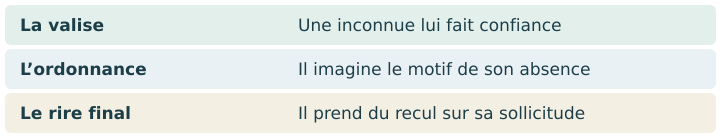

# X · MP-PC · Allemand 2006 — Corrigé brut

*Corrigé rédigé par IA, non officiel. Signalez toute erreur.*

**Rédaction** · GPT-6.2 Astra Ultra · vitesse non renseignée

**Un flâneur et les inquiétudes du XXIᵉ siècle.** La composition de l’École polytechnique et de l’ESPCI comprend une version et une expression écrite, chacune d’une heure et demie, sans dictionnaire. La seconde partie demande deux réponses en allemand.

Wilhelm Genazino, Ein Regenschirm für diesen Tag (2001). Thérèse Delpech, L’ensauvagement (Grasset, 2005).

## Version · Un flâneur

Près de l’église Saint-Nicolas, à l’endroit où un petit cirque donne en ce moment des représentations, une jeune femme me demande si je peux surveiller un instant sa valise. Oui, dis-je, pourquoi pas. Je serai de retour dans dix minutes, dit-elle. Elle pose sa valise à côté de moi, me fait un geste amical et poursuit son chemin. Je ne cesse de m’étonner de la confiance que me témoignent des inconnus. La valise est petite et a sans doute déjà bien voyagé. Déjà, des gens me regardent en se demandant si, cette valise et moi, nous allons ensemble. Non, nous n’allons pas ensemble. Autrefois, je supposais que les gens se regardaient parce qu’ils craignaient sans cesse qu’une mauvaise nouvelle ne leur arrive. Puis j’ai cru qu’en se regardant ils cherchaient des mots pour dire l’étrangeté de la vie. Car dans le regard des gens cette étrangeté ne cesse de vibrer, allant de l’un à l’autre sans pourtant jamais se laisser regarder. Aujourd’hui, je ne pense presque plus à rien, je me contente de regarder autour de moi. Comme on le voit, voilà que je me suis mis à mentir. Car il est impossible d’arpenter les rues sans penser à quelque chose. À l’instant même, je me dis combien je trouverais beau que les gens redeviennent soudain pauvres. Tous, oui, et tous en même temps. Comme ce serait beau si je pouvais les voir sans leurs lunettes de soleil, sans leurs sacs à main, leurs casques de protection, leurs vélos de course, sans leurs chiens de race, leurs patins à roulettes, leurs montres radiocommandées. Pendant une demi-heure au moins, ils ne porteraient sur eux que les quelques haillons qu’ils avaient déjà sur le dos il y a des années. […]

Voilà que revient la femme dont je garde la valise. Elle tient une ordonnance dans la main gauche. Tout s’explique : elle était chez le médecin, mais ne voulait pas s’y présenter avec une valise. Ce n’est probablement pas une voyageuse, c’est plutôt une sorte de vagabonde des villes, une femme sans domicile. Elle me remercie et reprend sa valise. J’aimerais la mettre en garde, lui dire de ne pas donner sa confiance aussi facilement. Au même instant, ma sollicitude me fait rire.

## Première question · Les codes de conduite

Für Thérèse Delpech macht gerade die wachsende Abhängigkeit von technischen Systemen moderne Gesellschaften verletzlich. Ein Fehler kann weit über den Ort seines Entstehens hinaus Folgen haben. Tschernobyl zeigt außerdem, wie wenig es erklärt, einen Unfall allein den Menschen zuzuschreiben und Mängel der Technik zu verschweigen. In der biologischen Forschung können selbst unbeabsichtigte Ergebnisse erhebliche Risiken erkennen lassen. Gleichzeitig übersteigt die Zahl der Neuerungen die Fähigkeit der Regierungen, jede Entwicklung rechtzeitig zu beurteilen. Deshalb müssen Wissenschaftler und Unternehmen ihr Fachwissen nutzen, um verbindliche Regeln für ihre eigene Arbeit zu entwickeln. Die Nutzung des Weltraums verdeutlicht schließlich, dass dieselbe Infrastruktur militärischen und zivilen Zwecken dienen kann. Werden ihre zivilen Funktionen gefährdet, betrifft das den Alltag vieler Menschen. Verhaltensregeln sollen solche Wechselwirkungen vorausschauend berücksichtigen, bevor ein schwerer Schaden eintritt.

*126 Wörter.*

## Seconde question · Un siècle de la peur ?

Ob das einundzwanzigste Jahrhundert als Jahrhundert der Angst in Erinnerung bleiben wird, hängt für mich auch davon ab, wie Gesellschaften über Unsicherheit sprechen. Eine Gefahr ernst zu nehmen ist etwas anderes, als den ganzen Alltag von ihr bestimmen zu lassen. Wer zum Beispiel nach einem Hochwasser die verwundbaren Stellen seiner Stadt untersucht, macht sich zunächst Sorgen. Zugleich gewinnt die Frage, was sich gemeinsam verändern lässt, eine konkrete Antwort.

Angst wächst dagegen leicht, wenn Informationen fehlen oder wenn Verantwortliche ihre früheren Aussagen stillschweigend ändern. Dann gibt es für die Bevölkerung keinen erkennbaren Unterschied mehr zwischen einer neuen Erkenntnis und einer früheren Täuschung. Eine Gemeinde, die offenlegt, welche ihrer Prognosen unsicher sind, kann auch nach einem Irrtum Vertrauen behalten. Entscheidend ist, ob Betroffene Fragen stellen und ihre eigenen Erfahrungen einbringen können.

Außerdem beschreibt eine einzige Stimmung ein ganzes Jahrhundert nur sehr unvollständig. Zur selben Zeit können Menschen politische Freiheit gewinnen, einen schweren Verlust erleiden oder an einer neuen Form der Zusammenarbeit teilnehmen. Ich würde deshalb eher von einem Jahrhundert widersprüchlicher Erwartungen sprechen. Welche davon unser Gedächtnis prägt, entscheiden auch die Institutionen, mit denen wir aus berechtigter Sorge gemeinsames Handeln machen.

*188 Wörter.*

La version et l’expression écrite font l’objet de deux rapports distincts pour les filières MP et PC.

[Version p. 1](https://web.archive.org/web/20090320042100id_/http://www.imprimerie.polytechnique.fr:80/EnLignes/Files/06_Version.pdf#page=1) · [Expression écrite p. 1–2](https://web.archive.org/web/20090320034643id_/http://www.imprimerie.polytechnique.fr:80/EnLignes/Files/06_ExprEcrit.pdf) · [Rapport sur la version](https://web.archive.org/web/20090320042917id_/http://www.imprimerie.polytechnique.fr:80/EnLignes/Files/06_Version_AL.pdf) · [Rapport sur l’expression écrite](https://web.archive.org/web/20090320034646id_/http://www.imprimerie.polytechnique.fr:80/EnLignes/Files/06_ExprEcrit_AL.pdf)
