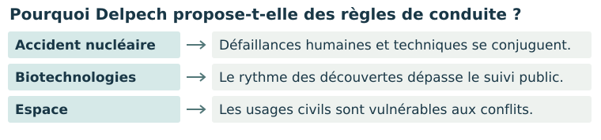
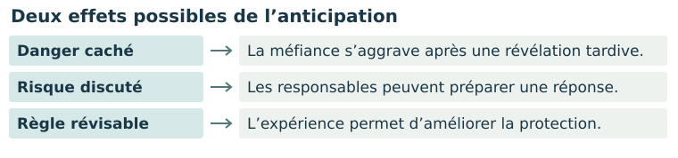

# X · MP-PC · Anglais 2006 — Corrigé guidé

*Corrigé rédigé par IA, non officiel. Signalez toute erreur.*

**Rédaction** · GPT-6.2 Astra Ultra · vitesse non renseignée

Les deux cahiers durent chacun une heure trente, sans dictionnaire. La version se rédige en français. Les deux réponses au texte français se rédigent en anglais. Le sujet donne à titre indicatif 120 à 150 mots pour la première et 180 à 200 pour la seconde.

## V. Version française

Le rapport attire l’attention sur *relieved*, qui se rapporte à Howard, et sur *struck Julia*, qui décrit la perception de Julia. Faire passer les bruits de la Morris et le grésillement du poste dans le trajet plutôt que dans un inventaire détaché. L’expression familière finale rend soudain audible la colère d’Howard.

**Les deuxièmes vacances**

Pan-Europa avait connu une mauvaise année. Les difficultés au Moyen-Orient perturbaient l’approvisionnement et un pétrolier de la compagnie avait vomi sa cargaison au large de la Bretagne, souillant des dizaines de plages et tuant des milliers d’oiseaux. La facture serait énorme pour l’entreprise. On avait fait savoir à Howard qu’il ne devait pas compter sur une augmentation. Il expliqua la situation à Julia, soulagé, en un sens, de pouvoir lui montrer dans les journaux les photographies d’oiseaux englués de mazout. Ce n’était pas sa faute s’ils n’avaient pas les moyens de s’offrir de vraies vacances.

« Enfin, il faut bien qu’on fasse quelque chose pour les enfants, dit Julia.

— Bien sûr, répondit Howard en hochant la tête. J’ai une idée. »

Il proposa une excursion à la plage, sur la côte sud de l’Angleterre.

La Morris 1100 avait dix ans. Entre ses grincements, ses ferraillements et son odeur qui se mêlait à celle des provisions dans le panier de pique-nique, les Lament sentaient cruellement à quel point ils voyageaient à l’économie. Les jumeaux se chamaillèrent pendant des heures, puis s’assoupirent, tandis que le poste de radio, au milieu des grésillements, égrenait des avis de tempête de plus en plus inquiétants. Julia tenta de voir l’excursion d’un bon œil en repensant à la précédente, mais ne put s’empêcher d’interroger une nouvelle fois Howard sur son travail.

Howard serra les mâchoires. « Au travail, tout va parfaitement bien », répondit-il d’un ton mesuré qui parut à Julia aussi condescendant qu’hostile.

« Howard, j’ai parfois l’impression que tu me crois incapable de comprendre le monde dans lequel tu vis.

— Mais pas du tout », répondit-il sans rien ajouter, ce qui ne faisait que donner raison à Julia.

« Alors raconte-moi quelque chose, Howard. N’importe quoi, puisque je ne sais absolument rien.

— C’est un simple travail de bureau, protesta-t-il. Il n’y a rien à raconter. »

Howard serra plus fort le volant, mais il ne put retenir les mots qui lui échappèrent.

« Eh bien voilà, dit-il. C’est affreux. Je déteste ce travail. Je m’ennuie à mourir. Je voudrais qu’on ne soit jamais partis de Rhodésie. Tout n’y était pas parfait, surtout sur le plan politique, mais nous y étions heureux, en famille. »

Julia fixa la route devant elle pendant un temps interminable et Howard regretta aussitôt son aveu. Puis elle jeta un regard derrière elle pour s’assurer que les enfants dormaient toujours.

Julia répondit doucement. « Howard, on se faisait tous les deux du souci pour les enfants, tu te souviens ? On voulait partir tous les deux.

— Et c’est ce qu’on a fait. C’est le prix à payer pour avoir bonne conscience, hein ? dit Howard. Des vacances au rabais et un boulot sans avenir dans ce fichu trou de Denham. »

## 1. Why does technological development require appropriate codes of conduct, according to Delpech?

Éviter d’attribuer l’accident de Tchernobyl à la seule faute des opérateurs. Delpech insiste sur l’interaction avec les défauts du réacteur, la difficulté du contrôle public en biotechnologie et l’interdépendance civile et militaire dans l’espace.

Delpech argues that the effects of a technology reach beyond the people who develop or operate it. Chernobyl showed the danger of blaming individuals while ignoring flaws in the equipment and withholding information from the public. In biotechnology, even a project undertaken for a legitimate purpose can have unforeseen consequences. Governments struggle to follow numerous, highly specialised developments, so scientists and companies must establish standards of responsible practice themselves. Space technology raises a further difficulty. Modern societies depend on satellites for communications and other civilian purposes, yet the same environment has become central to military operations. A confrontation there could disrupt ordinary life far beyond the forces involved. Appropriate rules must therefore reflect technical expertise and acknowledge wider obligations before an accident or conflict makes the need for restraint unmistakable.

*130 mots.*

## 2. Will the twenty-first century be the century of fear?

Distinguer une prédiction historique, impossible à garantir, et un jugement sur les facteurs qui rendent la peur durable. L’argument peut reconnaître l’exposition à des risques nouveaux et montrer par un exemple comment la confiance se construit.

Fear may shape this century, but I doubt that it has a stronger claim on us than it had on people who lived through world wars or expected a nuclear confrontation. What has changed is how quickly a distant danger enters an ordinary home. A striking image can travel farther than the explanation of how likely the event is to recur. When officials conceal uncertainty to prevent alarm, later discoveries can turn a reasonable concern into lasting distrust.

Yet the same connections can support cooperation. A coastal community that receives a storm warning from scientists abroad gains time to protect its residents. People will act on that message if they know its source, have practised what to do and can question officials after a false alarm. Fear then supplies a reason to prepare instead of a reason to withdraw from public life.

We cannot choose every danger we shall face. We can choose whether institutions acknowledge mistakes, share information and give citizens a part in deciding which risks are acceptable. I expect the quality of those choices to tell us more about the century than the number of frightening headlines it produces.

*192 mots.*

La version est extraite de The Laments (2004), l’expression de L’Ensauvagement (2005). Les deux cahiers ainsi que les rapports distincts sur la version et l’expression ont été consultés.

[Cahier de version](https://web.archive.org/web/20090320042100id_/http://www.imprimerie.polytechnique.fr:80/EnLignes/Files/06_Version.pdf#page=2) · [Cahier d’expression](https://web.archive.org/web/20090320034643id_/http://www.imprimerie.polytechnique.fr:80/EnLignes/Files/06_ExprEcrit.pdf) · [Rapport du jury](https://web.archive.org/web/20090320042919id_/http://www.imprimerie.polytechnique.fr:80/EnLignes/Files/06_Version_AN.pdf) · [Rapport complémentaire](https://web.archive.org/web/20061208144725id_/http://www.imprimerie.polytechnique.fr/EnLignes/Files/06_ExprEcrit_AN.pdf)
