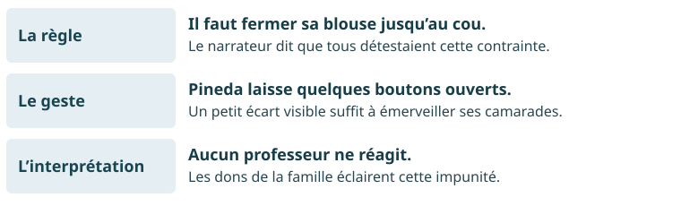

# X–ESPCI · MP-PC · Espagnol 2006 — corrigé guidé

*Corrigé rédigé par IA, non officiel. Signalez toute erreur.*

**Rédaction** · GPT-6.2 Astra Ultra · vitesse non renseignée · 25 novembre 2026

Version et expression de 1 h 30 chacune, sans dictionnaire. Réponses en espagnol. Longueurs indicatives : 120 à 150 mots environ, puis 180 à 200 mots environ.

## 1. Version française

**Un nouvel élève en classe**

### Avant de traduire

*La bata* est ici une blouse d’écolier. *A mitad de curso* renvoie au milieu de l’année scolaire, alors que *sexto de bachillerato* nomme une année dans l’ancien secondaire espagnol. *Un secreto a voces* est un secret de Polichinelle. Dans la dernière comparaison, conserver les hésitations de celui qui observe Pineda du coin de l’œil.

### Proposition de traduction

De Pineda, je garderai toujours le souvenir de ce glorieux après-midi de février 1963 où, provocant, en vrai dandy, comme s’il cherchait à dicter la mode et la morale de l’école, il entra en classe sans avoir entièrement boutonné sa blouse.

Nous détestions en silence les uniformes, et plus encore d’être boutonnés jusqu’au cou. Aussi un geste aussi audacieux eut-il de l’importance pour nous tous, surtout pour moi qui découvris en outre quelque chose qui allait beaucoup compter dans ma vie : la liberté d’allure.

Oui, ce geste hardi de Pineda est resté à jamais gravé dans ma mémoire. Pour couronner le tout, aucun professeur ne s’en mêla. Personne n’osa faire de remontrances à Pineda, le nouvel arrivé. Nous l’appelions « le nouveau » parce qu’il était entré à l’école en cours d’année. Personne ne le punit, ce qui confirma un secret déjà connu de tous : la famille distinguée de Pineda, à force de dons démesurés, jouissait d’un grand crédit auprès de la direction de l’établissement.

Ce jour-là, Pineda entra en classe — nous étions en sixième année du secondaire — en proposant une nouvelle façon de porter la blouse et de s’accommoder de la discipline. Nous en fûmes tous émerveillés, moi tout particulièrement. Après ce geste audacieux, j’étais presque amoureux de lui. Je trouvais Pineda beau, distingué, moderne, intelligent, hardi, avec des manières venues d’ailleurs, ce qui était peut-être le plus important.

Le lendemain, j’eus la confirmation qu’il était différent en tout. Je l’observais un peu du coin de l’œil quand je crus remarquer sur son visage quelque chose de très particulier, une expression étrangement assurée et intelligente. Penché sur son travail, concentré, résolu, il avait l’air d’un chercheur absorbé par ses propres problèmes plutôt que d’un élève faisant ses devoirs. Il y avait aussi comme quelque chose de féminin dans ce visage. Un instant, il ne me sembla ni masculin ni enfantin, ni vieux ni jeune, mais millénaire, hors du temps, marqué par d’autres âges que les nôtres.

*Enrique Vila-Matas, Bartleby y compañía, 2004, selon le sujet.*

## 2. Expression en espagnol

Thérèse Delpech, *L’Ensauvagement* (2005), sur la maîtrise du développement technologique.

### 1. ¿Por qué y de qué manera, según la autora, hacen falta códigos de conducta para el desarrollo tecnológico?

Identifier les acteurs auxquels l’autrice attribue une responsabilité particulière, puis relier les conséquences imprévues d’une innovation à la dépendance des activités civiles.

Según Thérèse Delpech, el poder que proporcionan ciertas técnicas crece más deprisa que la capacidad pública de prever sus consecuencias. En las biotecnologías, una investigación bien intencionada puede producir resultados inesperados y los gobiernos no disponen siempre de los conocimientos necesarios para seguir todos los avances. Por eso los científicos y las empresas deben acordar normas de conducta que reduzcan la posibilidad de un accidente. La utilización del espacio plantea otro problema de responsabilidad. Las sociedades dependen de servicios civiles como las telecomunicaciones, de modo que una decisión tomada por motivos militares puede perjudicar a personas completamente ajenas a un conflicto. En ambos ámbitos, la utilidad de una innovación no dispensa de considerar sus efectos colectivos ni de fijar límites antes de que se produzca un daño difícil de reparar.

*130 mots.*

### 2. ¿Será el siglo XXI el siglo del miedo?

La formule invite à discuter un jugement sur toute une époque. Choisir une peur précise, expliquer comment elle s’amplifie, puis présenter une expérience où la même inquiétude se transforme en action commune.

Llamar al siglo XXI el siglo del miedo me parece una predicción demasiado segura acerca de una emoción muy cambiante. Cuando vemos en pocos minutos imágenes de una inundación lejana y de un incendio cercano, podemos sentir que ambas amenazas están ya ante nuestra puerta. Esa impresión tiene consecuencias políticas si alguien aprovecha la inquietud para presentar a un grupo entero como enemigo o para prometer una protección imposible. Sin embargo, conocer una amenaza también puede favorecer la cooperación.

En un barrio expuesto a las crecidas de un río, por ejemplo, la publicación de un mapa puede provocar una primera reacción de alarma. Si después los vecinos participan en reuniones y comprueban qué apoyos están previstos para quienes tienen dificultades de movilidad, la inquietud adquiere un objeto preciso. Ya no depende enteramente del próximo rumor. No todos los riesgos se pueden resolver de esa manera, y sería injusto pedir calma a quienes sufren pérdidas. Pero una época se define también por las instituciones que construye y por la ayuda que sus habitantes se prestan. El miedo será una de nuestras experiencias comunes. Convertirlo en nuestro único horizonte depende, en parte, de decisiones que todavía podemos discutir.

*196 mots.*

## Sources

École polytechnique et École supérieure de physique et de chimie industrielles. Le rapport de Jocelyne Reith commente les deux sous-épreuves et, pour l’expression, le sens de « codes de conduite », la concision de la synthèse et le choix d’exemples personnels.

[Sujet, p. 4](https://web.archive.org/web/20090320042100id_/http://www.imprimerie.polytechnique.fr:80/EnLignes/Files/06_Version.pdf#page=4) · [Sujet complémentaire, p. 1–2](https://web.archive.org/web/20090320034643id_/http://www.imprimerie.polytechnique.fr:80/EnLignes/Files/06_ExprEcrit.pdf) · [Rapport, p. 1–3](https://web.archive.org/web/20061208142506id_/http://www.imprimerie.polytechnique.fr/EnLignes/Files/06_Version_ExprEcrit_ES.pdf)
