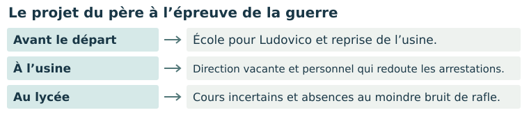
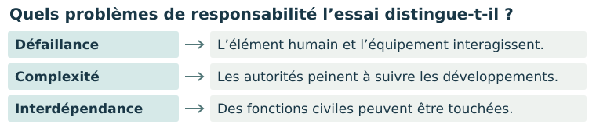
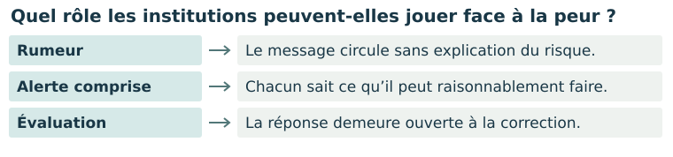

# X · MP-PC · Italien 2006 — Corrigé brut

*Corrigé rédigé par IA, non officiel. Signalez toute erreur.*

**Rédaction** · GPT-6.2 Astra Ultra · vitesse non renseignée

Les deux cahiers durent chacun une heure trente, sans dictionnaire. La version se rédige en français. Les deux réponses au texte français se rédigent en italien. Le sujet donne à titre indicatif 120 à 150 mots pour la première et 180 à 200 pour la seconde.

## V. Version française

**Souvenirs**

Lorsque, à la fin de septembre, le père était parti pour Rome en emmenant Ludovico, il avait un projet précis en tête. Il enverrait son fils en classe dès la rentrée pour lui éviter de perdre son année et se consacrerait corps et âme à l’usine, dont la production avait été suspendue après le 8 septembre. Une fois que les machines tourneraient de nouveau à plein régime, il retournerait à Gravello chercher sa femme et ses filles.

Pour le moment, « elles » étaient bien là où elles se trouvaient, en sécurité, loin des bombes et de la faim.

Ce qui lui avait fait prendre cette décision, c’était son excessive confiance en lui-même, jointe à la conviction que son instinct et son inébranlable volonté viendraient, comme toujours, à bout de tous les obstacles. Cette fois, au contraire, dès son arrivée à Rome, ces obstacles s’étaient révélés former un réseau inextricable. À commencer par la recherche de quelqu’un qui accepterait la responsabilité de l’usine après la disparition de son directeur, soucieux de ne pas collaborer avec les Allemands. Mais personne n’avait voulu accepter une charge qui présentait tant d’inconnues. Après une quinzaine de jours de tentatives infructueuses, le père avait décidé de prendre lui-même la direction pour recommencer à produire ces quintaux de savon dont l’armée allemande semblait avoir le plus grand besoin. […]

Il n’avait pourtant pas prévu l’hostilité qui l’entourait. Si certains des anciens chefs d’atelier et des ouvriers les plus âgés se présentaient à l’heure au travail, la majorité de la main-d’œuvre, composée surtout de femmes depuis le début de la guerre, refusait de « collaborer ». Il suffisait de ne pas venir travailler, par crainte de se faire un jour emmener à l’improviste et expédier en Allemagne.

Ludovico, lui aussi, s’était révélé difficile à tenir. À l’école régnait le chaos et les professeurs manquaient. Le proviseur lui-même n’était en mesure ni d’assurer les cours ni de vérifier que les garçons y assistaient régulièrement. Il suffisait d’une alerte aérienne ou d’une rumeur de rafle pour que la moitié des élèves manque à l’appel du matin.

## 1. In che senso e perché lo sviluppo tecnologico richiede codici di condotta adeguati, secondo Delpech?

Secondo Delpech le innovazioni possono avere conseguenze molto più vaste di quelle previste da chi le introduce. A Cernobyl gli errori degli operatori si combinarono con difetti dell’impianto: attribuire tutto alla condotta individuale avrebbe impedito di capire l’incidente. Nel campo delle biotecnologie la rapidità e la complessità dei cambiamenti rendono difficile un controllo tempestivo da parte dei governi. Spetta quindi anche agli scienziati e agli industriali fissare regole che permettano di proseguire la ricerca in condizioni sufficientemente sicure. Lo spazio offre un altro esempio di interdipendenza. Servizi civili essenziali, come le comunicazioni, dipendono da infrastrutture che potrebbero essere messe in pericolo da un conflitto. Codici adeguati devono tenere conto di questi effetti collettivi prima che un incidente renda evidente quanto fosse limitata la capacità di prevederli.

*126 mots.*

## 2. Il ventunesimo secolo sarà il secolo della paura?

Non credo che un secolo debba ricevere il nome dell’emozione che domina i suoi primi anni. Chi ha vissuto la guerra fredda conosceva già il timore di una catastrofe mondiale. Oggi, tuttavia, un’immagine proveniente da molto lontano raggiunge in pochi minuti milioni di persone, spesso prima che qualcuno sappia spiegarne il contesto. La velocità della notizia favorisce la paura soprattutto quando le autorità nascondono ciò che ancora ignorano.

La stessa rete di comunicazioni può avere un effetto opposto. Se una piena minaccia una valle, le osservazioni raccolte a monte consentono di avvertire chi vive a valle. Affinché il messaggio sia utile, gli abitanti devono sapere da chi proviene, dove possono trovare aiuto e quando riceveranno un aggiornamento. La fiducia si costruisce nei giorni tranquilli, anche spiegando apertamente un falso allarme.

Perciò la mia risposta dipende meno dal numero dei pericoli che dalla capacità di affrontarli insieme. La paura segnala che qualcosa merita attenzione, ma diventa un cattivo criterio di governo quando sostituisce ogni confronto sui fatti. Un secolo capace di organizzare la solidarietà potrebbe conservare una memoria molto diversa da quella suggerita dalle sue prime paure.

*186 mots.*

Le récit italien provient de Nero è l’albero dei ricordi (2004). Les questions d’expression portent sur l’extrait de L’Ensauvagement (2005). Le rapport commun à la version et à l’expression italiennes est signé Laura Fournier Finocchiaro.

[Cahier de version](https://web.archive.org/web/20090320042100id_/http://www.imprimerie.polytechnique.fr:80/EnLignes/Files/06_Version.pdf#page=5) · [Cahier d’expression](https://web.archive.org/web/20090320034643id_/http://www.imprimerie.polytechnique.fr:80/EnLignes/Files/06_ExprEcrit.pdf) · [Rapport du jury](https://web.archive.org/web/20061208144551id_/http://www.imprimerie.polytechnique.fr/EnLignes/Files/06_Version_ExprEcrit_IT.pdf)
