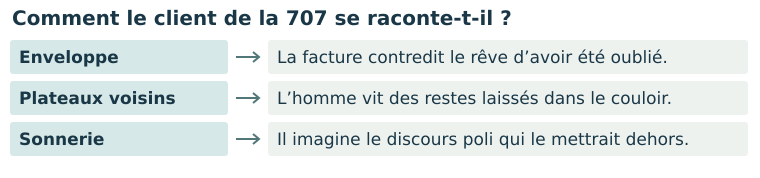
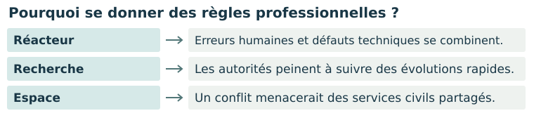
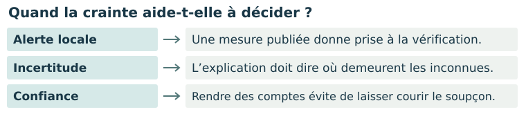

# X · MP-PC · Portugais 2006 — Corrigé brut

*Corrigé rédigé par IA, non officiel. Signalez toute erreur.*

**Rédaction** · GPT-6.2 Astra Ultra · vitesse non renseignée

Les deux cahiers durent chacun une heure trente, sans dictionnaire. La version se rédige en français. Les deux réponses au texte français se rédigent en portugais. Le sujet donne à titre indicatif 120 à 150 mots pour la première et 180 à 200 pour la seconde.

## V. Version française

**Un client un peu particulier**

En entrant dans ma chambre, j’ai trouvé l’enveloppe qu’on avait glissée sous la porte. Elle contenait une carte de la direction des hôtels Plaza qui me rappelait que cela faisait cent jours que je logeais là, avec en annexe la facture, que je n’ai même pas voulu regarder. J’en étais venu à croire qu’on m’avait oublié, d’autant que les commandes que je passais au service d’étage n’arrivaient plus jamais. Comme le directeur, lui non plus, n’était pas revenu me voir, je supposais même que mon nom, avec la chambre 707, s’était effacé de la mémoire de l’ordinateur de l’hôtel. Les chasseurs me tournaient le dos, les portiers ne m’ouvraient pas les portes. À la réception, peut-être ne comprenait-on pas bien qui était ce client, de quelle fichue chambre il sortait et dans laquelle il rentrait chaque jour. Mais à partir de ce moment-là, j’ai jugé bon de suspendre mes sorties. Mes promenades se limitaient à l’intérieur de la chambre et je n’avais rien d’autre à faire de toute la journée. J’avais déjà griffonné tout le papier à lettres, je n’avais plus envie de dessiner. Une seule fois, j’avais allumé machinalement la télévision, mais je l’avais éteinte dès que j’avais entendu le petit air nerveux du journal télévisé. Je ne me servais pas du téléphone, je n’allumais plus ma lampe de chevet, la 707 vivait dans le noir. Je ne donnais pas de travail aux femmes de chambre, je n’avais pas de linge à laver, je vivais tout nu, et le carton *do not disturb* pendait en permanence à la poignée. Je prenais mes repas à des heures incertaines, parfois une cuisse de poulet, des légumes, parfois du riz, parfois un quignon de pain avec un fond de sauce Stroganov. Selon les plateaux que les voisins laissaient dans le couloir, je pouvais même me régaler d’un fromage français, d’un demi-verre de vin avec une trace de rouge à lèvres sur le bord. Et un soir que j’étais bien tranquille, en train de siroter un whisky un peu trop allongé d’eau, le téléphone s’est mis à sonner. Il a sonné une dizaine de fois de suite, s’est tu, a recommencé. J’ai bien pensé que ce pouvait être Álvaro, mais pour régler une dette, personne n’insiste à ce point. Ce devait bel et bien être la direction des hôtels Plaza, car la haute saison commençait, nous affichons complet, vous voudrez bien nous excuser, monsieur, un couple d’Argentins vient d’arriver, il nous faut libérer la 707. Mais je ne prendrais pas l’appel. Je faisais le mort.

*Chico Buarque, Budapest, 2003.*

## 1. Em que sentido e por que motivos, segundo a autora, o desenvolvimento tecnológico exige códigos de conduta adequados?

Segundo Delpech, a dependência das sociedades em relação à tecnologia cresce mais depressa que a capacidade de acompanhar seus efeitos. Em Tchernóbil, atribuir o desastre apenas aos operadores permitia ocultar defeitos do próprio reator. A demora em esclarecer as responsabilidades também abalou a confiança muito além das fronteiras soviéticas. Na pesquisa biotecnológica, um resultado imprevisto pode revelar um perigo que nem os especialistas haviam antecipado. Como os governos dificilmente acompanham todas as experiências, cabe aos pesquisadores e às empresas estabelecer regras que permitam trabalhar com segurança. No espaço, por sua vez, uma decisão militar poderia prejudicar redes das quais dependem as comunicações civis. Os códigos de conduta devem levar em conta justamente quem fica exposto às consequências sem ter participado da decisão. Sua necessidade decorre tanto da complexidade técnica quanto do alcance coletivo dos riscos.

*135 mots.*

## 2. O século XXI será o século do medo?

Imagine uma cidade onde o rio costuma transbordar. Numa noite de chuva, uma moradora ouve que o nível da água subiu. Se puder consultar a medição feita perto de sua rua e souber quando virá o próximo boletim, a preocupação pode ajudá-la a tomar uma decisão sensata. Se receber apenas mensagens contraditórias, talvez passe a noite tentando adivinhar o que as autoridades esconderam. O rio é o mesmo nos dois casos. O que muda é a possibilidade de transformar um receio em pergunta e obter uma resposta que se possa conferir.

O século XXI tem meios extraordinários de fazer circular um aviso, mas também de repetir uma hipótese até que ela pareça um fato. Seria precipitado concluir que a velocidade da notícia determina sozinha nosso modo de viver. Uma associação de moradores que conhece o serviço responsável pelas medições e pode cobrar explicações depois de um erro já dispõe de alguma defesa contra o boato.

Haverá bons motivos para sentir medo. Chamar este século de século do medo dependerá de outra escolha, a de aceitar ou recusar instituições que tratem os cidadãos como interlocutores capazes de compreender a incerteza.

*189 mots.*

La version vient de Budapeste de Chico Buarque, paru en 2003. Le deuxième cahier donne un extrait de L’Ensauvagement de Thérèse Delpech, publié en 2005. Les réponses emploient le portugais du Brésil. Aucun rapport spécifique à cette composition portugaise n’a été retrouvé.

[Cahier de version](https://web.archive.org/web/20090320042100id_/http://www.imprimerie.polytechnique.fr:80/EnLignes/Files/06_Version.pdf#page=6) · [Cahier d’expression](https://web.archive.org/web/20090320034643id_/http://www.imprimerie.polytechnique.fr:80/EnLignes/Files/06_ExprEcrit.pdf)
