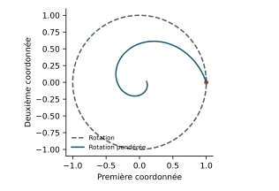

# École polytechnique MP — Deuxième composition de mathématiques 2006 · Corrigé guidé

*Corrigé rédigé par IA, non officiel. Signalez toute erreur.*

**Rédaction** · GPT-6.2 Astra Ultra · vitesse non renseignée

**Révision (tour 1)** · GPT-6.2 Astra Ultra · vitesse non renseignée · 26 novembre 2026

Une matrice réelle est dite s-positive lorsque sa forme quadratique est positive ou nulle. L’épreuve étudie sa résolvante, reconstruit la matrice à partir des identités de la résolvante, puis fait le lien avec le semi-groupe exponentiel.

## Première partie. Partie symétrique

### Question 1

> [!INDICATION]
> Transposer la décomposition puis prendre somme et différence.

#### Solution

Les matrices $A_s=(A+A^T)/2$ et $A_a=(A-A^T)/2$ ont les symétries voulues et somment à $A$. Dans toute telle décomposition, transposer donne $A^T=A_s-A_a$, donc ces deux formules sont imposées.

### Question 2

> [!INDICATION]
> Éliminer la partie antisymétrique dans la forme quadratique.

#### Solution

Le scalaire $x^TA_ax$ est égal à sa transposée $-x^TA_ax$, donc nul. Dans une base propre orthonormée de la symétrique réelle $A_s$, $(Ax|x)=\sum_j\mu_j x_j^2$. Cette quantité est positive ou nulle pour tout $x$ si et seulement si toutes les valeurs propres $\mu_j$ de $A_s$ sont positives ou nulles.

## Deuxième partie. La résolvante

### Question 3

> [!INDICATION]
> Prendre le produit scalaire avec un élément supposé dans le noyau.

#### Solution

Si $(\lambda I+A)x=0$, alors $0=\lambda\|x\|^2+(Ax|x)\ge\lambda\|x\|^2$ avec $\lambda>0$. D’où $x=0$, et la matrice carrée est inversible.

### Question 4.a

> [!INDICATION]
> Utiliser le carré de la rotation infinitésimale.

#### Solution

Ici $A^2=-I$, donc $\ker A=0$, $\operatorname{Im}A=\mathbb R^2$, et
$$R_\lambda=(\lambda I-A)/(1+\lambda^2)=\frac1{1+\lambda^2}\begin{pmatrix}\lambda&-1\\1&\lambda\end{pmatrix}.$$
Quand $\lambda\downarrow0$, $R_\lambda\to-A=A^{-1}$ et $\lambda R_\lambda\to0$.

### Question 4.b

> [!INDICATION]
> Isoler l’axe fixe et le plan sur lequel la matrice agit comme dans le premier exemple.

#### Solution

Le noyau est $\mathbb Re_2$ et l’image $\operatorname{Vect}(e_1,e_3)$. Sur ce plan, la matrice dans l’ordre $(e_1,e_3)$ est celle de 4.a ; sur l’axe elle est nulle. Ainsi
$$R_\lambda=\begin{pmatrix}\lambda/(1+\lambda^2)&0&-1/(1+\lambda^2)\\0&1/\lambda&0\\1/(1+\lambda^2)&0&\lambda/(1+\lambda^2)\end{pmatrix}.$$
Le coefficient $1/\lambda$ interdit une limite finie. En revanche $\lambda R_\lambda\to\operatorname{diag}(0,1,0)$.

### Question 5.a

> [!INDICATION]
> Développer les deux relations d’inversion.

#### Solution

Les égalités $(\lambda I+A)R_\lambda=R_\lambda(\lambda I+A)=I$ donnent $AR_\lambda=R_\lambda A=I-\lambda R_\lambda$.

### Question 5.b

> [!INDICATION]
> Insérer la différence des matrices avant inversion.

#### Solution

On a $R_\lambda-R_\mu=R_\lambda[(\mu I+A)-(\lambda I+A)]R_\mu=(\mu-\lambda)R_\lambda R_\mu$.

### Question 6

> [!INDICATION]
> Développer le carré de la norme et préciser quand son minimum sur la sphère est atteint.

#### Solution

Pour tout $y$, $\|(\lambda I+A)y\|^2=\lambda^2\|y\|^2+2\lambda(Ay|y)+\|Ay\|^2\ge\lambda^2\|y\|^2$. En posant $x=(\lambda I+A)y$ on déduit $\|R_\lambda\|\le1/\lambda$. Si $A$ est singulière, un $y\ne0$ du noyau réalise l’égalité. Réciproquement, le minimum de $\|(\lambda I+A)y\|$ sur la sphère unité est atteint par compacité ; si la norme de l’inverse vaut $1/\lambda$, ce minimum vaut $\lambda$. Les deux termes supplémentaires sont positifs ou nuls, donc $\|Ay\|^2=0$ pour un vecteur unitaire. Ainsi $\det A=0$.

### Question 7.a

> [!INDICATION]
> Remplacer un vecteur de l’image par Ay dans l’identité de la résolvante.

#### Solution

Pour $x=Ay$, $\lambda R_\lambda x=\lambda(I-\lambda R_\lambda)y$ par 5.a. Sa norme est au plus $2\lambda\|y\|$ par 6, d’où la limite nulle.

### Question 7.b

> [!INDICATION]
> Comparer le comportement de la résolvante multipliée par λ sur le noyau et sur l’image.

#### Solution

Si $x\in\ker A$, $(\lambda I+A)x=\lambda x$ donne $\lambda R_\lambda x=x$. Si $x$ est en outre dans l’image, 7.a donne $x=0$ à la limite. Les deux espaces ont donc intersection nulle et leurs dimensions somment à $n$ par la formule du rang. Ils sont supplémentaires.

### Question 7.c

> [!INDICATION]
> Décomposer tout vecteur dans la somme directe, puis contrôler une base finie.

#### Solution

Écrivons $x=x_0+x_1$ avec $x_0\in\ker A$, $x_1\in\operatorname{Im}A$. Alors $\lambda R_\lambda x\to x_0=Px$ pour le projecteur demandé. L’égalité sur une base orthonormée $e_j$ donne aussi la convergence en norme d’opérateur : $\|\lambda R_\lambda-P\|\le(\sum_j\|(\lambda R_\lambda-P)e_j\|^2)^{1/2}\to0$.

Dans ce cas le projecteur est même orthogonal. Pour $x\in\ker A$, $(A_sx|x)=0$ et $A_s$ est symétrique positive. En base propre cela impose $A_sx=0$, puis $A_ax=0$ et $A^Tx=(A_s-A_a)x=0$. Ainsi $\ker A\subset\ker A^T=(\operatorname{Im}A)^\perp$. Les dimensions sont égales par le théorème du rang, d’où l’égalité.

### Question 8

> [!INDICATION]
> Former le taux d’accroissement avec l’identité de la résolvante.

#### Solution

L’identité 5.b et la borne 6 donnent la continuité locale de $\Phi$. Puis $(R_{\lambda+h}-R_\lambda)/h=-R_{\lambda+h}R_\lambda\to-R_\lambda^2$. Ainsi $\Phi'=-\Phi^2$. Le produit de matrices est lisse, donc cette équation montre par récurrence que $\Phi$ est $C^\infty$. Comme $\Phi'$ commute avec $\Phi$, on obtient $\Phi^{(p)}=(-1)^pp!\Phi^{p+1}$ pour tout $p\ge0$.

## Troisième partie. Reconstruire la matrice

### Question 9

> [!INDICATION]
> Déduire la surjectivité du fait que le produit à gauche atteint une matrice inversible.

#### Solution

La relation (ii) pour $\mu=1$ donne $F(\lambda)[I+(\lambda-1)F(1)]=F(1)$. L’image du membre de droite est tout l’espace, donc celle de $F(\lambda)$ aussi. Ainsi $F(\lambda)$ est inversible en dimension finie.

### Question 10.a

> [!INDICATION]
> Multipliez l’identité abstraite à gauche et à droite par les inverses appropriés.

#### Solution

En multipliant (ii) à gauche par $F(\lambda)^{-1}$ et à droite par $F(\mu)^{-1}$, on obtient $F(\mu)^{-1}-F(\lambda)^{-1}=(\mu-\lambda)I$. La différence demandée vaut donc $(\lambda-\mu)I$.

### Question 10.b

> [!INDICATION]
> Soustraire le terme linéaire en λ.

#### Solution

Par 10.a la matrice $F(\lambda)^{-1}-\lambda I$ est indépendante de $\lambda$ ; notons-la $A=F(1)^{-1}-I$. Alors $F(\lambda)^{-1}=\lambda I+A$ et cette expression tend vers $A$ lorsque $\lambda\downarrow0$.

### Question 11

> [!INDICATION]
> Pour A, exploiter l’inégalité de norme pour tous les grands λ, au lieu d’en fixer un.

#### Solution

L’identité $AF(\lambda)=I-\lambda F(\lambda)$ et $\|\lambda F(\lambda)\|\le1$ donnent $(AF(\lambda)x|x)\ge\|x\|^2-\lambda\|F(\lambda)x\|\|x\|\ge0$. Pour $A$ lui-même, écrivant $y=F(\lambda)(\lambda I+A)y$, on obtient $\lambda\|y\|\le\|(\lambda I+A)y\|$. En élevant au carré et simplifiant, $2\lambda(Ay|y)+\|Ay\|^2\ge0$ pour chaque $\lambda>0$. Diviser par $2\lambda$ et faire tendre $\lambda$ vers l’infini donne $(Ay|y)\ge0$.

## Quatrième partie. Semi-groupe et transformation de Laplace

### Question 12

> [!INDICATION]
> Suivre la norme carrée le long d’une orbite exponentielle.

#### Solution

Si (i) vaut, pour $0\le s\le t$, la loi du semi-groupe donne $\|e^{-tA}x\|=\|e^{-(t-s)A}e^{-sA}x\|\le\|e^{-sA}x\|$, d’où (ii). La dérivée de la norme carrée vaut $-2(Ae^{-tA}x|e^{-tA}x)$. Si (ii) vaut, sa dérivée à droite en zéro est négative ou nulle, donc $(Ax|x)\ge0$ et (iii) suit. Si (iii) vaut, la même dérivée est partout négative ou nulle pour $t\ge0$, donc $\|e^{-tA}x\|\le\|x\|$ et (i) suit.

La loi utilisée pour passer d’un temps à l’autre découle des séries admises. Les séries de $e^{-sA}$ et de $e^{-hA}$ convergent absolument, et les puissances de la même matrice commutent. Au rang total $k$, leur produit de Cauchy a pour terme $(-A)^k\sum_{j=0}^k s^jh^{k-j}/(j!(k-j)!)=(-A)^k(s+h)^k/k!$. Ceci donne $e^{-sA}e^{-hA}=e^{-(s+h)A}$, sans décomposer $A$ en deux matrices qui devraient commuter.

### Question 13

> [!INDICATION]
> Borner un coefficient par la norme opératorielle.

#### Solution

L’exponentielle est continue en $t$. Par 12, $|(e^{-tA})_{ij}|=|(e_i|e^{-tA}e_j)|\le1$. Le facteur $e^{-\lambda t}$ est intégrable sur $[0,\infty)$, ce qui donne la convergence absolue de chaque intégrale de coefficient.

### Question 14

> [!INDICATION]
> Intégrer la dérivée du produit exponentiel sur un segment puis contrôler le bord à l’infini.

#### Solution

Posons $G(t)=e^{-\lambda t}e^{-tA}$. Alors $G'=-(\lambda I+A)G$. Sur $[0,T]$, $(\lambda I+A)\int_0^T G(t)dt=I-G(T)$. Comme $\|G(T)\|\le e^{-\lambda T}\to0$, on obtient $(\lambda I+A)\rho(\lambda)=I$, donc $\rho(\lambda)=R_\lambda(A)$.

L’intégrale sur $[0,T]$ approche la résolvante en norme avec une erreur contrôlée : la norme de la queue est au plus $\int_T^\infty e^{-\lambda t}\,dt=e^{-\lambda T}/\lambda$. Ce calcul justifie aussi le passage de l’identité matricielle tronquée à sa limite.

### Question 15

> [!INDICATION]
> Séparer les puissances paires et impaires de la matrice de rotation.

#### Solution

Puisque $A^2=-I$, les sous-séries absolument convergentes donnent $e^{-tA}=\cos(t)I-\sin(t)A$. Or $\int_0^\infty e^{-\lambda t}e^{it}dt=1/(\lambda-i)=(\lambda+i)/(1+\lambda^2)$ par intégration et décroissance du module au bord. En séparant parties réelle et imaginaire,
$$\rho(\lambda)=\frac{\lambda I-A}{1+\lambda^2}=R_\lambda(A),$$
ce qui retrouve 4.a.

