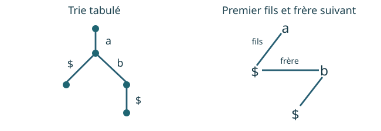

# X · MP · Informatique (option) 2006 — corrigé brut

*Corrigé rédigé par IA, non officiel. Signalez toute erreur.*

**Rédaction** · GPT-6.2 Astra Ultra · vitesse non renseignée · 25 novembre 2026

Langage choisi : OCaml. Les lettres ordinaires ont des indices de 1 à N. Le code 0 représente le terminateur dans le trie et l’espace à l’impression. Les mots fournis aux fonctions publiques ne portent pas le terminateur.

## I. Les deux sens de lecture d’un mot

### Question 1 · Imprimer un mot stocké à rebours

Émettre les caractères au retour des appels et produire un seul passage à la ligne après le parcours.

```ocaml
type mot = int list
let imprimer u =
  let rec ecrire = function
    | [] -> ()
    | x :: t -> ecrire t; lettre x
  in ecrire u; lettre (-1)
```

### Question 2 · Changer de sens

Transférer chaque tête vers un accumulateur. Le temps et le nombre de nouvelles cellules sont linéaires.

```ocaml
let inverseDe u =
  let rec inverse acc = function
    | [] -> acc
    | x :: t -> inverse (x :: acc) t
  in inverse [] u
```

## II. Trie à tableaux de fils

### Question 3 · États vides et cohérence

**a)** Le dictionnaire vide est `VideT`. Pour le singleton contenant le mot vide, former une racine dont seule la case 0 mène à un nœud terminal. Ce dernier a toutes ses cases vides.

```ocaml
type dictTab = VideT | NoeudT of dictTab array
let cases () = Array.make (n + 1) VideT
let terminal () = NoeudT (cases ())
```

**b)** Par définition, une branche terminale aboutit à une feuille et toute feuille termine la lecture d’un mot par le symbole spécial. Réciproquement, si les feuilles sont exactement les fils de rang zéro, tout chemin maximal fournit un mot de lettres ordinaires suivi d’une unique terminaison. Les indices du tableau assurent l’unicité d’une branche par lettre. Ces chemins définissent le dictionnaire représenté.

Ici `n` en OCaml est le cardinal $N$ de l’alphabet. Le $n$ mathématique de la question 11 désigne la longueur moyenne.

### Question 4 · Énumérer le dictionnaire

Transporter le préfixe à rebours et imprimer seulement si la case zéro est présente. Passer ce même préfixe aux autres branches, augmenté de leur lettre.

```ocaml
let imprimerDictTab d =
  let rec visite rev = function
    | VideT -> ()
    | NoeudT t ->
        if t.(0) <> VideT then imprimer rev;
        for a = 1 to n do
          if t.(a) <> VideT then visite (a :: rev) t.(a)
        done
  in visite [] d
```

### Question 5 · Appartenance tabulée

Descendre une case par lettre. Quand le mot est épuisé, vérifier que le préfixe est terminal.

```ocaml
let rec estDansDictTab u d = match d, u with
  | VideT, _ -> false
  | NoeudT t, [] -> t.(0) <> VideT
  | NoeudT t, a :: s -> estDansDictTab s t.(a)
```

### Question 6 · Insertion tabulée

Réutiliser les nœuds du préfixe commun. Dans une case manquante, allouer un nouveau tableau. À la fin, créer la feuille terminale seulement si nécessaire.

```ocaml
let rec ajoutADictTab u d =
  let t = match d with VideT -> cases () | NoeudT t -> t in
  (match u with
   | [] -> if t.(0) = VideT then t.(0) <- terminal ()
   | a :: s -> t.(a) <- ajoutADictTab s t.(a));
  NoeudT t
```

## III. Représentation premier fils, frère suivant

### Question 7 · Retirer la racine

La racine initiale ne porte aucune lettre puisque son arête entrante n’existe pas. Une fois la fratrie chaînée, elle possède au plus un lien utile, celui vers le premier enfant. Le conserver comme racine binaire suffit.

```ocaml
type dictBin = VideB | NoeudB of dictBin * int * dictBin
```

Le dictionnaire vide est `VideB`. Le dictionnaire réduit au mot vide est `NoeudB (VideB, 0, VideB)`.



### Question 8 · Énumération binaire

La descente à gauche consomme la lettre courante. La descente à droite essaie un frère avec le préfixe initial. Un nœud zéro provoque une impression et n’a aucun fils gauche.

```ocaml
let imprimerDictBin d =
  let rec visite rev = function
    | VideB -> ()
    | NoeudB (g,a,s) ->
        (if a = 0 then imprimer rev else visite (a :: rev) g);
        visite rev s
  in visite [] d
```

### Question 9 · Recherche dans des fratries non triées

La transition désirée vaut zéro après la dernière lettre. En cas de désaccord, passer au frère sans consommer de lettre. Seule la fin de la fratrie prouve l’absence.

```ocaml
let transition = function [] -> (0, []) | a :: s -> (a, s)
let rec estDansDictBin u = function
  | VideB -> false
  | NoeudB (g,a,b) ->
      let x,s = transition u in
      if a <> x then estDansDictBin u b
      else x = 0 || estDansDictBin s g
```

### Question 10 · Insertion binaire

Chercher la transition dans toute la chaîne. Si elle manque, fabriquer sa branche et le suffixe. Une marque terminale déjà présente rend l’ajout idempotent.

```ocaml
let rec ajoutADictBin u d =
  let x,s = transition u in
  match d with
  | VideB ->
      let g = if x = 0 then VideB else ajoutADictBin s VideB in
      NoeudB (g,x,VideB)
  | NoeudB (g,a,b) ->
      if a <> x then NoeudB (g,a,ajoutADictBin u b)
      else if x = 0 then d
      else NoeudB (ajoutADictBin s g,a,b)
```

## IV. Mémoire, temps et conversions

### Question 11 · Coût des deux représentations

**a)** Posons $M=n^5$ et comptons la racine du trie tabulé. Il y a $M$ feuilles terminales. Les autres sommets correspondent aux préfixes distincts, vide inclus. Chaque mot entier est un de ces préfixes et une branche au moins atteint la longueur $\lceil n\rceil$. Le total des longueurs vaut $Mn$. Ainsi $M+\max(M,1+\lceil n\rceil)\le S\le 1+M+Mn$ pour un dictionnaire non vide.

Pour relier ces bornes au partage, supposons $N\ge2$ fixé, $t=\lceil\log_N M\rceil\le n$ et $n$ entier. Choisir $M$ suffixes distincts de longueur $t$ après un même tronc de longueur $n-t$ donne $O(n+M)$ sommets, car le sous-arbre final tient dans $1+N+\cdots+N^t$. À l’inverse, choisir d’abord $M$ préfixes distincts de longueur $t$ puis leur ajouter à chacun $n-t$ lettres crée au moins $M(n-t)$ sommets supplémentaires. Comme $t=O(\log n)$, les ordres $n^5$ et $n^6$ sont atteints asymptotiquement.

Chaque nœud tabulé, feuille comprise, réserve $N+1$ cases, soit $(N+1)S$ liens. Le binaire contient $S-1$ nœuds ayant chacun deux liens et une étiquette. Les espaces sont donc $\Theta((N+1)S)$ et $\Theta(S)$ respectivement.

**b)** Le test tabulé coûte $O(\ell+1)$. Pour un ajout, si $a$ tableaux nouveaux sont alloués, le coût est $O(\ell+1+(N+1)a)$, avec $a\le\ell+2$. Pour le binaire, la fratrie a au plus $N+1$ nœuds. Recherche et ajout sont majorés par $O((N+1)(\ell+1))$ au pire.

### Question 12 · Du tableau à la fratrie

Pour chaque nœud tabulé, construire la chaîne des fils présents. Utiliser l’indice comme étiquette et convertir récursivement le sous-tableau en descendance gauche.

```ocaml
let rec tabVersBin = function
  | VideT -> VideB
  | NoeudT t ->
      let freres = ref VideB in
      for i = n downto 0 do
        if t.(i) <> VideT then
          freres := NoeudB (tabVersBin t.(i), i, !freres)
      done;
      !freres
```

### Question 13 · De la fratrie au tableau

Allouer un tableau pour chaque famille. Y répartir tous les frères par leur étiquette. Un nœud zéro doit engendrer un tableau-feuille, même avec un fils gauche absent.

```ocaml
let rec binVersTab = function
  | VideB -> VideT
  | famille ->
      let t = cases () in
      let rec remplir = function
        | VideB -> ()
        | NoeudB (g,a,b) ->
            t.(a) <- (if a = 0 then terminal () else binVersTab g);
            remplir b
      in remplir famille; NoeudT t
```

Chaque famille est reconstruite une seule fois. Le temps des deux conversions est $O((N+1)S)$ et la conversion ne passe pas par la liste des mots.

## V. Mots réalisables avec un chevalet

### Question 14 · Explorer seulement les préfixes réalisables

Compter les lettres du chevalet dans un tableau. Avant de descendre par $a$, décrémenter sa réserve, puis la rétablir après le retour. Produire le préfixe lorsqu’il se termine dans le dictionnaire.

```ocaml
let stock u =
  let h = Array.make (n+1) 0 in
  List.iter (fun a -> h.(a) <- h.(a) + 1) u; h
let choix h t f =
  for a = 1 to n do
    if h.(a) > 0 && t.(a) <> VideT then begin
      h.(a) <- h.(a) - 1; f a t.(a); h.(a) <- h.(a) + 1
    end
  done
let explorerMots d u produire =
  let h = stock u in
  let rec visite rev = function
    | VideT -> ()
    | NoeudT t ->
        if t.(0) <> VideT then produire rev;
        choix h t (fun a fils -> visite (a :: rev) fils)
  in visite [] d
let imprimerMotsDans d u = explorerMots d u imprimer
let motsDans d u =
  let resultats = ref [] in
  explorerMots d u (fun rev -> resultats := inverseDe rev :: !resultats);
  List.rev !resultats
```

La signature du sujet demande un affichage, sa phrase une liste. Les deux fonctions ci-dessus donnent ces sorties. Pour ne garder que les mots les plus longs, le rappel peut mémoriser le maximum rencontré et les mots l’atteignant, en vidant la collection à chaque nouveau maximum. Si $L=|u|$, $P$ est le nombre de préfixes réalisables visités et $E$ la taille de la sortie avec ses séparateurs, le coût vaut $O(L+N+(N+1)P+E)$, avec $P\le S$.

## VI. Anagrammes en plusieurs mots

### Question 15 · Repartir de la racine après un mot

Lorsque le préfixe courant est un mot non vide, deux choix sont indépendants. Le prolonger reste possible. Le terminer autorise un redémarrage à la racine si des lettres restent, ou l’impression de la phrase si le stock est épuisé.

```ocaml
let imprimerAnagrammes d u =
  let h = stock u in
  let rec visite reste entame rev = function
    | VideT -> ()
    | NoeudT t ->
        if entame && t.(0) <> VideT then begin
          if reste = 0 then imprimer rev
          else visite reste false (0 :: rev) d
        end;
        if reste > 0 then
          choix h t (fun a fils -> visite (reste-1) true (a :: rev) fils)
  in
  if u = [] then imprimer [] else visite (List.length u) false [] d
```

Le stock après chaque descente est exactement le multiensemble restant. Les fins de mots rencontrées décrivent toutes les coupures possibles d’un arrangement des lettres. Une suite de mots fixe ses lettres et ses coupures, donc n’est émise qu’une fois. Les facteurs doivent être non vides. Si l’on autorisait des facteurs vides répétés, toute solution donnerait une infinité de variantes, ce qui empêche une énumération finie complète.

Si $H$ compte les visites avec leurs différentes coupures et $E$ les symboles imprimés, le temps est $O(N+L+(N+1)H+E)$. Pour $L\ge1$, un préfixe de $j$ lettres a au plus $L!/(L-j)!$ arrangements et $2^j$ choix de coupures, redémarrage final compris. En sommant, $H=O(2^L L!)$. L’ordre peut être très élevé car les résultats distinguent aussi l’ordre des mots. Le long d’une branche, au plus $L$ lettres et $L-1$ espaces sont mémorisés, en plus du tableau de $N+1$ cases.

[Sujet](https://www.wikiprepa.fr/concours/data/x_option-info_mp_2006.pdf) · [Rapport](https://www.doc-solus.fr/prepa/sci/adc/pdf/rapports.pdf/2006/MP_INFO_X_1_2006.rapport.pdf) · [Autre exemplaire](https://www.doc-solus.fr/prepa/sci/adc/pdf/enonces.pdf/2006/MP_INFO_X_1_2006.enonce.pdf)
