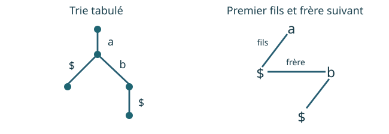

# X · MP · Informatique (option) 2006 — corrigé guidé

*Corrigé rédigé par IA, non officiel. Signalez toute erreur.*

**Rédaction** · GPT-6.2 Astra Ultra · vitesse non renseignée · 25 novembre 2026

Langage choisi : OCaml. Les lettres ordinaires ont des indices de 1 à N. Le code 0 représente le terminateur dans le trie et l’espace à l’impression. Les mots fournis aux fonctions publiques ne portent pas le terminateur.

## I. Les deux sens de lecture d’un mot

### Question 1 · Imprimer un mot stocké à rebours

Pour la liste $[1,2,3]$, la descente empile 1 puis 2 puis 3. La remontée écrit 3, 2, 1, soit « cba ». Appliquer le saut de ligne seulement après que toutes les lettres ont été émises.

```ocaml
type mot = int list
let imprimer u =
  let rec ecrire = function
    | [] -> ()
    | x :: t -> ecrire t; lettre x
  in ecrire u; lettre (-1)
```

### Question 2 · Changer de sens

Le renversement du préfixe déjà lu est au sommet de l’accumulateur. Cette construction évite une concaténation coûteuse en fin de liste. Renvoyer l’accumulateur dès que la source est vide.

```ocaml
let inverseDe u =
  let rec inverse acc = function
    | [] -> acc
    | x :: t -> inverse (x :: acc) t
  in inverse [] u
```

## II. Trie à tableaux de fils

### Question 3 · États vides et cohérence

**a)** Un arbre absent ne contient aucun chemin. Pour reconnaître le mot de longueur zéro, il faut au contraire un chemin, réduit à sa branche terminale. Il faut donc deux nœuds, la racine et sa feuille de terminaison.

```ocaml
type dictTab = VideT | NoeudT of dictTab array
let cases () = Array.make (n + 1) VideT
let terminal () = NoeudT (cases ())
```

**b)** Regarder toutes les branches de rang zéro, puis toutes les feuilles. La première condition interdit qu’un mot continue après sa marque de fin. La seconde empêche d’atteindre une feuille sans cette marque. Dans un arbre fini ainsi formé, chaque chemin maximal se décode donc sans ambiguïté en un mot. Inversement, la construction du trie d’un ensemble de mots satisfait précisément ces deux conditions. L’arbre absent les vérifie trivialement.

Ici `n` en OCaml est le cardinal $N$ de l’alphabet. Le $n$ mathématique de la question 11 désigne la longueur moyenne.

### Question 4 · Énumérer le dictionnaire

En visitant le nœud de « a », le préfixe peut lui-même être un mot et avoir encore des prolongements. Le test terminal commande l’impression. La boucle sur les lettres commande la suite de la recherche indépendamment de ce test.

```ocaml
let imprimerDictTab d =
  let rec visite rev = function
    | VideT -> ()
    | NoeudT t ->
        if t.(0) <> VideT then imprimer rev;
        for a = 1 to n do
          if t.(a) <> VideT then visite (a :: rev) t.(a)
        done
  in visite [] d
```

### Question 5 · Appartenance tabulée

La présence du chemin de « a » dans le dictionnaire contenant seulement « ab » prouve que « a » est un préfixe. Pour savoir si « a » est un mot, regarder ensuite la case de terminaison.

```ocaml
let rec estDansDictTab u d = match d, u with
  | VideT, _ -> false
  | NoeudT t, [] -> t.(0) <> VideT
  | NoeudT t, a :: s -> estDansDictTab s t.(a)
```

### Question 6 · Insertion tabulée

À partir du dictionnaire vide, l’ajout du mot vide doit créer la racine et son unique feuille terminale. Lorsqu’on ajoute « ab » après « a », il faut préserver la case zéro de « a ». La fonction ci-dessous modifie les tableaux en place et renvoie la racine.

```ocaml
let rec ajoutADictTab u d =
  let t = match d with VideT -> cases () | NoeudT t -> t in
  (match u with
   | [] -> if t.(0) = VideT then t.(0) <- terminal ()
   | a :: s -> t.(a) <- ajoutADictTab s t.(a));
  NoeudT t
```

## III. Représentation premier fils, frère suivant

### Question 7 · Retirer la racine

La lettre est transférée de l’arête au nœud d’arrivée. La racine d’origine resterait donc sans étiquette et sans frère. Son fils gauche donne déjà accès à toute la liste de ses enfants. S’il n’existe aucun enfant, le résultat est vide.

```ocaml
type dictBin = VideB | NoeudB of dictBin * int * dictBin
```

Le dictionnaire vide est `VideB`. Le dictionnaire réduit au mot vide est `NoeudB (VideB, 0, VideB)`.



### Question 8 · Énumération binaire

Sur la figure, emprunter l’arête horizontale de la marque de fin vers b doit donner le mot « ab ». La marque de fin elle-même ne s’ajoute donc jamais aux lettres imprimées. Un frère peut suivre la marque.

```ocaml
let imprimerDictBin d =
  let rec visite rev = function
    | VideB -> ()
    | NoeudB (g,a,s) ->
        (if a = 0 then imprimer rev else visite (a :: rev) g);
        visite rev s
  in visite [] d
```

### Question 9 · Recherche dans des fratries non triées

Chercher une petite lettre peut exiger de dépasser une grande. La comparaison d’ordre ne fournit donc aucune condition d’arrêt. Une marque zéro rencontrée trop tôt s’examine comme tout autre frère inadéquat.

```ocaml
let transition = function [] -> (0, []) | a :: s -> (a, s)
let rec estDansDictBin u = function
  | VideB -> false
  | NoeudB (g,a,b) ->
      let x,s = transition u in
      if a <> x then estDansDictBin u b
      else x = 0 || estDansDictBin s g
```

### Question 10 · Insertion binaire

Après une égalité sur une lettre, seul le fils gauche doit changer. Après un désaccord, seule la chaîne de frères reste à explorer. Conserver systématiquement l’autre lien permet de maintenir les mots déjà présents.

```ocaml
let rec ajoutADictBin u d =
  let x,s = transition u in
  match d with
  | VideB ->
      let g = if x = 0 then VideB else ajoutADictBin s VideB in
      NoeudB (g,x,VideB)
  | NoeudB (g,a,b) ->
      if a <> x then NoeudB (g,a,ajoutADictBin u b)
      else if x = 0 then d
      else NoeudB (ajoutADictBin s g,a,b)
```

## IV. Mémoire, temps et conversions

### Question 11 · Coût des deux représentations

**a)** Séparer les $M=n^5$ dernières arêtes de terminaison. Il reste un sommet par préfixe distinct, y compris le préfixe vide. Chaque mot donne un préfixe distinct, et un mot de longueur au moins $\lceil n\rceil$ donne à lui seul $1+\lceil n\rceil$ préfixes. À l’autre extrême, attribuer une nouvelle arête à chaque caractère écrit coûte au plus $Mn$ arêtes ordinaires. En ajoutant racine et terminaisons on obtient $M+\max(M,1+\lceil n\rceil)\le S\le1+M+Mn$.

Pour relier ces bornes au partage, supposons $N\ge2$ fixé, $t=\lceil\log_N M\rceil\le n$ et $n$ entier. Choisir $M$ suffixes distincts de longueur $t$ après un même tronc de longueur $n-t$ donne $O(n+M)$ sommets, car le sous-arbre final tient dans $1+N+\cdots+N^t$. À l’inverse, choisir d’abord $M$ préfixes distincts de longueur $t$ puis leur ajouter à chacun $n-t$ lettres crée au moins $M(n-t)$ sommets supplémentaires. Comme $t=O(\log n)$, les ordres $n^5$ et $n^6$ sont atteints asymptotiquement.

Chaque nœud tabulé, feuille comprise, réserve $N+1$ cases, soit $(N+1)S$ liens. Le binaire contient $S-1$ nœuds ayant chacun deux liens et une étiquette. Les espaces sont donc $\Theta((N+1)S)$ et $\Theta(S)$ respectivement.

**b)** Le test tabulé fait un accès direct par lettre, puis un dernier pour la marque. L’ajout paie aussi l’initialisation de chacun des $a\le\ell+2$ tableaux nouvellement créés. Le coût est donc $O(\ell+1)$ pour le test et $O(\ell+1+(N+1)a)$ pour l’ajout. En binaire, on peut visiter $N+1$ frères à chaque transition du préfixe existant. Les deux opérations coûtent au pire $O((N+1)(\ell+1))$. Sur un suffixe à créer, chaque nouveau nœud binaire coûte seulement un temps constant.

### Question 12 · Du tableau à la fratrie

Une vraie feuille terminale a un tableau entièrement vide. Sa conversion comme liste de fils rend donc `VideB`, mais son père produit bien un nœud binaire d’étiquette zéro. On peut traiter les cases à rebours pour obtenir des frères en ordre croissant.

```ocaml
let rec tabVersBin = function
  | VideT -> VideB
  | NoeudT t ->
      let freres = ref VideB in
      for i = n downto 0 do
        if t.(i) <> VideT then
          freres := NoeudB (tabVersBin t.(i), i, !freres)
      done;
      !freres
```

### Question 13 · De la fratrie au tableau

Le dictionnaire vide et la descendance vide d’une marque de fin correspondent à deux cas différents. La racine absente devient `VideT`. À l’intérieur, la marque devient au contraire `terminal ()`, faute de quoi le mot disparaîtrait.

```ocaml
let rec binVersTab = function
  | VideB -> VideT
  | famille ->
      let t = cases () in
      let rec remplir = function
        | VideB -> ()
        | NoeudB (g,a,b) ->
            t.(a) <- (if a = 0 then terminal () else binVersTab g);
            remplir b
      in remplir famille; NoeudT t
```

Chaque famille est reconstruite une seule fois. Le temps des deux conversions est $O((N+1)S)$ et la conversion ne passe pas par la liste des mots.

## V. Mots réalisables avec un chevalet

### Question 14 · Explorer seulement les préfixes réalisables

Avec deux lettres a et une lettre b, le chemin « aa » reste possible après le premier a, mais « aaa » s’arrête faute de réserve. Quand une branche est terminée, restaurer le compteur permet à une branche sœur de réutiliser les mêmes lettres. Les copies d’une lettre identique ne sont jamais distinguées.

```ocaml
let stock u =
  let h = Array.make (n+1) 0 in
  List.iter (fun a -> h.(a) <- h.(a) + 1) u; h
let choix h t f =
  for a = 1 to n do
    if h.(a) > 0 && t.(a) <> VideT then begin
      h.(a) <- h.(a) - 1; f a t.(a); h.(a) <- h.(a) + 1
    end
  done
let explorerMots d u produire =
  let h = stock u in
  let rec visite rev = function
    | VideT -> ()
    | NoeudT t ->
        if t.(0) <> VideT then produire rev;
        choix h t (fun a fils -> visite (a :: rev) fils)
  in visite [] d
let imprimerMotsDans d u = explorerMots d u imprimer
let motsDans d u =
  let resultats = ref [] in
  explorerMots d u (fun rev -> resultats := inverseDe rev :: !resultats);
  List.rev !resultats
```

La signature du sujet demande un affichage, sa phrase une liste. Les deux fonctions ci-dessus donnent ces sorties. Pour ne garder que les mots les plus longs, le rappel peut mémoriser le maximum rencontré et les mots l’atteignant, en vidant la collection à chaque nouveau maximum. Si $L=|u|$, $P$ est le nombre de préfixes réalisables visités et $E$ la taille de la sortie avec ses séparateurs, le coût vaut $O(L+N+(N+1)P+E)$, avec $P\le S$.

## VI. Anagrammes en plusieurs mots

### Question 15 · Repartir de la racine après un mot

Avec le chevalet « aa » et les mots « a » et « aa », les deux réponses sont « a a » et « aa ». Terminer un mot n’efface donc pas l’autre possibilité. Empiler un espace seulement au redémarrage donne une séparation entre mots sans espace final. Pour le chevalet vide, la factorisation vide donne une ligne vide.

```ocaml
let imprimerAnagrammes d u =
  let h = stock u in
  let rec visite reste entame rev = function
    | VideT -> ()
    | NoeudT t ->
        if entame && t.(0) <> VideT then begin
          if reste = 0 then imprimer rev
          else visite reste false (0 :: rev) d
        end;
        if reste > 0 then
          choix h t (fun a fils -> visite (reste-1) true (a :: rev) fils)
  in
  if u = [] then imprimer [] else visite (List.length u) false [] d
```

Le stock après chaque descente est exactement le multiensemble restant. Les fins de mots rencontrées décrivent toutes les coupures possibles d’un arrangement des lettres. Une suite de mots fixe ses lettres et ses coupures, donc n’est émise qu’une fois. Les facteurs doivent être non vides. Si l’on autorisait des facteurs vides répétés, toute solution donnerait une infinité de variantes, ce qui empêche une énumération finie complète.

Si $H$ compte les visites avec leurs différentes coupures et $E$ les symboles imprimés, le temps est $O(N+L+(N+1)H+E)$. Pour $L\ge1$, un préfixe de $j$ lettres a au plus $L!/(L-j)!$ arrangements et $2^j$ choix de coupures, redémarrage final compris. En sommant, $H=O(2^L L!)$. L’ordre peut être très élevé car les résultats distinguent aussi l’ordre des mots. Le long d’une branche, au plus $L$ lettres et $L-1$ espaces sont mémorisés, en plus du tableau de $N+1$ cases.

[Sujet](https://www.wikiprepa.fr/concours/data/x_option-info_mp_2006.pdf) · [Rapport](https://www.doc-solus.fr/prepa/sci/adc/pdf/rapports.pdf/2006/MP_INFO_X_1_2006.rapport.pdf) · [Autre exemplaire](https://www.doc-solus.fr/prepa/sci/adc/pdf/enonces.pdf/2006/MP_INFO_X_1_2006.enonce.pdf)
