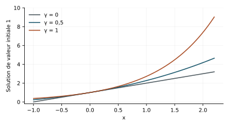

# École polytechnique MP — Première composition de mathématiques 2006 · Corrigé brut

*Corrigé rédigé par IA, non officiel. Signalez toute erreur.*

**Rédaction** · GPT-6.2 Astra Ultra · vitesse non renseignée

**Révision** · GPT-6.2 Astra Ultra · vitesse non renseignée

L’équation $f'(x)=f(\gamma x)$ change de comportement avec le facteur de dilatation. Sur la droite entière on étudie les itérations intégrales, puis des séries bilatères et des raccordements sur des intervalles géométriques.

## Première partie. Existence et unicité pour |γ| ≤ 1

### Question 1

Pour $\gamma=1$, $(e^{-x}f(x))'=0$. La condition initiale impose $f(x)=\alpha e^x$, qui vérifie le système.

### Question 2

Si $f'(x)=f(-x)$, le second membre est dérivable et $f''(x)=-f'(-x)=-f(x)$. On a $f(0)=f'(0)=\alpha$. L’unique candidat est donc $f(x)=\alpha(\cos x+\sin x)$. Sa dérivée vaut bien $\alpha(\cos x-\sin x)=f(-x)$, ce qui assure la réciproque.

### Question 3.a

Pour $|\gamma|\le1$, les termes sont majorés par $|\alpha||x|^n/n!$, d’où un rayon infini. La dérivation de la série entière ramène le terme de degré $n$ à $\alpha\gamma^{n(n+1)/2}x^n/n!$. C’est le terme de degré $n$ de la série évaluée en $\gamma x$, puisque $n(n+1)/2=n(n-1)/2+n$. La valeur initiale est $\alpha$.

### Question 3.b

Si $|\gamma|>1$ et $\alpha x\ne0$, le rapport des modules vaut $|x|\,|\gamma|^n/(n+1)\to\infty$. Le terme général ne tend pas vers zéro. La série ne définit alors pas de solution sur toute la droite ; pour $\alpha=0$ la série nulle reste une solution.

### Question 4.a

L’argument $\gamma t$ reste dans $[-A,A]$. L’intégration donne $|(T_Ag)(x)-(T_Ah)(x)|\le |x|\|g-h\|$, donc $\|T_Ag-T_Ah\|\le A\|g-h\|$. Les images sont continues, et $T_A$ est lipschitzienne, donc continue.

### Question 4.b

Si $f$ résout le système, intégrer $f'(t)=f(\gamma t)$ de $0$ à $x$ donne le point fixe sur chaque segment. Inversement, la relation de point fixe donne $f(0)=\alpha$, puis le théorème fondamental donne $f'(x)=f(\gamma x)$ à l’intérieur de chaque segment. Tout réel est intérieur à un tel segment.

### Question 4.c

Le cas $n=1$ est 4.a avant passage au supremum. Si la borne est vraie au rang $n$, la différence au rang $n+1$ est majorée par l’intégrale de $|\gamma|^{n(n-1)/2}|\gamma t|^n\|g-h\|/n!$ entre $0$ et $|x|$ (avec l’orientation adaptée). Elle vaut $|\gamma|^{n(n+1)/2}|x|^{n+1}\|g-h\|/(n+1)!$. La récurrence est établie.

### Question 4.d

On peut prendre $n(A)=\min\{n\ge1:A^n/n!<1\}$, bien défini car ces termes tendent vers zéro. Par 4.c, $k=A^{n(A)}/n(A)!<1$ majore le coefficient de Lipschitz de l’itérée (le facteur en $|\gamma|$ est au plus un).

### Question 4.e

Pour deux solutions, leurs restrictions $g,h$ à $[-A,A]$ vérifient $T_A^{n(A)}g=g$, $T_A^{n(A)}h=h$. Par 4.d, $\|g-h\|\le k\|g-h\|$ avec $k<1$, donc elles coïncident. Tout $A>0$ convient et l’existence est assurée en 3.a.

### Question 5.a

Les rangs zéro et un donnent $1+x$, tous les autres tendent vers zéro. La majorante sommable $|x|^n/n!$ permet le passage à la limite ; ainsi $f_\gamma(x)\to1+x$, expression qui définit $f_0$.

### Question 5.b

Notons $s_n=n(n-1)/2$. Pour $|\gamma|\le1$ et $|x|\le R$, le terme dérivé $p$ fois en $\gamma$ et $q$ fois en $x$ est nul si $p>s_n$ ou $q>n$. Sinon son module est au plus $(1+n^2)^p R^{n-q}/(n-q)!$. La série de ces majorants converge pour chaque $p,q,R$. Toutes les séries de dérivées mixtes convergent donc normalement sur les rectangles compacts et la série définit une fonction $C^\infty$ conjointement, au sens de dérivées continues jusqu’aux bords $\gamma=\pm1$.

### Question 5.c

Pour $x\ge0$, la série a des termes positifs ou nuls et $f_\gamma(x)\ge1+x$, donc sa limite en $+\infty$ est $+\infty$. Pour $-1\le x<0$, les modules successifs $a_n=\gamma^{n(n-1)/2}|x|^n/n!$ décroissent, car leur rapport est $\gamma^n|x|/(n+1)\le1$ lorsque $\gamma>0$. Ainsi $f_\gamma(x)\ge1+x\ge0$ ; en $x=-1$ et $\gamma>0$, la paire $a_2-a_3$ est strictement positive et les suivantes sont positives ou nulles. Pour $\gamma=0$, $f_0=1+x$, nul seulement en $-1$. Enfin $f_\gamma'(x)=f_\gamma(\gamma x)$ est strictement positif sur $[-1,+\infty)$, également pour $\gamma=0$. Toutes les fonctions considérées sont donc strictement croissantes.

## Deuxième partie. Séries bilatères pour γ > 1

### Question 6

Pour $n\in\mathbb Z$, imposons $\gamma^n c_n=c_{n-1}$. La formule $c_n=c_0\gamma^{-n(n+1)/2}$ résout cette relation aux rangs positifs et négatifs. Les deux séries pondérées (i) convergent, car leurs termes ont une décroissance quadratique dans l’exposant, qui domine tout facteur $\gamma^{Cn}$. Pour $x\le0$, $|e^{\gamma^nx}|\le1$ ; les séries de fonctions et de leurs dérivées convergent normalement grâce à $\sum |c_n|<\infty$ et $\sum |c_n|\gamma^n<\infty$. Ainsi $\varphi'(x)=\sum_n c_{n-1}e^{\gamma^nx}=\varphi(\gamma x)$, avec dérivée à gauche en zéro.

Plus explicitement, pour $n\ge0$, les deux termes pondérés de (i) valent $|c_0|\gamma^{(-n^2+n)/2}$ et $|c_0|\gamma^{(-n^2+3n)/2}$. Le rapport de deux termes consécutifs tend vers zéro dans les deux cas.

### Question 7

Pour $c_0=1$, $H=\sum_{n\in\mathbb Z}\gamma^{-n(n+1)/2}$ est fini et strictement positif. En prenant $c_0=\alpha/H$ dans 6, on obtient $\varphi(0)=\alpha$ tout en conservant l’équation.

### Question 8

Pour $x\ge0$, prenons cette fois $c_n=c_0(-1)^n\gamma^{-n(n+1)/2}$ ; alors $-\gamma^nc_n=c_{n-1}$. Les mêmes majorations assurent la convergence normale des termes $c_ne^{-\gamma^nx}$ et de leurs dérivées et donnent $\varphi'=\varphi(\gamma\cdot)$. En zéro, les termes de rangs $n$ et $-n-1$ ont même module et signes opposés, de sorte que $\varphi(0)=0$ quel que soit $c_0$. La normalisation de 7 ne procure donc ici que la donnée initiale nulle.

Pour $c_0\ne0$, cette annulation n’impose pas que la fonction soit identiquement nulle. En effet, si elle l’était, la mesure finie $\sum c_n\delta_{e^{-\gamma^n}}$ sur $[0,1]$ aurait tous ses moments nuls (évaluer $\varphi$ aux entiers naturels). Par approximation polynomiale elle annulerait toute fonction continue ; une fonction à support dans un petit voisinage de $e^{-1}$ isolant cet atome donnerait $c_0=0$, contradiction.

La même séparation des atomes établit la nécessité de la récurrence dans cette classe de séries. Posons $d_n=-\gamma^nc_n-c_{n-1}$. Les conditions (i) assurent $\sum_{n\in\mathbb Z}|d_n|<\infty$. L’équation différentielle entraîne $\sum_n d_n(e^{-\gamma^n})^m=0$ pour tout entier $m\ge0$. L’approximation polynomiale et l’isolement de chaque atome imposent chaque $d_n=0$. Toutes les suites admissibles sont donc celles trouvées ci-dessus. Elles donnent exclusivement la donnée initiale zéro.

## Troisième partie. Une solution à partir d’un intervalle fondamental

### Question 9

L’équation améliore d’un ordre la régularité, donc $f$ est $C^\infty$. En différenciant $n-1$ fois, $f^{(n)}(x)=\gamma^{n-1}f^{(n-1)}(\gamma x)$. En itérant $k$ fois, la somme des exposants est $(n-1)+\cdots+(n-k)=kn-k(k+1)/2$. On obtient l’identité demandée, également pour $k=0$.

### Question 10

Pour $y\in I^{(p+1)}$, l’équation impose $f(y)=f'_{(p)}(y/\gamma)$ à partir de la restriction précédente. Pour $x\in I^{(p-1)}$, elle impose $f(x)=f(\gamma^p)+\int_{\gamma^p}^x f_{(p)}(\gamma t)\,dt$. Ainsi la donnée sur $[1,\gamma]$ détermine successivement tous les morceaux supérieurs et inférieurs, donc la solution entière sur $(0,\infty)$. L’application $\Psi$ est injective.

### Question 11

La condition est
$$g^{(n+1)}(1)=\gamma^n g^{(n)}(\gamma)\quad(n\ge0).$$
Elle est nécessaire par 9 avec $k=1$. Pour la suffisance, construisons les morceaux vers la droite par $g_{p+1}(x)=g_p'(x/\gamma)$, avec $g_0=g$. Au premier raccord $x=\gamma$, les dérivées à droite sont $\gamma^{-n}g^{(n+1)}(1)$, celles à gauche $g^{(n)}(\gamma)$, égales par hypothèse. Les mêmes identités de jets se transmettent à chaque nouveau raccord par dérivation et changement d’échelle. Vers la gauche, utiliser les primitives de 10. La valeur est raccordée par construction et, pour $n\ge1$, la dérivée à gauche du nouveau morceau au raccord $c$ vaut $\gamma^{n-1}g_p^{(n-1)}(\gamma c)$, égale à $g_p^{(n)}(c)$ par le même accord des jets. Cette propriété se propage encore par la formule de primitive. Les raccords n’ont aucune accumulation dans $(0,\infty)$ ; on obtient une fonction $C^\infty$ qui vérifie l’équation sur chaque intervalle puis aux raccords par continuité.

Pour suivre le raccord vers la droite d’un cran, posons $b=\gamma a$ et supposons $g_p^{(n+1)}(a)=\gamma^n g_p^{(n)}(b)$ pour tout $n$. Sur $[b,\gamma b]$, le morceau $h(x)=g_p'(x/\gamma)$ vérifie $h^{(n+1)}(b)=\gamma^{-n-1}g_p^{(n+2)}(a)=g_p^{(n+1)}(b)=\gamma^n h^{(n)}(\gamma b)$. La condition se transmet donc exactement avec les mêmes puissances.

### Question 12.a

Par 9 pour $k=n=p$, $f_{(-p)}^{(p)}(x)=\gamma^{p(p-1)/2}f_{(0)}(\gamma^p x)$ sur $I^{(-p)}$. En $x=\gamma^{-p}$, pour $k<p$, $f^{(k)}(\gamma^{-p})=\gamma^{k(k-1)/2}f(\gamma^{k-p})=0$ par l’hypothèse de la question.

### Question 12.b

La formule de Taylor à l’ordre $p-1$ en $\gamma^{-p}$ ne laisse que son reste intégral par 12.a. On obtient $f_{(-p)}(x)=q_p\int_{\gamma^{-p}}^x(x-t)^{p-1}f_{(0)}(\gamma^p t)\,dt$ avec $q_p=\gamma^{p(p-1)/2}/(p-1)!$.

### Question 12.c

Évaluer 12.b en $x=\gamma^{1-p}$ donne zéro, puisque $p\ge1$. Par $u=\gamma^p t$, on tire $0=q_p\gamma^{-p^2}\int_1^\gamma(\gamma-u)^{p-1}f_{(0)}(u)\,du$. Le facteur est non nul, d’où l’annulation de l’intégrale pour tout $p\ge1$.

### Question 12.d

Les puissances de $\gamma-u$ engendrent les polynômes en $u$. Par 12.c, $\int_1^\gamma P(u)f_{(0)}(u)\,du=0$ pour tout polynôme $P$. Par Weierstrass, on peut prendre une suite $P_n$ tendant uniformément vers la fonction réelle continue $f_{(0)}$. En passant à la limite, $\int_1^\gamma f_{(0)}(u)^2du=0$. La continuité impose $f_{(0)}=0$, puis $f=0$ par injectivité de $\Psi$.
