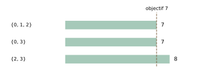
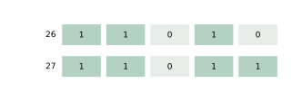
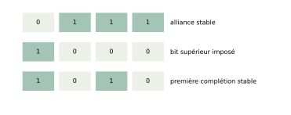

# École polytechnique · PSI et PT · Informatique 2006 · Corrigé guidé

*Corrigé rédigé par IA, non officiel. Signalez toute erreur.*

**Rédaction** · GPT-6.2 Astra Ultra · vitesse non renseignée · 25 novembre 2026

**Alliance d’entreprises.** Le langage choisi est Python. Le nombre d’entreprises `n` est une constante globale, les chiffres d’affaires sont strictement positifs et l’objectif est atteignable. Dans la partie III, le tableau des montants est trié dans l’ordre croissant.

## Repères

Une alliance stable est minimale pour l’inclusion. Sa stabilité ne lui impose pas d’avoir le plus petit nombre de membres parmi toutes les alliances possibles. En partie III, noter le solde et la signification des bits après chaque ajout ou retrait.

## I · Alliances

### Question 1 · Additionner les chiffres d’affaires sélectionnés

**Indication.** La case de l’entreprise i indique si son montant entre dans la somme.

#### Solution

```python
def somme(c, a):
    total = 0
    for i in range(n):
        if a[i]:
            total += c[i]
    return total
```

La somme vide vaut 0. La boucle visite les $n$ entreprises une fois, donc coûte $\Theta(n)$ en temps et $O(1)$ en espace auxiliaire.

### Question 2 · Décider si l’alliance réussit

**Indication.** Le seuil est inclus dans la définition. Une alliance atteignant exactement l’objectif réussit.

#### Solution

```python
def estReussie(c, a, Obj):
    return somme(c, a) >= Obj
```

L’appel de la question 1 calcule le montant global une seule fois. Le test qui suit est constant, donc le coût total reste $\Theta(n)$.

### Question 3 · Décider si l’alliance est stable

**Indication.** Quelle est la plus grande somme que peut encore avoir un sous-ensemble strict de l’alliance ?

#### Solution

```python
def estStable(c, a, Obj):
    total = somme(c, a)
    if total < Obj:
        return False
    for i in range(n):
        if a[i] and total - c[i] >= Obj:
            return False
    return True
```

Une alliance réussie qui reste réussie après le retrait d’une entreprise n’est pas stable. Réciproquement, tout sous-ensemble strict omet au moins une entreprise et tous les chiffres sont positifs. Si le retrait d’une seule entreprise fait déjà échouer l’alliance, tous les sous-ensembles qui l’omettent échouent aussi. Le coût est $O(n)$ sans recalculer les sommes partielles.

### Question 4 · Obtenir une alliance stable de cardinal minimal

**Indication.** Le plus grand total réalisable avec k entreprises s’obtient en prenant les k derniers chiffres d’affaires du tableau trié.

#### Solution

```python
def allianceMin(c, Obj):
    i = n
    montant = 0
    while montant < Obj:
        i -= 1
        montant += c[i]
    for j in range(i, n):
        print(j, end=" ")
    print()
```

L’existence d’une solution assure l’arrêt avant tout dépassement d’indice. Si l’on a pris $k$ entreprises, les $k-1$ plus grandes ne suffisaient pas à la précédente étape. Aucune alliance à moins de $k$ membres ne peut donc réussir. En particulier, l’alliance affichée est stable et de cardinal minimal. Le temps est $O(n)$.



## II · Calcul des alliances stables

### Question 5 · Passer à l’alliance binaire suivante

**Indication.** Le bit de poids faible est en case zéro. Le premier zéro devient un et tous les uns de poids inférieur deviennent zéro.

#### Solution

```python
def suivanteDe(a):
    i = 0
    while i < n and a[i]:
        i += 1
    if i == n:
        return False
    for j in range(i):
        a[j] = False
    a[i] = True
    return True
```

La variation de la valeur binaire est $2^i-(2^i-1)=1$. Le tableau maximal, composé uniquement de uns, ne possède pas de successeur et reste inchangé. Le temps maximal est $O(n)$.



### Question 6 · Afficher les membres de l’alliance

**Indication.** Les valeurs du tableau sont des indicateurs. L’impression porte sur leurs indices.

#### Solution

```python
def imprimer(a):
    for i in range(n):
        if a[i]:
            print(i, end=" ")
    print()
```

Le tableau $(0,1,0,1,1)$ imprime les indices 1, 3 et 4 sur la même ligne. L’alliance vide produit une ligne vide. Le temps est $\Theta(n)$.

### Question 7 · Examiner toutes les alliances

**Indication.** Partir de l’alliance vide et tester aussi le dernier tableau avant de sortir.

#### Solution

```python
def imprimerStables(c, Obj):
    a = [False] * n
    while True:
        if estStable(c, a, Obj):
            imprimer(a)
        if not suivanteDe(a):
            break
```

Chaque entier de 0 à $2^n-1$ représente exactement une alliance et est testé exactement une fois. La somme calculée dans `estStable` visite toujours $n$ cases, et les opérations supplémentaires ont au plus le même ordre. Le temps est $\Theta(n2^n)$ et le tableau auxiliaire occupe $O(n)$ cases.

## III · Optimisation

### Question 8 · Préparer les sommes cumulées

**Indication.** La nouvelle somme préfixe se déduit de la précédente par une seule addition.

#### Solution

```python
def cumuls(c, t):
    cumul = 0
    for i in range(n):
        cumul += c[i]
        t[i] = cumul
```

On obtient $t[i]=c[0]+\cdots+c[i]$. Les chiffres d’affaires strictement positifs rendent les préfixes strictement croissants. Le coût est $\Theta(n)$.

### Question 9 · Compléter avec le plus petit préfixe suffisant

**Indication.** Pour éviter au maximum les bits forts, prendre le premier indice j dont le préfixe atteint le solde courant. Les indices nécessaires pour finir sont ensuite strictement plus petits.

#### Solution

En Python, la boîte `Obj = [solde]` permet de modifier le solde chez l’appelant. Pour un départ vide, on appelle la fonction avec `k = n-1`. Lorsque $k$ est déjà choisi, il est la plus petite entreprise fixée et seules les entreprises d’indice strictement inférieur restent libres.

```python
def completer(t, c, a, Obj, k):
    minimum = k if a[k] else n
    j = k - 1 if a[k] else k
    while Obj[0] > 0:
        while j > 0 and t[j - 1] >= Obj[0]:
            j -= 1
        a[j] = True
        Obj[0] -= c[j]
        minimum = j
        j -= 1
    return minimum
```

La précondition de faisabilité garantit au début de chaque tour un préfixe libre dont le montant atteint le solde. Le choix de $j$ donne $t[j-1]<\text{solde}\leqslant t[j]$, en posant $t[-1]=0$ mathématiquement. Un masque plus petit renonçant à $j$ ne pourrait pas réussir avec les entreprises disponibles. Si le solde reste positif après l’ajout, il vaut au plus $t[j-1]$. Le balayage ne repart jamais du dernier indice et coûte $O(n)$.

La stabilité vient du dernier ajout. Juste avant celui-ci l’objectif n’était pas atteint. Le dernier montant ajouté est le plus petit montant de l’alliance complétée, les entreprises étant triées. En retirer un autre diminue donc le total d’au moins autant.

### Question 10 · Préparer le prochain préfixe binaire

**Indication.** Annuler le premier bloc de uns à partir du plus petit indice sélectionné et restituer au solde les montants retirés.

#### Solution

```python
def prelude(t, c, a, Obj, i):
    k = i
    while k < n and a[k]:
        a[k] = False
        Obj[0] += c[k]
        k += 1
    return k
```

L’invariant est $\text{solde}=\text{objectif initial}-\sum_{a[j]}c[j]$. Au retour, les bits de rang inférieur à $k$ sont tous à zéro. Si $k<n$, le bit $k$ était nul et constitue le prochain bit à imposer à un. Si $k=n$, on a atteint la fin de l’énumération stable. Le tableau de préfixes `t` fait partie de la signature donnée et n’est pas nécessaire dans le corps de ce prélude.

### Question 11 · Imprimer les seules alliances stables dans l’ordre

**Indication.** Après le prélude, forcer le premier bit nul puis choisir le plus petit masque qui complète ce préfixe et atteint l’objectif.

#### Solution

```python
def imprimerAStables1(c, Obj):
    if Obj <= 0:
        imprimer([False] * n)
        return
    t = [0] * n
    cumuls(c, t)
    a = [False] * n
    solde = [Obj]
    i = completer(t, c, a, solde, n - 1)
    while True:
        imprimer(a)
        k = prelude(t, c, a, solde, i)
        if k == n:
            return
        a[k] = True
        solde[0] -= c[k]
        i = completer(t, c, a, solde, k)
```

Pour justifier le saut, notons $i$ le plus petit indice du masque stable courant. Tant que le premier bloc de uns $i,\ldots,k-1$ n’est pas dépassé, tout masque strictement supérieur conserve ces bits et les bits supérieurs et ajoute un ou plusieurs bits au-dessous de $i$. Il contient alors l’alliance courante comme sous-ensemble strict et ne peut être stable. La première autre possibilité est donc de garder les bits au-dessus de $k$, de mettre $k$ à un et de libérer tous les indices plus petits.

Les entreprises conservées au-dessus de $k$ ne réussissent pas seules, par stabilité de l’alliance précédente. Si le nouveau bit atteint l’objectif, son retrait rend donc l’alliance insuffisante et tout autre retrait enlève un montant au moins aussi grand. Sinon la complétion de la question 9 choisit le plus petit masque réalisable et stable. La faisabilité est assurée, puisque les entreprises du bloc précédent sont de nouveau disponibles et que le bit $k$ s’y ajoute. En cas de sortie par $k=n$, tout masque supérieur contient l’alliance précédente et aucun ne convient. Pour $K$ alliances imprimées, le calcul initial et les parcours coûtent $O(n(K+1))$ en temps, impression comprise, et $O(n)$ en mémoire.


