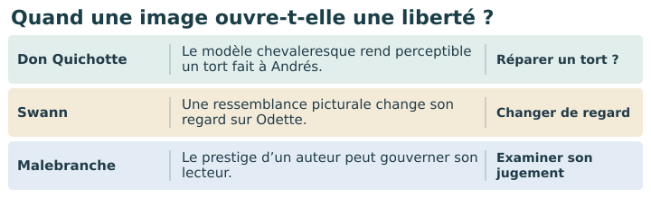

# Banque PT — Français A 2007 · Corrigé brut

*Corrigé rédigé par IA, non officiel. Signalez toute erreur.*

**Rédaction** · GPT-6.2 Astra Ultra · vitesse non renseignée

[Énoncé officiel](https://www.banquept.fr/documents/2007/francais_a_2007.pdf) · [Rapport du jury](https://www.banquept.fr/documents/ecrit/rapport/2007/rapport_fra_a_ecrit_2007.pdf) · [Programme officiel](https://www.education.gouv.fr/bo/2006/27/MENS0601476A.htm) · [Grille de la session](https://www.banquept.fr/documents/livret/2007/Livret_Rose_2007_1_2.pdf#page=12)

Épreuve de quatre heures sur « Puissances de l’imagination ». Miguel de Cervantès, Don Quichotte, volume I, chapitres 1 à 32 (traduction d’Aline Schulman) · Marcel Proust, Un amour de Swann · Nicolas Malebranche, De la recherche de la vérité, livre II, parties II et III.

## Sujet

Herbert Marcuse, Eros et civilisation (1955).

« La valeur authentique de l’imagination ne concerne pas seulement le passé mais aussi le futur : les formes de la liberté et du bonheur qu’elle évoque tendent à libérer de la réalité historique. C’est dans le refus d’accepter comme définitives les limitations imposées à la liberté et au bonheur par le principe de réalité, dans son refus d’oublier ce qui peut être que réside cette fonction critique de l’imagination. »

Les auteurs au programme vous semblent-ils vérifier une telle conception de l’imagination ?

## Dissertation

Quand Don Quichotte prononce devant les chevriers son discours sur l’âge d’or, de simples glands lui remettent en mémoire un temps où, dit-il, les hommes ignoraient le tien et le mien. Le souvenir d’un passé fabuleux devient une manière de faire entendre ce que le présent ne permet plus. Marcuse reconnaît précisément à l’imagination une « fonction critique ». En maintenant vivantes des formes de bonheur et de liberté que l’époque déclare impossibles, elle desserre l’emprise de ce qui existe sur l’idée de ce qui pourrait être. Mais celui qui refuse de confondre le réel et le possible risque aussi de prendre ses propres images pour une réalité à laquelle les autres devraient se plier. Que vaut donc ce refus, et pour qui peut-il devenir une liberté ?

Le premier mérite de l’imagination est de suspendre une évidence sociale. Celui que ses voisins connaissent comme un gentilhomme de la Manche pourrait demeurer ce que son bien, son âge et son ordinaire semblent lui prescrire. Ses lectures lui font entrevoir une autre manière de vivre et de valoir. Le cheval, l’équipement et le nom lui-même reçoivent un sens nouveau à partir de la figure du chevalier errant. Il serait peu satisfaisant de ne voir là qu’une suite de méprises amusantes. Les premiers chapitres donnent aussi à mesurer la pauvreté d’un monde où le seul droit de porter secours appartiendrait d’avance à ceux qui disposent d’une charge. L’imagination fait apparaître comme historiques, donc discutables, les limites d’une existence qui passaient pour naturelles. L’écart est comique aux yeux des voisins et déjà fécond pour le lecteur.

Swann porte sur Odette un regard que modifie une image peinte. Il prête attention à la ressemblance qu’il aperçoit entre elle et une figure de Botticelli. Le changement ne survient pas parce qu’Odette serait devenue plus conforme à un modèle ordinaire de beauté. En associant son visage à celui de la peinture, Swann devient sensible à ce qui lui échappait auparavant. Un objet du passé élargit ainsi le champ des rencontres possibles dans le présent. Il y a bien ici matière à donner raison à Marcuse. La réalité socialement définie d’une personne n’épuise pas les façons dont elle peut être regardée et aimée. Un autre bonheur devient pensable parce qu’un homme a pu déplacer ses habitudes de perception.

Le roman met toutefois cette première conclusion en péril. Est-ce Odette que Swann a rendue plus libre en l’apercevant sous les traits d’une figure admirée ? Ce rapprochement peut favoriser une rencontre. Il peut tout aussi bien enfermer une femme dans un rôle choisi sans elle. Lorsque Swann ne la trouve pas un soir chez les Verdurin, son absence occupe tout le champ du possible. Les lieux où elle pourrait être, les personnes avec qui elle pourrait passer sa soirée deviennent autant d’occasions d’inquiétude. La même disposition qui avait ouvert le monde le resserre autour d’une alternative dont il ne se délivre plus. Plus son imagination est féconde en possibles, moins il se sent libre de les laisser ouverts. L’association immédiate entre puissance d’imaginer et puissance de vivre heureux vient de se défaire.

Malebranche donne un nom au mécanisme par lequel un tel pouvoir pourrait même renforcer des contraintes historiques. La communication des imaginations fortes peut faire adopter à plusieurs ce qu’un seul représente avec éclat. Le prestige, le ton, la façon de rendre sensible une chose modifient l’assentiment de ceux qui écoutent ou lisent. Dans sa lecture de Montaigne, le philosophe demande quelle part du succès de l’auteur tient à la force avec laquelle il imprime à son lecteur ses manières et ses jugements. Il ne suffirait donc pas qu’une image soit neuve pour qu’elle soit critique. La personne qui croit s’être affranchie d’une opinion commune peut avoir adopté l’opinion d’une voix dont l’ascendant lui échappe. L’imagination est parfois le moyen par lequel un ordre établi se perpétue sans avoir à se justifier.

Le chevalier de Cervantès rencontre très tôt une épreuve de ce genre. Il voit un jeune domestique, Andrés, maltraité par son maître. Le tort est réel. L’ardeur à le secourir marque que Don Quichotte n’accepte pas comme définitif le pouvoir du plus fort. Mais il croit pouvoir se retirer dès que le maître a donné sa parole, comme si l’homme auquel il s’adresse reconnaissait le même code que lui. Le garçon demeure dépendant de celui qui l’emploie. Un récit de chevalerie avait rendu visible au passant une exigence de justice. Son incapacité à tenir compte des conditions réelles où vit Andrés empêche que cette liberté imaginée devienne celle du plus faible. La fonction critique ne saurait être jugée au seul sentiment de délivrance de celui qui imagine.

Une œuvre peut dès lors réaliser ce dont son personnage reste incapable. Cervantès donne assez de place aux objections de Sancho et aux conséquences des interventions du maître pour que le lecteur distingue l’idéal de secours et l’application mécanique d’un scénario. Proust suit assez longtemps l’histoire de Swann pour nous faire entendre que son jugement sur Odette change avec son désir. La distance ouverte par ces deux formes narratives est une liberté effective du lecteur. Il peut se détacher aussi bien de l’ordre qui juge ridicule tout idéal que de l’amoureux ou du chevalier qui rend son image incontestable. Cette liberté procède d’un travail de comparaison et de vérification. À cet égard la mise en garde de Malebranche conserve une place auprès de l’intuition de Marcuse.

Les œuvres justifient donc le conditionnel implicite de « ce qui peut être ». Elles font voir combien de possibilités un ordre historique ou une habitude personnelle tend à faire oublier. Mais elles mesurent aussi le prix d’une image qui écarte l’objection, la réponse de la personne aimée ou la parole du garçon laissé derrière soi. L’imagination exerce sa valeur critique lorsqu’elle maintient un possible assez ouvert pour que d’autres puissent le reconnaître, le contester et en éprouver la promesse à leur tour.

