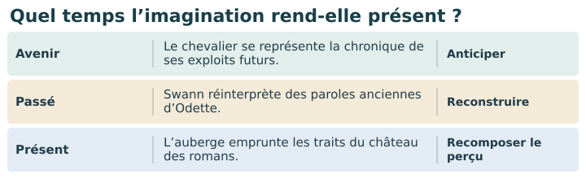

# Banque PT — Français B 2007 · Corrigé guidé

*Corrigé rédigé par IA, non officiel. Signalez toute erreur.*

**Rédaction** · GPT-6.2 Astra Ultra · vitesse non renseignée

[Énoncé officiel](https://www.banquept.fr/documents/2007/francais_b_2007.pdf) · [Rapport du jury](https://www.banquept.fr/documents/ecrit/rapport/2007/rapport_fra_b_ecrit_2007.pdf) · [Programme officiel](https://www.education.gouv.fr/bo/2006/27/MENS0601476A.htm) · [Grille de la session](https://www.banquept.fr/documents/livret/2007/Livret_Rose_2007_1_2.pdf#page=12)

Épreuve de quatre heures sur « Puissances de l’imagination ». Miguel de Cervantès, Don Quichotte, volume I, chapitres 1 à 32 (traduction d’Aline Schulman) · Marcel Proust, Un amour de Swann · Nicolas Malebranche, De la recherche de la vérité, livre II, parties II et III.

## Sujet

Nicolas Grimaldi, Bref traité du désenchantement, PUF, collection Perspectives critiques, 1998.

Le texte occupe les pages 1 à 4, de « Reine des facultés » à « ne peut pas être un objet ? ». La page 4 porte également les deux questions et leurs barèmes.

Vous résumerez ce texte en 200 mots plus ou moins 10% ; (8 points)

## Préparer le résumé

Retenez le paradoxe d’une faculté à laquelle rien ne résiste et qui peut pourtant nous asservir. L’exemple de l’officier déçu fait passer à une difficulté plus ordinaire que l’obsession. Trois pistes se dégagent ensuite, usure de la nouveauté, différence de nature entre imaginé et perçu, objet du désir impossible à posséder comme tel. Le décompte distingue les unités de chaque côté des apostrophes et des traits d’union.

## Résumé

Notre imagination nous montre un avenir composé selon nos désirs, que seul un délai séparerait du présent. Nous pouvons en modifier les moindres traits. L’ambitieux lui doit aussi bien ses projets que le plaisir de se croire envié. Cette souveraineté explique pourtant sa déraison. En grossissant les avantages et en supprimant les difficultés, elle nous persuade. Surtout, nous pouvons quitter des choses réelles qui nous déplaisent, tandis que certaines images nous obsèdent jusque dans la souffrance dont nous les nourrissons.

Mais voici une déception plus ordinaire. Même lorsque tout arrive conformément à notre attente, la joie attendue manque. Le même événement survenu par surprise aurait pu nous combler. Est-ce sa nouveauté qui fut usée par anticipation ? Il faudrait alors comprendre pourquoi le présent prévu semble appauvri.

Y aurait-il plutôt une erreur dans notre jugement ? Pourtant les caractères de la chose perçue sont bien ceux que nous avions imaginés. Si imaginer et percevoir diffèrent par nature, une illusion inévitable subsiste jusque dans la plus exacte prévision. Enfin faut-il chercher la difficulté dans le désir lui-même ? Peut-être ce qui nous meut vers son objet est-il tel que posséder cet objet ne puisse jamais nous satisfaire.

*200 mots.*

Cervantes, Malebranche et Proust, dans les œuvres au programme, considèrent-ils l’imagination comme une faculté essentiellement tournée vers l’avenir ?

## Préparer la dissertation

**Pourquoi faut-il discuter l’adverbe « essentiellement » ?**

Qu’une activité porte souvent sur le futur ne prouve pas que le futur la définisse. Cherchez une expérience imaginative dont le contenu est passé, puis une autre dont l’objet est actuel mais demeure absent ou mal perçu.

**Où séparer mémoire et imagination ?**

Swann se souvient de propos entendus. Il imagine ce qu’Odette pouvait faire ou vouloir dire à ce moment. Le retour aux mêmes mots peut ainsi produire une scène nouvelle.

**Quelle place donner au sujet philosophique ?**

Suivez chez Malebranche la communication présente d’une forte impression, puis le poids des dispositions acquises. Montrez pourquoi l’anticipation ne suffit pas à expliquer l’autorité qu’une voix exerce.

## Dissertation

Don Quichotte invente un nom pour son cheval, un autre pour lui-même, enfin une dame à laquelle il destine les exploits qu’il n’a pas encore accomplis. Qu’y a-t-il de plus manifestement tourné vers l’avenir que cette distribution des rôles avant le départ ? Pourtant les noms, les aventures attendues et les règles de conduite viennent d’ouvrages lus dans le passé. Et, dès que le chevalier est en chemin, ils changent ce qu’il croit voir au présent. Dire que l’imagination se tourne essentiellement vers l’avenir engage donc davantage que relever son rôle dans les projets ou les craintes. Il faut examiner si l’anticipation définit cette faculté, ou si elle est un emploi, particulièrement visible, d’un pouvoir qui transforme notre rapport à tous les temps.

L’avenir est assurément le champ où l’imagination semble disposer de ses objets avec la plus grande liberté. Don Quichotte ne pourrait pas changer d’un coup sa place dans la société de la Manche. Il peut en revanche se peindre les aventures que rencontrera un chevalier errant, la réputation qu’il acquerra et la chronique que l’on écrira de lui. Il en vient au début de sa première sortie à imaginer comment un historien futur décrira cette aube même. Le présent est ainsi vécu comme la première page d’un récit déjà composé par avance. Le futur donne à l’heure actuelle un relief qu’elle n’aurait pas sans cette projection. Nous saisissons ici le pouvoir que Grimaldi reconnaît à la représentation d’une vie possible. Elle commence par changer la valeur que nous accordons à la vie en cours.

Swann éprouve lui aussi l’attrait de ce qui n’a pas encore eu lieu. Longtemps il peut disposer de ses soirées comme il l’entend parce qu’il sait qu’il trouvera Odette chez les Verdurin. Ce que cette certitude lui procure est moins un plaisir actuel que la disponibilité d’une rencontre. Lorsqu’il arrive trop tard et ne la trouve plus, la soirée change brusquement de nature. Les différentes issues de sa recherche se chargent d’espoir ou de crainte. L’imagination a le pouvoir de faire dépendre le présent d’un événement encore incertain. Mais l’essentiel tient peut-être moins à la direction du temps qu’à l’absence d’une personne. Swann cherche à se représenter où se trouve Odette au moment même où il pense à elle. Il peut souffrir tout autant d’un présent qui lui échappe que d’un avenir qu’il redoute.

Cette remarque oblige à reconsidérer le rôle de la mémoire. La jalousie de Swann le ramène à des paroles anciennes dont il avait d’abord accepté le sens le plus simple. Un détail jusque-là insignifiant reparaît au voisinage d’un aveu ou d’une réticence, et l’ensemble change de signification. Swann essaie de se représenter une scène passée à laquelle il n’a pas assisté. Le fait qu’elle soit irrévocable peut précisément la rendre plus obsédante. Il n’a aucun avenir à modifier en imaginant ce qui s’est passé, et pourtant les images affluent. La mémoire lui rend les mots jadis entendus. Son imagination les rattache à d’autres actes possibles et prête à Odette des intentions qui n’avaient jamais fait partie de son souvenir. Cette distinction explique comment des images nouvelles peuvent avoir le passé pour seul objet.

Malebranche examine aussi les effets persistants de ce qui s’est imprimé en nous. Les habitudes, l’éducation, les lectures et le commerce des hommes ne laissent pas l’esprit également disposé à recevoir toutes les représentations. Celui qui a longtemps fréquenté certains livres et certaines manières de parler apporte déjà avec lui des associations qui lui semblent aller de soi. Étudier les imaginations fortes, dans le livre II de la Recherche de la vérité, c’est demander comment un discours en impose aujourd’hui par le ton de celui qui l’adresse et par les dispositions de celui qui l’écoute. On peut croire une chose fausse quant au présent sans former le moindre projet sur l’avenir. La communication d’une image, et parfois d’une erreur, oblige ainsi à considérer en même temps le dépôt du passé et la situation où une voix exerce son prestige.

Cervantès donne corps à ce mécanisme lorsqu’une auberge revêt pour Don Quichotte les caractères d’un château. Le chevalier n’attend pas d’un événement futur qu’il confirme le changement de décor. Il salue et s’adresse dès maintenant aux gens qu’il rencontre en leur prêtant les rôles que lui rend familiers sa lecture. Il a fallu du passé pour nourrir la vision, un désir pour l’animer et une circonstance présente pour la fixer sur tel objet. Que se passe-t-il si l’aubergiste accepte de jouer le rôle qu’on lui propose ? L’imagination fait réellement advenir un échange de paroles et une cérémonie que nul n’aurait prévus. Elle produit donc un avenir à partir d’une méprise sur le présent. Cette conséquence réelle ne fait pas rétrospectivement de l’anticipation sa seule opération.

Les œuvres montrent enfin que le propre de la représentation littéraire est de nous faire éprouver ces passages temporels. Lors de la soirée chez les Saint-Euverte, la petite phrase de Vinteuil rappelle à Swann ce que fut le temps où il espérait encore le bonheur avec Odette. Une perception présente ressuscite des attentes qui appartiennent à son passé. Un lecteur qui suivrait simplement la chronologie de la liaison ne reconnaîtrait pas ce singulier présent d’une espérance perdue. La phrase musicale fait remonter une ancienne manière d’imaginer l’avenir au moment où celui-ci a depuis longtemps déçu. Il n’existe plus ici de direction temporelle unique que l’on puisse assigner à l’imagination.

Le terme « essentiellement » se révèle donc trop restrictif. L’avenir attire l’imagination parce qu’il donne du jeu au choix et offre à la crainte comme au désir un vaste domaine. Pourtant le passé inobservé, le présent absent et la perception transformée sollicitent le même pouvoir. Ce que Proust, Cervantès et Malebranche conduisent à interroger est notre aptitude à éprouver la force d’une représentation en l’absence de son objet, ou malgré la présence d’un objet qui la contredit. L’avenir est l’un des lieux privilégiés de cette puissance, et parfois le résultat inattendu de son exercice.

