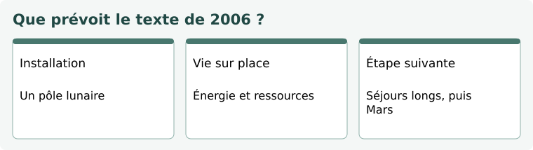
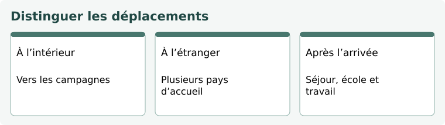
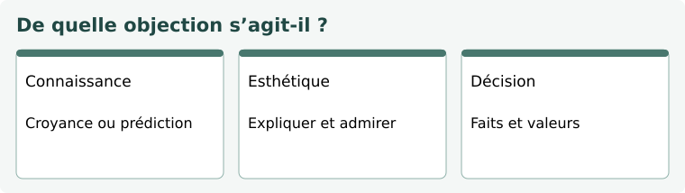
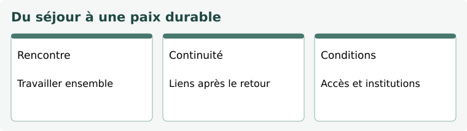

# Banque PT — Langue vivante A 2007 · Corrigé brut

*Corrigé rédigé par IA, non officiel.*

**Rédaction** · GPT-6.2 Astra Ultra · vitesse non renseignée

**Révision** · GPT-6.2 Astra Ultra · vitesse non renseignée

L’épreuve dure trois heures. Chaque candidat traite la langue choisie à l’inscription. La version française vaut 10 points. La question a demande 80 à 100 mots pour 4 points. La question b demande 200 à 250 mots pour 6 points.

[Sujet](https://www.banquept.fr/documents/2007/lv_a_2007.pdf) · [Index des rapports](https://www.banquept.fr/article153.html) · [Grille du livret](https://www.banquept.fr/documents/livret/2007/Livret_Rose_2007_1_2.pdf)

## Allemand

*Nasa-Entscheidung: 2024 soll die Mondbasis stehen*

### Version française

De « Mit einer internationalen Station » à « andere Ressourcen gewonnen werden können ».

Avec une station internationale sur la Lune, l’agence spatiale américaine, la NASA, entend faire progresser l’exploration de l’espace. La décision d’y construire une station permanente d’ici à 2024 a été prise après consultation de centaines de spécialistes de quatorze pays, a expliqué à Houston Shana Dale, porte-parole de la NASA, en présentant le projet.

Selon la NASA, la base lunaire doit servir de point de départ à la poursuite de l’exploration de l’Univers et à l’expansion de la civilisation humaine. On envisage déjà Mars comme prochaine étape. Alors que les missions Apollo des années 1960 s’étaient concentrées sur la région située entre les deux pôles de la Lune, la station projetée doit voir le jour à l’un de ces deux points fixes. On choisira probablement le pôle Sud, car la durée d’ensoleillement y est très importante, a déclaré Doug Cooke, membre de l’équipe chargée du programme. On aurait ainsi la possibilité d’utiliser l’énergie solaire. En outre, le sous-sol des environs pourrait receler des richesses.

La NASA cherche des partenaires

D’après les indications fournies, les premiers vols d’essai sont prévus pour 2009 et 2014. Six ans plus tard doit avoir lieu le premier alunissage d’un équipage de quatre personnes. Dans un premier temps, les astronautes ne devraient effectuer que de brefs séjours sur la Lune. D’ici à 2024, toutefois, l’avant-poste doit être suffisamment agrandi pour permettre des missions de six mois. La NASA espère qu’il sera possible de produire sur place de l’oxygène, de l’hydrogène et d’autres ressources pour approvisionner la station lunaire.

### Question a

*Die Mond-Pläne der Nasa haben mehrere Ziele. Erklären Sie, inwiefern die Ergebnisse dieser neuen Mondmission das Leben der Menschen verändern können.*

Die Mondstation könnte Menschen längere Aufenthalte außerhalb der Erde ermöglichen. Wenn die Besatzung vor Ort Wasser gewinnen und Sonnenenergie nutzen könnte, müsste sie weniger Material von der Erde mitbringen. Die Erfahrungen wären für eine spätere Reise zum Mars wertvoll. Auch die Zusammenarbeit verschiedener Länder würde sich ändern, weil sie Kosten, Kenntnisse und Verantwortung teilen müssten. Der Artikel erwähnt außerdem die mögliche wirtschaftliche Nutzung von Rohstoffen und sogar den Tourismus. Ob solche Vorhaben das Leben vieler Menschen verändern würden, hängt allerdings davon ab, wem ihre Ergebnisse zugutekommen.

**86 mots**

### Question b

*Die Wissenschaftler machen seit einigen Jahren große Fortschritte im Bereich der Technik und Eroberung des Weltraums. Wie stellen Sie sich in naher und ferner Zukunft das Leben im Weltraum vor?*

In naher Zukunft stelle ich mir das Leben im Weltraum vor allem als Arbeit in einer kleinen Gemeinschaft vor. Wer dort lebt, kann nicht einfach die Tür öffnen und spazieren gehen. Der Tag wird von gemeinsam geplanten Aufgaben bestimmt: Messungen durchführen, Geräte in Ordnung halten und auch für die nächste Mahlzeit sorgen. Gerade deshalb scheint mir wichtig, dass jedes Mitglied der Besatzung Zeit für sich und regelmäßigen Kontakt mit vertrauten Menschen auf der Erde hat.

In fernerer Zukunft könnten Stationen entstehen, in denen Menschen verschiedener Berufe längere Zeit miteinander leben. Dann wäre die Frage, wer über den gemeinsamen Alltag entscheidet, ebenso wichtig wie die technische Versorgung. Wenn eine Station Wasser nur in begrenzter Menge gewinnt, braucht sie Regeln, die auch diejenigen verstehen und mitbestimmen können, die keine Ingenieure sind. Außerdem müsste geklärt werden, wer für die Rückreise aufkommt, wenn jemand seinen Aufenthalt beenden möchte.

Ich glaube deshalb nicht, dass eine größere Siedlung allein durch leistungsfähigere Maschinen zu einem guten Wohnort wird. Sie braucht neben zuverlässiger Technik auch Vertrauen und Möglichkeiten, Konflikte auszutragen. Vielleicht wäre der wertvollste Ertrag solcher Versuche sogar auf der Erde zu finden: Wer gelernt hat, knappe Ressourcen in einem kleinen Lebensraum gerecht zu teilen, kann seine Erfahrungen auch zu Hause einbringen.

**204 mots**

## Anglais

*Surveillance is really getting under my skin*

### Version française

De « Take the new passport » à « it is that much easier to clone it ».

Prenons le nouveau passeport. Sous la pression des États-Unis, des pays du monde entier mettent en circulation un passeport muni d’une puce RFID qui transmet tous les renseignements figurant sur le document ainsi que votre photographie lorsqu’on le passe au lecteur à une frontière. Or ces nouveaux passeports du XXIe siècle pourraient bien être moins sûrs que ceux du XXe siècle.

Lors d’une expérience réalisée pour Suspect Nation, Adam Laurie, spécialiste de la sécurité, n’a mis qu’environ deux semaines à écrire un programme et à y adjoindre un lecteur permettant de lire n’importe quel nouveau passeport britannique sans même l’ouvrir.

La possibilité que votre passeport puisse être lu par quelqu’un qui n’aurait qu’à vous frôler avec un appareil semblable à celui de Laurie est évidemment inquiétante. […] La lecture des passeports à l’insu de leurs titulaires pourrait représenter une menace considérable, en particulier pour les personnes que des terroristes voudraient prendre pour cible en raison de leur nationalité ou qui pourraient constituer une proie lucrative pour des malfaiteurs.

La technologie utilisée dans la carte d’identité sera vraisemblablement très proche de celle du nouveau passeport. Certes, tous les renseignements que vous serez obligé de communiquer aux pouvoirs publics dans le cadre du projet de carte d’identité seront conservés dans une base de données centrale appelée Registre national d’identité. Mais notre expérience de lecture des passeports doit au moins nous amener à envisager la possibilité d’une usurpation d’identité. Une fois qu’on a pu lire quelque chose, il est d’autant plus facile d’en faire une copie à l’identique.

### Question a

*In what ways can RFID technologies be used to increase surveillance?*

In the article, RFID tags allow shops to keep track of goods, while a reader at a border can obtain identity details from a passport. A building pass can associate a person's identity with a visit. The proposed implants would take identification a step further by making the tag accompany its wearer wherever they went. The author worries about the connection between these separate checks and central records. Information supplied for one purpose could then be used to follow people in circumstances they had never agreed to.

**87 mots**

### Question b

*To what degree should new technologies be used to control people?*

I would give a public authority permission to use a new technology only if it can explain what particular problem it needs to solve and how people can challenge a mistake. Checking a passenger's identity at a border has a clear purpose. Keeping a permanent record of everyone who enters a public library would be much harder to justify. People should be able to read about a personal problem without wondering who might later examine their choices.

Consent matters, but it can be misleading. Someone who wants to keep a job may feel unable to refuse an electronic pass. An employer should therefore say what information is collected, when it is erased and who can inspect it. If a faulty record suggests that a worker was absent, that person needs a human contact who can correct the error before it affects their pay.

Finally, any measure that is introduced for an emergency should have an end date and an independent review. The review should ask whether the measure actually helped and whether a less intrusive one would have worked as well. A society gains little from collecting detailed information that nobody can use responsibly. I would draw the line where an ordinary person can no longer understand, question or reasonably avoid the scrutiny applied to everyday life.

**217 mots**

## Arabe

*وطن بلا شعب*

### Version française

De « لم تجد المنظمات الإنسانية » à « في المدارس والجامعات », soit le premier paragraphe.

Pour décrire la fuite des Irakiens à l’étranger en raison de la situation dramatique sur le plan de la sécurité, les organisations humanitaires n’ont trouvé qu’une expression, celle d’exode silencieux. Cet exode ne se déroule pourtant pas à l’insu du monde, qui le voit et l’entend. Mais il a lieu sans annonces, sans projecteurs ni couverture médiatique. D’après les chiffres du Haut-Commissariat des Nations unies pour les réfugiés, il y a actuellement à l’étranger plus de huit millions de réfugiés irakiens. À cela s’ajoutent plus de six millions de citoyens qui ont été contraints, à l’intérieur même du pays, de quitter leurs maisons, leurs villes et leurs villages pour rejoindre des camps rudimentaires dans les campagnes, fuyant les violences confessionnelles. Autrement dit, le nombre total des réfugiés irakiens à l’intérieur et à l’extérieur du pays est d’au moins quatorze millions dans un pays dont la population ne dépasse pas vingt-cinq millions d’habitants. Cela signifie que plus de la moitié du peuple irakien a dû se résoudre à émigrer ou à s’exiler volontairement, dans des conditions absolument inhumaines qui règnent dans le pays depuis le début de l’occupation américaine en avril 2003. Les Irakiens qui quittent leur pays pour la Syrie sont désormais plus d’un millier par jour. Ils viennent s’ajouter aux plus de mille personnes qui arrivent chaque jour en Jordanie, ainsi qu’à celles qui partent par avion vers d’autres pays ou qui gagnent l’Iran et la Turquie par voie terrestre. Le Haut-Commissariat estime à plus de cent mille le nombre de réfugiés irakiens en Égypte, malgré les difficultés qu’ils y rencontrent pour obtenir un titre de séjour, la rareté des emplois et les obstacles à l’inscription des enfants à l’école et à l’université.

### Question a

*بينوا الفكرة الأساسية للنص.*

يريد الكاتب أن يجعل القارئ يرى ما تخفيه عبارة الهجرة الصامتة من معاناة. فالخوف أجبر عائلات عراقية على ترك بيوتها، وبقي بعضها في مخيمات داخل البلاد، بينما قصد بعضها الآخر الدول المجاورة بحثا عن الأمان. ولم تنته الصعوبات عند الوصول، إذ يحتاج الناس إلى إقامة وعمل ومدارس لأبنائهم. ويقارن الكاتب بين اتساع الأزمة وضعف الاهتمام الدولي بها، وينتقد اجتماعات تهتم بالحكومة أكثر مما تهتم بالسكان. وهو يدعو إلى أن يجد العراقيون في البلدان العربية تضامنا يتيح لهم مواصلة حياتهم إلى أن تسمح الظروف بالعودة.

**84 mots**

### Question b

*هل مغادرة الوطن أثناء الحرب هو الحل الوحيد؟*

لا أعتقد أن هناك جوابا واحدا يصلح لكل أسرة أثناء الحرب. فمن يجد نفسه في خطر مباشر قد تكون المغادرة بالنسبة إليه الوسيلة المتاحة لحماية أطفاله، ولا يحق لمن يعيش في أمان أن يلومه على ذلك. وقد تبقى أسرة أخرى قرب أقارب يحتاجون إلى رعايتها، أو لأنها لا تملك الوثائق والمال اللازمين للسفر. لا يدل بقاؤها بالضرورة على أن المكان آمن، كما لا تدل المغادرة على ضعف الارتباط بالوطن.

هناك أيضا فرق بين أن يختار الإنسان مكان إقامته وأن يجد كل الأبواب مغلقة إلا بابا واحدا. فإذا توفرت داخل البلد خدمات أساسية ومأوى آمن ومدرسة تستقبل الأطفال، أمكن لبعض العائلات أن تنتقل مؤقتا إلى مدينة أخرى. أما حين تعجز هذه المؤسسات عن القيام بعملها، فينبغي أن تستطيع الأسرة طلب الحماية خارج الحدود وأن تجد من يستمع إليها ويحترم حقوقها. ولا معنى للحديث عن حرية الاختيار إذا كان أحد الخيارين يعرضها لخطر لا تطيقه.

يقع جزء من المسؤولية إذن على المجتمعات التي تستقبل النازحين واللاجئين. فإتاحة التعليم والعمل والرعاية تمنع الغياب المؤقت من أن يصبح ضياعا لسنوات كاملة. وحين يعود الاستقرار، يظل قرار العودة من حق من عاش التجربة، لأنه يعرف أحوال أسرته وحاجاتها. إن السؤال في رأيي ليس أي الطريقين أشجع، بل كيف نوسع مجال الاختيار ونحفظ للناس كرامتهم أينما اضطروا إلى العيش.

**203 mots**

## Espagnol

*La ciencia y sus adversarios culturales*

### Version française

De « La Ciencia tiene hoy abiertos » à « una floreciente tecnología ».

La science est aujourd’hui en conflit sur plusieurs fronts avec d’autres courants de la culture. Le plus notable est sans doute celui qui l’oppose à certains courants sociologiques et philosophiques actuels. On y affirme que « la connaissance scientifique n’est qu’un système de croyances dont le lien avec la réalité est douteux », qu’elle est « une simple construction culturelle », ou encore que « lorsqu’on élabore une vision du monde, rien n’oblige personne à tenir compte de ce que la science du XXe siècle a à dire ». Un peu plus et l’on accuserait les scientifiques de ne produire que de simples mythes. Face à tant de légèreté, on ne peut que souligner la capacité croissante de la science du XXe siècle à faire des prédictions et l’efficacité avec laquelle elle a donné naissance à une technologie florissante.

### Question a

*Analice Usted en este texto la relación que mantiene hoy la ciencia con los otros campos del saber y de la cultura en nuestras sociedades.*

El autor presenta dos conflictos distintos. Algunos pensadores reducen el conocimiento científico a una creencia elaborada por una cultura, mientras que ciertos artistas temen que explicar un fenómeno le quite su belleza. García Olmedo responde al primer argumento recordando las predicciones que se han podido comprobar y sus aplicaciones. Frente al segundo recoge la opinión de Weinberg, para quien conocer mejor el cielo no impide admirarlo. La ciencia aparece así como una actividad capaz de dialogar con otras formas de saber y de reconocer cuánto queda por descubrir.

**88 mots**

### Question b

*¿Piensa Usted que la ciencia ofrece una respuesta adecuada a tantas preguntas esenciales como las que considera Steven Weinberg?*

La ciencia me parece indispensable para responder a muchas preguntas esenciales, especialmente cuando una decisión tiene consecuencias que se pueden observar. Si una ciudad teme quedarse sin agua, necesita conocer la evolución de las lluvias, el estado de sus reservas y el consumo de los distintos barrios. Un modelo permite comparar escenarios e indicar en cuáles la incertidumbre es mayor. Decidir sin esos conocimientos sería dar a una intuición el mismo peso que a años de observaciones.

Ahora bien, conocer las consecuencias no basta para elegir entre ellas. Si hay que repartir el agua disponible, queda por decidir qué necesidades tendrán prioridad y quién soportará el coste de las medidas. Ningún instrumento puede determinar por sí solo qué reparto considerarán justo los vecinos. La historia de la ciudad, la palabra de quienes han sido olvidados y la discusión pública forman parte de la respuesta.

Por eso entiendo la admiración de Weinberg ante el cielo nocturno. Saber de qué está hecha una estrella puede dar más profundidad a la experiencia de mirarla, sin decirnos qué poema escribir ni qué emoción sentir. Me parece que reconocer ese límite fortalece la ciencia. Podemos pedirle explicaciones rigurosas y aceptar que las preguntas sobre cómo queremos vivir necesitan también argumentos morales, obras de arte y conversaciones entre personas que no comparten las mismas prioridades.

**219 mots**

## Italien

*Erasmus, la festa dei vent’anni*

### Version française

De « Ma anche gli italiani » à « il 15% degli studenti ».

Mais les Italiens, eux aussi, passent volontiers la frontière. À eux seuls, nos étudiants pourraient peupler une petite ville de 160 000 âmes aux caractéristiques bien particulières. Un peu nomades, partisans de l’Europe et polyglottes, ils passent en moyenne quelque sept mois à l’étranger. Il faut dire cependant que, ces derniers temps, les choses semblent avoir un peu changé. L’effectif annuel paraît s’être stabilisé autour de 16 000 et ne semble plus progresser.

C’est en partie à cause de la réforme universitaire. En multipliant les examens avec la formule « 3 + 2 », elle a rendu plus difficile l’insertion dans le cursus d’un séjour de cinq ou six mois à l’étranger. C’est aussi que la peur de ne pas trouver de travail rend de plus en plus difficile la décision de prendre quelques mois pour aller étudier en Espagne ou au Royaume-Uni. « Ces dernières années, en même temps qu’intervenait la réforme, nous dit Consuelo Corradi, enseignante en sociologie, la précarité de l’emploi s’est fait davantage sentir dans la vie des étudiants. S’il est vrai que le “3 + 2” a engendré en soi une certaine angoisse, c’est surtout le marché du travail qui est devenu très difficile. Il est donc naturel que les étudiants s’interrogent sur l’intérêt de partir à l’étranger. Pour beaucoup, il vaut mieux terminer rapidement ses études et se mettre au plus vite à chercher du travail. »

D’après l’analyse d’Almalaurea, présentée lors d’un colloque à la fin de septembre, les Italiens qui étudient à l’étranger sont encore trop peu nombreux. Ce sont les étudiants de Trente, d’Udine et de Trieste qui partent le plus. Dans ces universités, 15 % des étudiants participent à des programmes Erasmus.

### Question a

*Spiegate come una tale esperienza possa aprire la mente?*

Studiare in un altro paese obbliga a rivedere abitudini che a casa sembravano naturali. Anche un gesto semplice, come chiedere un chiarimento durante una lezione, può richiedere parole e modi diversi. Chi parte incontra inoltre studenti che hanno imparato la stessa materia seguendo percorsi differenti. Dal confronto può nascere una domanda nuova, da portare con sé al ritorno. L’esperienza apre davvero la mente quando il soggiorno comprende rapporti con chi vive sul posto e il tempo necessario per superare un primo malinteso, invece di limitarsi a visitare una città.

**89 mots**

### Question b

*«Vera messa fuori legge della guerra tra europei». Pensate che quegli studi all’estero permettano veramente e a lungo di stabilire la pace europea?*

Studiare all’estero può contribuire alla pace europea perché rende concreta la vita di persone che prima conoscevamo soprattutto attraverso una bandiera o un titolo di giornale. Se ho lavorato per un semestre con una studentessa di un altro paese, mi sarà più difficile accettare senza domande un discorso che attribuisca a tutti i suoi concittadini le stesse intenzioni. Un’amicizia non risolve un conflitto politico, ma cambia le persone che ascoltano quel discorso.

Perché l’effetto duri, tuttavia, il soggiorno dovrebbe lasciare tracce anche dopo il ritorno. Due gruppi universitari possono continuare a discutere un problema comune, per esempio il costo degli alloggi, e scoprire che una difficoltà presentata come puramente nazionale ha cause condivise. Sarebbe inoltre importante permettere di partire a chi non può contare sul sostegno economico della famiglia. Se gli scambi restano riservati a pochi, anche la loro influenza sulla società sarà limitata.

La pace richiede poi istituzioni capaci di risolvere controversie, proteggere i diritti e dare voce a chi si sente escluso. Nessuna università può assumere da sola questi compiti. L’intuizione di Spinelli conserva però un valore preciso: riconoscere le differenze tra le esperienze nazionali non impedisce di sentirle vicine. Erasmus offre a molti giovani l’occasione di praticare questo riconoscimento nella vita quotidiana. La durata dei suoi effetti dipende da come la società raccoglie quell’esperienza.

**217 mots**

