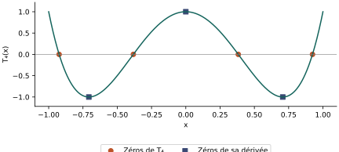
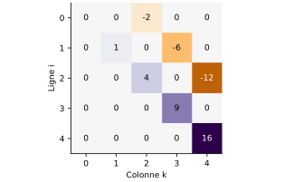

# Banque PT — Mathématiques A 2007 · Corrigé guidé

*Corrigé rédigé par IA, non officiel. Signalez toute erreur.*

**Rédaction** · GPT-6.2 Astra Ultra · vitesse non renseignée

Une même famille de polynômes permet de comparer deux normes puis de diagonaliser un opérateur différentiel sur les polynômes de degré au plus $n$. La grille d’admissibilité attribue à Maths A un coefficient 6 pour l’École polytechnique et 3 pour l’ENS Cachan. [Sujet officiel](https://www.banquept.fr/documents/2007/math_a_2007.pdf) · [Rapport du jury](https://www.banquept.fr/documents/ecrit/rapport/2007/rapport_math_a_ecrit_2007.pdf) · [Grille des coefficients](https://www.banquept.fr/documents/livret/2007/Livret_Rose_2007_1_2.pdf#page=12)

Le jury insiste sur les deux initialisations des récurrences, sur l’unicité dans la représentation trigonométrique et sur la valeur particulière du produit scalaire pour l’indice zéro. Les indications suivent ces trois difficultés.

## Partie A

### A.1 · Premiers polynômes

> [!INDICATION]
> Faire porter le facteur deux sur tout le premier produit de la récurrence.

Avec $T_0=1$, $T_1=X$ et $T_{k+1}=2XT_k-T_{k-1}$, les trois substitutions donnent $T_2=2X^2-1$, $T_3=2X(2X^2-1)-X=4X^3-3X$, puis $T_4=2X(4X^3-3X)-(2X^2-1)=8X^4-8X^2+1$.

### A.2 · Degré et coefficient dominant

> [!INDICATION]
> Comparer les degrés des deux termes avant de prendre le coefficient de tête.

Les degrés initiaux sont 0 et 1, les coefficients dominants valent 1. Si $\deg T_k=k$ et $\deg T_{k-1}=k-1$ pour $k\ge1$, le terme de degré $k+1$ de $2XT_k$ subsiste. Ainsi $\deg T_n=n$ pour tout $n$ et, à partir de $T_1$, le coefficient dominant double à chaque pas. Il vaut $2^{n-1}$ pour $n\ge1$.

### A.3 · Parité

> [!INDICATION]
> Changer le signe de la variable dans la récurrence double.

$T_0$ est pair et $T_1$ impair. Si $T_j(-X)=(-1)^jT_j(X)$ aux indices $j=k-1,k$, alors $2(-X)T_k(-X)-T_{k-1}(-X)=(-1)^{k+1}(2XT_k(X)-T_{k-1}(X))$. Cela établit la formule pour tout $n$, avec la parité de l’indice.

### A.4 · Valeurs particulières

> [!INDICATION]
> À zéro la relation ne dépend que du terme d’indice inférieur de deux.

À 1, les valeurs initiales sont 1, 1 et la récurrence conserve la valeur commune 1. La parité donne donc $T_n(-1)=(-1)^n$. À zéro, $T_{n+2}(0)=-T_n(0)$ avec valeurs initiales 1 et 0. Ainsi $T_{2j}(0)=(-1)^j$ et $T_{2j+1}(0)=0$.

### A.5 · Représentation trigonométrique

> [!INDICATION]
> Pour l’unicité, déterminer sur quel intervalle deux polynômes candidats coïncident.

La formule d’addition donne $\cos((k+1)\theta)=2\cos\theta\cos(k\theta)-\cos((k-1)\theta)$. Pour tout réel $\theta$, les suites $T_k(\cos\theta)$ et $\cos(k\theta)$ ont donc les mêmes deux premières valeurs $1,\cos\theta$ et la même récurrence. Elles coïncident. Si un autre polynôme vérifie cette identité à l’indice $n$, leur différence s’annule sur $\cos([0,\pi])=[-1,1]$ et, ayant une infinité de zéros, est identiquement nulle.

### A.6.a · Angles d’annulation

> [!INDICATION]
> Résoudre d’abord une équation trigonométrique sur la droite réelle.

Pour $n\ge1$, $\cos(n\theta)=0$ équivaut à $n\theta=\pi/2+k\pi$, soit $\theta=(2k+1)\pi/(2n)$, $k\in\mathbb Z$.

### A.6.b · Racines du polynôme

> [!INDICATION]
> Choisir les angles dans un intervalle où le cosinus est injectif.

Les $n$ angles précédents d’indices $0\le k<n$ appartiennent à $]0,\pi[$. Leurs cosinus $x_k$ sont distincts, par stricte décroissance, et $T_n(x_k)=0$ par A.5. Le degré $n$ interdit toute autre racine et impose la simplicité de chacune. Pour $n\ge1$, $T_n=2^{n-1}\prod_{k=0}^{n-1}(X-x_k)$. Le polynôme $T_0=1$ n’a aucune racine.

### A.7 · Racines du polynôme dérivé

> [!INDICATION]
> Sur l’intervalle ouvert des angles, le facteur sinus se simplifie.

La dérivation de A.5 donne $\sin\theta\,T'_n(\cos\theta)=n\sin(n\theta)$. Pour $n\ge2$, aux angles $k\pi/n$, $1\le k<n$, le sinus à gauche est non nul et le second membre est nul. Les $n-1$ cosinus obtenus sont distincts et épuisent les racines de $T'_n$, de degré $n-1$. Elles sont simples. Pour $n=1$, $T'_1=1$ n’a pas de racine. Pour $n=0$, le dérivé est nul en tout point.

## Partie B

### B.1 · Deux normes

> [!INDICATION]
> Une borne uniforme sur chaque valeur permet ensuite de passer au supremum.

On pose $L(P)=\sup_{x\in[-1,1]}|P(x)|$ et $N(P)=\max_k|a_k|$ pour $P=\sum_k a_kX^k$, avec $N(0)=0$. La première quantité est finie par continuité sur un compact. Dans la seconde, on complète les coefficients par des zéros. Les deux quantités sont positives ou nulles. Si $L(P)=0$, $P$ s’annule sur l’intervalle, donc est le polynôme nul. Si $N(P)=0$, tous les coefficients sont nuls. Dans les deux cas le polynôme nul a bien norme zéro. Multiplier par un réel $\lambda$ multiplie chaque valeur absolue par $|\lambda|$, d’où l’homogénéité. Pour tout $x$, $|(P+Q)(x)|\le L(P)+L(Q)$, d’où l’inégalité triangulaire en passant au supremum. Pour tout indice $k$, $|a_k+b_k|\le N(P)+N(Q)$, d’où l’autre inégalité triangulaire en prenant le maximum. Ce sont deux normes sur $\mathbb R[X]$.

### B.2 · Majoration de la norme uniforme

> [!INDICATION]
> Sur le segment, chaque puissance de la variable a une valeur absolue inférieure ou égale à un.

Pour $P\in\mathbb R_n[X]$, tout $|x|\le1$ vérifie $|P(x)|\le\sum_{k=0}^n|a_k|\,|x|^k\le(n+1)N(P)$. La borne est indépendante de $x$, donc $L(P)\le(n+1)N(P)$.

### B.3 · Constante optimale

> [!INDICATION]
> Chercher un polynôme dont tous les monômes s’ajoutent au même point.

Posons $Q=1+X+\cdots+X^n$. Alors $N(Q)=1$ et $Q(1)=n+1$. Par B.2, $n+1\le L(Q)\le n+1$. Toute constante valable pour tous les polynômes de degré au plus $n$ est donc au moins $n+1$, qui convient effectivement.

### B.4 · Norme uniforme de la famille

> [!INDICATION]
> Établir la borne et donner un point où elle est atteinte.

Par A.5, chaque $x\in[-1,1]$ s’écrit $\cos\theta$ et $|T_n(x)|=|\cos(n\theta)|\le1$. Comme $T_n(1)=1$, on a exactement $L(T_n)=1$, y compris pour $n=0$.

### B.5 · Produit scalaire

> [!INDICATION]
> Exploiter la continuité de l’intégrande lorsqu’une intégrale de carré est nulle.

$\varphi(P,Q)=\int_0^\pi P(\cos\theta)Q(\cos\theta)\,d\theta$ est définie par continuité, bilinéaire par linéarité de l’intégrale et symétrique par commutativité du produit. En outre $\varphi(P,P)\ge0$. Si cette quantité est nulle, le carré continu et positif ou nul est nul partout, car toute valeur strictement positive donnerait une contribution strictement positive sur un intervalle. Le polynôme $P$ est alors nul sur $[-1,1]$, donc identiquement nul. Cela établit le caractère défini positif.

### B.6 · Orthogonalité et normes quadratiques

> [!INDICATION]
> Traiter à part le cosinus de fréquence zéro.

Par A.5 et la formule du produit, $2\varphi(T_n,T_m)=\int_0^\pi(\cos((n-m)\theta)+\cos((n+m)\theta))\,d\theta$. L’intégrale d’un cosinus de fréquence entière non nulle est nulle, tandis que celle de la constante 1 est $\pi$. On obtient donc zéro pour $n\ne m$, $\pi/2$ pour $n=m\ge1$, et $\pi$ pour $n=m=0$.

### B.7 · Coordonnées dans la base orthogonale

> [!INDICATION]
> Prendre le produit scalaire avec un seul polynôme de la famille.

Les $n+1$ polynômes $T_0,\ldots,T_n$, de degrés étagés, forment une base de $\mathbb R_n[X]$. Ainsi $P=\sum_{k=0}^n\alpha_kT_k$ de façon unique. Par B.6, $\alpha_k=\varphi(P,T_k)/\varphi(T_k,T_k)$. L’intégrande du numérateur a une valeur absolue majorée par $L(P)$, donc ce numérateur a une valeur absolue au plus $\pi L(P)$. Finalement $|\alpha_0|\le L(P)$ et, pour $k\ge1$, $|\alpha_k|\le2L(P)$.

### B.8 · Récurrence sur les coefficients

> [!INDICATION]
> La multiplication par la variable décale la liste des coefficients.

Comme $N(XQ)=N(Q)$, la récurrence et l’inégalité triangulaire donnent $N(T_{n+1})\le2N(T_n)+N(T_{n-1})$ pour tout $n\ge1$.

### B.9 · Majoration géométrique

> [!INDICATION]
> Choisir une suite géométrique satisfaisant la récurrence majorante.

Écrivons $q=1+\sqrt2$. On a $q^2=2q+1$, $N(T_0)=1=q^0$ et $N(T_1)=1\le q$. Si les majorations sont vraies aux indices $n-1,n$, alors B.8 donne $N(T_{n+1})\le2q^n+q^{n-1}=q^{n+1}$. Ainsi $N(T_n)\le q^n$ pour tout $n$.

### B.10 · Comparaison inverse des normes

> [!INDICATION]
> Développer le polynôme dans la base dont on vient de majorer les coefficients.

Par B.7–B.9, $N(P)\le\sum_{k=0}^n|\alpha_k|N(T_k)\le2L(P)\sum_{k=0}^n q^k$. La somme vaut $(q^{n+1}-1)/(q-1)$ et $2/(q-1)=\sqrt2$. Il en résulte $N(P)\le\sqrt2(q^{n+1}-1)L(P)\le\sqrt2(1+\sqrt2)^{n+1}L(P)$.

## Partie C

### C.1 · Endomorphisme

> [!INDICATION]
> Vérifier séparément la linéarité et la stabilité par l’opération.

Posons $\Phi(P)=(X^2-1)P''+XP'$. La dérivation, la multiplication par un polynôme fixé et l’addition sont linéaires dans l’argument $P$. Si $\deg P\le n$, chacun des produits a degré au plus $n$, les dérivées nulles étant admises. Donc $\Phi$ définit un endomorphisme de $\mathbb R_n[X]$.

### C.2 · Action sur les monômes

> [!INDICATION]
> Aux deux premiers indices, calculer directement pour éviter une puissance négative.

$\Phi(1)=0$ et $\Phi(X)=X$. Pour $2\le k\le n$, les deux dérivations donnent $\Phi(X^k)=k(k-1)(X^k-X^{k-2})+kX^k=k^2X^k-k(k-1)X^{k-2}$.

### C.3 · Noyau

> [!INDICATION]
> Observer ce que devient le terme de plus haut degré.

Si $P$ est de degré $d\ge1$ et de coefficient dominant $a$, le coefficient de degré $d$ dans $\Phi(P)$ vaut $d^2a\ne0$ par C.2. Un tel $P$ ne peut appartenir au noyau. Toutes les constantes y appartiennent, donc $\ker\Phi=\mathbb R\cdot1$, y compris lorsque $n=0$.

### C.4 · Matrice canonique

> [!INDICATION]
> Écrire les coefficients de l’image du monôme d’indice k dans la colonne k.

En indexant lignes et colonnes de 0 à $n$, la matrice $M$ a $M_{k,k}=k^2$ pour tout $k$ et $M_{k-2,k}=-k(k-1)$ pour $2\le k\le n$. Tous les autres coefficients valent zéro par C.2. C’est une matrice triangulaire supérieure dont la première surdiagonale est nulle.

### C.5 · Trace

> [!INDICATION]
> Rechercher une expression dont la différence à deux indices successifs vaut le carré voulu.

La trace est la somme des termes diagonaux, $\sum_{k=0}^n k^2=n(n+1)(2n+1)/6$. En effet le membre de droite vaut zéro pour $n=0$ et, en retranchant sa valeur en $n-1$, on obtient $n((n+1)(2n+1)-(n-1)(2n-1))/6=n^2$.

### C.6 · Spectre et diagonalisation

> [!INDICATION]
> Compter les valeurs propres distinctes d’une matrice triangulaire.

Le polynôme caractéristique est $\prod_{k=0}^n(\lambda-k^2)$ par triangularité. Ces $n+1$ valeurs réelles sont distinctes, donc les espaces propres fournissent $n+1$ directions indépendantes, ce qui donne une base propre. L’endomorphisme est diagonalisable.

### C.7 · Vecteurs propres explicites

> [!INDICATION]
> Dériver deux fois la composée en angle et identifier la variable du polynôme.

Posons $y(\theta)=T_k(\cos\theta)=\cos(k\theta)$. D’une part $y''=-k^2y$. D’autre part $y''=\sin^2\theta\,T_k''(\cos\theta)-\cos\theta\,T'_k(\cos\theta)=-\Phi(T_k)(\cos\theta)$. Ainsi $\Phi(T_k)=k^2T_k$ sur $[-1,1]$, donc comme identité polynomiale. Chaque $T_k$ est non nul et la valeur propre est simple. L’espace propre pour $k^2$ est donc exactement $\mathbb R T_k$, pour $0\le k\le n$. Dans cette base, la matrice est $\operatorname{diag}(0,1,4,\ldots,n^2)$, avec la seule entrée 0 si $n=0$.
