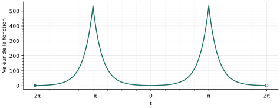
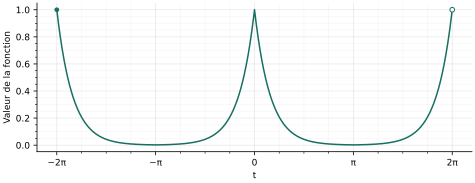
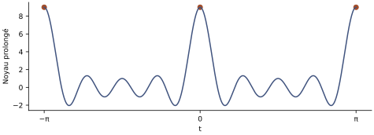

# Banque PT — Mathématiques C 2007 · Corrigé guidé

*Corrigé rédigé par IA, non officiel. Signalez toute erreur.*

**Rédaction** · GPT-6.2 Astra Ultra · vitesse non renseignée

Les trois parties étudient des fonctions exponentielles périodiques, une intégrale dépendant d’un paramètre et un noyau trigonométrique. Le coefficient constant de Fourier est pris égal à la moyenne. La grille d’admissibilité attribue à Maths C un coefficient 6 pour l’École polytechnique et 3 pour l’ENS Cachan. [Sujet officiel](https://www.banquept.fr/documents/2007/math_c_2007.pdf) · [Rapport du jury](https://www.banquept.fr/documents/ecrit/rapport/2007/rapport_math_c_ecrit_2007.pdf) · [Grille des coefficients](https://www.banquept.fr/documents/livret/2007/Livret_Rose_2007_1_2.pdf#page=12)

Le rapport souligne la nécessité de tracer les exponentielles sur l’intervalle complet, de préciser les hypothèses de Dirichlet et d’employer une majoration intégrable pour les intégrales dépendant d’un paramètre.

## Partie I · Fonctions périodiques

### I.1.a · Graphe de la première exponentielle

> [!INDICATION]
> Ramener chaque abscisse à sa distance au multiple de deux pi le plus proche.

Notons $d(t)=\min_{j\in\mathbb Z}|t-2j\pi|$. Pour $a=2$, $f_2(t)=e^{2d(t)}$. Sur les quatre intervalles successifs délimités par $-2\pi,-\pi,0,\pi,2\pi$, $d(t)$ vaut $t+2\pi,-t,t,2\pi-t$. Les minima valent 1 en $-2\pi$ et 0 (abscisses) et les maxima valent $e^{2\pi}$ en $\pm\pi$. Le point d’abscisse $2\pi$ est exclu.

### I.1.b · Graphe de la seconde exponentielle

> [!INDICATION]
> Le changement de signe de l’exposant échange maxima et minima.

Sur les mêmes quatre intervalles $f_{-2}(t)=e^{-2d(t)}=1/f_2(t)$. Les maxima valent 1 en $-2\pi$ et 0 ; les minima valent $e^{-2\pi}$ en $-\pi$ et $\pi$. La limite en $2\pi$ vaut 1, avec l’extrémité droite exclue.

### I.2 · Coefficients trigonométriques

> [!INDICATION]
> La fréquence fondamentale est déterminée par la période.

Pour une fonction réelle $F$, $T$-périodique et continue par morceaux, posons $\omega=2\pi/T$. Sur une période quelconque $[u,u+T]$,
$$
a_0(F)=\frac1T\int_u^{u+T}F,\quad
a_n(F)=\frac2T\int_u^{u+T}F(t)\cos(n\omega t)\,dt,\quad
b_n(F)=\frac2T\int_u^{u+T}F(t)\sin(n\omega t)\,dt\quad(n\ge1).
$$
La série correspondante est $a_0+\sum_{n\ge1}(a_n\cos(n\omega t)+b_n\sin(n\omega t))$.

### I.3.a · Intégrales sur une période

> [!INDICATION]
> Sur la demi-période positive, la valeur absolue de t vaut t.

Par parité, $\int_{-\pi}^\pi f_a(t)\,dt=2\int_0^\pi e^{at}\,dt=2(e^{a\pi}-1)/a$. De même $\int_{-\pi}^\pi f_{-a}(t)\,dt=2(1-e^{-a\pi})/a$.

### I.3.b · Double intégration par parties

> [!INDICATION]
> Le sinus aux deux bornes est nul pour une fréquence entière.

Posons $C=\int_0^\pi e^{at}\cos(nt)\,dt$, $S=\int_0^\pi e^{at}\sin(nt)\,dt$. En prenant $e^{at}/a$ comme primitive à chaque fois, on trouve $C=[(-1)^ne^{a\pi}-1]/a+(n/a)S$ et $S=-(n/a)C$. Ainsi $C=[(-1)^ne^{a\pi}-1]/a-(n^2/a^2)C$, comme demandé.

### I.3.c · Coefficients de l’exponentielle croissante

> [!INDICATION]
> L’imparité de l’intégrande suffit pour chaque coefficient en sinus.

Par I.3.a, $a_0(f_a)=(e^{a\pi}-1)/(a\pi)$. Pour $n\ge1$, $b_n(f_a)=0$ par parité et I.3.b donne
$$
a_n(f_a)=\frac{2}{\pi}C=\frac{2a[(-1)^ne^{a\pi}-1]}{\pi(a^2+n^2)}.
$$

### I.3.d · Coefficients de l’exponentielle décroissante

> [!INDICATION]
> Remplacer le paramètre par son opposé en conservant son signe dans le numérateur.

Le même calcul donne $a_0(f_{-a})=(1-e^{-a\pi})/(a\pi)$ et, pour $n\ge1$, $b_n(f_{-a})=0$ et
$$
a_n(f_{-a})=\frac{2a[1-(-1)^ne^{-a\pi}]}{\pi(a^2+n^2)}.
$$

### I.4.a · Régularité des deux fonctions

> [!INDICATION]
> Vérifier les raccords de la fonction et les limites des dérivées sur les morceaux.

Une fonction est $C^1$ par morceaux si tout segment admet une subdivision finie telle que, sur l’intérieur de chacun des morceaux, la restriction se prolonge en une fonction $C^1$ sur le morceau fermé. Les deux exponentielles ont cette propriété en coupant aux multiples de $\pi$. Elles sont continues sur $[-\pi,\pi[$, et aussi aux raccords périodiques puisque les deux valeurs latérales y sont égales.

### I.4.b · Série de la somme

> [!INDICATION]
> La convergence ponctuelle de Dirichlet donne la valeur exacte au point considéré.

Les fonctions sont périodiques, $C^1$ par morceaux et continues, donc leurs séries de Fourier convergent en tout point vers leurs valeurs. En additionnant les coefficients de I.3.c–d, la moyenne est $2\sinh(a\pi)/(a\pi)$ et
$$
f_a(t)+f_{-a}(t)=\frac{2\sinh(a\pi)}{a\pi}
+\frac{4a\sinh(a\pi)}{\pi}\sum_{n=1}^{\infty}\frac{(-1)^n\cos(nt)}{a^2+n^2}.
$$

### I.5.a · Somme alternée

> [!INDICATION]
> Choisir un argument où tous les cosinus valent un.

En $t=0$, le membre de gauche de I.4.b vaut 2. En isolant la somme,
$$
\sum_{n=1}^\infty\frac{(-1)^n}{n^2+a^2}=\frac{\pi}{2a\sinh(a\pi)}-\frac1{2a^2}.
$$

### I.5.b · Somme sans alternance

> [!INDICATION]
> Choisir l’extrémité gauche incluse de l’intervalle.

En $t=-\pi$, $\cos(nt)=(-1)^n$ et le membre de gauche vaut $2\cosh(a\pi)$. Donc
$$
\sum_{n=1}^\infty\frac1{n^2+a^2}=\frac{\pi}{2a}\coth(a\pi)-\frac1{2a^2}.
$$

## Partie II · Intégrale à paramètre

### II.1.a · Continuité et domination de l’intégrande

> [!INDICATION]
> Majorer séparément le numérateur et l’inverse du dénominateur.

$g(x,t)=\cos(xt)/\cosh t$ est continue sur $\mathbb R\times[0,\infty[$ comme quotient de fonctions continues avec dénominateur strictement positif. Puisque $\cosh t=(e^t+e^{-t})/2\ge e^t/2$, $|g(x,t)|\le2e^{-t}$.

### II.1.b · Continuité de l’intégrale

> [!INDICATION]
> La même fonction intégrable domine tous les paramètres x.

Le théorème de continuité sous l’intégrale affirme que, pour un intégrande continu en paramètre et mesurable en variable d’intégration, une domination locale uniforme par une fonction intégrable assure la continuité de l’intégrale. Ici la domination globale $2e^{-t}$ sur $[0,\infty[$ fournit la convergence absolue et la continuité de $\psi(x)=\int_0^\infty g(x,t)\,dt$ sur $\mathbb R$.

### II.2.a · Somme géométrique finie

> [!INDICATION]
> Vérifier le dénominateur avant de diviser l’identité polynomiale.

Pour $X\in\mathbb R\setminus\{-1\}$, $(1+X)\sum_{k=0}^N(-X)^k=1-(-X)^{N+1}$. Diviser et réarranger donne
$$
\frac1{1+X}=\sum_{k=0}^N(-1)^kX^k+\frac{(-1)^{N+1}X^{N+1}}{1+X}.
$$
Au point $X=-1$ visé par le quantificateur imprimé, les quotients ne sont pas définis.

### II.2.b · Développement fini de la sécante hyperbolique

> [!INDICATION]
> Factoriser l’exponentielle croissante dans le dénominateur.

Comme $1/\cosh t=2e^{-t}/(1+e^{-2t})$, II.2.a avec $X=e^{-2t}>0$ donne, pour tout réel $t$,
$$
\frac1{\cosh t}=2e^{-t}\left(\sum_{k=0}^N(-1)^ke^{-2kt}
+\frac{(-1)^{N+1}e^{-2(N+1)t}}{1+e^{-2t}}\right).
$$

### II.2.c · Décomposition sous le signe intégral

> [!INDICATION]
> La somme est finie à ce stade.

Multiplier II.2.b par $\cos(xt)$ et intégrer pour $0\le t<\infty$. Chaque terme est intégrable en valeur absolue, car dominé par une exponentielle décroissante. On obtient
$$
\psi(x)=2\int_0^\infty e^{-t}\cos(xt)\left(\sum_{k=0}^N(-1)^ke^{-2kt}+
\frac{(-1)^{N+1}e^{-2(N+1)t}}{1+e^{-2t}}\right)\,dt.
$$

### II.3.a · Borne uniforme pour la fonction auxiliaire

> [!INDICATION]
> Simplifier en faisant remonter le facteur exponentiel au dénominateur.

$h(x,t)=e^{-t}\cos(xt)/(1+e^{-2t})=\cos(xt)/(2\cosh t)$. Donc $|h(x,t)|\le1/2$ pour tout $(x,t)$ du domaine.

### II.3.b · Limite du reste

> [!INDICATION]
> Intégrer une borne indépendante de x.

Écrivons $R_N(x)=(-1)^{N+1}\int_0^\infty h(x,t)e^{-2(N+1)t}\,dt$. Par II.3.a,
$$
|R_N(x)|\le\tfrac12\int_0^\infty e^{-2(N+1)t}\,dt=\frac1{4(N+1)}.
$$
Donc $R_N(x)\to0$, uniformément en $x$.

### II.4 · Transformée d’une exponentielle

> [!INDICATION]
> Prendre la partie réelle d’une intégrale complexe absolument convergente.

Pour $0\le k\le N$, $J_k(x)=\int_0^\infty e^{-(2k+1)t}\cos(xt)\,dt$. Comme $2k+1>0$, on a
$$
J_k(x)=\operatorname{Re}\frac1{2k+1-ix}=\frac{2k+1}{(2k+1)^2+x^2}.
$$

### II.5 · Série de l’intégrale

> [!INDICATION]
> Utiliser la borne du reste pour passer à la limite dans la somme finie.

II.2.c donne $\psi(x)=2\sum_{k=0}^N(-1)^kJ_k(x)+2R_N(x)$. Par II.3.b et II.4,
$$
\psi(x)=\sum_{k=0}^\infty u_k(x),\qquad u_k(x)=\frac{2(-1)^k(2k+1)}{(2k+1)^2+x^2}.
$$

## Partie III · Noyau trigonométrique

### III.1 · Somme des exponentielles

> [!INDICATION]
> Factoriser la somme géométrique par sa première exponentielle.

Pour $t\notin\pi\mathbb Z$, $e^{2it}\ne1$. Ainsi
$$
\sum_{k=-N}^N e^{2ikt}=e^{-2iNt}\frac{1-e^{2i(2N+1)t}}{1-e^{2it}}
=\frac{\sin((2N+1)t)}{\sin t}=S_N(t),
$$
par $1-e^{2iu}=-2ie^{iu}\sin u$.

### III.2.a · Valeurs aux points singuliers

> [!INDICATION]
> La somme finie conserve un sens aux multiples de pi.

La somme de III.1 est continue sur tout $\mathbb R$ et coïncide avec $S_N$ sur son domaine. Elle fournit l’unique prolongement continu $\widetilde S_N$. À $t=m\pi$, chacun des $2N+1$ termes vaut 1, donc $\widetilde S_N(m\pi)=2N+1$.

### III.2.b · Périodicité du prolongement

> [!INDICATION]
> Examiner la période de chaque terme de la somme.

Comme $e^{2ik(t+\pi)}=e^{2ikt}$ pour tout entier $k$, la somme est $\pi$-périodique, et donc aussi $2\pi$-périodique comme demandé.

### III.2.c · Norme uniforme du noyau

> [!INDICATION]
> L’inégalité triangulaire porte sur une somme finie de nombres de module un.

Pour tout $t$, $|\widetilde S_N(t)|\le\sum_{k=-N}^N|e^{2ikt}|=2N+1$. La borne est atteinte en zéro.

### III.3 · Convergence de l’intégrale pondérée

> [!INDICATION]
> Le paramètre a est strictement positif.

L’intégrande est continu et $|e^{-2at}\widetilde S_N(t)|\le(2N+1)e^{-2at}$. L’intégrale de droite sur $[0,\infty[$ est finie, donc $I_{a,N}=\int_0^\infty e^{-2at}\widetilde S_N(t)\,dt$ converge absolument.

### III.4 · Découpage en périodes

> [!INDICATION]
> Effectuer le changement de variable avant de couper l’intervalle en périodes.

La somme en $k$ étant finie, $I_{a,N}=\sum_{k=-N}^N\int_0^\infty e^{2ikt}e^{-2at}\,dt$. Avec $u=2t$, puis par additivité et convergence absolue,
$$
I_{a,N}=\frac12\sum_{k=-N}^N\sum_{p=0}^\infty
\int_{2p\pi}^{2(p+1)\pi}e^{iku}e^{-au}\,du .
$$
Pour chaque $k$, la somme des intégrales en valeur absolue est majorée par $\int_0^\infty e^{-au}\,du$.

### III.5.a · Fonction sur sa première période

> [!INDICATION]
> Utiliser séparément la définition sur les deux demi-périodes.

Pour $0\le t<\pi$, $g_a(t)=f_{-a}(t)=e^{-at}$. Pour $\pi\le t<2\pi$, on a $0\le t-\pi<\pi$, donc $g_a(t)=e^{-a\pi}f_{-a}(t-\pi)=e^{-at}$. Le raccord en $\pi$ a bien la même valeur.

### III.5.b · Lien avec les coefficients réels

> [!INDICATION]
> Après translation de chaque période, grouper les termes de fréquences opposées.

Dans la période d’indice $p$, substituer $u=2p\pi+v$. Le facteur $e^{2ikp\pi}=1$, et la décroissance donne $e^{-2ap\pi}$. Sur $[0,2\pi[$, $e^{-av}=g_a(v)$. Dans la somme sur $k$, les termes $k$ et $-k$ se groupent en $2\cos(kv)$. Le terme constant donne $\int_0^{2\pi}g_a=2\pi a_0(g_a)$ et chaque paire donne $2\pi a_k(g_a)$. Avec le facteur $1/2$,
$$
I_{a,N}=\pi\left(\sum_{p=0}^\infty e^{-2ap\pi}\right)\left(\sum_{k=0}^N a_k(g_a)\right).
$$

### III.5.c · Facteur géométrique

> [!INDICATION]
> Le premier terme est un et la raison appartient à l’intervalle ouvert de zéro à un.

Comme $a>0$, $\sum_{p=0}^\infty e^{-2ap\pi}=1/(1-e^{-2a\pi})$.

### III.6 · Limite en nombre d’harmoniques

> [!INDICATION]
> Au point de saut, utiliser la moyenne des limites gauche et droite.

La somme $\sum_{k=0}^N a_k(g_a)$ est la somme partielle de Fourier de $g_a$ en zéro. La fonction $2\pi$-périodique est $C^1$ par morceaux, avec $g_a(0^+)=1$ et $g_a(0^-)=e^{-2a\pi}$. Par Dirichlet, la limite est $(1+e^{-2a\pi})/2$. Par III.5,
$$
\lim_{N\to\infty}I_{a,N}=\frac{\pi(1+e^{-2a\pi})}{2(1-e^{-2a\pi})}
=\frac{\pi}{2}\coth(a\pi).
$$
