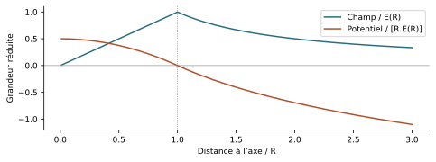
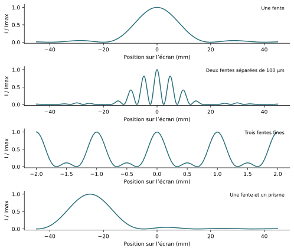
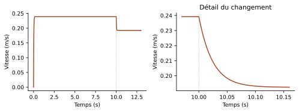

# Banque PT — Physique A 2007 · Corrigé brut

*Corrigé rédigé par IA, non officiel. Signalez toute erreur.*

**Rédaction** · GPT-6.2 Astra Ultra · vitesse non renseignée

**Révision** · GPT-6.2 Astra Ultra · vitesse non renseignée

Les trois problèmes passent du champ local à une grandeur mesurable : puissance traversant un câble, intensité diffractée dans le plan focal et ralentissement d’une spire. Coefficients d’admissibilité : 6 pour l’École polytechnique, 3 pour l’ENS Cachan. [Sujet officiel](https://www.banquept.fr/documents/2007/phys_a_2007.pdf) · [Rapport du jury](https://www.banquept.fr/documents/ecrit/rapport/2007/rapport_phys_a_ecrit_2007.pdf) · [Grille des coefficients](https://www.banquept.fr/documents/livret/2007/Livret_Rose_2007_1_2.pdf#page=12)

## 1 — Analogies électriques et magnétiques

### 1.1.1 · Champ et potentiel du cylindre chargé

**a.** L’invariance par translation et rotation et les plans de symétrie imposent $\vec E=E(r)\vec u_r$. Gauss donne $2\pi rHE=\rho\pi H\min(r,R)^2/\epsilon_0$. À l’intérieur $E=\rho r/(2\epsilon_0)$, à l’extérieur $E=\rho R^2/(2\epsilon_0 r)$. Comme $E=-V'$ et $V(R)=0$, $V_{\rm ext}=\alpha\ln(r/R)$, $\alpha=-\rho R^2/(2\epsilon_0)$.

**b.** $V_{\rm int}=\rho(R^2-r^2)/(4\epsilon_0)$. Les deux courbes sont continues à $R$. Pour $\rho>0$, le champ augmente puis décroît ; le potentiel décroît avec une tangente horizontale sur l’axe. **c.** $\Delta V_{\rm ext}=(rV')'/r=0$ car $rV'$ est constant. C’est l’équation de Laplace dans une zone sans charge.

### 1.1.2 · Champ d’un cylindre parcouru par un courant

Le plan méridien est plan de symétrie des courants, donc $\vec B=B_\theta(r)\vec u_\theta$. Ampère donne $2\pi rB_\theta=\mu_0j\pi\min(r,R)^2$. Ainsi $B_\theta=\mu_0jr/2$ à l’intérieur et $\mu_0jR^2/(2r)$ à l’extérieur. Pour $\vec A=A_z(r)\vec u_z$, $B_\theta=-A_z'$, d’où $A_z=\beta\ln(r/R)$ avec $\beta=-\mu_0jR^2/2$ dans la jauge $A_z(R)=0$.

### 1.2.1 · Cylindre conducteur dans un champ axial

**a.** $\vec j=\gamma E_0\vec u_z$ et, pour $r<R$, $\vec B=\mu_0\gamma E_0r\,\vec u_\theta/2$. **b.** $\vec j\cdot\vec E=\gamma E_0^2$ donne $P_J=\pi R^2h\gamma E_0^2$. **c.** $\vec\Pi=\vec E\times\vec B/\mu_0=-\gamma E_0^2r\,\vec u_r/2$. Le flux latéral sortant vaut $-P_J$ ; l’énergie arrive par la surface latérale et se dissipe par effet Joule.

### 1.2.2 · Cylindre conducteur dans un champ transversal

**a.** À l’équilibre électrostatique, $\vec E_{\rm int}=0$. **b.** En posant $V=g(r)\cos\theta$, $\Delta V=0$ donne $r^2g''+rg'-g=0$. Un essai $r^p$ impose $p^2-1=0$, d’où $g=Ar+B/r$.

**c (p. 4).** $E_r=-(A-B/r^2)\cos\theta$ et $E_\theta=(A+B/r^2)\sin\theta$. **d.** Le champ lointain est $E_0\vec u_x=E_0(\cos\theta\,\vec u_r-\sin\theta\,\vec u_\theta)$, donc $A=-E_0$. **e.** La composante tangentielle est continue et $E_{r,\rm ext}-E_{r,\rm int}=\sigma/\epsilon_0$. **f.** $E_\theta(R)=0$ impose $B=E_0R^2$. Enfin $\sigma=2\epsilon_0E_0\cos\theta$ ; sa moyenne angulaire nulle conserve la neutralité.

### 1.2.3 · Cylindre supraconducteur

**a.** De $A_z=(A'r+B'/r)\cos\theta$, on tire $B_r=-(A'+B'/r^2)\sin\theta$ et $B_\theta=-(A'-B'/r^2)\cos\theta$. À l’infini $\vec B=B_0\vec u_y$ exige $A'=-B_0$. L’expulsion du champ impose $B_r(R)=0$, donc $B'=B_0R^2$. Ainsi $B_r=B_0(1-R^2/r^2)\sin\theta$ et $B_\theta=B_0(1+R^2/r^2)\cos\theta$.

**b.** $\vec j_s=\vec u_r\times(\vec B_{\rm ext}-\vec B_{\rm int})/\mu_0=(2B_0/\mu_0)\cos\theta\,\vec u_z$. **c.** La plus grande norme est $2|B_0|/\mu_0$ d’où le seuil $|B_0|_{\rm crit}=\mu_0j_{sc}/2$.

### 1.3.1–3.3 · Onde dans un câble coaxial

**3.1.** Dans le vide, appliquer le rotationnel à $\nabla\times\vec E=-\partial_t\vec B$, utiliser $\nabla\times\vec B=\mu_0\epsilon_0\partial_t\vec E$ et $\nabla\cdot\vec E=0$. On obtient $\Delta\vec E-c^{-2}\partial_t^2\vec E=0$, $c=(\epsilon_0\mu_0)^{-1/2}$.

**3.2.a.** $\partial_r(rE_0)=0$ impose $E_0(r)=E_1R_1/r$. **b (p. 5).** Faraday, composante azimutale, donne $B_\theta=(k/\omega)E_0(r)\cos(\omega t-kz)$, après exclusion d’une composante permanente. **3.3.** Le terme radial du laplacien vectoriel, $E_0''+E_0'/r-E_0/r^2$, s’annule pour $1/r$. Ainsi $k^2=\omega^2/c^2$, soit $k=\omega/c$, propagation non dispersive.

### 1.3.4–3.6 · Charges, courants et puissance transportée

**3.4.** Poser $F=E_1\cos(\omega t-kz)$. À $R_1$, $\sigma_1=\epsilon_0F$ et $\vec j_{s1}=F\vec u_z/(\mu_0c)$. À $R_2$, la normale vers le vide est $-\vec u_r$, donc $\sigma_2=-\epsilon_0F R_1/R_2$ et $\vec j_{s2}=-F R_1\vec u_z/(\mu_0cR_2)$.

**3.5.** $\vec\Pi=(R_1/r)^2F^2\vec u_z/(\mu_0c)$ et sa moyenne se déduit en remplaçant $F^2$ par $E_1^2/2$. **3.6.** L’intégration sur les couronnes $2\pi r\,dr$ donne $\bar P=\pi E_1^2R_1^2\ln(R_2/R_1)/(\mu_0c)$. Pour $E_1=5000$ V/m, $R_1=1$ mm et $R_2=1,5$ mm, $\bar P\simeq0,0844$ W.

## 2 — Interférences et diffraction

### 2.1.1–1.2 · Huygens–Fresnel et intégrale d’ouverture

**1.1.** Chaque élément de l’ouverture éclairée émet une onde secondaire cohérente. L’amplitude en un point est la somme complexe des contributions avec leurs phases de propagation. **1.2.** Sous incidence normale, tous les points reçoivent la même phase. Vers $\vec u$, l’écart de chemin depuis $M(x,y)$ relativement à $O$ est $-(\alpha x+\beta y)$. Avec $e^{i\omega t}$ cela donne $s_0=K\iint_D\exp[i(Ax+By)]\,dx\,dy$ où $A=2\pi\alpha/\lambda$, $B=2\pi\beta/\lambda$.

### 2.1.3 · Fente rectangulaire et tache centrale

**a.** L’observation dans le plan focal donne $\alpha\simeq x'/f'$, $\beta\simeq y'/f'$ aux petits angles. **b.** Avec $\operatorname{sinc}u=\sin u/u$, prolongée par 1 en 0,
$$s_0=KL\ell\,\operatorname{sinc}{\pi Lx'\over\lambda f'}\,\operatorname{sinc}{\pi\ell y'\over\lambda f'},\qquad I=I_{\max}|s_0/(KL\ell)|^2.$$
**c.** Pour $L\gg\ell$, l’intensité est confinée près de $x'=0$ et s’étale suivant $y'$. Sur l’axe $O'y'$, $I/I_{\max}=\operatorname{sinc}^2[\pi\ell y'/(\lambda f')]$. **d.** Les premiers zéros se situent en $\pm\lambda f'/\ell=\pm2,0$ cm ; la largeur totale est 4,0 cm.

### 2.1.4 · Deux fentes de largeur finie

Les fentes centrées en $\pm a$ donnent des facteurs $\exp[\pm i2\pi a y'/(\lambda f')]$. Leurs champs s’ajoutent, donc
$$I=I_{\max}\operatorname{sinc}^2\!\left({\pi\ell y'\over\lambda f'}\right)\cos^2\!\left({2\pi a y'\over\lambda f'}\right).$$
L’interfrange vaut $\lambda f'/(2a)=5$ mm. À la limite des fentes fines, l’enveloppe normalisée tend vers 1 et il reste les franges cosinus carré. À éclairement incident fixé, la puissance totale transmise diminue avec la largeur.

### 2.1.5 · Indice de l’air et cannelures du spectre

**a.** L’ajout d’air introduit $(n-1)e$. La translation de toute la figure vérifie $(n-1)e=2b|\Delta y'|/f'$, donc $n-1=(0,001)(0,01)/(0,034)\simeq2,94\times10^{-4}$.

**b.** À $y'=1$ cm et sans dispositif, $\delta=2by'/f'=10$ micromètres. Pour une extinction, $\lambda=2\delta/(2p+1)$. Entre 400 et 800 nm, les dénominateurs impairs sont $25,27,\ldots,49$. Les longueurs d’onde absentes (nm) sont $800$, $740,7$, $689,7$, $645,2$, $606,1$, $571,4$, $540,5$, $512,8$, $487,8$, $465,1$, $444,4$, $425,5$ et $408,2$.

### 2.1.6 · Trois fentes fines

Avec $\varphi=2\pi b y'/(\lambda f')$, $s_0=s_f(1+e^{i\varphi}+e^{-i\varphi})=s_f(1+2\cos\varphi)$. Donc $I/I_{\max}=(1+2\cos\varphi)^2/9$, $I_{\max}=9I_f$. Entre deux maxima principaux, les deux zéros vérifient $\cos\varphi=-1/2$ et le maximum secondaire vaut $I_{\max}/9$.

### 2.2.1 · Fente précédée d’un prisme

**a.** Le supplément de chemin optique est $\delta(y)=(n-1)(e_0-\theta y)$, le retard de phase vaut $2\pi\delta/\lambda$ et l’amplitude est multipliée par $\exp(-i2\pi\delta/\lambda)$. **b.** Le facteur constant disparaît dans l’intensité, d’où
$$I/I_{\max}=\operatorname{sinc}^2\left[{\pi\ell\over\lambda}\left({y'\over f'}+(n-1)\theta\right)\right].$$
**c.** Le maximum se trouve vers la base du prisme, $\beta\simeq-(n-1)\theta=-0,025$ rad ou $y'=-2,5$ cm pour $f'=1$ m. **d (p. 8).** La loi de Snell–Descartes linéarisée aux deux faces donne une déviation de module $(n-1)\theta$ vers la base. Cette direction est celle du maximum diffracté.

## 3 — Spire dans un champ non uniforme

### 3.1 · Flux et signe du courant

**a.** Si $b=0$ le flux ne varie pas pendant la chute rigide, donc aucune f.é.m. **b.** Pour $b>0$ le flux selon $+\vec u_x$ décroît quand $z$ augmente, d’où un courant trigonométrique positif qui s’oppose à cette diminution ; son signe s’inverse si $b<0$. **c (p. 9).** $\Phi=a\int_z^{z+a}(B_0-bu)\,du=a^2(B_0-bz-ba/2)$ et $e=-\dot\Phi=ba^2\dot z$.

### 3.2 · Chute avec freinage

**a.** Leurs forces magnétiques, opposées, ont une résultante verticale $F_z=-ba^2i$. Les deux autres brins n’apportent pas de force verticale. Pour $b>0$ et une chute, $F_z<0$, comme l’impose la loi de Lenz. Ainsi $m\ddot z=mg-ba^2i$. **b.** Pour le cadre purement résistif, $Ri=ba^2\dot z$. **c.** On obtient $\ddot z+\dot z/\tau=g$, $\tau=mR/(b^2a^4)$.

**d.** Partant du repos, $v_z=v_\ell(1-e^{-t/\tau})$, $v_\ell=g\tau$ et $z=g\tau[t-\tau(1-e^{-t/\tau})]$. **e.** Les données donnent $\tau=0,0244$ s et $v_\ell=0,239$ m/s.

### 3.3 · Changement du champ à dix secondes

**a.** Après $t_0$, $Ri=a^2(b\dot z+b_1)$. La résultante de Laplace reste $-ba^2i$, donc $\dot v+v/\tau=g-\gamma$, $\gamma=bb_1a^4/(mR)=1,92$ m/s². Avec $v_0=g\tau(1-e^{-t_0/\tau})$ et $v_2=(g-\gamma)\tau=0,1924$ m/s,
$$v_z(t)=v_2+(v_0-v_2)\exp[-(t-t_0)/\tau].$$
**b.** La vitesse est continue et sa pente subit un saut de $-\gamma$. La première montée et la seconde relaxation sont presque instantanées à l’échelle de 13 s, comme le montre le détail du graphe.

### 3.4 · Oscillations amorties

**a.** En posant $u=z-z_1$, le poids est compensé au repos et $m\ddot u+(b^2a^4/R)\dot u+ku=0$. **b.** Poser $d=1/(2\tau)=20,48$ s$^{-1}$, $\omega_0=\sqrt{k/m}=31,62$ rad/s. La pulsation amortie $\omega_d=\sqrt{\omega_0^2-d^2}=24,10$ rad/s donne $T_d=2\pi/\omega_d=0,261$ s.

**c.** Les conditions $z(0)=0,08$ m et $\dot z(0)=0$ donnent en mètres, avec $t$ en secondes,
$$z(t)=0,050+0,030e^{-20,48t}\left[\cos(24,10t)+0,850\sin(24,10t)\right].$$
Le décrément entre amplitudes du même signe est $dT_d=5,34$. **d.** Le mouvement induit un courant et perd de l’énergie mécanique par effet Joule, d’où un freinage sans contact. Les ralentisseurs électromagnétiques de poids lourds exploitent ce principe.
