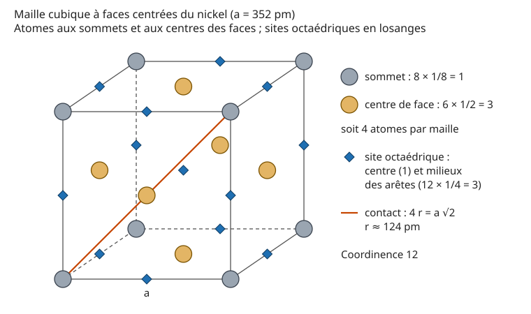
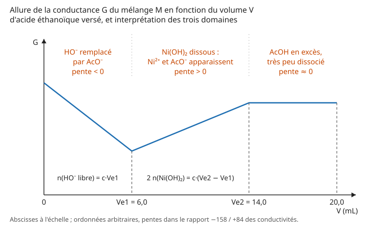

# Banque PT PT — Physique C - Chimie 2007 · Corrigé brut

*Corrigé rédigé par IA, non officiel. Signalez toute erreur.*

**Rédaction** · modèle exact non renseigné (famille Claude) · effort non renseigné · vitesse non renseignée

Problème de chimie de l'épreuve de Physique C (4 heures pour les deux problèmes, chimie et thermodynamique, de même barème ; calculatrice autorisée), consacré au nickel : 21 questions en trois parties indépendantes (atome et cristal, décomposition thermique du nickel carbonyle, dosage conductimétrique). Les 21 questions sont traitées, sous les repères de l'énoncé. Les données numériques sont celles de la fin du sujet ; le produit ionique de l'eau, qui n'y figure pas, est pris égal à $10^{-14}$ (question III-4).

[Sujet officiel](https://www.banquept.fr/documents/2007/phys_c_2007.pdf) · [Rapport du jury](https://www.banquept.fr/documents/ecrit/rapport/2007/rapport_phys_c_ecrit_2007.pdf)

## Partie I — Le nickel

### Question I-1-a — Configuration électronique, élément de transition

L'atome de nickel possède $Z = 28$ électrons. On remplit les sous-couches par énergie croissante (règle de Klechkowski : $n + \ell$ croissant, puis $n$ croissant à $n + \ell$ égal), en respectant le principe de Pauli :

$$\boxed{\mathrm{Ni} : 1s^2\,2s^2\,2p^6\,3s^2\,3p^6\,3d^8\,4s^2 = [\mathrm{Ar}]\,3d^8\,4s^2}$$

Vérification : $2 + 2 + 6 + 2 + 6 + 8 + 2 = 28$.

Un élément de transition est un élément dont l'atome possède une sous-couche $d$ incomplète, ou qui donne au moins un ion stable dont la sous-couche $d$ est incomplète. Le nickel répond aux deux critères : sa sous-couche $3d$ contient 8 électrons sur 10 possibles, et l'ion $\mathrm{Ni^{2+}}$, obtenu par départ des deux électrons $4s$, a la configuration $[\mathrm{Ar}]\,3d^8$. **Le nickel est donc un élément de transition** (bloc $d$, quatrième période, première série de transition).

### Question I-1-b — Composition isotopique

On assimile la masse molaire de l'isotope de nombre de masse $A$ à $A\ \mathrm{g\cdot mol^{-1}}$ (c'est le sens de « approximativement »). Soient $x$ et $y$ les fractions molaires de $^{60}\mathrm{Ni}$ et de $^{62}\mathrm{Ni}$.

$$x + y = 1 - 0{,}68 = 0{,}32$$

$$0{,}68 \times 58 + 60\,x + 62\,y = 58{,}7$$

La seconde relation donne $60\,x + 62\,y = 58{,}7 - 39{,}44 = 19{,}26$. En retranchant $60\,(x + y) = 19{,}20$ :

$$2\,y = 0{,}06$$

$$\boxed{y = 0{,}03 \quad\text{et}\quad x = 0{,}29}$$

Le nickel naturel contiendrait donc environ **29 % de $^{60}\mathrm{Ni}$ et 3 % de $^{62}\mathrm{Ni}$**. Le résultat est très sensible à l'arrondi de $M$ (une variation de $0{,}1\ \mathrm{g\cdot mol^{-1}}$ déplace $y$ de 5 points), d'où le caractère approximatif du calcul.

### Question I-2-a — Maille conventionnelle et coordinence

La maille conventionnelle est un cube d'arête $a$ avec un atome à chaque sommet et un atome au centre de chaque face.

Nombre d'atomes par maille : $8 \times \tfrac18 + 6 \times \tfrac12 = 4$.

Coordinence : un atome de sommet a pour plus proches voisins les centres des faces qui contiennent ce sommet, à la distance $a\sqrt2/2$. Il y en a 4 dans chacun des trois plans perpendiculaires passant par cet atome :

$$\boxed{\text{coordinence} = 12}$$

### Question I-2-b — Rayon atomique

Dans le modèle des sphères dures, les atomes sont tangents le long de la diagonale d'une face (sommet, centre de face, sommet) :

$$4\,r = a\sqrt2$$

$$r = \frac{a\sqrt2}{4} = \frac{352 \times 1{,}414}{4}$$

$$\boxed{r \approx 124\ \mathrm{pm}}$$

### Question I-2-c — Masse volumique et densité

La maille de volume $a^3$ contient 4 atomes, de masse $M/N_A$ chacun :

$$\rho = \frac{4\,M}{N_A\,a^3}$$

$$\rho = \frac{4 \times 58{,}7\cdot10^{-3}}{6{,}02\cdot10^{23} \times (352\cdot10^{-12})^3}$$

$$\boxed{\rho \approx 8{,}94\cdot10^{3}\ \mathrm{kg\cdot m^{-3}}}$$

La densité d'un solide est le rapport de sa masse volumique à celle de l'eau liquide :

$$d = \frac{\rho}{\rho_{\mathrm{eau}}}$$

$$\boxed{d \approx 8{,}94}$$

La densité est sans unité. La valeur est celle d'un métal dense, proche de la valeur usuelle du nickel (environ 8,9).

### Question I-2-d — Sites octaédriques et tétraédriques

Un site interstitiel est une cavité laissée libre entre les atomes de l'empilement.

- *Site octaédrique* : cavité située au centre d'un octaèdre régulier dont les six sommets sont occupés par des atomes ; un atome qui s'y loge a six plus proches voisins.
- *Site tétraédrique* : cavité située au centre d'un tétraèdre régulier dont les quatre sommets sont occupés par des atomes ; un atome qui s'y loge a quatre plus proches voisins.

Dénombrement dans la maille cubique à faces centrées.

- Sites octaédriques : un au centre du cube (entouré des six centres de faces), en propre à la maille, et un au milieu de chacune des 12 arêtes, partagé entre 4 mailles.

$$N_O = 1 + 12 \times \tfrac14 = 4$$

- Sites tétraédriques : un au centre de chacun des huit petits cubes d'arête $a/2$ (entouré d'un sommet et des trois centres de faces voisins), tous intérieurs à la maille.

$$N_T = 8$$

$$\boxed{N_O = 4 = \frac{N_T}{2}}$$

Il y a donc un site octaédrique et deux sites tétraédriques par atome de nickel.

## Partie II — Décomposition thermique du nickel carbonyle

### Question II-1 — Vaporisation du nickel carbonyle

Pour l'équilibre (2), le liquide pur a une activité égale à 1 et le gaz parfait une activité $P_2/P^\circ$. La constante d'équilibre est donc :

$$K_2^\circ(T) = \frac{P_2}{P^\circ}$$

Avec $\Delta_{vap}H^\circ$ et $\Delta_{vap}S^\circ$ indépendantes de $T$ :

$$\Delta_r G_2^\circ = \Delta_{vap}H^\circ - T\,\Delta_{vap}S^\circ = -RT\ln K_2^\circ$$

$$\ln\frac{P_2}{P^\circ} = \frac{\Delta_{vap}S^\circ}{R} - \frac{\Delta_{vap}H^\circ}{R\,T}$$

Par identification avec $\ln(P_2/P^\circ) = 11{,}0537 - 3493/T$ :

$$\Delta_{vap}H^\circ = 3493 \times R = 3493 \times 8{,}314$$

$$\boxed{\Delta_{vap}H^\circ \approx 29{,}0\ \mathrm{kJ\cdot mol^{-1}}}$$

$$\Delta_{vap}S^\circ = 11{,}0537 \times R$$

$$\boxed{\Delta_{vap}S^\circ \approx 91{,}9\ \mathrm{J\cdot K^{-1}\cdot mol^{-1}}}$$

Les deux signes sont ceux attendus pour une vaporisation (endothermique, avec augmentation du désordre). La température standard d'ébullition est celle pour laquelle $P_2 = P^\circ$, soit $\ln(P_2/P^\circ) = 0$ :

$$T_{eb} = \frac{\Delta_{vap}H^\circ}{\Delta_{vap}S^\circ} = \frac{3493}{11{,}0537}$$

$$\boxed{T_{eb} \approx 316\ \mathrm{K}\ (\text{environ } 43\ ^\circ\mathrm{C})}$$

Cette température appartient bien au domaine de validité de la loi (de $-35\ ^\circ\mathrm{C}$ à $45\ ^\circ\mathrm{C}$).

### Question II-2-a — Grandeurs standard de la réaction (1)

Loi de Hess appliquée à $\mathrm{Ni(CO)_{4\,(g)}} = \mathrm{Ni_{(s)}} + 4\,\mathrm{CO_{(g)}}$ :

$$\Delta_r H_1^\circ = \Delta_f H^\circ(\mathrm{Ni}) + 4\,\Delta_f H^\circ(\mathrm{CO}) - \Delta_f H^\circ(\mathrm{Ni(CO)_4})$$

$$\Delta_r H_1^\circ = 0 + 4 \times (-111) - (-602)$$

$$\boxed{\Delta_r H_1^\circ = +158\ \mathrm{kJ\cdot mol^{-1}}}$$

$$\Delta_r S_1^\circ = S^\circ(\mathrm{Ni}) + 4\,S^\circ(\mathrm{CO}) - S^\circ(\mathrm{Ni(CO)_4})$$

$$\Delta_r S_1^\circ = 30 + 4 \times 198 - 409$$

$$\boxed{\Delta_r S_1^\circ = +413\ \mathrm{J\cdot K^{-1}\cdot mol^{-1}}}$$

La réaction est endothermique (rupture de quatre liaisons nickel-carbone) et s'accompagne d'une forte augmentation d'entropie (la quantité de gaz passe de 1 à 4 moles). Dans l'approximation d'Ellingham, ces deux grandeurs sont indépendantes de la température :

$$\Delta_r G_1^\circ(T) = \Delta_r H_1^\circ - T\,\Delta_r S_1^\circ$$

$$\boxed{\Delta_r G_1^\circ(T) = 158\cdot10^{3} - 413\,T \quad (\mathrm{J\cdot mol^{-1}},\ T \text{ en K})}$$

La température d'inversion, pour laquelle $\Delta_r G_1^\circ = 0$ et $K_1^\circ = 1$, vaut $158\cdot10^3/413 \approx 383\ \mathrm{K}$.

### Question II-2-b — Coefficient de dissociation

Tableau d'avancement, en partant de $n_0$ moles de $\mathrm{Ni(CO)_4}$ gazeux seul, avec $\xi_{eq} = n_0\,\alpha$ :

| | $\mathrm{Ni(CO)_{4\,(g)}}$ | $\mathrm{Ni_{(s)}}$ | $\mathrm{CO_{(g)}}$ | total gaz |
|---|---|---|---|---|
| état initial | $n_0$ | $0$ | $0$ | $n_0$ |
| équilibre | $n_0(1-\alpha)$ | $n_0\,\alpha$ | $4\,n_0\,\alpha$ | $n_0(1+3\alpha)$ |

Pressions partielles à l'équilibre, sous la pression totale $P$ :

$$P_{\mathrm{Ni(CO)_4}} = \frac{1-\alpha}{1+3\alpha}\,P$$

$$P_{\mathrm{CO}} = \frac{4\alpha}{1+3\alpha}\,P$$

Le nickel solide, seul dans sa phase, a une activité égale à 1. La loi d'action des masses s'écrit :

$$K_1^\circ(T) = \frac{\left(P_{\mathrm{CO}}/P^\circ\right)^4}{P_{\mathrm{Ni(CO)_4}}/P^\circ}$$

$$\boxed{K_1^\circ(T) = \frac{256\,\alpha^4}{(1-\alpha)\,(1+3\alpha)^3}\left(\frac{P}{P^\circ}\right)^{3}}$$

$K_1^\circ$ ne dépend que de $T$ : la relation lie $\alpha$ à $T$ (par $K_1^\circ$) et à $P$. La fonction $\alpha \mapsto 256\,\alpha^4/[(1-\alpha)(1+3\alpha)^3]$ est croissante sur $[0,1[$ : à $T$ fixée, une augmentation de $P$ diminue $\alpha$, conformément à la loi de modération (la réaction directe augmente la quantité de gaz).

### Question II-2-c — Températures de décomposition

Sous $P = P^\circ = 1\ \mathrm{bar}$, $K_1^\circ = 256\,\alpha^4/[(1-\alpha)(1+3\alpha)^3]$. Par ailleurs $-RT\ln K_1^\circ = \Delta_r H_1^\circ - T\,\Delta_r S_1^\circ$, d'où :

$$T = \frac{\Delta_r H_1^\circ}{\Delta_r S_1^\circ - R\ln K_1^\circ}$$

*Pour $\alpha = 0{,}05$.*

$$K_1^\circ(T_1) = \frac{256 \times 0{,}05^4}{0{,}95 \times 1{,}15^3} \approx 1{,}11\cdot10^{-3}$$

$$T_1 = \frac{158\cdot10^{3}}{413 - 8{,}314 \times \ln(1{,}11\cdot10^{-3})} = \frac{158\cdot10^{3}}{413 + 56{,}6}$$

$$\boxed{T_1 \approx 336\ \mathrm{K}\ (\text{environ } 63\ ^\circ\mathrm{C})}$$

*Pour $\alpha = 0{,}95$.*

$$K_1^\circ(T_2) = \frac{256 \times 0{,}95^4}{0{,}05 \times 3{,}85^3} \approx 73{,}1$$

$$T_2 = \frac{158\cdot10^{3}}{413 - 8{,}314 \times \ln(73{,}1)} = \frac{158\cdot10^{3}}{413 - 35{,}7}$$

$$\boxed{T_2 \approx 419\ \mathrm{K}\ (\text{environ } 146\ ^\circ\mathrm{C})}$$

Les deux températures sont supérieures à la température d'ébullition (316 K), comme le suppose l'énoncé, et encadrent la température d'inversion (383 K). La décomposition, négligeable au-dessous de $T_1$, devient quasi totale au-dessus de $T_2$ : **pour déposer le nickel sous 1 bar, il faut opérer à $T \geqslant T_2 \approx 420\ \mathrm{K}$**, soit au-delà de 150 °C environ ; entre $T_1$ et $T_2$ (un intervalle d'environ 80 K seulement) la décomposition n'est que partielle.

*Prévision sans calcul.* La réaction (1) est endothermique ($\Delta_r H_1^\circ > 0$). D'après la loi de Van't Hoff,

$$\frac{\mathrm{d}\ln K_1^\circ}{\mathrm{d}T} = \frac{\Delta_r H_1^\circ}{R\,T^2} > 0$$

$K_1^\circ$ croît avec $T$ : une élévation isobare de température déplace l'équilibre dans le sens direct (sens endothermique), celui de la décomposition. On a bien $T_2 > T_1$.

### Question II-3-a — Vitesse de réaction

Le réacteur est de volume constant. La vitesse volumique de la réaction (1), dont A est le réactif de nombre stœchiométrique 1, est :

$$v = -\frac{\mathrm{d}[\mathrm{A}]}{\mathrm{d}t}$$

La cinétique est d'ordre 1 par rapport à A, la réaction inverse étant négligée :

$$\boxed{v = -\frac{\mathrm{d}[\mathrm{A}]}{\mathrm{d}t} = k\,[\mathrm{A}]}$$

$v$ est positive ($[\mathrm{A}]$ décroît) et $k$ s'exprime en $\mathrm{s^{-1}}$ (ou $\mathrm{min^{-1}}$).

### Question II-3-b — Équation différentielle sur la pression partielle

A est un gaz parfait de pression partielle $P_A$ dans le volume $V$ :

$$P_A\,V = n_A\,R\,T$$

$$[\mathrm{A}] = \frac{n_A}{V} = \frac{P_A}{R\,T}$$

La température est maintenue constante, donc $RT$ est une constante que l'on peut sortir de la dérivée :

$$-\frac{1}{RT}\,\frac{\mathrm{d}P_A}{\mathrm{d}t} = k\,\frac{P_A}{RT}$$

$$\boxed{\frac{\mathrm{d}P_A}{\mathrm{d}t} = -k\,P_A}$$

### Question II-3-c — Lois d'évolution de la pression partielle et de la pression totale

Par séparation des variables, avec $P_A(0) = P_0$ (A seul introduit) :

$$\int_{P_0}^{P_A}\frac{\mathrm{d}P_A}{P_A} = -k\int_0^t \mathrm{d}t$$

$$\ln\frac{P_A}{P_0} = -k\,t$$

$$\boxed{P_A(t) = P_0\,e^{-kt}}$$

À température et volume constants, les pressions partielles sont proportionnelles aux quantités de matière. Chaque mole de A décomposée fournit 4 moles de CO (le nickel est solide) :

$$P_{\mathrm{CO}} = 4\,(P_0 - P_A)$$

$$P = P_A + P_{\mathrm{CO}} = 4\,P_0 - 3\,P_A$$

$$\boxed{P(t) = P_0\left(4 - 3\,e^{-kt}\right)}$$

Vérifications : $P(0) = P_0$ ; $P$ croît avec $t$ et tend vers $4\,P_0$.

### Question II-3-d — Temps de demi-réaction, constante de vitesse, pression finale

À $t_1$, $P = 2{,}5\,P_0$ :

$$4 - 3\,e^{-kt_1} = 2{,}5$$

$$e^{-kt_1} = \frac12 \quad\text{soit}\quad P_A(t_1) = \frac{P_0}{2}$$

La moitié du réactif a disparu : **$t_1 = 8\ \mathrm{min}$ est le temps de demi-réaction** $t_{1/2}$ (indépendant de $P_0$ pour un ordre 1).

$$k = \frac{\ln 2}{t_{1/2}} = \frac{0{,}693}{8}$$

$$\boxed{k \approx 8{,}7\cdot10^{-2}\ \mathrm{min^{-1}} \approx 1{,}4\cdot10^{-3}\ \mathrm{s^{-1}}}$$

Quand $t \to \infty$, $e^{-kt} \to 0$ :

$$\boxed{P_\infty = 4\,P_0}$$

Cette valeur s'obtient directement, sans aucune étude cinétique, par un bilan de matière : la dissociation totale de $n_0$ moles de A gazeux donne $4\,n_0$ moles de CO gazeux et du nickel solide ; à volume et température constants, la pression des gaz parfaits est proportionnelle à leur quantité, donc quadruple. En pratique, la loi étant exponentielle, $P_\infty$ n'est approchée qu'asymptotiquement (à mieux que 0,1 % après une dizaine de demi-réactions, soit environ 80 min).

## Partie III — Dosage conductimétrique d'un mélange de soude et de sulfate de nickel par l'acide éthanoïque

### Question III-1 — Excès de soude dans le mélange initial

Dans le mélange M, les ions nickel et hydroxyde ont précipité : $\mathrm{Ni^{2+}} + 2\,\mathrm{HO^-} \to \mathrm{Ni(OH)_{2\,(s)}}$.

La courbe commence par une branche nettement **décroissante**. Or l'ajout d'acide éthanoïque, molécule non chargée, ne peut faire baisser la conductance que s'il remplace un ion très mobile par un ion de même signe moins mobile. D'après les données, le seul candidat est l'ion hydroxyde ($\lambda = 198\ \mathrm{S\cdot cm^2\cdot mol^{-1}}$), remplacé par l'ion éthanoate ($\lambda = 40$) : il faut donc des ions $\mathrm{HO^-}$ libres en solution au départ.

À l'inverse, si la soude n'était pas en excès, la solution ne contiendrait initialement que $\mathrm{Na^+}$, $\mathrm{SO_4^{2-}}$ et éventuellement $\mathrm{Ni^{2+}}$ : l'acide attaquerait d'emblée le précipité en créant des ions ($\mathrm{Ni^{2+}}$ et $\mathrm{AcO^-}$), et la conductance augmenterait dès le début. La présence de deux ruptures de pente, donc de deux titrages successifs, confirme l'existence de deux bases : $\mathrm{HO^-}$ en excès, puis $\mathrm{Ni(OH)_2}$.

**Le mélange M contient donc initialement un excès de soude.**

### Question III-2-a — Premier titrage et signe de la pente

La base la plus forte, l'ion hydroxyde libre, réagit la première :

$$\boxed{\mathrm{AcOH} + \mathrm{HO^-} \to \mathrm{AcO^-} + \mathrm{H_2O}}$$

Bilan ionique pour une mole d'acide versée avant $V_{e1}$ : une mole de $\mathrm{HO^-}$ disparaît et une mole de $\mathrm{AcO^-}$ apparaît ; $\mathrm{Na^+}$ et $\mathrm{SO_4^{2-}}$ sont spectateurs, le précipité n'est pas touché. Le nombre de charges en solution est inchangé (l'électroneutralité est respectée : un anion remplace un anion), mais l'anion qui apparaît est environ cinq fois moins conducteur que celui qui disparaît. La dilution étant faible, la variation de conductance est proportionnelle à :

$$\lambda(\mathrm{AcO^-}) - \lambda(\mathrm{HO^-}) = 40 - 198 = -158\ \mathrm{S\cdot cm^2\cdot mol^{-1}} < 0$$

**La conductance décroît linéairement : pente négative.**

### Question III-2-b — Second titrage, pentes après la première équivalence

Entre $V_{e1}$ et $V_{e2}$, l'acide dissout le précipité (ce que confirme l'observation : le mélange est limpide à $V_{e2}$) :

$$\boxed{\mathrm{Ni(OH)_{2\,(s)}} + 2\,\mathrm{AcOH} \to \mathrm{Ni^{2+}} + 2\,\mathrm{AcO^-} + 2\,\mathrm{H_2O}}$$

Bilan ionique pour une mole d'acide versée : il apparaît une mole de $\mathrm{AcO^-}$ et une demi-mole de $\mathrm{Ni^{2+}}$ (soit une mole de charges positives), aucun ion ne disparaît. La solution s'enrichit en ions, anions et cations simultanément. Avec les conductivités équivalentes (rapportées à une mole de charge), la variation est proportionnelle à :

$$\lambda(\mathrm{AcO^-}) + \lambda(\tfrac12\mathrm{Ni^{2+}}) = 40 + 44 = +84\ \mathrm{S\cdot cm^2\cdot mol^{-1}} > 0$$

**La conductance croît linéairement : pente positive**, environ deux fois plus faible en valeur absolue que la première ($84$ contre $158$), ce qui s'accorde avec l'allure donnée (la conductance à $V_{e2}$ reste inférieure à sa valeur initiale).

Après $V_{e2}$, il n'y a plus de base à titrer. L'acide éthanoïque ajouté est un acide faible, dont la dissociation est de plus bloquée par les ions éthanoate déjà présents (mélange tampon $\mathrm{AcOH/AcO^-}$) : il reste sous forme moléculaire et n'apporte pratiquement aucun ion. **La conductance reste constante : pente quasi nulle** (très légèrement négative à cause de la dilution).

### Question III-3 — Concentrations de la soude et du sulfate de nickel

La soude étant en excès, tout le nickel est précipité : $n(\mathrm{Ni(OH)_2}) = c_2 V_2$, et il reste $n(\mathrm{HO^-})_{libre} = c_1 V_1 - 2\,c_2 V_2$.

Première équivalence (titrage de $\mathrm{HO^-}$ libre, une mole d'acide par mole) :

$$c_1 V_1 - 2\,c_2 V_2 = c\,V_{e1}$$

Seconde équivalence (titrage de $\mathrm{Ni(OH)_2}$, deux moles d'acide par mole) :

$$2\,c_2 V_2 = c\,(V_{e2} - V_{e1})$$

En additionnant, $c_1 V_1 = c\,V_{e2}$ : au total, l'acide versé jusqu'à $V_{e2}$ a neutralisé toute la soude introduite.

$$\boxed{c_1 = \frac{c\,V_{e2}}{V_1} \qquad c_2 = \frac{c\,(V_{e2} - V_{e1})}{2\,V_2}}$$

$$c_1 = \frac{0{,}50 \times 14{,}0}{10{,}0}$$

$$c_2 = \frac{0{,}50 \times (14{,}0 - 6{,}0)}{2 \times 20{,}0}$$

$$\boxed{c_1 = 0{,}70\ \mathrm{mol\cdot L^{-1}} \qquad c_2 = 0{,}10\ \mathrm{mol\cdot L^{-1}}}$$

Contrôle : $c_1 V_1 = 7{,}0\ \mathrm{mmol}$ de soude pour $2\,c_2 V_2 = 4{,}0\ \mathrm{mmol}$ nécessaires à la précipitation ; il reste $3{,}0\ \mathrm{mmol}$ de $\mathrm{HO^-}$ libre, soit $c\,V_{e1}$ : la soude est bien en excès.

### Question III-4 — Concentration en ion nickel à 12,0 mL et produit de solubilité

À $V = 12{,}0\ \mathrm{mL}$ ($V_{e1} < V < V_{e2}$), l'acide versé depuis $V_{e1}$ a dissous une partie du précipité, à raison d'un ion nickel pour deux molécules d'acide :

$$n(\mathrm{Ni^{2+}}) = \frac{c\,(V - V_{e1})}{2} = \frac{0{,}50 \times 6{,}0}{2} = 1{,}5\ \mathrm{mmol}$$

Le volume du mélange M est $V_0 = 10{,}0 + 20{,}0 + 50 = 80\ \mathrm{mL}$, et le volume total $V_0 + V = 92\ \mathrm{mL}$ :

$$[\mathrm{Ni^{2+}}] = \frac{c\,(V - V_{e1})}{2\,(V_0 + V)} = \frac{1{,}5}{92}$$

$$\boxed{[\mathrm{Ni^{2+}}] \approx 1{,}6\cdot10^{-2}\ \mathrm{mol\cdot L^{-1}}}$$

Il reste $2{,}0 - 1{,}5 = 0{,}5\ \mathrm{mmol}$ de précipité : la solution est saturée et l'équilibre $\mathrm{Ni(OH)_{2\,(s)}} = \mathrm{Ni^{2+}} + 2\,\mathrm{HO^-}$ est réalisé. L'énoncé ne donne pas le produit ionique de l'eau ; on prend $\mathrm{p}K_e = 14{,}0$ (25 °C).

$$[\mathrm{HO^-}] = 10^{\,\mathrm{pH} - \mathrm{p}K_e} = 10^{-6{,}10} \approx 7{,}9\cdot10^{-7}\ \mathrm{mol\cdot L^{-1}}$$

$$K_s = [\mathrm{Ni^{2+}}]\,[\mathrm{HO^-}]^2 = 1{,}63\cdot10^{-2} \times \left(7{,}94\cdot10^{-7}\right)^2$$

$$\boxed{K_s \approx 1{,}0\cdot10^{-14} \quad\text{soit}\quad \mathrm{p}K_s \approx 14{,}0}$$

*Commentaire.* $K_s$ est très petit : l'hydroxyde de nickel est très peu soluble, comme l'annonce l'énoncé. Dans le mélange M, où $[\mathrm{HO^-}]_{libre} = 3{,}0/80 \approx 3{,}8\cdot10^{-2}\ \mathrm{mol\cdot L^{-1}}$, la concentration résiduelle en nickel vaut $K_s/[\mathrm{HO^-}]^2 \approx 7\cdot10^{-12}\ \mathrm{mol\cdot L^{-1}}$ : la précipitation initiale est bien totale, ce qui justifie le raisonnement de la question III-3. La valeur n'est qu'un ordre de grandeur : elle repose sur une seule mesure de pH, et une incertitude de 0,1 unité de pH change $K_s$ d'un facteur 1,6 (les tables donnent des valeurs de $\mathrm{p}K_s$ un peu supérieures, de l'ordre de 15 à 16).

### Question III-5 — Constante d'acidité du couple de l'acide éthanoïque

À $V = 20\ \mathrm{mL} > V_{e2}$, tout l'acide versé jusqu'à $V_{e2}$ a été transformé en ion éthanoate, et l'acide versé ensuite reste sous forme moléculaire (réactions de titrage quantitatives, dissociation de l'acide faible négligeable devant ces quantités) :

$$n(\mathrm{AcO^-}) = c\,V_{e2} = 7{,}0\ \mathrm{mmol}$$

$$n(\mathrm{AcOH}) = c\,(V - V_{e2}) = 3{,}0\ \mathrm{mmol}$$

Les deux espèces sont dans le même volume :

$$\mathrm{pH} = \mathrm{p}K_a + \log\frac{n(\mathrm{AcO^-})}{n(\mathrm{AcOH})} = \mathrm{p}K_a + \log\frac{V_{e2}}{V - V_{e2}}$$

$$\mathrm{p}K_a = 5{,}10 - \log\frac{14{,}0}{6{,}0} = 5{,}10 - 0{,}37$$

$$\boxed{\mathrm{p}K_a \approx 4{,}73}$$

Cette valeur est proche de la valeur usuelle (4,76 à 25 °C). L'hypothèse est cohérente : à pH 5,1, $[\mathrm{H_3O^+}] \approx 8\cdot10^{-6}\ \mathrm{mol\cdot L^{-1}}$ est négligeable devant les concentrations d'acide et de base conjuguée (de l'ordre de $10^{-2}\ \mathrm{mol\cdot L^{-1}}$).

### Question III-6 — Constantes des deux réactions de titrage

*Première réaction* : $\mathrm{AcOH} + \mathrm{HO^-} = \mathrm{AcO^-} + \mathrm{H_2O}$.

$$K_1 = \frac{[\mathrm{AcO^-}]}{[\mathrm{AcOH}]\,[\mathrm{HO^-}]} = \frac{K_a}{K_e} = 10^{\,14{,}0 - 4{,}73}$$

$$\boxed{K_1 \approx 10^{9{,}27} \approx 1{,}9\cdot10^{9}}$$

*Seconde réaction* : $\mathrm{Ni(OH)_{2\,(s)}} + 2\,\mathrm{AcOH} = \mathrm{Ni^{2+}} + 2\,\mathrm{AcO^-} + 2\,\mathrm{H_2O}$, somme de la dissolution du précipité ($K_s$) et de deux fois la première réaction.

$$K_2 = \frac{[\mathrm{Ni^{2+}}]\,[\mathrm{AcO^-}]^2}{[\mathrm{AcOH}]^2} = K_s\left(\frac{K_a}{K_e}\right)^2 = 10^{\,-14{,}0 + 2 \times 9{,}27}$$

$$\boxed{K_2 \approx 10^{4{,}54} \approx 3{,}5\cdot10^{4}}$$

*Conclusion.* Les deux constantes sont très supérieures à 1 : les deux réactions sont quantitatives, ce qui valide l'hypothèse de la question III-3 et l'exploitation des volumes équivalents. De plus $K_1 \gg K_2$ (rapport de l'ordre de $5\cdot10^{4}$) : les ions hydroxyde libres sont titrés avant le précipité et les deux titrages sont bien successifs, d'où deux ruptures de pente nettes. La seconde réaction, moins favorable, reste suffisamment avancée pour que la rupture à $V_{e2}$ soit exploitable.
