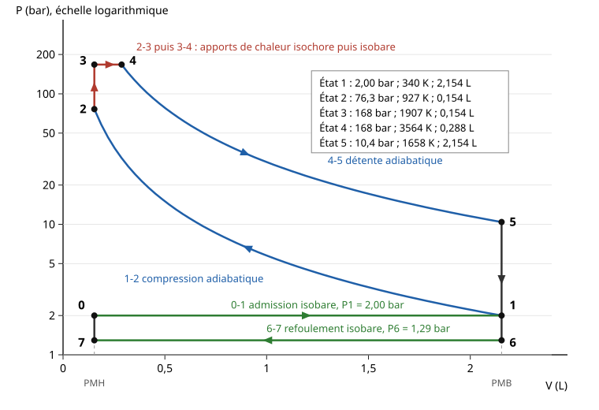

# Banque PT PT — Physique C - Thermodynamique 2007 · Corrigé guidé

*Corrigé rédigé par IA, non officiel. Signalez toute erreur.*

**Rédaction** · modèle exact non renseigné (famille Claude) · effort non renseigné · vitesse non renseignée

## Présentation du sujet

**Thème.** Moteur Diesel rapide à quatre temps, suralimenté par un turbocompresseur et refroidi à l'admission par un échangeur air-air ; le gaz du cylindre décrit le cycle mixte de Sabathé (apport de chaleur à volume constant, puis à pression constante). L'épreuve de Physique C dure 4 heures pour deux problèmes, chimie et thermodynamique, aux barèmes identiques : le sujet conseille d'y consacrer le même temps, soit 2 heures pour cette partie. **Calculatrice autorisée.** Le problème de thermodynamique comporte 12 questions numérotées de 1 à 12, en six parties, dont l'énoncé donne le poids dans le barème.

- *Première partie (questions 1 et 2, 15 %)* : volumes extrêmes, masse de gaz, combustion stœchiométrique, chaleur dégagée.
- *Seconde partie (questions 3 à 6, 40 %)* : états 2 à 5 du cycle et travaux échangés avec le piston.
- *Troisième partie (question 7, 10 %)* : compresseur et turbine couplés.
- *Quatrième partie (questions 8 et 9, 15 %)* : travaux de balayage, travail utile, rendement thermique.
- *Cinquième partie (questions 10 et 11, 10 %)* : débits massiques et puissances.
- *Sixième partie (question 12, 10 %)* : échangeur air-air.

**Notions mobilisées.** Gaz parfait, relation de Mayer, loi de Laplace ; premier principe pour un système fermé (gaz du cylindre) et pour un fluide en écoulement permanent (compresseur, turbine, échangeur) ; équation de combustion ; rendement d'un moteur ; débit massique et débit volumique.

**Documents à lire.** Le schéma de l'installation et le diagramme de Watt du cycle (points 0 à 7), qui n'est pas gradué : il fixe l'ordre des évolutions et leur nature, pas de valeur numérique. Les valeurs $M_a = 4{,}1\ \mathrm{g}$, $M_t = 4{,}4\ \mathrm{g}$ et $M_c = 0{,}28\ \mathrm{g}$ sont imposées pour toute la suite à partir de la question 2.

**Difficulté.** Les calculs sont élémentaires ; toute la difficulté est de choisir le bon système, la bonne masse et la bonne forme du premier principe. Les questions s'enchaînent : une erreur sur un état se propage, d'où l'intérêt de contrôler chaque état par l'équation d'état.

**Gestion du temps.** Environ 20 minutes pour la première partie, 45 minutes pour la seconde, 15 minutes pour la troisième, 15 minutes pour la quatrième, 10 minutes pour la cinquième et 15 minutes pour la sixième. Les questions 7, 10 et 12 (hors valeurs numériques reprises) peuvent être abordées sans avoir terminé le cycle.

> [!JURY]
> Le rapport 2007 conseille de soigner le raisonnement (équations fondamentales, hypothèses, modélisation), de respecter les conventions d'écriture, en particulier les minuscules pour les grandeurs massiques, d'employer les notations de l'énoncé ou de définir celles que l'on introduit, de mener des calculs numériques assez précis et d'éviter les arguments du type « on sait que ». Il attribue les erreurs les plus fréquentes à trois causes : une lecture trop rapide de l'énoncé, qui fait associer une mauvaise masse de gaz à l'état étudié ($M_t$ pour les états 1 et 2, $M_t + M_c$ pour 3, 4 et 5, $M_a$ ou $D_a$ pour A et B, $M_a + M_c$ ou $D_a + D_c$ pour C et D) ; l'emploi au hasard du premier principe pour un système fermé ou pour un système ouvert en écoulement permanent ; la confusion entre une grandeur et la grandeur massique correspondante.

[Sujet officiel (fascicule réunissant les deux parties de Physique C)](https://www.banquept.fr/documents/2007/phys_c_2007.pdf) · [Rapport du jury](https://www.banquept.fr/documents/ecrit/rapport/2007/rapport_phys_c_ecrit_2007.pdf)

*Mode d'emploi* : chercher chaque question seul, lire la première indication en cas de blocage, réessayer, puis la seconde, et seulement ensuite la solution. Conventions : les travaux $W$ et les chaleurs $Q$ sont comptés positivement quand ils sont reçus par le gaz ; les majuscules désignent des grandeurs relatives à la masse contenue dans le cylindre (en joules), les minuscules des grandeurs massiques (en $\mathrm{J\cdot kg^{-1}}$). On note $r = c_p - c_v$ la constante massique du gaz et $c_p = \gamma c_v$ sa capacité thermique massique à pression constante.

## Première partie — Définition des différentes masses

### Question 1 — Volumes extrêmes et masse totale de gaz

> [!INDICATION]
> Deux relations lient $V_1$ et $V_2$ : la définition de la cylindrée et celle du rapport volumétrique. La cylindrée n'est pas le volume maximal.

> [!INDICATION]
> Écrire l'équation d'état pour la masse $M_t$ : $P_1V_1 = M_t\,r\,T_1$. La relation de Mayer et la définition de $\gamma$ donnent $r = c_p - c_v = (\gamma-1)\,c_v$.

#### Solution

**Volumes.** L'énoncé donne $V_1 - V_2 = C_y$ et $\delta = V_1/V_2$. En remplaçant $V_1 = \delta V_2$ dans la première relation :

$$V_2 = \frac{C_y}{\delta - 1} = \frac{2{,}00}{13} = 0{,}154\ \mathrm{L}$$

$$V_1 = \frac{\delta\,C_y}{\delta - 1} = \frac{14\times 2{,}00}{13} = 2{,}154\ \mathrm{L}$$

$$\boxed{V_1 = 2{,}15\ \mathrm{L} \qquad V_2 = 0{,}154\ \mathrm{L}}$$

Le volume maximal dépasse la cylindrée : il s'y ajoute le volume mort $V_2$ de la chambre de combustion.

**Masse totale.** Le gaz est parfait. Par unité de masse, son équation d'état s'écrit $Pv = rT$, avec $r = c_p - c_v$ (relation de Mayer). Comme $c_p = \gamma c_v$,

$$r = (\gamma - 1)\,c_v = 0{,}38\times 760 = 288{,}8\ \mathrm{J\cdot kg^{-1}\cdot K^{-1}}$$

Au point 1, la masse $M_t$ occupe le volume $V_1$ à la température $T_1$ sous la pression $P_1$ :

$$\boxed{M_t = \frac{P_1 V_1}{(\gamma - 1)\,c_v\,T_1}}$$

Application numérique, en unités du Système international :

$$M_t = \frac{2{,}00\times 10^{5}\times 2{,}154\times 10^{-3}}{288{,}8\times 340} = 4{,}39\times 10^{-3}\ \mathrm{kg}$$

$$\boxed{M_t \approx 4{,}4\ \mathrm{g}}$$

**Contrôle.** $M_t$ est supérieure à la masse d'air frais $M_a = 4{,}1\ \mathrm{g}$ donnée plus loin : l'écart, environ $0{,}3\ \mathrm{g}$, correspond aux gaz brûlés restés dans le volume mort $V_2$ à la fin du refoulement, qui se mélangent à l'air admis.

> [!JURY]
> Le rapport note que certains candidats se sont laissé piéger par cette première question, qui pouvait sembler évidente.

> [!PIEGE]
> Écrire $V_1 = C_y = 2\ \mathrm{L}$ : la cylindrée est le volume balayé $V_1 - V_2$, pas le volume maximal. Autre erreur : employer la constante molaire $R$ sans masse molaire, alors que l'énoncé demande une expression en fonction de $c_v$ et $\gamma$.

### Question 2 — Combustion stœchiométrique, pouvoir comburivore, chaleur dégagée

> [!INDICATION]
> Équilibrer d'abord le carbone et l'hydrogène, puis l'oxygène. Le diazote de l'air accompagne le dioxygène à raison de 3,76 mol par mole.

> [!INDICATION]
> Le pouvoir comburivore est un rapport de masses : masse d'air (dioxygène et diazote) nécessaire pour une mole de carburant, divisée par la masse molaire du carburant, qui vaut ici $100\ \mathrm{g\cdot mol^{-1}}$.

#### Solution

**Équation de combustion.** Pour une mole de carburant $\mathrm{C_{7{,}1}H_{14{,}8}}$ : 7,1 mol de carbone donnent 7,1 mol de $\mathrm{CO_2}$ et 14,8 mol d'hydrogène donnent 7,4 mol de $\mathrm{H_2O}$. Il faut donc $7{,}1 + 7{,}4/2 = 10{,}8$ mol de $\mathrm{O_2}$, accompagnées de $10{,}8\times 3{,}76 = 40{,}6$ mol de $\mathrm{N_2}$, qui ne réagit pas :

$$\boxed{\mathrm{C_{7{,}1}H_{14{,}8}} + 10{,}8\,\left(\mathrm{O_2} + 3{,}76\,\mathrm{N_2}\right) \longrightarrow 7{,}1\,\mathrm{CO_2} + 7{,}4\,\mathrm{H_2O} + 40{,}6\,\mathrm{N_2}}$$

Contrôle sur l'oxygène : $2\times 10{,}8 = 21{,}6$ à gauche, $2\times 7{,}1 + 7{,}4 = 21{,}6$ à droite.

**Pouvoir comburivore.** Masse molaire du carburant :

$$M_{carb} = 7{,}1\times 12 + 14{,}8\times 1 = 100\ \mathrm{g\cdot mol^{-1}}$$

Masse d'air associée à une mole de carburant :

$$m_{air} = 10{,}8\times\left(32 + 3{,}76\times 28\right) = 10{,}8\times 137{,}3 = 1483\ \mathrm{g}$$

$$\boxed{P_{co} = \frac{m_{air}}{M_{carb}} = \frac{1483}{100} \approx 14{,}8}$$

Il faut 14,8 kg d'air pour brûler 1 kg de carburant (grandeur sans dimension).

**Masse de carburant.** La combustion est stœchiométrique, donc $M_a = P_{co}\,M_c$ :

$$\boxed{M_c = \frac{M_a}{P_{co}} = \frac{4{,}1}{14{,}83} = 0{,}277\ \mathrm{g} \approx 0{,}28\ \mathrm{g}}$$

**Chaleur dégagée.** Avec la valeur imposée $M_c = 0{,}28\ \mathrm{g}$ :

$$Q_{combustion} = M_c\,P_{ci} = 0{,}28\times 10^{-3}\times 41\,500\times 10^{3}$$

$$\boxed{Q_{combustion} = 1{,}16\times 10^{4}\ \mathrm{J} \approx 11{,}6\ \mathrm{kJ}}$$

La valeur non arrondie, $11\,620\ \mathrm{J}$, est conservée dans les calculs qui suivent.

> [!JURY]
> Le rapport regrette que l'équilibrage de l'équation de combustion donne encore lieu à trop d'erreurs.

> [!METHODE]
> Pour un hydrocarbure $\mathrm{C}_x\mathrm{H}_y$, la combustion complète consomme $x + y/4$ moles de dioxygène et produit $x$ moles de $\mathrm{CO_2}$ et $y/2$ moles de $\mathrm{H_2O}$. Vérifier ensuite le bilan en oxygène.

## Seconde partie — Étude du cycle

### Question 3 — État 2 en fin de compression

> [!INDICATION]
> L'évolution 1-2 est adiabatique et réversible, pour un gaz parfait de $\gamma$ constant : quelle loi relie alors $P$ et $V$, puis $T$ et $V$ ?

> [!INDICATION]
> $P_2 = P_1\,\delta^{\gamma}$ et $T_2 = T_1\,\delta^{\gamma-1}$, avec $\delta = V_1/V_2 = 14$.

#### Solution

La masse $M_t$ de gaz parfait, de $\gamma$ constant, subit de 1 à 2 une évolution adiabatique et réversible (système fermé). La loi de Laplace s'applique : $PV^{\gamma}$ et $TV^{\gamma-1}$ sont constants. D'où

$$\boxed{P_2 = P_1\left(\frac{V_1}{V_2}\right)^{\gamma} = P_1\,\delta^{\gamma}}$$

$$\boxed{T_2 = T_1\left(\frac{V_1}{V_2}\right)^{\gamma-1} = T_1\,\delta^{\gamma-1}}$$

Applications numériques :

$$P_2 = 2{,}00\times 14^{1{,}38} = 76{,}3\ \mathrm{bar}$$

$$T_2 = 340\times 14^{0{,}38} = 927\ \mathrm{K}$$

$$\boxed{P_2 \approx 76{,}3\ \mathrm{bar} \qquad T_2 \approx 927\ \mathrm{K}}$$

**Contrôle.** $P_2V_2/T_2 = P_1V_1/T_1$ : $76{,}3\times 0{,}1538/927 = 1{,}267\times 10^{-2}$ et $2{,}00\times 2{,}154/340 = 1{,}267\times 10^{-2}$ (en $\mathrm{bar\cdot L\cdot K^{-1}}$). La température atteinte, voisine de $650\ \mathrm{°C}$, suffit à l'auto-inflammation du carburant injecté.

> [!JURY]
> Selon le rapport, la loi de Laplace, utile ici et à la question 5, est connue de presque tous les candidats.

> [!PIEGE]
> La loi de Laplace n'est pas une identité : rappeler ses trois conditions (gaz parfait, évolution adiabatique réversible, $\gamma$ constant) avant de l'écrire.

### Question 4 — Apports de chaleur, états 3 et 4

> [!INDICATION]
> Après l'injection, la masse de gaz dans le cylindre est $M_t + M_c$. Écrire le premier principe pour ce système fermé : à volume constant la chaleur reçue vaut la variation d'énergie interne, à pression constante la variation d'enthalpie.

> [!INDICATION]
> $T_3 = T_2 + \dfrac{Q_{2\text{-}3}}{(M_t+M_c)\,c_v}$ et $T_4 = T_3 + \dfrac{Q_{3\text{-}4}}{(M_t+M_c)\,c_p}$. La pression $P_3$ se tire de l'équation d'état écrite avec la masse $M_t + M_c$ ; $V_4$ de l'évolution isobare 3-4.

#### Solution

**Chaleurs reçues.**

$$Q_{2\text{-}3} = 0{,}3\,Q_{combustion} = 0{,}3\times 11\,620 = 3{,}49\times 10^{3}\ \mathrm{J}$$

$$Q_{3\text{-}4} = 0{,}7\,Q_{combustion} = 0{,}7\times 11\,620 = 8{,}13\times 10^{3}\ \mathrm{J}$$

$$\boxed{Q_{2\text{-}3} \approx 3{,}49\ \mathrm{kJ} \qquad Q_{3\text{-}4} \approx 8{,}13\ \mathrm{kJ}}$$

**Système.** À partir du point 2, le cylindre contient le gaz comprimé et le carburant injecté, soit la masse

$$M = M_t + M_c = 4{,}4 + 0{,}28 = 4{,}68\ \mathrm{g}$$

Suivant l'hypothèse de l'énoncé, ce gaz de masse $M$, de mêmes $c_v$ et $\gamma$, s'échauffe comme s'il recevait $Q_{2\text{-}3}$ à volume constant, puis $Q_{3\text{-}4}$ à pression constante, l'enthalpie apportée par le carburant étant négligée.

**Évolution 2-3 (isochore).** Le volume ne varie pas, donc $W_{2\text{-}3} = 0$, et le premier principe appliqué au système fermé donne $\Delta U = Q_{2\text{-}3}$. Pour un gaz parfait, $\Delta U = M c_v\,(T_3 - T_2)$ :

$$\boxed{T_3 = T_2 + \frac{Q_{2\text{-}3}}{(M_t + M_c)\,c_v}}$$

$$T_3 = 927 + \frac{3486}{4{,}68\times 10^{-3}\times 760} = 927 + 980 = 1907\ \mathrm{K}$$

L'équation d'état, écrite pour la masse $M$ dans le volume $V_3 = V_2$, donne la pression :

$$\boxed{P_3 = \frac{(M_t + M_c)\,r\,T_3}{V_2}}$$

$$P_3 = \frac{4{,}68\times 10^{-3}\times 288{,}8\times 1907}{0{,}1538\times 10^{-3}} = 1{,}68\times 10^{7}\ \mathrm{Pa}$$

$$\boxed{T_3 \approx 1907\ \mathrm{K} \qquad P_3 \approx 168\ \mathrm{bar}}$$

La pression est multipliée par 2,2 entre 2 et 3, sous l'effet de l'échauffement (facteur $T_3/T_2 = 2{,}06$) et de l'augmentation de masse (facteur $M/M_t = 1{,}06$).

**Évolution 3-4 (isobare).** À pression constante, le premier principe pour le système fermé s'écrit $\Delta H = Q_{3\text{-}4}$, avec $\Delta H = M c_p\,(T_4 - T_3)$ pour un gaz parfait, et $c_p = \gamma c_v = 1049\ \mathrm{J\cdot kg^{-1}\cdot K^{-1}}$ :

$$\boxed{T_4 = T_3 + \frac{Q_{3\text{-}4}}{(M_t + M_c)\,c_p}}$$

$$T_4 = 1907 + \frac{8134}{4{,}68\times 10^{-3}\times 1049} = 1907 + 1657 = 3564\ \mathrm{K}$$

La pression ne change pas, $P_4 = P_3$, et la masse non plus : $V/T$ est constant de 3 à 4, d'où

$$\boxed{V_4 = V_2\,\frac{T_4}{T_3}}$$

$$V_4 = 0{,}1538\times\frac{3564}{1907} = 0{,}288\ \mathrm{L}$$

$$\boxed{T_4 \approx 3564\ \mathrm{K} \qquad P_4 = P_3 \approx 168\ \mathrm{bar} \qquad V_4 \approx 0{,}288\ \mathrm{L}}$$

**Commentaire.** La température $T_4$ dépasse de loin ce que supporte un moteur réel : le modèle ignore les pertes thermiques aux parois, la dissociation des produits et la variation des capacités thermiques avec la température. Le rapport $V_4/V_2 = 1{,}87$ montre que la combustion isobare se termine tôt dans la course de détente.

**Remarque sur le choix du modèle.** L'énoncé prête au gaz du cylindre, de masse $M_t + M_c$, l'échauffement qu'il aurait en recevant la chaleur de combustion sans réaction chimique ; c'est la lecture retenue ici. Une copie qui garderait la masse $M_t$ dans ce bilan trouverait $T_3 = 1969\ \mathrm{K}$ : l'écart vient uniquement de la masse associée aux états 3 et 4.

> [!JURY]
> Le rapport indique que les questions 4 et 6 n'ont été traitées correctement que très rarement, avec de nombreux résultats numériques incohérents. Il renvoie à sa remarque générale : beaucoup de candidats n'ont pas associé à chaque état la bonne masse de gaz, $M_t$ pour les états 1 et 2, $M_t + M_c$ pour les états 3, 4 et 5.

> [!PIEGE]
> Écrire $P_3 = P_2\,T_3/T_2$ : cette relation suppose la masse constante de 2 à 3, alors que le carburant vient d'être injecté. Elle donne 157 bar au lieu de 168 bar.

> [!METHODE]
> Système fermé de gaz parfait : chaleur reçue à volume constant $Q = M c_v\,\Delta T$, à pression constante $Q = M c_p\,\Delta T$. Toujours préciser la masse du système avant d'écrire le bilan.

### Question 5 — État 5 en fin de détente

> [!INDICATION]
> L'évolution 4-5 est de même nature que 1-2. Quel est le volume au point 5 ?

> [!INDICATION]
> $V_5 = V_1$ : $P_5 = P_4\,(V_4/V_1)^{\gamma}$ et $T_5 = T_4\,(V_4/V_1)^{\gamma-1}$.

#### Solution

La détente 4-5 de la masse $M_t + M_c$ est adiabatique et réversible : la loi de Laplace s'applique de nouveau. Le point 5 correspond au point mort bas, $V_5 = V_1$. Le rapport des volumes vaut

$$\frac{V_4}{V_1} = \frac{0{,}2875}{2{,}154} = 0{,}1335$$

$$\boxed{P_5 = P_4\left(\frac{V_4}{V_1}\right)^{\gamma}}$$

$$\boxed{T_5 = T_4\left(\frac{V_4}{V_1}\right)^{\gamma-1}}$$

Applications numériques :

$$P_5 = 167{,}5\times 0{,}1335^{1{,}38} = 10{,}4\ \mathrm{bar}$$

$$T_5 = 3564\times 0{,}1335^{0{,}38} = 1658\ \mathrm{K}$$

$$\boxed{P_5 \approx 10{,}4\ \mathrm{bar} \qquad T_5 \approx 1658\ \mathrm{K}}$$

**Contrôle.** L'équation d'état donne $P_5 = (M_t + M_c)\,r\,T_5/V_1 = 4{,}68\times 10^{-3}\times 288{,}8\times 1658/(2{,}154\times 10^{-3}) = 1{,}04\times 10^{6}\ \mathrm{Pa}$ : les deux résultats concordent. Les gaz sont encore chauds et sous pression à l'ouverture de la soupape d'échappement : c'est cette énergie que récupère la turbine.

La pression est portée en échelle logarithmique pour que la boucle de balayage 0-1-6-7, située entre 1,29 et 2,00 bar (questions 7 et 8), reste visible sous la boucle principale, qui monte à 168 bar.

### Question 6 — Travaux échangés avec le piston

> [!INDICATION]
> Le travail reçu par le gaz est $W = -\int P\,\mathrm{d}V$. Quelles évolutions se font à volume constant ? Pour une évolution adiabatique, le premier principe donne directement $W = \Delta U$.

> [!INDICATION]
> $W_{1\text{-}2} = M_t c_v\,(T_2 - T_1)$, $W_{3\text{-}4} = -P_3\,(V_4 - V_2)$, $W_{4\text{-}5} = (M_t + M_c)\,c_v\,(T_5 - T_4)$. Attention à la masse de chaque évolution.

#### Solution

Le gaz du cylindre est un système fermé qui reçoit du piston le travail $\delta W = -P\,\mathrm{d}V$ (évolutions réversibles).

**Compression 1-2** (adiabatique, masse $M_t$) : $Q_{1\text{-}2} = 0$, donc $W_{1\text{-}2} = \Delta U$.

$$\boxed{W_{1\text{-}2} = M_t\,c_v\,(T_2 - T_1)}$$

$$W_{1\text{-}2} = 4{,}4\times 10^{-3}\times 760\times(926{,}8 - 340) = +1{,}96\times 10^{3}\ \mathrm{J}$$

**Évolution 2-3** (isochore) : le piston ne se déplace pas.

$$\boxed{W_{2\text{-}3} = 0}$$

**Évolution 3-4** (isobare, masse $M_t + M_c$) :

$$\boxed{W_{3\text{-}4} = -P_3\,(V_4 - V_2) = -(M_t + M_c)\,r\,(T_4 - T_3)}$$

$$W_{3\text{-}4} = -4{,}68\times 10^{-3}\times 288{,}8\times(3564 - 1907) = -2{,}24\times 10^{3}\ \mathrm{J}$$

**Détente 4-5** (adiabatique, masse $M_t + M_c$) :

$$\boxed{W_{4\text{-}5} = (M_t + M_c)\,c_v\,(T_5 - T_4)}$$

$$W_{4\text{-}5} = 4{,}68\times 10^{-3}\times 760\times(1658 - 3564) = -6{,}78\times 10^{3}\ \mathrm{J}$$

**Évolution 5-1** (isochore, piston au point mort bas) :

$$\boxed{W_{5\text{-}1} = 0}$$

Récapitulatif :

$$\boxed{W_{1\text{-}2} \approx +1{,}96\ \mathrm{kJ} \qquad W_{2\text{-}3} = 0 \qquad W_{3\text{-}4} \approx -2{,}24\ \mathrm{kJ} \qquad W_{4\text{-}5} \approx -6{,}78\ \mathrm{kJ} \qquad W_{5\text{-}1} = 0}$$

**Signes.** Le gaz reçoit du travail pendant la compression ($W > 0$) et en fournit au piston pendant les deux phases de détente ($W < 0$). **Contrôle** de $W_{3\text{-}4}$ par la première forme : $-167{,}5\times 10^{5}\times(0{,}2875 - 0{,}1538)\times 10^{-3} = -2{,}24\times 10^{3}\ \mathrm{J}$. La somme sur la boucle 1-2-3-4-5-1 vaut $-7{,}06\ \mathrm{kJ}$ : le gaz fournit ce travail au piston pendant ces évolutions.

> [!JURY]
> Comme pour la question 4, le rapport signale que cette question a très rarement été traitée correctement, les résultats numériques étant souvent incohérents ; il rattache ces erreurs au choix de la masse de gaz propre à chaque état. Il relève aussi, parmi les erreurs générales, la confusion entre une grandeur et la grandeur massique correspondante ($W$ ou $w$, $C_p$ ou $c_p$).

> [!PIEGE]
> Le gaz du cylindre est un système fermé : le travail est $-\int P\,\mathrm{d}V$ et le bilan porte sur l'énergie interne. Le premier principe en écoulement permanent ($\Delta h = w_i + q$) ne concerne que le compresseur, la turbine et l'échangeur.

## Troisième partie — Étude du turbocompresseur

### Question 7 — Températures de sortie et pression d'entrée de la turbine

> [!INDICATION]
> Compresseur et turbine sont des systèmes ouverts en régime permanent : écrire $\Delta h = w_i + q$ pour chacun. Les évolutions y sont adiabatiques et réversibles : la loi de Laplace relie $T$ et $P$.

> [!INDICATION]
> La turbine entraîne le compresseur sans pertes : la puissance qu'elle fournit est égale à celle que le compresseur absorbe. Les deux débits massiques diffèrent : $D_a$ dans le compresseur, $D_a + D_c$ dans la turbine, et leur rapport est celui des masses par cycle, $M_a/(M_a + M_c)$.

#### Solution

**Relation de départ.** Pour un fluide en écoulement permanent traversant une machine, le premier principe s'écrit, par unité de masse de fluide et en négligeant les énergies cinétique et potentielle,

$$h_s - h_e = w_i + q$$

où $w_i$ est le travail indiqué massique reçu des parties mobiles et $q$ la chaleur massique reçue. Pour un gaz parfait, $h_s - h_e = c_p\,(T_s - T_e)$.

**Compresseur.** La compression de l'air de A à B est adiabatique et réversible, pour un gaz parfait de $\gamma$ constant : $T^{\gamma}P^{1-\gamma}$ est constant (loi de Laplace), d'où

$$\boxed{T_B = T_A\left(\frac{P_B}{P_A}\right)^{\frac{\gamma-1}{\gamma}}}$$

$$T_B = 293\times 2{,}4^{0{,}38/1{,}38} = 293\times 2{,}4^{0{,}2754} = 372{,}9\ \mathrm{K}$$

$$\boxed{T_B \approx 373\ \mathrm{K}}$$

Le travail indiqué massique reçu par l'air ($q = 0$) vaut

$$w_{i,c} = c_p\,(T_B - T_A) = 1049\times(372{,}9 - 293) = +83{,}8\ \mathrm{kJ\cdot kg^{-1}}$$

**Turbine.** La détente des gaz de C à D est adiabatique : le travail indiqué massique reçu par les gaz est

$$w_{i,T} = c_p\,(T_D - T_C) < 0$$

**Couplage.** La turbine a pour seul rôle d'entraîner le compresseur et les pertes mécaniques sont négligées : la puissance cédée par les gaz à la turbine est égale à la puissance reçue par l'air dans le compresseur. Le compresseur est traversé par le débit d'air $D_a$, la turbine par le débit $D_a + D_c$ :

$$D_a\,c_p\,(T_B - T_A) = (D_a + D_c)\,c_p\,(T_C - T_D)$$

Les débits sont proportionnels aux masses mises en jeu à chaque cycle, donc $D_a/(D_a + D_c) = M_a/(M_a + M_c)$ :

$$\boxed{T_D = T_C - \frac{M_a}{M_a + M_c}\,(T_B - T_A)}$$

$$T_D = 1100 - \frac{4{,}1}{4{,}38}\times(372{,}9 - 293) = 1100 - 74{,}8 = 1025{,}2\ \mathrm{K}$$

$$\boxed{T_D \approx 1025\ \mathrm{K}}$$

**Pression d'entrée de la turbine.** La détente C-D est adiabatique et réversible : la loi de Laplace donne

$$\boxed{P_C = P_D\left(\frac{T_C}{T_D}\right)^{\frac{\gamma}{\gamma-1}}}$$

$$P_C = 1{,}00\times\left(\frac{1100}{1025{,}2}\right)^{3{,}632} = 1{,}29\ \mathrm{bar}$$

$$\boxed{P_C \approx 1{,}29\ \mathrm{bar}}$$

**Commentaire.** Une faible détente des gaz chauds (de 1,29 à 1,00 bar, chute de 75 K) suffit à comprimer l'air froid de 1,00 à 2,4 bar : à rapport de pression donné, le travail massique de détente est proportionnel à la température d'entrée. La pression d'échappement du moteur (1,29 bar) reste inférieure à sa pression d'admission (2,00 bar).

> [!JURY]
> Le rapport constate que les résultats numériques sont souvent à peu près corrects, mais obtenus par des raisonnements faux : travail indiqué confondu avec une variation d'énergie interne, débits massiques pris égaux dans le compresseur et dans la turbine, erreurs de signe entre le travail du compresseur et celui de la turbine. Il relève plus généralement l'emploi au hasard du premier principe pour un système fermé ou pour un système ouvert en écoulement permanent, parfois les deux pour une même évolution, et rappelle les masses à associer : $M_a$ (ou $D_a$) pour A et B, $M_a + M_c$ (ou $D_a + D_c$) pour C et D.

> [!METHODE]
> Pour une turbomachine adiabatique traversée par un gaz parfait : $w_i = c_p\,(T_s - T_e)$, positif pour un compresseur, négatif pour une turbine. Une égalité de puissances s'écrit avec le débit propre à chaque machine.

## Quatrième partie — Étude du balayage et du rendement du moteur

### Question 8 — Travaux d'admission et de refoulement

> [!INDICATION]
> Les évolutions 0-1 et 6-7 sont isobares : $W = -P\,\Delta V$, avec une variation de volume égale à la cylindrée, au signe près.

> [!INDICATION]
> $W_{0\text{-}1} = -P_1\,C_y$ et $W_{6\text{-}7} = +P_6\,C_y$, avec $P_6 = P_C$ trouvée à la question 7.

#### Solution

Pendant l'admission et le refoulement, le gaz présent dans le cylindre exerce sur le piston une pression uniforme et constante ; le travail qu'il reçoit du piston est $W = -P\,(V_{final} - V_{initial})$.

**Admission 0-1**, à la pression $P_1$, le volume passant de $V_2$ à $V_1$ :

$$\boxed{W_{0\text{-}1} = -P_1\,(V_1 - V_2) = -P_1\,C_y}$$

$$W_{0\text{-}1} = -2{,}00\times 10^{5}\times 2{,}00\times 10^{-3} = -400\ \mathrm{J}$$

**Refoulement 6-7**, à la pression $P_6 = P_C = 1{,}29\ \mathrm{bar}$, le volume passant de $V_1$ à $V_2$ :

$$\boxed{W_{6\text{-}7} = -P_6\,(V_2 - V_1) = +P_6\,C_y}$$

$$W_{6\text{-}7} = 1{,}291\times 10^{5}\times 2{,}00\times 10^{-3} = +258\ \mathrm{J}$$

$$\boxed{W_{0\text{-}1} = -400\ \mathrm{J} \qquad W_{6\text{-}7} \approx +258\ \mathrm{J}}$$

**Commentaire.** La somme $W_{0\text{-}1} + W_{6\text{-}7} = -142\ \mathrm{J}$ est négative : grâce à la suralimentation, la pression d'admission dépasse la pression d'échappement et la boucle de balayage 0-1-6-7 est motrice. Dans un moteur à aspiration naturelle, elle serait résistante.

> [!JURY]
> Le rapport fait état de beaucoup de bonnes réponses, avec cependant quelques copies qui écrivent le travail élémentaire $+P\,\mathrm{d}V$ ou $+V\,\mathrm{d}P$.

> [!PIEGE]
> Le signe : pendant l'admission le volume augmente, le gaz pousse le piston et reçoit un travail négatif ; pendant le refoulement c'est le piston qui pousse le gaz.

### Question 9 — Travail utile et rendement thermique

> [!INDICATION]
> Le travail utile est le travail fourni au piston sur le cycle complet du moteur à quatre temps : il faut sommer tous les travaux, balayage compris, et changer le signe.

> [!INDICATION]
> Le rendement thermique compare ce travail utile à la dépense : la chaleur dégagée par la combustion, $Q_{combustion}$.

#### Solution

**Travail utile.** Sur un cycle complet (deux tours de vilebrequin), le gaz reçoit du piston la somme des travaux de toutes les évolutions ; les évolutions isochores 2-3, 5-6 et 7-0 n'en échangent pas. Le travail utile, fourni par le moteur, est l'opposé de cette somme :

$$\boxed{W_u = -\left(W_{0\text{-}1} + W_{1\text{-}2} + W_{3\text{-}4} + W_{4\text{-}5} + W_{6\text{-}7}\right)}$$

$$W_u = -\left(-400 + 1962 - 2240 - 6779 + 258\right) = 7{,}20\times 10^{3}\ \mathrm{J}$$

$$\boxed{W_u \approx 7{,}20\ \mathrm{kJ}}$$

La boucle haute pression 1-2-3-4-5 en apporte $7{,}06\ \mathrm{kJ}$ et la boucle de balayage $0{,}14\ \mathrm{kJ}$.

**Rendement thermique.** C'est le rapport du travail utile à l'énergie dépensée, c'est-à-dire la chaleur dégagée par la combustion du carburant :

$$\boxed{\eta_{th} = \frac{W_u}{Q_{combustion}} = \frac{W_u}{M_c\,P_{ci}}}$$

$$\eta_{th} = \frac{7198}{11\,620} = 0{,}62$$

$$\boxed{\eta_{th} \approx 0{,}62}$$

**Commentaire.** Cette valeur, comprise entre 0 et 1, est élevée : elle est celle d'un cycle idéal (évolutions réversibles, aucune perte thermique aux parois ni frottement, combustion complète). Un moteur Diesel suralimenté réel atteint plutôt 0,40 à 0,45.

> [!JURY]
> Le rapport relève beaucoup d'erreurs : travail utile réduit au seul travail de détente $W_{4\text{-}5}$, ou oubli des travaux de balayage $W_{0\text{-}1}$ et $W_{6\text{-}7}$. Il note que la définition du rendement thermique n'a reçu que très peu de bonnes réponses.

> [!METHODE]
> Rendement d'un moteur : grandeur utile (travail fourni sur le cycle) divisée par grandeur coûteuse (chaleur apportée par la source chaude, ici la combustion). Écrire la définition avant le calcul.

## Cinquième partie — Bilan global

### Question 10 — Débits massiques d'air et de carburant

> [!INDICATION]
> Combien de cycles le moteur effectue-t-il par seconde, sachant qu'un cycle occupe deux tours de vilebrequin ?

> [!INDICATION]
> 25 cycles par seconde. À chaque cycle, le moteur aspire la masse $M_a$ d'air et consomme la masse $M_c$ de carburant.

#### Solution

Le moteur à quatre temps effectue un cycle tous les deux tours. Le nombre de cycles par unité de temps est donc

$$f = \frac{N}{2} = \frac{3000}{2} = 1500\ \mathrm{cycles\cdot min^{-1}} = 25\ \mathrm{cycles\cdot s^{-1}}$$

À chaque cycle, le moteur aspire la masse d'air frais $M_a$, fournie par le compresseur, et brûle la masse de carburant $M_c$ :

$$\boxed{D_a = \frac{N}{2}\,M_a \qquad D_c = \frac{N}{2}\,M_c}$$

$$D_a = 25\times 4{,}1\times 10^{-3} = 0{,}1025\ \mathrm{kg\cdot s^{-1}}$$

$$D_c = 25\times 0{,}28\times 10^{-3} = 7{,}0\times 10^{-3}\ \mathrm{kg\cdot s^{-1}}$$

$$\boxed{D_a \approx 0{,}103\ \mathrm{kg\cdot s^{-1}} \qquad D_c = 7{,}0\ \mathrm{g\cdot s^{-1}}}$$

soit environ $369\ \mathrm{kg\cdot h^{-1}}$ d'air et $25\ \mathrm{kg\cdot h^{-1}}$ de carburant.

> [!JURY]
> Pour les questions 10 et 11, le rapport estime que la réponse figurait pratiquement dans l'énoncé et s'étonne du peu de bonnes réponses : débit volumique calculé à partir de la cylindrée au lieu du débit massique demandé, unités fausses.

> [!PIEGE]
> Prendre 3000 cycles par minute (un cycle par tour) double tous les débits et toutes les puissances. Convertir aussi les minutes en secondes pour obtenir des $\mathrm{kg\cdot s^{-1}}$ et des watts.

### Question 11 — Puissances du moteur et du compresseur

> [!INDICATION]
> Une puissance est un travail par cycle multiplié par le nombre de cycles par seconde, ou un travail massique multiplié par un débit massique.

> [!INDICATION]
> $\mathcal{P}_m = (N/2)\,W_u$ pour le moteur ; $\mathcal{P}_c = D_a\,c_p\,(T_B - T_A)$ pour le compresseur.

#### Solution

**Moteur.** Il fournit le travail utile $W_u$ à chaque cycle, 25 fois par seconde :

$$\boxed{\mathcal{P}_m = \frac{N}{2}\,W_u}$$

$$\mathcal{P}_m = 25\times 7198 = 1{,}80\times 10^{5}\ \mathrm{W}$$

$$\boxed{\mathcal{P}_m \approx 180\ \mathrm{kW}}$$

**Compresseur.** Il est traversé par le débit $D_a$ d'air, qui y reçoit le travail indiqué massique $w_{i,c} = c_p\,(T_B - T_A)$ (question 7) :

$$\boxed{\mathcal{P}_c = D_a\,c_p\,(T_B - T_A)}$$

$$\mathcal{P}_c = 0{,}1025\times 1049\times(372{,}9 - 293) = 8{,}59\times 10^{3}\ \mathrm{W}$$

$$\boxed{\mathcal{P}_c \approx 8{,}6\ \mathrm{kW}}$$

**Commentaire.** Cette puissance, fournie par la turbine, est prélevée sur les gaz d'échappement et non sur l'arbre moteur : elle représente moins de 5 % de la puissance du moteur. Contrôle du rendement : la puissance thermique de combustion vaut $D_c\,P_{ci} = 7{,}0\times 10^{-3}\times 41{,}5\times 10^{6} = 290\ \mathrm{kW}$, et $180/290 = 0{,}62$.

## Sixième partie — Étude de l'échangeur air-air

### Question 12 — Débit volumique d'air ambiant

> [!INDICATION]
> Appliquer le premier principe en écoulement permanent à l'échangeur entier, supposé calorifugé : aucune chaleur et aucun travail ne sont échangés avec l'extérieur, la variation totale du débit d'enthalpie est nulle.

> [!INDICATION]
> $D_a\,c_p\,(T_B - T_1) = D_e\,c_p\,\Delta T$ donne le débit massique $D_e$ d'air ambiant. Le débit volumique s'en déduit par la masse volumique de l'air ambiant, $\rho = P_A/(r\,T_A)$.

#### Solution

**Hypothèses.**

- Régime permanent ; énergies cinétique et potentielle négligées.
- Échangeur globalement calorifugé : les deux courants d'air n'échangent de la chaleur qu'entre eux ; il ne comporte aucune pièce mobile.
- L'air ambiant de refroidissement est le même gaz parfait que l'air comprimé (mêmes $c_p$ et $r$), pris à $T_A = 293\ \mathrm{K}$ sous $P_A = 1{,}00\ \mathrm{bar}$ ; son débit volumique est évalué dans ces conditions d'entrée.
- L'enthalpie massique d'un gaz parfait ne dépend que de la température : la perte de charge de l'air comprimé (de 2,4 à 2,00 bar) n'intervient pas dans le bilan.

**Bilan.** Le premier principe appliqué au système ouvert formé de tout l'échangeur, à deux entrées et deux sorties, sans travail ni chaleur reçus de l'extérieur, s'écrit

$$D_a\,c_p\,(T_1 - T_B) + D_e\,c_p\,\Delta T = 0$$

où $D_e$ est le débit massique d'air ambiant. D'où

$$\boxed{D_e = D_a\,\frac{T_B - T_1}{\Delta T}}$$

$$D_e = 0{,}1025\times\frac{372{,}9 - 340}{10} = 0{,}337\ \mathrm{kg\cdot s^{-1}}$$

**Débit volumique.** La masse volumique de l'air ambiant vaut

$$\rho_e = \frac{P_A}{r\,T_A} = \frac{1{,}00\times 10^{5}}{288{,}8\times 293} = 1{,}18\ \mathrm{kg\cdot m^{-3}}$$

$$\boxed{D_{v,e} = \frac{D_e}{\rho_e} = \frac{D_a\,(T_B - T_1)}{\Delta T}\,\frac{r\,T_A}{P_A}}$$

$$D_{v,e} = \frac{0{,}337}{1{,}182} = 0{,}285\ \mathrm{m^3\cdot s^{-1}}$$

$$\boxed{D_{v,e} \approx 0{,}29\ \mathrm{m^3\cdot s^{-1}}}$$

soit environ 285 litres par seconde. **Commentaire.** La puissance thermique évacuée, $D_a\,c_p\,(T_B - T_1) = 3{,}5\ \mathrm{kW}$, est modeste, mais l'échauffement toléré de l'air ambiant est faible : il faut un débit massique 3,3 fois plus grand que celui de l'air comprimé. Refroidir l'air d'admission augmente sa masse volumique, donc la masse d'air admise par cycle.

> [!JURY]
> Le rapport renvoie à sa remarque sur la question 7 : peu de raisonnement logique, auquel s'ajoute ici la confusion entre débit massique et débit volumique.

> [!PIEGE]
> Le bilan d'enthalpie porte sur des débits massiques. Le passage au débit volumique demande de préciser l'état de l'air considéré : ici l'air ambiant à 293 K sous 1 bar, et non l'air comprimé.

## Bilan

**Résultats à retenir.**

| État | Pression | Température | Volume | Masse |
|---|---|---|---|---|
| 1 | 2,00 bar | 340 K | 2,154 L | 4,4 g |
| 2 | 76,3 bar | 927 K | 0,154 L | 4,4 g |
| 3 | 168 bar | 1907 K | 0,154 L | 4,68 g |
| 4 | 168 bar | 3564 K | 0,288 L | 4,68 g |
| 5 | 10,4 bar | 1658 K | 2,154 L | 4,68 g |

Turbocompresseur : $T_B \approx 373\ \mathrm{K}$, $T_D \approx 1025\ \mathrm{K}$, $P_C \approx 1{,}29\ \mathrm{bar}$. Moteur : $W_u \approx 7{,}20\ \mathrm{kJ}$ par cycle, $\eta_{th} \approx 0{,}62$, puissance d'environ 180 kW à 3000 tours par minute.

**Méthodes à retenir.**

- Avant tout bilan, nommer le système : gaz enfermé dans le cylindre (système fermé, $\Delta U = W + Q$, $W = -\int P\,\mathrm{d}V$) ou fluide traversant une machine en régime permanent ($\Delta h = w_i + q$).
- Associer à chaque état la masse qui s'y trouve : $M_t$ avant l'injection, $M_t + M_c$ après ; $D_a$ au compresseur, $D_a + D_c$ à la turbine.
- Loi de Laplace pour toute évolution adiabatique réversible d'un gaz parfait, sous la forme adaptée aux données : $(P, V)$, $(T, V)$ ou $(T, P)$.
- Couplage turbine-compresseur : égalité de deux puissances, chacune écrite avec son propre débit.
- Passage du cycle aux débits et aux puissances : un cycle tous les deux tours pour un moteur à quatre temps.

**Points de vigilance.**

- La cylindrée est $V_1 - V_2$, pas $V_1$.
- Le travail utile inclut les travaux de balayage 0-1 et 6-7 ; le rendement thermique rapporte ce travail à la chaleur de combustion.
- Un débit massique s'exprime en $\mathrm{kg\cdot s^{-1}}$, un débit volumique en $\mathrm{m^3\cdot s^{-1}}$ : l'un se déduit de l'autre par la masse volumique, dans un état à préciser.
- Contrôler chaque état par l'équation d'état, et le rendement par le rapport des puissances.
