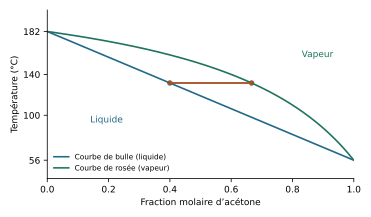
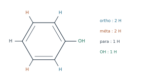
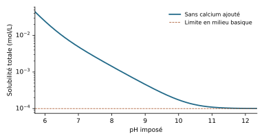
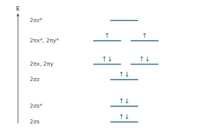
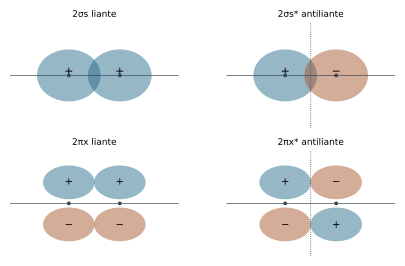
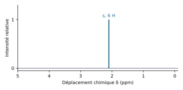
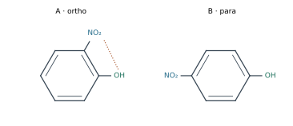

# ENS de Lyon — Second concours, Chimie 2007 · Corrigé brut

*Corrigé rédigé par IA, non officiel.*

**Rédaction (tour 1)** · GPT-6.2 Astra Ultra · vitesse non renseignée

Sur les 55 questions et sous-questions terminales du scan, 45 sont entièrement traitées et une partiellement. Cette dernière, V.B2, couvre le principe du reflux. Les neuf autres rubriques hors couverture sont indiquées individuellement. Les parties sur les carbonates et sur les orbitales du dioxygène sont corrigées intégralement. Les éditions distinguent les intégrales RMN du tableau des déplacements usuels, l’ordre de volatilité ortho/para et les deux valeurs possibles du calcul massique final. Aucun rapport de jury spécifique ne figure dans les sources disponibles.

## I. Bilan thermodynamique et propriétés du phénol

### Question I.A1 — Origine industrielle des deux matières premières

Le benzène provient notamment de coupes aromatiques du reformage catalytique et de la valorisation de l’essence de pyrolyse. Le propène est une oléfine fournie notamment par le vapocraquage et le craquage catalytique de fractions pétrolières.

*Question I.A2 hors couverture.*

### Question I.A3a — Signe de l’enthalpie de réaction

$\Delta_rH^\circ=-113\ \mathrm{kJ\,mol^{-1}}<0$. La transformation, dans son sens d’écriture, est **exothermique**.

### Question I.A3b — Enthalpie de formation manquante

Pour les coefficients stœchiométriques unitaires du bilan, $\Delta_rH^\circ=\Delta_fH^\circ(\mathrm{cumène,l})-\Delta_fH^\circ(\mathrm{benzène,l})-\Delta_fH^\circ(\mathrm{propène,g})$. Ainsi $\Delta_fH^\circ(\mathrm{cumène,l})=-113+49{,}1+20{,}0=\mathbf{-43{,}9\ kJ\,mol^{-1}}$ à 298 K.

### Question I.A4 — Entropie standard de réaction

$\Delta_rS^\circ=287{,}7-173{,}3-270{,}3=\mathbf{-155{,}9\ J\,mol^{-1}\,K^{-1}}$. Le signe négatif était plausible, car le bilan consomme une mole de gaz en donnant du liquide. Les entropies des phases condensées interviennent aussi dans la valeur numérique.

### Question I.A5 — Enthalpie libre et constante

À 298 K, $\Delta_rG^\circ=-113-298(-0{,}1559)=\mathbf{-66{,}5\ kJ\,mol^{-1}}$. Alors $\ln K^\circ=66\,542/(8{,}314\times298)\simeq26{,}9$ et **$K^\circ\simeq4{,}6\times10^{11}$**, sans unité. Une grande constante d’équilibre ne renseigne pas à elle seule sur la vitesse.

### Question I.B1 — Vocabulaire d’un mécanisme en chaîne

L’**amorçage** crée les premiers porteurs de chaîne. La **propagation** en consomme et en régénère, assurant la répétition du cycle. La **terminaison** fait disparaître les porteurs actifs, par exemple par combinaison de deux radicaux.

*Question I.B2 hors couverture.*

*Question I.B3 hors couverture.*

*Question I.B4 hors couverture.*

## I.C. Équilibres de phase et spectroscopie

### Question I.C1 — Diagramme de phases liquide–vapeur

En abscisse, porter la fraction molaire d’acétone, $x$ pour le liquide et $y$ pour la vapeur. L’ordonnée est la température. Les courbes d’ébullition et de rosée joignent **182 °C** à $x=y=0$ et **56 °C** à $x=y=1$. Dans le modèle idéal elles délimitent un fuseau, la courbe de bulle en bas et celle de rosée en haut. À une température du fuseau, une horizontale donne les compositions coexistantes, avec $y_{\rm acétone}>x_{\rm acétone}$. Sous le fuseau se trouve le liquide, au-dessus la vapeur. Les températures d’ébullition pures fixent les extrémités, sans déterminer à elles seules la courbure exacte.

### Question I.C2 — Influence de la pression sur l’ébullition

L’ébullition a lieu quand la pression de vapeur saturante atteint la pression extérieure. Comme cette pression saturante croît avec la température, une pression extérieure plus faible correspond à une température d’ébullition **inférieure à 182 °C**.

### Question I.C3a — Acidité du phénol

Le $pK_a$ du couple phénol/ion phénolate dans l’eau est **voisin de 10** à température ambiante.

### Question I.C3b — Comparer phénol et alcool

Un alcool aliphatique simple a généralement un $pK_a$ de l’ordre de **16** dans l’eau. Le phénol est donc sensiblement plus acide. Dans le phénolate, le doublet de O se conjugue avec le cycle et des formes mésomères placent de la charge en ortho et para. Dans l’alcoolate aliphatique la charge est essentiellement localisée sur O.

*Question I.C3c hors couverture.*

### Question I.C4 — Attribution des signaux du phénol

A, singulet de 1 H à 5,7 ppm, correspond à OH, dont le déplacement et la largeur varient avec les conditions. B, doublet de 2 H à 6,8 ppm, correspond aux deux H **ortho**, chacun ayant un voisin ortho porteur de H. En suivant strictement les intégrations et multiplicités simplifiées du tableau, C, triplet de 2 H à 6,9 ppm, correspond aux deux H **méta** et D, triplet de 1 H à 7,2 ppm, au H **para**. Les déplacements habituels du phénol donnent souvent l’ordre inverse pour ces deux derniers groupes, le méta étant le plus déblindé. L’attribution demandée suit ici les intégrales imprimées. Les couplages à longue distance peuvent aussi compliquer les multiplets réels.

## II. Équilibres des carbonates

### Question II.A1 — Dissolution du carbonate de sodium

$\mathrm{Na_2CO_3(s)\to 2Na^+(aq)+CO_3^{2-}(aq)}$. Ce bilan de dissolution doit être complété par les équilibres acido-basiques des ions carbonate dans l’eau.

### Question II.A2 — Concentrations et pH du carbonate

Le quotient $2{,}5\times10^{-3}/0{,}250$ donne $C=0{,}0100\ \mathrm{mol\,L^{-1}}$ de carbonate analytique et **$[\mathrm{Na^+}]=0{,}0200\ \mathrm{mol\,L^{-1}}$**. Pour $\mathrm{CO_3^{2-}+H_2O\rightleftharpoons HCO_3^-+OH^-}$, $K_b=10^{-14+10{,}3}=2{,}00\times10^{-4}$. En posant $x\simeq[\mathrm{OH^-}]\simeq[\mathrm{HCO_3^-}]$, $x^2/(C-x)=K_b$ donne $x=1{,}32\times10^{-3}\ \mathrm{mol\,L^{-1}}$. Donc **$[\mathrm{CO_3^{2-}}]\simeq8{,}68\times10^{-3}\ \mathrm{mol\,L^{-1}}$ et pH 11,12**. La fraction hydrolysée est de 13 %, ce qui justifie le second degré. À ce pH $[\mathrm{H_3O^+}]\ll x$ et $[\mathrm{CO_2(aq)}]/[\mathrm{HCO_3^-}]\simeq10^{6{,}3-11{,}12}$ est négligeable. Le modèle assimile activités et concentrations et suppose l’absence d’échanges externes de CO₂.

### Question II.A3a — Protonation de l’ion carbonate

$\mathrm{CO_3^{2-}+H_3O^+\rightleftharpoons HCO_3^-+H_2O}$. La constante est $1/K_{a2}=10^{10{,}3}\simeq\mathbf{2{,}0\times10^{10}}$.

### Question II.A3b — Définition d’un ampholyte

Un ampholyte de Brønsted peut accepter ou céder un proton. $\mathrm{HCO_3^-}$ peut être protoné vers la forme carbonique dissoute et déprotoné vers $\mathrm{CO_3^{2-}}$.

### Question II.A3c — pH d’une solution d’ampholyte

Notons $\mathrm{H_2A,HA^-,A^{2-}}$ les trois formes et $C$ la concentration analytique d’un sel monovalent de $\mathrm{HA^-}$. Le bilan de charge et le bilan en A donnent $[\mathrm{H_2A}]+[\mathrm{H_3O^+}]=[\mathrm{A^{2-}}]+[\mathrm{OH^-}]$. Si les ions de l’eau sont minoritaires devant les deux formes latérales, $[\mathrm{H_2A}]\simeq[\mathrm{A^{2-}}]$. Le produit des constantes conduit alors à $h^2\simeq K_{a1}K_{a2}$. Donc **$\mathrm{pH}\simeq(pK_{a1}+pK_{a2})/2=8{,}3$**. On suppose une solution idéale assez concentrée, sans autre acide ni base.

### Question II.B1 — Solubilité à pH imposé

À pH 12, la fraction carbonate $\alpha_2=1/[1+10^{10{,}3-12}+10^{6{,}3+10{,}3-24}]\simeq0{,}9804$. En l’absence d’autre calcium ni carbone, $[\mathrm{Ca^{2+}}]=S$ et $[\mathrm{CO_3^{2-}}]=\alpha_2S$. Comme $K_s=10^{-8}$, **$S=\sqrt{K_s/\alpha_2}\simeq1{,}01\times10^{-4}\ \mathrm{mol\,L^{-1}}$**. Assimiler la fraction à un donnerait $10^{-4}$ à 1 % près.

### Question II.B2a — Effet d’ion commun

Le calcium préexistant est un ion commun. À pH fixé, une plus petite quantité de solide doit se dissoudre pour atteindre la saturation. On a donc **$S'<S$**.

### Question II.B2b — Valeur avec calcium supplémentaire

On a $K_s=(0{,}50+S')\alpha_2 S'$. Puisque $S'\ll0{,}50$, **$S'\simeq10^{-8}/(0{,}50\times0{,}9804)=2{,}04\times10^{-8}\ \mathrm{mol\,L^{-1}}$**. L’approximation sur $S'$ est vérifiée. À une force ionique aussi élevée, la valeur réelle demanderait des coefficients d’activité. Le chiffre est celui du modèle de concentrations du sujet.

### Question II.B3a — Influence de l’acidité

Une baisse du pH accroît la proportion d’hydrogénocarbonate, puis celle du carbone dissous sous forme carbonique. À carbone total fixé, la concentration de carbonate libre diminue. Un supplément de solide se dissout donc jusqu’à la saturation et la solubilité totale augmente, dans le système fermé au dégagement de CO₂ demandé.

### Question II.B3b — Formule de la solubilité conditionnelle

Posons $h=[\mathrm{H_3O^+}]$ en valeurs numériques rapportées à la concentration standard. Le bilan du carbone donne $S=[\mathrm{CO_3^{2-}}](1+h/K_{a2}+h^2/(K_{a1}K_{a2}))$. Sans calcium ajouté, $[\mathrm{Ca^{2+}}]=S$ et $K_s=S[\mathrm{CO_3^{2-}}]$. D’où **$S^2=K_s(1+h/K_{a2}+h^2/(K_{a1}K_{a2}))$**. Les égalités supposent les ions libres, les activités idéales et l’absence de dégazage.

## III. Orbitales et propriétés du dioxygène

### Question III.A1 — Électrons de l’atome d’oxygène

La configuration fondamentale est **$1s^2\,2s^2\,2p^4$**. Les deux électrons 1s forment le cœur. Les six électrons de la couche 2 sont les électrons de valence. Les quatre électrons 2p occupent trois orbitales selon la règle de Hund.

### Question III.A2 — Structure de Lewis de O₂

On écrit **O=O**, avec **deux doublets non liants sur chacun des deux oxygènes**. Ce dessin utilise douze électrons et donne deux charges formelles nulles.

### Question III.A3a — Remplissage du diagramme moléculaire

Avec l’axe interatomique $z$, les niveaux $\sigma$ occupés portent **$(2\sigma_s)^2(2\sigma_s^*)^2(2\sigma_z)^2$**. Les niveaux $\pi$ portent **$(2\pi_x)^2(2\pi_y)^2(2\pi_x^*)^1(2\pi_y^*)^1$**. On compte ainsi douze électrons de valence. Les deux électrons dans les $\pi^*$ dégénérées occupent deux orbitales différentes à spins parallèles. Si l’on écrit aussi le cœur, ajouter $(1\sigma_s)^2(1\sigma_s^*)^2$, qui se compensent dans l’indice de liaison.

### Question III.A3b — Indice de liaison du dioxygène

Il y a huit électrons liants et quatre antiliants dans les orbitales de valence. L’indice vaut **$(8-4)/2=2$**.

### Question III.A3c — Magnétisme du dioxygène

Les deux électrons $\pi^*$ sont célibataires, avec spins parallèles. Le dioxygène a un état fondamental **triplet**, $S=1$, et il est **paramagnétique**.

### Question III.A3d — Confrontation entre modèles

L’ordre de liaison 2 est compatible avec la double liaison de Lewis. En revanche, le dessin de Lewis ordinaire apparie tous les électrons et n’explique pas le paramagnétisme. Le diagramme moléculaire rend compte des deux observations.

### Question III.A3e — Formes et phases des orbitales

$2\sigma_s$ résulte d’une combinaison constructive des deux 2s, avec densité entre les noyaux. $2\sigma_s^*$ a des phases opposées et un nœud entre les noyaux. Pour $2\pi_x$, deux orbitales $2p_x$ transverses ont des lobes supérieurs de même phase et des lobes inférieurs de même phase, avec un plan nodal contenant l’axe $z$. Pour $2\pi_x^*$, les phases de deux lobes qui se font face latéralement sont opposées. Un second plan nodal, perpendiculaire à l’axe au milieu des noyaux, apparaît. La figure représente les phases de recouvrement et omet les nœuds radiaux internes des 2s.

### Question III.A4a — Ionisation, réduction et longueur O–O

Seule la population de $\pi^*$ varie dans la série. Pour $\mathrm{O_2^+}$, $\mathrm{O_2}$, $\mathrm{O_2^-}$ et $\mathrm{O_2^{2-}}$, elle vaut respectivement 1, 2, 3 et 4, d’où des indices de liaison **2,5, 2, 1,5 et 1**. Les longueurs imprimées augmentent dans le même ordre, **0,112, 0,121, 0,126 et 0,149 nm**. Le retrait d’un électron antiliant raccourcit la liaison.

### Question III.A4b — Force de la liaison

On prévoit une force de liaison décroissante selon **$\mathrm{O_2^+>O_2>O_2^->O_2^{2-}}$**. L’ordre de liaison diminue et la distance augmente. Ce classement qualitatif de la liaison O–O doit être distingué d’une comparaison de toutes les énergies de formation des ions dans des milieux différents.

### Question III.A4c — Structure de Lewis du peroxyde

L’écriture **$[\mathrm{^-O-O^-}]$** porte une liaison simple et **trois doublets libres par oxygène**, pour quatorze électrons de valence en tout. Chaque O a une charge formelle $-1$. L’indice de liaison déduit du diagramme moléculaire est bien 1.

## IV. Propriétés de l’acétone

### Question IV.A1 — Nature du solvant acétone

L’acétone est un solvant **polaire aprotique**. Sa liaison carbonyle est fortement polarisée. L’oxygène peut accepter une liaison hydrogène, mais la molécule ne possède ni OH ni NH donneur.

### Question IV.A2a — Spectre RMN du proton de l’acétone

Les deux méthyles de $\mathrm{CH_3COCH_3}$ sont équivalents par symétrie, et les protons d’un même méthyle s’équivalent par rotation. Le spectre présente **un singulet intégrant pour six protons, vers 2,1 ppm**. Le carbone voisin est carbonylé et ne porte aucun H assurant un dédoublement vicinal usuel. Le groupe C=O déblinde les méthyles par rapport au méthyle d’un alcane, généralement proche de 0,9 ppm.

### Question IV.A2b — Vibration du carbonyle

La bande correspond à la **vibration d’élongation de C=O**. Elle est intense parce que le moment dipolaire varie fortement lorsque la longueur de cette liaison change.

### Question IV.A3a — Famille des carbonyles

Le groupe $\mathrm{C=O}$ est le **carbonyle**. Les aldéhydes et les cétones sont souvent désignés comme composés carbonylés au sens restreint du cours. L’acétone est une **cétone**, le carbone carbonylé portant deux groupes carbonés. Les acides carboxyliques et leurs dérivés possèdent eux aussi un carbonyle.

### Question IV.A3b — Polarisation et type de réactivité

L’oxygène, plus électronégatif, porte une charge partielle $\delta-$ et le carbone une charge partielle $\delta+$. Le carbone du carbonyle constitue donc un **site électrophile**, susceptible d’interagir avec un **nucléophile** donneur de doublet.

### Question IV.A3c — Orbitale frontière de l’acétone

L’acétone intervient par sa **BV ou LUMO**, essentiellement $\pi^*_{\mathrm{C=O}}$, et l’autre partenaire par une orbitale occupée donneuse. L’orbitale $\pi$ liante est davantage portée par O, plus électronégatif, tandis que la $\pi^*$ a le coefficient le plus élevé sur C. Le recouvrement donneur–accepteur favorise donc l’interaction avec le carbone, également déficient en densité électronique.

*Question IV.B1a hors couverture.*

*Question IV.B1b hors couverture.*

### Question IV.B1c — Identification de l’alcène 4

Le nom de la transformation indiquée est **réaction de Wittig**. Le produit 4 est $(\mathrm{CH_3})_2\mathrm{C=CHCH_3}$, soit le **2-méthylbut-2-ène**. Un carbone de la double liaison porte deux groupes méthyle identiques. L’alcène ne possède donc pas de paire de stéréoisomères E/Z, et il n’a pas de centre chiral.

## V. Lecture critique et bilan analytique

### Question V.A1a — Structure électronique du groupe nitro

Le motif nitro s’écrit $\mathrm{Ar-N^+(=O)-O^-\leftrightarrow Ar-N^+(-O^-)=O}$. L’azote ne porte pas de doublet libre, O en double liaison en porte deux et O⁻ en porte trois. Le groupe exerce des effets **$-I$ et $-M$**. Il attire de la densité par polarisation et par conjugaison lorsque le système voisin le permet.

### Question V.A1b — Volatilité relative des deux isomères

L’entraînement à la vapeur repose, pour deux liquides pratiquement non miscibles, sur l’addition de leurs pressions de vapeur. La co-vaporisation est possible quand leur somme atteint la pression extérieure. **La dernière phrase du sujet inverse la tendance attendue.** A est l’ortho-nitrophénol, capable d’établir une liaison O–H···O intramoléculaire. Son association intermoléculaire est moindre et il est le plus volatil. B est le para-nitrophénol, qui s’associe davantage entre molécules et est moins bien entraîné. C’est bien B qui porte le motif para requis pour la suite du texte.

### Question V.A2a — Type d’oxydoréduction organique

Le passage du groupe nitro au groupe amino est une **réduction** de l’azote. L’analyse du changement de fonction suffit ici à classer la transformation.

*Question V.A2b hors couverture.*

*Question V.B1 hors couverture.*

### Question V.B2 — Principe du reflux

**Partie traitée : principe physique.** Le reflux correspond à la vaporisation du solvant puis à la condensation des vapeurs qui reviennent au liquide. Il permet de maintenir une température proche de celle de l’ébullition du mélange tout en limitant les pertes de solvant par évaporation. La réalisation matérielle et le dessin du montage de préparation restent hors couverture.

### Question V.B3 — Principe d’une recristallisation

La recristallisation est une purification fondée sur la solubilité et sa variation avec la température. Lorsque le produit cristallise depuis une solution, son réseau tend à exclure des impuretés qui restent dans la solution mère. Des impuretés insolubles ont un autre comportement de séparation. Comme une fraction du produit demeure dissoute, le gain en pureté s’accompagne d’une perte de masse récupérée.

### Question V.B4 — Interprétation d’une CCM

CCM signifie **chromatographie sur couche mince**. Le standard de départ et celui de produit donnent les positions de référence dans les mêmes conditions de migration. Une tache du produit au même rapport frontal $R_f$ que le standard et l’absence de tache au $R_f$ du départ appuient l’attribution et la purification. Une tache unique ne prouve pas une pureté absolue, notamment en cas de coélution ou d’impureté non détectée.

### Question V.B5a — Calcul de la masse théorique

Le rapport molaire de conversion est 1:1 et le réactif limitant correspond à $10/109=0{,}0917$ mol. **Avec la masse molaire imprimée, 153 g/mol**, la masse théorique vaut **14,04 g**. Le paracétamol de formule $\mathrm{C_8H_9NO_2}$ a en réalité une masse molaire proche de **151,16 g/mol**, ce qui donne **13,87 g** pour la même quantité de matière. Les deux bases de calcul sont conservées pour la question suivante.

### Question V.B5b — Rendements de deux étapes

Sur la base de 14,04 g du sujet, le rendement brut est **$12{,}1/14{,}04=86{,}2$ %**. La récupération à la recristallisation est **$4{,}2/5{,}0=84{,}0$ %**. Pour une fraction représentative du lot brut, le rendement global extrapolé vaut **$0{,}862\times0{,}840=72{,}4$ %**. Avec la masse molaire réelle, les valeurs deviennent 87,3 % pour le brut et 73,3 % au total. Le rendement massique dit brut peut inclure des impuretés.
