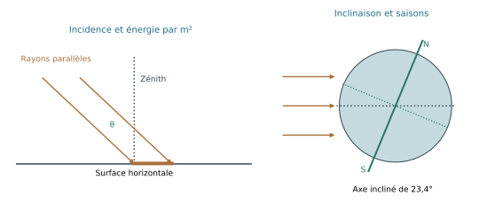
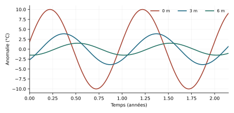
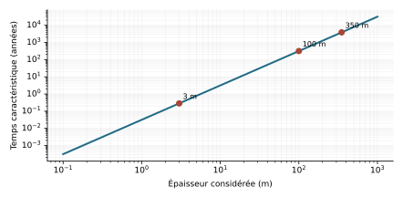
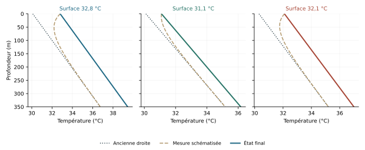

# ENS de Lyon — Second concours, Géosciences 2007 · Corrigé brut

*Corrigé rédigé par IA, non officiel.*

**Rédaction (tour 1)** · GPT-6.2 Astra Ultra · vitesse non renseignée

Les 29 questions sont traitées sur le sujet officiel et le rapport de l’écrit. Les valeurs lues dans les cartes et courbes sont données à leur précision graphique. Les tracés demandés pour l’insolation et les géothermes sont fournis. La formule de 1.8 est évaluée, de même que la demi-amplitude indiquée dans la consigne.

## 1. Températures superficielles

### Question 1.1 — Situer eaux chaudes, eaux froides et anomalies régionales

Les eaux superficielles les plus chaudes forment une ceinture intertropicale, généralement au-dessus de 25 °C, avec des secteurs proches de 30 °C. La température décroît vers les pôles, jusqu’aux environs du point de congélation de l’eau de mer. Les isothermes ne suivent pas exactement les parallèles. Les courants chauds transportent de l’énergie vers les hautes latitudes, par exemple dans l’Atlantique Nord. Des langues froides longent la façade pacifique de l’Amérique du Sud et la façade atlantique sud-ouest de l’Afrique. L’écartement des eaux superficielles sous l’effet des vents y fait remonter des eaux profondes froides (upwelling).

### Question 1.2 — Expliquer l’ensoleillement local

Au sommet de l’atmosphère, un faisceau de section donnée éclaire une aire d’autant plus grande que ses rayons sont obliques. Sur un plan horizontal, la puissance reçue est proportionnelle à $\cos\theta$, où $\theta$ est la distance au zénith. À latitude $\varphi$ et déclinaison solaire $\delta$, le Soleil culmine à une hauteur $90^\circ-|\varphi-\delta|$. La rotation de la Terre règle l’alternance du jour et de la nuit et la hauteur au cours du jour. L’inclinaison de l’axe (environ 23,4°) combinée à la révolution annuelle règle hauteur et durée du jour au fil des saisons, avec saisons opposées dans les deux hémisphères. La distance Terre–Soleil module plus faiblement l’irradiance comme $1/r^2$. Au sol interviennent épaisseur d’atmosphère traversée, nuages, aérosols, altitude, pente, orientation et ombres. L’albédo règle ensuite la fraction **absorbée** de l’énergie reçue.

### Question 1.3 — Interpréter les maximums continentaux

Les maximums les plus élevés se situent surtout dans les régions arides et peu végétalisées des basses et moyennes latitudes. Le scan indique 69,3 °C en Australie en 2003 et 68,0 puis 70,7 °C dans la région du désert de Lout en 2004 et 2005. Un ciel souvent clair, des sols secs et une faible évaporation y permettent une forte élévation de la température de surface. Aux hautes latitudes, l’ensoleillement plus oblique et les surfaces enneigées limitent les maximums. Les forêts humides d’Amazonie et du bassin du Congo se distinguent des déserts même lorsque leur surface est sombre. Les plantes dissipent de l’énergie par évapotranspiration et le couvert ombrage le sol. Sur la carte, le maximum caractéristique des vastes couverts forestiers tropicaux se situe approximativement dans les **30 à 40 °C**, avec variations locales. La figure fournit des classes et une température radiative de surface, sans mesure directe sous chaque canopée.

### Question 1.4 — Suivre l’amplitude saisonnière

La demi-amplitude passe d’environ 10 °C en surface à 3,5 °C à 3 m et 1,4 °C à 6 m. Le rapport vaut environ 0,35–0,4 lorsqu’on s’enfonce de 3 m supplémentaires. Cette décroissance est compatible avec une enveloppe exponentielle d’une perturbation diffusée.

### Question 1.5 — Définir une profondeur peu affectée

Une oscillation annuelle de ±1,4 °C subsiste à 6 m. Si son amplitude est multipliée par environ 0,37 tous les 3 m, elle passe sous 0,5 °C vers 9–10 m, puis sous environ 0,1 °C vers 14–15 m. Les variations saisonnières sont donc peu sensibles à partir d’une dizaine à une quinzaine de mètres selon la précision. L’atténuation diffuse est continue, sans frontière de disparition absolue.

### Question 1.6 — Comprendre le retard en profondeur

La chaleur se redistribue par conduction selon l’équation de diffusion. Une variation de surface affecte d’abord les couches supérieures, puis de façon de plus en plus amortie les couches profondes. En régime périodique, chaque profondeur oscille à la même période, avec une phase retardée qui croît avec la profondeur. Le maximum de température est donc observé après le maximum de surface.

### Question 1.7 — Mesurer une vitesse de phase

Sur la figure 1.3, le maximum à 3 m est décalé d’environ 0,16–0,18 année par rapport à la surface. À 6 m, l’écart est proche du tiers d’une année. La vitesse de déplacement d’une phase vaut alors $3/0,17\simeq18$ m/an, soit environ $5,6\times10^{-7}$ m/s. Comparer surface et 6 m donne le même ordre de grandeur. Il s’agit du déplacement d’un maximum d’onde thermique à période annuelle. La diffusion d’une variation brusque se caractérise par une longueur proportionnelle à la racine carrée du temps.

### Question 1.8 — Comparer les pénétrations quotidienne et annuelle

Avec $\kappa=10^{-6}$ m²/s, la formule fournie donne $d=\sqrt{\kappa P/\pi}$. Pour $P=86\,400$ s, $d\simeq0,166$ m. Pour $P=365,25\times86\,400$ s, $d\simeq3,17$ m. La longueur annuelle est environ 19 fois la longueur journalière. La figure montre bien une oscillation annuelle encore visible à 3 m et très atténuée à 6 m. La formule imprimée est, pour une sinusoïde dans un demi-espace, la longueur d’atténuation à $1/e$ de l’amplitude, ce que confirment les $3,5/10$ lus à 3 m. Pour diviser l’amplitude exactement par deux, comme l’annonce le texte, on obtient $d\ln2$, soit environ **0,115 m et 2,20 m**. Les deux conventions sont ainsi chiffrées.

## 2. Géotherme superficiel

### Question 2.1 — Proposer une localisation des forages

Les trois températures de surface, environ 32,8, 31,1 et 32,1 °C, sont très élevées pour une moyenne superficielle. Une région continentale chaude de basse latitude, par exemple une zone sèche du Sahel ou de l’Inde, offre une localisation plausible. Un forage continental permet de mesurer le profil jusque vers 300–350 m. Ces seules températures ne permettent pas d’identifier un pays ou une station précise.

### Question 2.2 — Mesurer les trois gradients stationnaires

Avec $z$ positif vers le bas, les trois gradients sont positifs. Sur la droite de gauche, une augmentation d’environ 5,4 °C pour 280 m donne $G_1\simeq0,019$ °C/m. Au centre, 4,7 °C pour 325 m donnent $G_2\simeq0,0145$ °C/m. À droite, 4,5 °C pour 325 m donnent $G_3\simeq0,014$ °C/m. Cela représente respectivement environ 19, 14 à 15 et 14 °C/km. La largeur des traits limite naturellement le dernier chiffre.

### Question 2.3 — Définir l’état stationnaire

En régime stationnaire, $\partial T/\partial t=0$ à toute profondeur. Chaque volume reçoit autant de chaleur qu’il en cède si aucune source interne n’y agit. En conduction unidimensionnelle avec conductivité constante, sans production locale, le flux est constant et $T(z)$ est une droite. Un flux non nul est compatible avec cet état stationnaire. L’équilibre thermodynamique strict demanderait de plus l’absence de gradient et de flux.

### Question 2.4 — Expliquer la courbure superficielle

Les points proches de la surface sont plus chauds que ne le prévoit l’extrapolation de la droite profonde. L’écart se réduit progressivement en profondeur. Une élévation de la température de surface modifie rapidement le haut de la colonne, alors que les couches profondes gardent le gradient antérieur. La conduction diffuse ensuite l’excédent vers le bas. D’éventuels écoulements d’eau souterraine ou changements d’occupation du sol devraient être examinés avant une interprétation climatique locale définitive.

### Question 2.5 — Donner le sens physique du signe de Fourier

Le flux de Fourier $q_z=-k\,\mathrm dT/\mathrm dz$ est dirigé des températures élevées vers les températures plus basses. Comme $k>0$, le signe moins indique que la composante du flux est opposée à celle du gradient. Avec $z$ vers le bas, un géotherme ordinaire croissant donne un flux terrestre dirigé vers le haut.

### Question 2.6 — Orienter le flux près de la surface

Si la surface est plus chaude que le sous-sol immédiatement en dessous, $\mathrm dT/\mathrm dz<0$ et $q_z>0$. La chaleur pénètre alors **vers le bas** à travers cette couche. Le flux profond peut rester ascendant sous la zone perturbée.

### Question 2.7 — Calculer le flux de chaque forage

Avec les pentes de 2.2, les modules des flux valent $2,5\times0,019\simeq0,048$, $2,5\times0,0145\simeq0,036$ et $2,5\times0,014\simeq0,035$ W/m². Les trois flux stationnaires sont **ascendants**, soit environ 48, 36 et 35 mW/m². Leur composante suivant la profondeur positive vers le bas porte le signe moins.

### Question 2.8 — Passer d’un flux surfacique à une puissance terrestre

Le flux moyen sortant estimé vaut environ $(0,048+0,036+0,035)/3=0,040$ W/m². Pour $R\simeq6,37\times10^6$ m, l’aire terrestre est $4\pi R^2\simeq5,10\times10^{14}$ m². La puissance vaut donc environ $2,0\times10^{13}$ W, soit **20 TW**, de même ordre que les 40 TW cités mais environ deux fois moindre. L’hypothèse de la question étend à tous les continents et aux océans des forages continentaux dont les gradients sont assez faibles. En particulier, les jeunes fonds océaniques perdent plus de chaleur.

### Question 2.9 — Estimer le temps de relaxation

Pour une colonne de 300 m, $t=E^2/\kappa=9\times10^{10}$ s, soit environ 2 850 ans. À 350 m, on obtient $1,225\times10^{11}$ s, environ 3 900 ans. Pour une perturbation limitée aux 100 premiers mètres, le temps caractéristique est plutôt de 320 ans, et à 200 m d’environ 1 270 ans. La durée dépend de l’épaisseur retenue. Il s’agit d’un ordre de grandeur d’ajustement lorsque la température de surface est maintenue.

### Question 2.10 — Tracer les géothermes après relaxation

Si la température de surface reste celle mesurée et si le flux profond imposé conserve sa valeur, chaque profil final est une droite $T(z)=T_{s,\mathrm{actuel}}+Gz$. Elle part respectivement de 32,8, 31,1 ou 32,1 °C et a la pente de la droite profonde correspondante. La courbure superficielle disparaît au cours de la relaxation. L’illustration donne les trois tracés dans des panneaux indépendants. Avec une autre condition aux limites, par exemple une température fixée à 350 m, la droite relierait exactement les deux températures imposées et la pente finale s’ajusterait.

### Question 2.11 — Interpréter l’échelle du signal

L’onde annuelle est presque éteinte après quelques dizaines de mètres. Les écarts des forages persistent sur des dizaines à plus d’une centaine de mètres, avec des temps de diffusion de siècles ou davantage. Une succession de journées chaudes ou une seule saison ne peut produire cette géométrie. L’hypothèse commune est une hausse durable de la température de surface, dont le signal descend progressivement sur un fond géothermique ascendant.

## 3. Flux et chaleur depuis 1850

### Question 3.1 — Décrire la série instrumentale

Depuis 1850, les anomalies annuelles oscillent fortement autour de la tendance. Celle-ci est proche de zéro pendant une bonne partie du XIXe siècle, se situe un peu en dessous vers la fin du XIXe et le début du XXe siècle, puis monte jusqu’à environ +0,4 °C vers 1940. Une stabilisation ou un léger recul précède la forte hausse depuis les années 1970. La fin de la série atteint environ +1 à +1,1 °C par rapport à la référence. Le texte précise que la série instrumentale concerne l’air au-dessus des continents hors Antarctique, utilisé ici pour estimer la sollicitation thermique du sol.

### Question 3.2 — Déterminer le signe de la convolution

Pour $j\le i$, le poids $w_{ij}=\sqrt{i-j+1}-\sqrt{i-j}$ est strictement positif. Le signe moins global transforme le facteur $(T_{j-1}-T_j)$ en accroissement $(T_j-T_{j-1})$. Le signe de $q_i$ est donc celui de la **somme pondérée des accroissements de température** antérieurs. Un réchauffement monotone donne une variation positive du flux vers le sol. Avec des variations de sens opposés, c’est leur somme pondérée qui décide, avec un poids plus élevé pour les variations récentes.

### Question 3.3 — Traiter une température constante

Si tous les $T_j$ sont égaux, $T_j-T_{j-1}=0$ dans chaque terme. On obtient $q_i=0$. Cette quantité est l’anomalie du flux échangé avec la surface. Le flux géothermique de fond peut rester non nul.

### Question 3.4 — Lire le flux reconstruit

Le flux calculé varie rapidement autour de zéro, avec des pics individuels pouvant approcher quelques dixièmes de W/m² dans les deux sens. Le refroidissement ou la stabilisation de certaines décennies produit des anomalies faibles ou négatives. La tendance lissée devient positive pendant le réchauffement du début du XXe siècle, s’atténue au milieu du siècle, puis monte depuis les années 1970 vers +0,1 W/m² en fin de série. Le signe positif indique un transfert supplémentaire vers le sol. La mémoire diffusive et la variabilité d’une année à l’autre expliquent le décalage avec la simple courbe de température.

### Question 3.5 — Établir le bilan depuis 1850

La courbe cumulée oscille autour de zéro jusqu’au début du XXe siècle, remonte par paliers, puis augmente vite dans les dernières décennies. Elle passe d’une valeur voisine de zéro en 1850 à environ **12 × 10²¹ J** en 2005. Le sol continental du domaine étudié a donc gagné environ $1,2\times10^{22}$ J sur cet intervalle, avec des pertes transitoires.

### Question 3.6 — Relier flux et énergie

Pour un domaine de surface $S$, l’énergie reçue vaut $\Delta Q=\int_{t_1}^{t_2}\!\int_S q(\mathbf x,t)\,\mathrm dS\,\mathrm dt$. Si $q_i$ est la moyenne spatiale du flux pendant l’année $i$ et reste représentatif pendant $\Delta t$ secondes, $\Delta Q\simeq S\sum_i q_i\Delta t$. On utilise ici la surface continentale couverte par la série. Une année à flux négatif enlève de l’énergie au cumul.

### Question 3.7 — Comparer une année de chaleur interne au stockage continental

La puissance terrestre extrapolée est d’environ $2,0\times10^{13}$ W. En un an, cela représente $2,0\times10^{13}\times3,156\times10^7\simeq6,3\times10^{20}$ J, soit **0,63 × 10²¹ J** dégagé par le globe. Le gain cumulé du sol continental entre 1850 et 2005, environ 12 × 10²¹ J, est près de 19 fois cette énergie annuelle. Ramené à 155 ans, il vaut en moyenne environ $0,077\times10^{21}$ J par an, avec une hausse récente sensible. Le premier bilan concerne la chaleur interne sortante de la Terre entière. Le second concerne le stockage associé aux variations de température de surface sur les continents.

## 4. Paléotempératures du sol

### Question 4.1 — Comparer les cinq siècles

La plupart des régions présentent de faibles variations lors des premiers siècles puis une hausse croissante vers le XIXe et surtout le XXe siècle. En Amérique du Nord, par exemple, la dernière colonne est de l’ordre de 0,5–0,6 K par siècle, nettement supérieure aux premières. Les amplitudes diffèrent d’un continent à l’autre et la dernière colonne sud-américaine approche l’ordre de 0,7 K par siècle. Les séries asiatiques et sud-américaines sont grisées en raison d’une incertitude accrue. Ce sont des variations déduites des profils du sous-sol et moyennées sur de longues durées, qui ne restituent guère les fluctuations d’une seule année.

### Question 4.2 — Lire l’inversion sur cent mille ans

Les quatre forages de plus de 1 600 m du bouclier canadien conservent une phase froide autour de quelques dizaines de milliers d’années avant le présent, suivie d’un réchauffement vers l’Holocène. À Sept-Îles, courbe sans décalage, le minimum vers 15–25 ka approche −1 °C, contre 4 à 5 °C pendant une partie de l’Holocène. Le réchauffement est donc de plusieurs degrés. Les amplitudes sont moindres sur certains autres sites. Flin-Flon, Balmertown et Thompson sont décalés graphiquement de +4, +6 et +10 °C. Les oscillations récentes de quelques siècles et les variations plurimillénaires ont des amplitudes et des résolutions différentes. À l’échelle glaciaire, les paramètres orbitaux modulent l’insolation saisonnière, avec des rétroactions de l’albédo des glaces et des gaz à effet de serre. Cette reconstruction locale de température **du sol** est aussi sensible au rôle isolant d’une calotte de glace.

### Question 4.3 — Faire la synthèse des échelles

L’insolation, les circulations et les propriétés de surface organisent la température du globe. Dans les continents, les variations de température se superposent au géotherme lié à la chaleur interne. Une oscillation journalière pénètre de quelques décimètres, une oscillation annuelle de quelques mètres. À plus grande profondeur, le retard et l’amortissement croissent. Un forage dont le profil superficiel s’écarte de la droite profonde garde ainsi une mémoire des anciennes températures de surface. L’inversion du modèle de conduction reconstitue des tendances lissées, avec une résolution qui diminue vers le passé.

Les mesures instrumentales depuis 1850 et les forages peu profonds indiquent un réchauffement récent d’environ un degré sur la série continentale et un gain de chaleur du sol. Les forages profonds du Canada conservent, sur 100 000 ans, un contraste de plusieurs degrés entre l’épisode glaciaire et l’Holocène. La modulation orbitale, les glaces et le carbone interviennent à cette échelle. Les mêmes lois de diffusion relient ces observations, mais les sites, les périodes et la résolution de chaque archive doivent être précisés.
