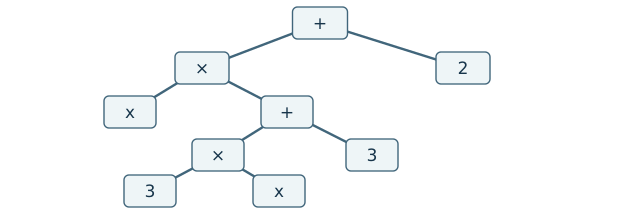
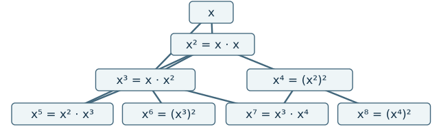
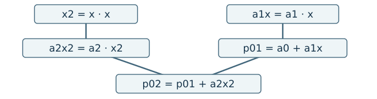
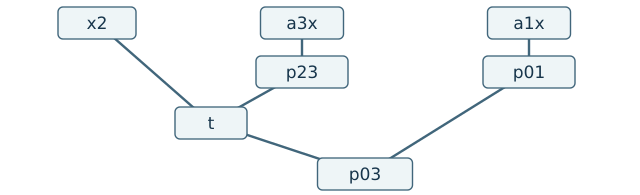

# ENS de Lyon · Second concours · Informatique 2007 — corrigé brut

*Corrigé rédigé par IA, non officiel. Signalez toute erreur.*

**Rédaction** · GPT-6.2 Astra Ultra · vitesse non renseignée · 25 novembre 2026

Le degré n est celui d’un polynôme univarié dont les coefficients sont des entrées indépendantes. Une addition ou une multiplication binaire occupe un opérateur pendant une unité de temps. Une feuille a hauteur zéro. On note GAD un graphe acyclique dirigé.

## Partie I. Évaluer un polynôme

### Questions I-1 et I-2 · Forme développée

**I-1.** Le produit $w$ porte $x^i$ au début du tour $i$.

```text
s ← a[0] ; w ← x
pour i de 1 à n :
    s ← s + a[i] × w
    si i < n : w ← w × x
renvoyer s
```

**I-2.** Pour $n\ge1$, on compte $n-1$ multiplications de puissances, $n$ multiplications par les coefficients et $n$ additions, soit $3n-1$ opérations. Pour $n=0$, aucune opération.

### Questions I-3 à I-5 · Schéma de Horner

**I-3.** Poser $s=a_n$. Pour $j=n-1,\dots,0$, remplacer $s$ par $a_j+xs$. Renvoyer $s$. Après ce tour, $s=\sum_{k=j}^na_k x^{k-j}$.

**I-4.** Le coût est de $n$ sommes et $n$ produits, soit $2n$ opérations.

**I-5.** Le polynôme donné vaut $(x+1)^3+2$. Calculer successivement $y=x+1$, $z=y^2$, $u=zy$, puis $u+2$. Quatre opérations suffisent, contre six pour le programme générique, ou cinq pour Horner si on élimine la multiplication initiale par le coefficient dominant 1.

## Partie II. Arbres d’expression

### Questions II-1 et II-2 · Arbre et type de données

**II-1.** Écrire $2+x(3+3x)$. Les quatre portes de ce calcul appartiennent à une même chaîne. L’arbre développé du sujet comporte cinq portes mais une hauteur de trois.



**II-2.** Un type algébrique possible en OCaml est le suivant. Les deux champs de l’opération sont ordonnés et une feuille détient le nom littéral d’une entrée.

```ocaml
type operation = Plus | Fois
type arbre =
  | Feuille of string
  | Noeud of operation * arbre * arbre
```

### Questions II-3 et II-4 · Arbre d’une puissance

**II-3.** Pour $k=1$, renvoyer la feuille $x$. Pour $k\ge2$, poser $u=\lfloor k/2\rfloor$, $v=\lceil k/2\rceil$ et renvoyer le produit de deux arbres construits séparément pour $u$ et $v$. Leurs exposants s’additionnent en $k$. La hauteur est logarithmique.

**II-4.** Elle vaut exactement $\lceil\log_2 k\rceil$. Une hauteur $h$ autorise au plus $2^h$ feuilles, et l’arbre construit a $k$ feuilles. Réciproquement les deux exposants fils sont au plus $2^{h-1}$ dès que $k\le2^h$ et $k\ge2$, d’où la borne inverse par récurrence. Si le bit de tête a l’indice $p$, la hauteur vaut $p$ pour un unique bit à 1 et $p+1$ sinon.

### Questions II-5 et II-6 · Somme équilibrée

**II-5.** Sur un intervalle d’indices contenant une seule expression, la renvoyer. Sinon partager l’intervalle en deux moitiés de tailles voisines, appeler la procédure sur chacune et joindre leurs racines par Plus. Pour $r$ expressions la surhauteur est $\lceil\log_2 r\rceil$, à ajouter à la hauteur maximale des expressions initiales pour une borne globale.

**II-6.** Former les $n+1$ arbres $a_0$ et $a_iP_i$ pour $i\ge1$, puis appliquer II-5. Pour $n\ge1$ la hauteur est au plus $1+\lceil\log_2 n\rceil+\lceil\log_2(n+1)\rceil$, donc $O(\log(n+1))$.

## Partie III. Partager les résultats

### Questions III-1 et III-2 · Toutes les puissances

**III-1.** Les sept puissances $x^2,\ldots,x^8$ sont différentes et aucune n’est une entrée. Chacune doit donc être produite par au moins une porte. Les sept portes de la figure réalisent ce minimum.



**III-2.** Poser $X_1=x$, puis, pour $k=2,\ldots,n$, créer $X_k=X_{\lfloor k/2\rfloor}X_{\lceil k/2\rceil}$. Les deux sources ont déjà été construites. Une porte par $k$ donne $n-1$ opérations. Par II-4, la profondeur de $X_k$ est $\lceil\log_2 k\rceil$. Pour $n=2^p$ la hauteur vaut $p$, atteinte au dernier carré. La borne par doublement du degré en un étage donne aussi sa minimalité.

### Question III-3 · Hauteur minimale pour le polynôme général

Pour une hauteur **exactement minimale**, autoriser aussi les factorisations comme $x^r(U+V)$. Voici une récurrence finie pour tout $n=2^p$. Un ensemble non vide $S$ d’exposants représente une somme de monômes à coefficients distincts, à raison d’un coefficient par exposant. Noter $H(S)$ sa hauteur minimale et $h(r)=\lceil\log_2 r\rceil$ pour $r\ge1$. Poser $H(\{0\})=0$. Pour toute autre entrée, $H(S)$ vaut le minimum des candidats suivants, en omettant les familles vides.

- $1+\max(H(A),H(S\setminus A))$ pour $\varnothing\ne A\subsetneq S$.
- $1+\max(h(r),H(S-r))$ pour $1\le r\le\min S$, avec $S-r=\{s-r:s\in S\}$.

La hauteur demandée est donc $H(\{0,\ldots,2^p\})$. Cette formule entière récursive donne, par exemple, $2,3,4,6$ pour $p=0,1,2,3$. Elle est en $\Theta(\log(n+1))$ puisque le degré total du terme $a_nx^n$ impose $2^H\ge n+1$ et que II-6 donne une borne supérieure logarithmique.

**Preuve d’exhaustivité.** Avec les seules portes $+,\times$, les monômes formels produits ne peuvent s’annuler. Un sous-calcul utile contenant un coefficient ne peut donc être multiplié par un autre sous-calcul contenant un coefficient. Un facteur sans coefficient doit être une puissance pure de $x$, sinon un même coefficient apparaîtrait dans deux monômes de la sortie ou avec multiplicité. Une addition sépare deux groupes disjoints de coefficients. La dernière porte est donc exactement l’un des cas de la récurrence. Inversement, chaque candidat se réalise avec une porte de plus, en partageant les puissances de III-2.

**Construction et nombre d’opérations.** Mémoriser un choix qui minimise chaque $H$, à égalité prendre le premier dans un ordre fixé. Le reconstruire depuis la racine, avec les étiquettes de coefficients d’origine, puis demander les puissances nécessaires au graphe de III-2. Le nombre exact de portes de la construction est $n+b+|D|$. Les $n$ additions réunissent les $n+1$ coefficients, $b$ est le nombre de choix de produit dans la reconstruction (incrémenter un compteur à chacun), et $D$ l’ensemble des exposants $r\ge2$ effectivement demandés, fermé par les deux moitiés de III-2 en omettant 1. Chaque membre de $D$ n’est construit qu’une fois. Ces deux compteurs accompagnent la récurrence et distinguent les graphes de même hauteur. Pour le degré 4, par exemple, choisir $(a_0+a_1x+a_2x^2)+x^3(a_3+a_4x)$ avec la somme à trois termes organisée comme $(a_0+a_1x)+a_2x^2$. On a $H=4$, $b=4$, $D=\{2,3\}$ et dix opérations.

## Partie IV. Émettre du code machine

### Question IV-1 · Compiler l’arbre

```text
codeMachine(a) :
    si a est une feuille : renvoyer son nom
    g ← codeMachine(fils gauche de a)
    d ← codeMachine(fils droit de a)
    r ← nouveau nom distinct des entrées et des noms déjà utilisés
    imprimer r ← g opération(a) d
    renvoyer r
```

Les feuilles sont déjà disponibles comme entrées. Par induction, les deux appels ont défini leurs résultats avant que le parent imprime son instruction. Le nouveau nom garantit une assignation unique.

## Partie V. Dépendances

### Questions V-1 et V-2 · Lire et réordonner les instructions

**V-1.** Les arcs entre instructions sont $x2\to a2x2$, $a1x\to p01$, $p01\to p02$ et $a2x2\to p02$. Le graphe nomme aussi les entrées utilisées par chaque calcul.



**V-2.** Un autre ordre de définition est $a1x,p01,x2,a2x2,p02$. Chaque terme est encore disponible lorsqu’il est lu.

### Questions V-3 et V-4 · Indépendance et graphe

**V-3.** Deux instructions indépendantes écrivent dans des destinations distinctes et ne lisent pas la destination l’une de l’autre. Dès que leurs prédécesseurs ont terminé, elles commutent et peuvent s’exécuter sur deux unités à la même ligne. En présence d’autres instructions, on conserve les contraintes de tous les prédécesseurs.

**V-4.** Le graphe de V-1, muni des opérateurs et des entrées dans les cases, est le GAD demandé. Une arête entre deux opérateurs code exactement une dépendance directe. La fermeture transitive correspond aux chemins dirigés.

## Partie VI. Quatre unités de calcul

### Questions VI-1 à VI-3 · Degré trois

**VI-1.** Poser $t=x2\times p23$. Les six arcs sont $a1x\to p01$, $a3x\to p23$, $x2\to t$, $p23\to t$, $t\to p03$ et $p01\to p03$.



**VI-2.** Le chemin $a3x,p23,t,p03$ porte quatre instructions. Deux instructions de ce chemin ne peuvent partager une ligne. Les quatre lignes proposées atteignent donc le minimum pour ce graphe.

**VI-3.** Horner nécessite six instructions arithmétiques en chaîne et six lignes, avec une utilisation de $6/(4\cdot6)=1/4$. Si on conserve la copie initiale explicite $p\gets a_3$ du modèle IV, on compte sept instructions en sept lignes et toujours $1/4$. L’assignation unique s’obtient en donnant un nom neuf à chaque résultat.

### Question VI-4 · Programmes aux degrés cinq et sept

Chaque ligne du bloc est un cycle. Les affectations d’une même ligne sont séparées par une barre. Les noms $b_j$ désignent $a_jx$ et $s_{ij}$ le résultat intermédiaire indiqué.

```text
Degré 5
x2=x*x | b1=a1*x | b3=a3*x | b5=a5*x
x4=x2*x2 | s01=a0+b1 | s23=a2+b3 | s45=a4+b5
t23=x2*s23 | t45=x4*s45
s03=s01+t23
P=s03+t45

Degré 7
x2=x*x | b5=a5*x | b7=a7*x | b3=a3*x
x4=x2*x2 | s45=a4+b5 | s67=a6+b7 | b1=a1*x
t67=x2*s67 | s23=a2+b3 | s01=a0+b1
s47=s45+t67 | t23=x2*s23
t47=x4*s47 | s03=s01+t23
P=s03+t47
```

Comptes respectifs : 12 opérations en cinq lignes et 16 opérations en six lignes. Horner en demande 10 et 14, en autant de lignes. Le premier temps est minimal car la récurrence de III-3 donne $H(\{0,\ldots,5\})=5$.

Pour certifier le second, viser cinq lignes. En reprenant les partages et décalages de III-3 qui satisfont la hauteur disponible, à symétrie des fils près, la dernière somme doit séparer les indices $0,\ldots,4$ et $5,6,7$. À la ligne 4, le premier groupe doit additionner $0,1,2$ et $3,4$, le second multiplier $x^5$ par $a_5+a_6x+a_7x^2$. Ces quatre opérandes ont tous hauteur 3 et doivent donc être produits à la ligne 3. Pour que cette ligne soit disponible, la ligne 2 doit fournir au minimum les six résultats distincts suivants, tous de hauteur 2 : $a_0+a_1x$, $a_2x^2$, $a_3+a_4x$, $x^3$, $a_5+a_6x$, $a_7x^2$. Ils excèdent les quatre unités. Ainsi six lignes sont nécessaires. Les factorisations possibles de $x^5$ ne retirent aucune de ces six obligations.

### Question VI-5 · Programmer le graphe de hauteur minimale

La construction de III-3 s’applique aussi au degré 7. Prendre la factorisation de hauteur 5 décrite en VI-4 et partager $x^2,x^3,x^5$. Voici une exécution en six lignes.

```text
x2=x*x | b1=a1*x | b4=a4*x | b6=a6*x
x3=x2*x | t2=a2*x2 | s34=a3+b4 | t7=a7*x2
x5=x2*x3 | s01=a0+b1 | t34=x3*s34 | s56=a5+b6
s02=s01+t2 | s57=s56+t7
s04=s02+t34 | t57=x5*s57
P=s04+t57
```

La sortie est $[(a_0+a_1x+a_2x^2)+x^3(a_3+a_4x)]+x^5(a_5+a_6x+a_7x^2)$. Le graphe compte 17 opérations, soit une de plus que VI-4 pour le même temps minimal. Une cinquième ligne ne suffit pas avec quatre unités, comme démontré ci-dessus.

### Questions VI-6 et VI-7 · Génération à grand degré

**VI-6.** Pour $n=2^p-1$, appliquer des regroupements par paires. Le tableau $B$ contient des noms de signaux. À chaque tour, émettre d’abord les calculs de produits et du carré indépendant, puis les sommes. Une émission par paquets découpe une liste en tronçons d’au plus quatre et imprime un tronçon par ligne. Toutes les destinations sont fraîches.

```text
B ← [a0, ..., an] ; y ← x
tant que la longueur de B dépasse 1 :
    h ← longueur(B)/2
    créer les noms t[0..h−1] et C[0..h−1]
    L ← instructions t[j] ← y × B[2j+1] pour 0 ≤ j < h
    si h > 1 : ajouter z ← y × y à L, avec un nom z frais
    émettre L par paquets de quatre
    émettre C[j] ← B[2j]+t[j] par paquets de quatre
    B ← C
    si h > 1 : y ← z
renvoyer le nom B[0]
```

L’invariant est $P=\sum_j B_j y^j$. Une paire $B_{2j}+yB_{2j+1}$ devient coefficient de $(y^2)^j$. On obtient ainsi un ordonnancement directement imprimable. Si l’on veut l’optimum exact sur toutes les programmations, on peut tester les durées croissantes, depuis la hauteur III-3 jusqu’au temps construit. À rebours, pour une ligne, choisir jusqu’à quatre valeurs requises, remplacer chacune par les deux arguments d’une décomposition admissible de III-3 (pour une puissance, essayer tous les partages de l’exposant). Garder les autres valeurs requises, fusionner les exigences identiques, enlever les entrées déjà fournies. Rejeter si une valeur a une hauteur dépassant le nombre de lignes restantes. Le premier essai qui aboutit à la liste vide donne l’optimum après inversion des lignes. Les étiquettes des coefficients sont conservées dans cette recherche. Son coût de génération est bien plus élevé que celui du regroupement direct.

**VI-7.** Pour le programme par paires, il y a $n$ produits de branches, $n$ additions et $p-1$ carrés pour $p\ge1$, soit $W=2n+p-1\sim2n$. Les tailles $h$ successives sont $2^{p-1},\ldots,1$. Son nombre de lignes vaut

$$
L=\sum_h\left(\left\lceil\frac{h+\mathbf1_{h>1}}4\right\rceil+\left\lceil\frac h4\right\rceil\right)=\frac W4+O(p)\sim\frac n2.
$$

L’utilisation $W/(4L)$ tend vers 1. En degré zéro, aucun calcul n’est nécessaire.
