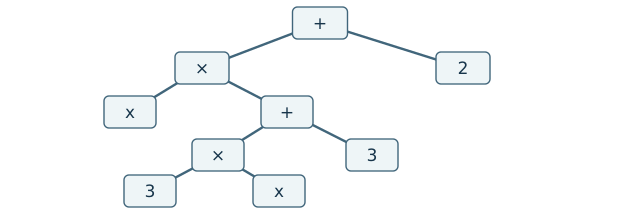
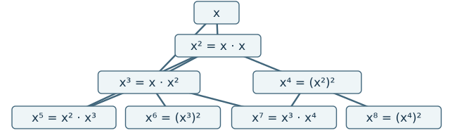
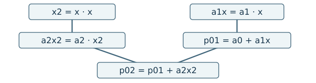
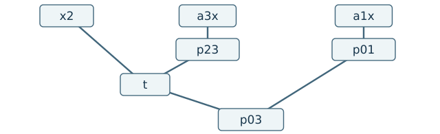

# ENS de Lyon · Second concours · Informatique 2007 — corrigé guidé

*Corrigé rédigé par IA, non officiel. Signalez toute erreur.*

**Rédaction** · GPT-6.2 Astra Ultra · vitesse non renseignée · 25 novembre 2026

Compter les portes mesure le travail, compter le plus long chemin mesure le délai avec autant de portes que nécessaire. La dernière partie impose quatre unités seulement. On suit ces trois mesures sur des polynômes dont les coefficients sont fournis en entrée.

## Partie I. Évaluer un polynôme

### Questions I-1 et I-2 · Forme développée

**I-1.** Pour passer de $x^i$ à $x^{i+1}$ une seule multiplication suffit. Maintenir la somme déjà calculée et ne former la puissance suivante que si elle va servir.

```text
puissance ← x ; somme ← a[0]
pour k de 1 à n :
    somme ← somme + a[k] × puissance
    si k < n : puissance ← puissance × x
renvoyer somme
```

Après le tour $k$, la somme contient tous les termes jusqu’au terme d’indice $k$.

**I-2.** Pour $n\ge1$, on effectue $n$ additions au total. Les produits sont au nombre de $n$ pour former les termes et de $n-1$ pour préparer leurs puissances, donc $3n-1$ opérations au total. Un polynôme constant est immédiatement disponible.

### Questions I-3 à I-5 · Schéma de Horner

**I-3.** Lire les coefficients du dernier au premier. Le suffixe à partir de $a_j$ se construit à partir du suffixe suivant en le multipliant par $x$ puis en ajoutant $a_j$.

```text
s ← a[n]
pour j de n−1 à 0, en descendant :
    s ← x × s + a[j]
renvoyer s
```

**I-4.** Chaque coefficient ajouté déclenche deux opérations, d’où $2n$ pour $n$ coefficients à intégrer.

**I-5.** Les coefficients $1,3,3$ des trois termes de plus haut degré suggèrent le cube d’une somme. Le terme constant doit être ajusté de 2. Avec $y=x+1$, former $y^2$, multiplier par $y$, puis ajouter 2. Le calcul coûte deux additions et deux produits.

## Partie II. Arbres d’expression

### Questions II-1 et II-2 · Arbre et type de données

**II-1.** Le calcul en Horner suit la succession « multiplier 3 par $x$, ajouter 3, multiplier par $x$, ajouter 2 ». Son arbre a quatre opérations et une branche de longueur quatre. L’arbre développé du sujet permet de calculer simultanément les deux branches. Il prend cinq opérations au total, avec au plus trois entre feuille et résultat.



**II-2.** Il faut distinguer les feuilles, qui ne portent pas d’enfant, et les opérateurs, qui en portent exactement deux. En OCaml, la distinction est exprimée par le constructeur du nœud.

```ocaml
type operation = Plus | Fois
type arbre =
  | Feuille of string
  | Noeud of operation * arbre * arbre
```

### Questions II-3 et II-4 · Arbre d’une puissance

**II-3.** Construire un produit équilibré. Les deux moitiés de l’exposant peuvent différer d’une unité.

```text
Puissance(k) :
    si k = 1 : renvoyer Feuille("x")
    u ← partie entière de k/2
    renvoyer Noeud(Fois, Puissance(u), Puissance(k−u))
```

Chaque feuille est une copie et le produit représente $x^{u+k-u}$.

**II-4.** Si $k=2^p$, il y a $p$ étages de multiplications. Si le développement binaire comporte un autre bit à 1, alors $2^p<k<2^{p+1}$. La hauteur $p$ ne suffit plus car un arbre binaire de cette hauteur n’a que $2^p$ feuilles au maximum. La construction tient dans la hauteur $p+1$ car à chaque coupe les deux morceaux contiennent au plus la moitié, arrondie au supérieur. C’est la formule $\lceil\log_2 k\rceil$, valable aussi pour $k=1$.

### Questions II-5 et II-6 · Somme équilibrée

**II-5.** La somme de huit arbres peut se faire en trois étages, quatre additions puis deux puis une. Pour un nombre quelconque, séparer en deux groupes de tailles $\lfloor r/2\rfloor$ et $\lceil r/2\rceil$, sommer récursivement chaque groupe et ajouter les résultats. Le cas $r=1$ renvoie directement son arbre. Les opérations ajoutées donnent au plus $\lceil\log_2 r\rceil$ niveaux. Les feuilles de ces nouvelles additions peuvent elles-mêmes être des arbres de hauteur positive.

**II-6.** Utiliser pour feuille de la somme l’arbre du monôme complet. Chaque $a_i x^i$ nécessite l’arbre de II-3 et une multiplication par son coefficient. Le terme constant arrive sans délai. La hauteur finale est au plus $\lceil\log_2 n\rceil+1+\lceil\log_2(n+1)\rceil$ si $n\ge1$. Elle est nulle en degré zéro.

## Partie III. Partager les résultats

### Questions III-1 et III-2 · Toutes les puissances

**III-1.** Dans un graphe on peut brancher une même sortie sur plusieurs consommateurs. Utiliser le carré pour $x^2$ puis le réemployer pour obtenir $x^3$ et $x^4$. Les mêmes puissances alimentent les derniers produits.



Il y a sept valeurs à produire en plus de l’entrée. Sept portes sont donc à la fois nécessaires et suffisantes.

**III-2.** Prévoir une table de références aux nœuds. La case 1 contient la feuille $x$. La case $k$ reçoit une nouvelle porte de multiplication reliée aux cases $\lfloor k/2\rfloor$ et $\lceil k/2\rceil$. Les valeurs se multiplient en $x^k$. La construction utilise exactement une porte pour chaque case de 2 à $n$. Une simple induction sur les indices donne la même hauteur individuelle que celle de l’arbre équilibré, même si deux arêtes arrivent du même enfant. Pour $n=2^p$, le dernier nœud atteint la hauteur $p$ et aucun autre ne la dépasse.

### Question III-3 · Hauteur minimale pour le polynôme général

Une somme de tous les monômes préparés séparément donne bien une hauteur logarithmique. Pour savoir si cette hauteur est la plus petite possible, il faut essayer aussi les regroupements. En degré 4, construire $L=(a_0+a_1x)+a_2x^2$ et $R=x^3(a_3+a_4x)$. Chacun est prêt à hauteur 3. La somme est prête à hauteur 4. Le calcul utilise quatre additions, quatre produits faisant intervenir un coefficient et les deux produits pour $x^2,x^3$.

**Comment obtenir la réponse exacte à tout degré $2^p$ ?** Retenir la liste $S$ des exposants que l’expression à construire doit porter, en conservant leur lien avec les coefficients. Le cas $S=\{0\}$ est une feuille. La dernière addition partage ces coefficients en deux groupes. La dernière multiplication retire un exposant commun $r$ à tous les termes. Il est inutile d’essayer d’autres portes. En effet les coefficients sont indépendants et aucun terme ne s’annule avec les seuls opérateurs du sujet. Un produit de deux expressions contenant des coefficients créerait un terme quadratique en ceux-ci. Un facteur en $x$ contenant plusieurs termes donnerait plusieurs occurrences d’un même coefficient. On peut donc calculer la hauteur exacte par le programme suivant avec mémorisation.

```text
Hauteur(S) :
    si S = {0} : renvoyer 0
    candidats ← liste vide
    pour chaque partage non trivial de S en A et B :
        ajouter 1 + max(Hauteur(A), Hauteur(B)) aux candidats
    pour r de 1 à min(S) :
        ajouter 1 + max(plafond(log2(r)), Hauteur(S−r))
    mémoriser un choix qui donne le minimum
    renvoyer ce minimum
```

Ici $S-r$ soustrait $r$ à chaque exposant. La réponse est $H=\mathrm{Hauteur}(\{0,1,\dots,2^p\})$. Les appels diminuent le nombre de termes ou la somme des exposants. Pour les degrés 1, 2, 4 et 8, ils donnent respectivement 2, 3, 4 et 6. Le terme $a_nx^n$ impose $2^H\ge n+1$, tandis que II-6 assure $H=O(\log(n+1))$. Ce procédé privilégie la hauteur sans imposer un temps de construction court.

**Reconstruire et compter.** Parcourir les choix mémorisés et rétablir les noms des coefficients. Il y a $n$ additions car chaque partage sépare des coefficients distincts. Incrémenter $b$ à chaque choix d’extraction d’une puissance. Demander la puissance correspondante à III-2. Pour la produire, demander ses deux moitiés sauf si elle est déjà disponible. Si $d$ puissances nouvelles autres que $x$ ont ainsi été créées, le compte exact vaut $n+b+d$. Ce calcul précise le nombre d’opérations du graphe choisi lorsque plusieurs graphes atteignent la même hauteur.

## Partie IV. Émettre du code machine

### Question IV-1 · Compiler l’arbre

Le programme demandé doit **écrire** une instruction pour chaque opérateur. Une feuille ne demande aucune instruction puisque son nom est déjà une entrée. En parcours postfixe, lorsque l’on traite une porte, ses deux arguments sont disponibles.

```text
codeMachine(Feuille(nom)) : renvoyer nom
codeMachine(Noeud(op, gauche, droite)) :
    u ← codeMachine(gauche)
    v ← codeMachine(droite)
    z ← nouvelleVariable()
    afficher z, " ← ", u, op, v
    renvoyer z
```

Réserver des noms temporaires distincts de toutes les entrées. Une induction sur la taille de l’arbre établit la définition préalable de chaque opérande et la valeur portée par le nom renvoyé.

## Partie V. Dépendances

### Questions V-1 et V-2 · Lire et réordonner les instructions

**V-1.** Pour chaque nom lu, chercher l’unique instruction qui l’a écrit. Relier cette instruction à celle qui lit la valeur. Les entrées $x,a_0,a_1,a_2$ sont déjà disponibles avant le programme.



**V-2.** La branche qui prépare $a_0+a_1x$ peut être terminée avant de commencer celle de $a_2x^2$. On peut donc écrire dans l’ordre les instructions définissant $a1x,p01,x2,a2x2,p02$.

### Questions V-3 et V-4 · Indépendance et graphe

**V-3.** Échanger deux instructions exécutables ne change aucune valeur lue, puisque aucune n’écrit une source de l’autre. Les affectations ont des cibles distinctes par assignation unique. Le résultat est identique si les lectures ont lieu simultanément et les deux résultats deviennent disponibles à la fin de la ligne.

**V-4.** Reprendre la figure de V-1. Le nœud $x2$ représente un produit de $x$ par lui-même, le nœud $a2x2$ un produit de ce résultat par $a_2$, et ainsi de suite. Chaque fil entre opérateurs est exactement une dépendance directe entre instructions. Un chemin de plusieurs fils impose une dépendance indirecte.

## Partie VI. Quatre unités de calcul

### Questions VI-1 à VI-3 · Degré trois

**VI-1.** La figure note $t$ le résultat du produit du carré par le polynôme de coefficients $a_2,a_3$. Lire une liaison de haut en bas donne une dépendance directe.



**VI-2.** On peut avancer des instructions indépendantes, mais la chaîne qui part du produit $a_3x$, passe par $p23$, puis $t$, et aboutit à $p03$ ne peut être comprimée. Ses quatre opérations imposent quatre lignes.

**VI-3.** Avec Horner, chaque produit attend la somme précédente et chaque somme attend le produit. Sans la copie d’initialisation, six opérations imposent six lignes avec une unité sur quatre utilisée. Si le code suit exactement l’exemple de IV avec une copie initiale, le temps est sept lignes et la fraction utilisée reste un quart.

### Question VI-4 · Programmes aux degrés cinq et sept

Commencer par regrouper les coefficients en paires, $s_{j,j+1}=a_j+a_{j+1}x$ pour $j$ pair. Le degré 5 exige trois paires et on peut appliquer directement $x^2$ et $x^4$ aux deux dernières. Pour le degré 7, commencer par les paires de poids fort afin qu’elles soient prêtes pour la multiplication par $x^4$. Les barres séparent les instructions simultanées.

```text
Degré 5
x2=x*x | b1=a1*x | b3=a3*x | b5=a5*x
x4=x2*x2 | s01=a0+b1 | s23=a2+b3 | s45=a4+b5
t23=x2*s23 | t45=x4*s45
s03=s01+t23
P=s03+t45

Degré 7
x2=x*x | b5=a5*x | b7=a7*x | b3=a3*x
x4=x2*x2 | s45=a4+b5 | s67=a6+b7 | b1=a1*x
t67=x2*s67 | s23=a2+b3 | s01=a0+b1
s47=s45+t67 | t23=x2*s23
t47=x4*s47 | s03=s01+t23
P=s03+t47
```

On lit cinq lignes et douze opérations, puis six lignes et seize opérations. Horner économise deux opérations dans chaque cas mais occupe respectivement dix et quatorze lignes. La hauteur minimale en degré 5 est déjà cinq d’après III-3. En degré 7, cinq lignes correspondraient exactement à la hauteur minimale sans limite d’unités. Vérifier dans la récurrence de III-3 les choix qui tiennent dans cette hauteur. La seule coupure initiale admissible sépare les cinq premiers termes des trois derniers. Le premier morceau se coupe ensuite en $(a_0+a_1x+a_2x^2)$ et $x^3(a_3+a_4x)$, le second exige $x^5(a_5+a_6x+a_7x^2)$. Les quatre résultats demandés à hauteur 3 sont ainsi les deux termes du premier morceau, $x^5$ et le trinôme du second morceau. Dès la ligne 2 il faut simultanément les deux résultats intermédiaires de chaque trinôme, la paire $a_3+a_4x$ et la puissance $x^3$. Cela fait déjà six instructions de hauteur 2. Quatre unités ne peuvent les produire à temps. La sixième ligne est donc indispensable.

### Question VI-5 · Programmer le graphe de hauteur minimale

Une hauteur de cinq présuppose que toutes les portes d’un étage puissent travailler ensemble. Pour exécuter le graphe de III-3 avec seulement quatre unités, on doit décaler certains calculs. Conserver en particulier $x^2$ pour la puissance cinq et les deux trinômes.

```text
x2=x*x | b1=a1*x | b4=a4*x | b6=a6*x
x3=x2*x | t2=a2*x2 | s34=a3+b4 | t7=a7*x2
x5=x2*x3 | s01=a0+b1 | t34=x3*s34 | s56=a5+b6
s02=s01+t2 | s57=s56+t7
s04=s02+t34 | t57=x5*s57
P=s04+t57
```

En développant les deux derniers termes on retrouve tous les coefficients de $a_0$ à $a_7$. Six lignes sont nécessaires par VI-4 et elles suffisent ici. Le prix de cette autre organisation est de 17 opérations contre 16 pour le programme précédent.

### Questions VI-6 et VI-7 · Génération à grand degré

**VI-6.** Reprendre le regroupement en paires de la question VI-4. Au départ les poids sont $1,x,x^2,\ldots$. Après fusion d’une paire sur deux ils sont $1,x^2,x^4,\ldots$. Il suffit donc de mettre au carré le poids courant une fois par étage utile. À cet étage, les produits de branches et le carré ne dépendent pas les uns des autres. Les envoyer à l’imprimante par groupes de quatre. Une fois ces produits disponibles, imprimer de la même manière les additions.

```text
noms ← [a0, ..., an] ; poids ← x
tant que noms a plus d’un élément :
    pour chaque paire consécutive (g,d) de noms :
        préparer un produit frais t ← poids × d
        préparer une somme fraîche c ← g + t
    s’il reste plus d’une paire :
        joindre aux produits le carré frais z ← poids × poids
    imprimer les produits par lignes de quatre au maximum
    imprimer les sommes par lignes de quatre au maximum
    remplacer noms par les noms c dans leur ordre
    s’il y avait plus d’une paire : poids ← z
le seul nom restant donne le résultat
```

Le polynôme est conservé puisque $gy^{2j}+dy^{2j+1}=(g+yd)(y^2)^j$. Le regroupement limite le coût de génération. Pour certifier, si nécessaire, un nombre minimal de lignes, utiliser cette durée comme borne supérieure. Essayer chaque durée depuis la hauteur minimale, en choisissant à rebours jusqu’à quatre portes requises par ligne. Pour une expression linéaire en les coefficients, les décompositions possibles sont exactement celles de III-3, avec maintien des noms des coefficients. Pour $x^r$, essayer $x^u x^{r-u}$ pour $1\le u<r$. Reporter les valeurs non traitées, réunir les valeurs identiques, enlever les feuilles disponibles et éliminer les branches dont la hauteur dépasse le temps restant. La première durée permettant d’atteindre un ensemble vide est optimale.

**VI-7.** Chaque fusion réclame un produit et une somme. Réduire $n+1$ coefficients à un seul demande $n$ fusions. Ajouter les $p-1$ carrés intermédiaires donne $W=2n+p-1$. Dans chaque phase d’un étage, seule la dernière ligne peut présenter des emplacements vides. Il y a $2p$ phases, d’où $W/4\le L\le W/4+2p$ pour le programme par paires. Comme $p=\log_2(n+1)$, les opérations sont équivalentes à $2n$, les lignes à $n/2$ et la fraction des quatre unités occupées tend vers 1.
