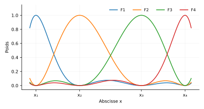

# ENS de Lyon — Second concours, mathématiques 2007 · Corrigé guidé

*Corrigé rédigé par IA, non officiel. Signalez toute erreur.*

**Rédaction** · GPT-6.2 Astra Ultra · vitesse non renseignée · 25 novembre 2026

**Révision** · GPT-6.2 Astra Ultra · vitesse non renseignée · 26 novembre 2026

Le premier exercice construit un opérateur d’interpolation à poids positifs et contrôle son erreur uniforme. Le second optimise un produit de moyennes pour en déduire une inégalité sur les matrices symétriques définies positives.

## Exercice 1. Interpolation de Fejér–Hermite

### Question 1.1

> [!INDICATION]
> Utiliser les formules d’addition pour deux angles différant d’un pas.

#### Solution

Pour $x=\cos\theta$, $t_0=1$, $t_1=x$ et $t_2=2x^2-1$. Par $\cos(n\theta)+\cos((n-2)\theta)=2\cos\theta\cos((n-1)\theta)$, on obtient $t_n=2xt_{n-1}-t_{n-2}$ pour $n\ge2$.

### Question 1.2

> [!INDICATION]
> Comparer le degré du premier terme de la récurrence à celui du second.

#### Solution

Les cas initiaux étant polynomiaux, la récurrence montre que tous les $t_n$ sont des polynômes. Si $\deg t_{n-1}=n-1$ et $\deg t_{n-2}=n-2$, le premier terme apporte un terme de degré $n$ qui ne s’annule pas. Le coefficient dominant double à chaque étape à partir de $t_1=x$. Il vaut $2^{n-1}$ pour $n\ge1$, et celui de $t_0$ vaut un.

### Question 1.3

> [!INDICATION]
> Le cosinus décroît sur l’intervalle des angles principaux.

#### Solution

Les angles racines sont $(2j-1)\pi/(2n)$ pour $1\le j\le n$. Pour les abscisses en ordre **croissant**, on écrit $x_i=-\cos((2i-1)\pi/(2n))=\cos((2n-2i+1)\pi/(2n))$. Ce sont $n$ racines distinctes, donc toutes les racines, et elles sont simples.

### Question 1.4

> [!INDICATION]
> Envoyer un polynôme sur ses valeurs et dérivées aux nœuds.

#### Solution

L’application linéaire $P\mapsto(P(x_i),P'(x_i))_{i=1}^n$ a domaine $\mathbb R_{2n-1}[X]$ et but $\mathbb R^{2n}$ de même dimension $2n$. Un élément du noyau est divisible par $\prod_i(X-x_i)^2$, de degré $2n$ ; il est donc nul. L’application est bijective et les données $(f(x_i),0)_i$ ont un unique antécédent.

### Question 1.5

> [!INDICATION]
> Dériver le produit en isolant son facteur nul.

#### Solution

L’écriture $\pi_n(X)=(X-x_i)\prod_{j\ne i}(X-x_j)$ donne $\pi_n'(x_i)=\prod_{j\ne i}(x_i-x_j)\ne0$, par règle du produit.

### Question 1.6

> [!INDICATION]
> Évaluer les valeurs et les dérivées des fonctions cardinales.

#### Solution

Comme $\pi_n(X)=(X-x_i)\pi_n'(x_i)\ell_i(X)$, on a $\ell_i(x_i)=1$ et $2\ell_i'(x_i)=\pi_n''(x_i)/\pi_n'(x_i)$. Pour $j\ne i$, $\ell_i^2$ a un zéro double en $x_j$. Ainsi $F_i(x_j)=\delta_{ij}$ et $F_i'(x_j)=0$ dans tous les cas : en $x_i$, la dérivée du facteur affine compense celle de $\ell_i^2$. Le polynôme $\sum_i f(x_i)F_i$ a degré au plus $2n-1$ et vérifie toutes les conditions de 1.4, d’où la formule.

Le polynôme cardinal employé s’écrit $F_i(X)=\bigl(1-(X-x_i)\pi_n''(x_i)/\pi_n'(x_i)\bigr)\ell_i(X)^2$. En $x_i$, sa dérivée est bien $-\pi_n''(x_i)/\pi_n'(x_i)+2\ell_i'(x_i)=0$.

### Question 1.7

> [!INDICATION]
> Dériver la définition trigonométrique au nœud en tenant compte de l’ordre croissant.

#### Solution

On a $t_n'(\cos\theta)=n\sin(n\theta)/\sin\theta$. Avec les racines croissantes de 1.3, $t_n'(x_i)=n(-1)^{n-i}/\sqrt{1-x_i^2}$. Comme $t_n=2^{n-1}\pi_n$, on obtient, pour $x\ne x_i$,
$$\ell_i(x)=\frac{(-1)^{n-i}\sqrt{1-x_i^2}\,t_n(x)}{n(x-x_i)}.$$
Le signe $(-1)^{i-1}$ imprimé correspond au rangement **décroissant**. Les deux conventions diffèrent pour $n$ pair ; par exemple pour $n=2$ la dérivée de $2x^2-1$ au premier nœud croissant est négative.

En dérivant deux fois $t_n(\cos\theta)=\cos(n\theta)$, on obtient $(1-x^2)t_n''-xt_n'+n^2t_n=0$. Au nœud, $\pi_n''(x_i)/\pi_n'(x_i)=x_i/(1-x_i^2)$. En substituant dans 1.6, le signe disparaît au carré et
$$F_i(x)=(1-xx_i)\left(\frac{t_n(x)}{n(x-x_i)}\right)^2.$$
Les quotients sont prolongés au nœud par leurs limites.

### Question 1.8

> [!INDICATION]
> Appliquer la formule d’interpolation à la fonction constante.

#### Solution

L’unique interpolant de la constante un est elle-même ; donc $\sum_i F_i(x)=1$. Par 1.7, $F_i\ge0$ sur $[-1,1]$. On écrit $f(x)-p_N(x)=\sum_i[f(x)-f(x_i)]F_i(x)$, puis on prend la valeur absolue et on applique l’inégalité triangulaire.

### Question 1.9

> [!INDICATION]
> Utiliser la compacité de l’intervalle de définition.

#### Solution

La fonction $f$ est continue sur le compact $[-1,1]$, donc uniformément continue par Heine–Cantor. Pour tout $\varepsilon>0$ il existe $\eta>0$ tel que $|x-x'|\le\eta$ entraîne $|f(x)-f(x')|\le\varepsilon$ sur cet intervalle, quitte à diminuer le seuil fourni par la définition.

### Question 1.9.a

> [!INDICATION]
> Répartir les nœuds selon leur distance à x.

#### Solution

Les nœuds à distance au plus $\eta$ contribuent ensemble au plus $\varepsilon\sum_iF_i(x)=\varepsilon$. Pour un autre nœud, $|t_n(x)|\le1$ et $1-xx_i\le2$ donnent $F_i(x)\le 2/(n^2\eta^2)$ par 1.7. On a en outre $|f(x)-f(x_i)|\le2\|f\|_\infty$. Il y a au plus $n$ termes, donc $|f(x)-p_N(x)|\le\varepsilon+4\|f\|_\infty/(n\eta^2)$.

### Question 1.9.b

> [!INDICATION]
> Fixer le seuil de continuité avant de laisser grandir le nombre de nœuds.

#### Solution

Pour $\varepsilon>0$ fixé et $\eta$ associé, la majoration indépendante de $x$ donne $\limsup_{n\to\infty}\|f-p_{2n-1}\|_\infty\le\varepsilon$. Comme $\varepsilon$ est arbitraire, la norme tend vers zéro.

### Question 1.10

> [!INDICATION]
> Ajuster la précision de l’approximation initiale au coût de l’interpolation des résidus.

#### Solution

Pour les $n$ nœuds de la ligne $n$, soit $L_{i,n}$ la base de Lagrange associée et $B_n=\sum_i\|L_{i,n}\|_\infty<\infty$. Par Weierstrass, choisissons un polynôme $Q_n$ avec $\|Q_n-f\|_\infty\le1/[n(1+B_n)]$. Posons
$$p_n=Q_n+\sum_{i=1}^n(f(x_{i,n})-Q_n(x_{i,n}))L_{i,n}.$$
Il prend les valeurs souhaitées et $\|p_n-f\|_\infty\le(1+B_n)\|Q_n-f\|_\infty\le1/n$. Aucune borne de degré n’est imposée ici.

## Exercice 2. Inégalité de Kantorovitch

### Question 2.1

> [!INDICATION]
> Utiliser le rapport du plus grand des deux nombres au plus petit.

#### Solution

Pour $r=\max(x,y)/\min(x,y)$, on a $1\le r\le a_2/a_1$. La fonction $r\mapsto r+r^{-1}$ est croissante sur cet intervalle, par sa dérivée $1-r^{-2}\ge0$. Donc $x/y+y/x\le a_2/a_1+a_1/a_2$.

### Question 2.2

> [!INDICATION]
> Ramener le maximum à la face de somme un puis développer le produit.

#### Solution

Écrivons $a<b$ pour les deux valeurs. Le maximum existe par compacité et se trouve sur la face $x_1+x_2=1$, par homogénéité de degré deux et positivité du produit hors de zéro. Avec $x_1=t$, $x_2=1-t$, il vaut au point choisi $1+(a/b+b/a-2)t(1-t)$. Le coefficient est positif, et le maximum de $t(1-t)$ est $1/4$ en $1/2$. Ainsi $\rho(J)=(a+b)^2/(4ab)$.

### Question 2.3

> [!INDICATION]
> Transformer chaque équation de dépendance en l’annulation d’un même polynôme.

#### Solution

Si $A\lambda+B\mu+C\omega=0$, on a $A\lambda_j^2+C\lambda_j+B=0$ pour chaque $j$, après multiplication par $\lambda_j>0$. Un polynôme de degré au plus deux ayant trois racines distinctes est nul. D’où $A=B=C=0$.

### Question 2.4

> [!INDICATION]
> Faire varier le point dans toute direction conservant la somme des coordonnées.

#### Solution

Pour $z\perp\omega$, $x+tz$ reste admissible pour $|t|$ assez petit dès que toutes les coordonnées de $x$ sont positives ; la somme est constante. La dérivée de $f_J(x+tz)$ en zéro doit être nulle, soit $(\mu,x)(\lambda,z)+(\lambda,x)(\mu,z)=0$. Ainsi $(\mu,x)\lambda+(\lambda,x)\mu$ est colinéaire à $\omega$. Les deux coefficients sont strictement positifs, en contradiction avec 2.3 dès que $|J|\ge3$. Ce raisonnement reste valable dans l’intérieur relatif de la face de somme un.

### Question 2.5

> [!INDICATION]
> Restreindre aux seuls indices qui portent un poids strictement positif.

#### Solution

Le maximum est positif et atteint sur la face de somme un par homogénéité. Si trois indices ou plus avaient un poids positif, 2.4 appliquée sur leur support donnerait une contradiction. Un support de taille un donne un, et deux indices donnent au plus la valeur de 2.2. Par 2.1, cette dernière est maximale pour les deux extrêmes $a=\lambda_1$, $b=\lambda_n$. Les poids $1/2,1/2$ les réalisent et $\rho(J)=(a+b)^2/(4ab)$. Si des valeurs se répètent, regroupons les poids qui leur correspondent : le produit et la contrainte de somme demeurent identiques. Une unique valeur distincte donne le maximum un, également conforme à la formule.

On peut aussi caractériser l’égalité directement. Pour $a<b$ et $a\le\lambda\le b$, $(b-\lambda)(\lambda-a)\ge0$ donne $\lambda+ab/\lambda\le a+b$. En moyennant avec des poids de somme un, puis en appliquant l’inégalité arithmético-géométrique aux deux moyennes positives, on retrouve la borne. L’égalité exige que tout le poids porte sur $a$ et $b$ et que leurs poids totaux soient égaux. Si $a=b$, toute distribution de masse totale un convient.

### Question 2.6

> [!INDICATION]
> Exprimer les deux formes quadratiques dans la même base orthonormée propre.

#### Solution

Soient $c_j$ les coordonnées de $x\ne0$ dans une base propre orthonormée de $A$, et $w_j=c_j^2/\|x\|^2$. Ces poids sont positifs ou nuls et de somme un. Comme $A^{-1}$ a dans cette base les valeurs propres réciproques, le quotient imprimé est $(\sum_j\lambda_jw_j)(\sum_jw_j/\lambda_j)$. Par 2.5, il est au plus $(\lambda_1+\lambda_n)^2/(4\lambda_1\lambda_n)$. L’égalité est réalisable en partageant la norme carrée également entre les deux espaces propres extrêmes, ou pour tout $x$ si $A$ est scalaire.
