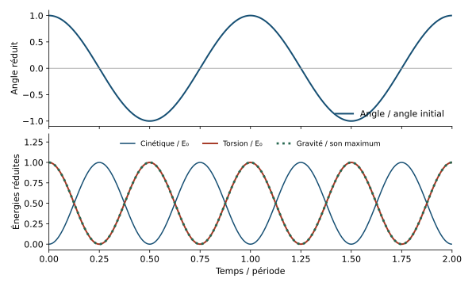
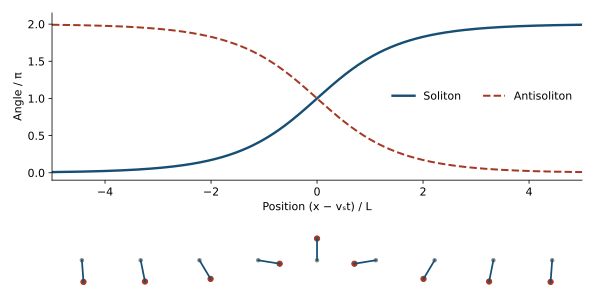
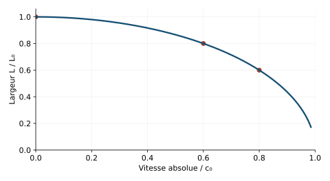

# ENS de Lyon, second concours 2007 — Physique · Corrigé brut

*Corrigé rédigé par IA, non officiel. Signalez toute erreur.*

**Lecture du rapport du jury** · GPT-6.2 Astra Ultra · vitesse non renseignée

**Rédaction** · GPT-6.2 Astra Ultra · vitesse non renseignée

## 1 — Pendule simple

### Question 1.1 — Raideur de torsion

La grandeur $k$ est le coefficient reliant le couple de rappel à l’angle relatif entre les deux bouts d’un tronçon de longueur $\Delta$. Le module du couple est $k|\theta|$. Son unité est $\mathrm{N\,m\,rad^{-1}}$ et sa dimension $ML^2T^{-2}$, le radian étant sans dimension.

### Question 1.2 — Inertie

La tige est sans masse et la masse $m$ est à distance $\ell$ de l’axe. Le moment d’inertie est donc $I=m\ell^2=0.008(0.05)^2=2.0\times10^{-5}\,\mathrm{kg\,m^2}$.

### Question 1.3 — Deux échelles de pulsation

$g/\ell$ et $k/I$ s’expriment tous deux en $\mathrm{s^{-2}}$. D’où $\omega_g=\sqrt{9.81/0.05}\simeq14.0\,\mathrm{rad\,s^{-1}}$ et $\omega_t=\sqrt{9/(2.0\times10^{-5})}\simeq671\,\mathrm{rad\,s^{-1}}$. Les données imprimées font donc largement dominer la torsion.

### Question 1.4 — Bilan des couples

Autour de l’axe du câble, le poids développe $-mg\ell\sin\theta_1$. Chacun des deux tronçons développe $-k\theta_1$. Ainsi $I\ddot\theta_1=-mg\ell\sin\theta_1-2k\theta_1$, ou $\ddot\theta_1+\omega_g^2\sin\theta_1+2\omega_t^2\theta_1=0$.

### Question 1.5 — Période linéarisée

Pour $|\theta_1|\ll1$, remplacer $\sin\theta_1$ par $\theta_1$. La pulsation vaut $\Omega=\sqrt{\omega_g^2+2\omega_t^2}$ et la période $T=2\pi/\Omega\simeq6.62$ ms. Les deux tronçons augmentent la raideur de rappel.

### Question 1.6 — Lâcher sans vitesse

La solution générale de l’équation linéaire est $A\cos\Omega t+B\sin\Omega t$. À l’instant initial, $\theta_1(0)=\pi/6$ et $\dot\theta_1(0)=0$. Ainsi $\theta_1(t)=(\pi/6)\cos\Omega t$ dans l’approximation demandée.

### Question 1.7 — Énergie conservée

En choisissant le bas et le câble détordu comme référence, $E_{\rm tot}=\tfrac12 I\dot\theta_1^2+mg\ell(1-\cos\theta_1)+k\theta_1^2$. Les deux potentiels sont celui de pesanteur et la somme des énergies de torsion, chacune $k\theta_1^2/2$. Sa dérivée est la vitesse angulaire multipliée par l’équation dynamique, donc nulle. Dans le calcul linéarisé, on remplace le potentiel gravitationnel par $mg\ell\,\theta_1^2/2$.

### Question 1.8 — Échange entre les énergies

Posons $\Theta=\pi/6$. À l’ordre quadratique, $E_c=\tfrac12 I\Omega^2\Theta^2\sin^2\Omega t$, $E_g=\tfrac12 mg\ell\Theta^2\cos^2\Omega t$ et $E_t=k\Theta^2\cos^2\Omega t$. L’angle oscille à $\Omega$. Les trois énergies varient à $2\Omega$, et leur somme vaut $E_0=I\Omega^2\Theta^2/2$. L’énergie maximale de gravité représente seulement $\omega_g^2/\Omega^2\simeq2.18\times10^{-4}$ de $E_0$. La figure lui donne une échelle distincte.

## 2 — Deux pendules couplés

### Question 2.1 — Deux pendules couplés

Pour le pendule 1, le segment extérieur exerce $-k\theta_1$, le segment intérieur $k(\theta_2-\theta_1)$. Le poids linéarisé ajoute $-mg\ell\theta_1$. On obtient $\ddot\theta_1+(\omega_g^2+2\omega_t^2)\theta_1-\omega_t^2\theta_2=0$ et, par échange des indices, $\ddot\theta_2+(\omega_g^2+2\omega_t^2)\theta_2-\omega_t^2\theta_1=0$.

### Question 2.2 — Coordonnées normales

En additionnant les équations, $\theta_s=\theta_1+\theta_2$ vérifie $\ddot\theta_s+\omega_s^2\theta_s=0$ avec $\omega_s^2=\omega_g^2+\omega_t^2$. En les soustrayant, $\theta_d=\theta_1-\theta_2$ vérifie $\ddot\theta_d+\omega_d^2\theta_d=0$ avec $\omega_d^2=\omega_g^2+3\omega_t^2$. Comme $\theta_{1,2}=(\theta_s\pm\theta_d)/2$, les deux signaux sinusoïdaux engendrent tout mouvement de petite amplitude.

### Question 2.3 — Préparer un mode propre

Si $\theta_s=0$ à tout instant, les oscillations sont opposées, $\theta_2=-\theta_1$, à $\omega_d$. On écarte les masses d’angles opposés puis on les lâche ensemble au repos. Si $\theta_d=0$, les masses oscillent en phase avec le même angle, à $\omega_s$. On les écarte du même angle puis on les lâche ensemble. Plus généralement, il faut préparer aussi les vitesses avec la symétrie choisie.

### Question 2.4 — Matrice dans la base des angles individuels

Posons $r=\omega_g/\omega_t$ et $\boldsymbol\theta=(\theta_1,\theta_2)^{\rm T}$. Les équations de 2.1 s’écrivent $\ddot{\boldsymbol\theta}=-\omega_t^2 M_2\boldsymbol\theta$, avec
$$
M_2=\begin{pmatrix}\alpha&-1\\-1&\alpha\end{pmatrix},\qquad \alpha=2+r^2.
$$

### Question 2.5 — Matrice dans la base adaptée

Dans la base $(\theta_s,\theta_d)$, on obtient $M'_2=\operatorname{diag}(\alpha-1,\alpha+1)$. Le premier coefficient est $\omega_s^2/\omega_t^2$, le second $\omega_d^2/\omega_t^2$. Les termes hors diagonale s’annulent.

### Question 2.6 — Valeurs et vecteurs propres

L’équation caractéristique est $(\alpha-\lambda)^2-1=0$. Le vecteur $(1,1)^{\rm T}/\sqrt2$ a pour valeur propre $\alpha-1$, et $(1,-1)^{\rm T}/\sqrt2$ a pour valeur propre $\alpha+1$. Ils décrivent respectivement le mouvement symétrique et le mouvement antisymétrique. À chaque vecteur propre est associée une pulsation $\omega=\omega_t\sqrt\lambda$. Le mode antisymétrique est plus rapide car il tord également le segment central.

## 3 — Chaîne discrète

### Question 3.1 — Chaîne discrète non linéaire

Posons $\theta_0=\theta_{N+1}=0$ pour représenter les deux attaches. Pour $1\le n\le N$,
$$
\ddot\theta_n=-\omega_g^2\sin\theta_n+
\omega_t^2(\theta_{n+1}-2\theta_n+\theta_{n-1}).
$$
Le premier pendule reçoit donc $\omega_t^2(\theta_2-2\theta_1)$ comme terme de torsion, et le dernier $\omega_t^2(\theta_{N-1}-2\theta_N)$. Le poids garde son sinus exact.

### Question 3.2 — Nombre des pulsations propres

Pour les petites oscillations, $\ddot{\boldsymbol\theta}=-\omega_t^2M_N\boldsymbol\theta$. La diagonale de $M_N$ vaut $2+r^2$ et chacune des deux diagonales voisines vaut $-1$. Tous les autres coefficients sont nuls. Pour $j=1,\ldots,N$, les composantes $\sin[nj\pi/(N+1)]$ satisfont les conditions aux attaches et donnent $\lambda_j=r^2+2-2\cos[j\pi/(N+1)]$. On obtient $N$ pulsations propres distinctes $\omega_t\sqrt{\lambda_j}$ pour $N$ degrés de liberté. Une chaîne de $N$ masses reliées par des ressorts et mobiles sur un axe entre deux supports fixes offre un autre exemple.

## 4 — Milieu continu et solitons

### Question 4.1 — Rigidité de torsion du câble

$\gamma=k\Delta$ a les unités $\mathrm{N\,m^2}$ et la dimension $ML^3T^{-2}$. Pour un câble uniforme sous le même couple, l’angle de torsion s’ajoute sur les tronçons successifs. Il est ainsi proportionnel à la longueur, donc $k$ est inversement proportionnel à $\Delta$. Le produit $\gamma$ caractérise le matériau et la section du câble.

### Question 4.2 — Équation du milieu continu

La différence seconde entre voisins vaut $\Delta^2\partial_x^2\theta+O(\Delta^4)$ pour un profil régulier. Avec $\mu=m/\Delta$, $\gamma=k\Delta$ et $I=m\ell^2$, on garde $\omega_t^2\Delta^2=\gamma/(\mu\ell^2)=c_0^2$ fini. L’équation devient $\partial_t^2\theta=c_0^2\partial_x^2\theta-\omega_g^2\sin\theta$. Numériquement $\mu=0.40\,\mathrm{kg\,m^{-1}}$, $\gamma=0.18\,\mathrm{N\,m^2}$ et $c_0=\Delta\omega_t\simeq13.4\,\mathrm{m\,s^{-1}}$.

### Question 4.3 — Conditions de linéarité

En l’absence de pesanteur l’équation est exactement linéaire pour toute amplitude. En présence de gravité elle se linéarise pour de petites perturbations autour d’une configuration d’équilibre, par exemple $\theta=2n\pi+\delta$ avec $|\delta|\ll1$ et $\sin\theta\simeq\delta$. Le terme de torsion était déjà linéaire.

### Question 4.4 — Énergie du continuum

Notons $J=\mu\ell^2$ l’inertie de rotation par unité de longueur. Une longueur $dx$ porte l’énergie $dE=\mathcal E\,dx$ avec
$$
\mathcal E=\tfrac12 J\theta_t^2+\mu g\ell(1-\cos\theta)+\tfrac12\gamma\theta_x^2 .
$$
Le dernier terme vient de l’énergie d’un tronçon $\tfrac12k(\theta_{n+1}-\theta_n)^2$, divisée par $\Delta$. On obtient $E=\int\mathcal E(x,t)\,dx$ sur toute la chaîne, conservée si aucun travail n’est fourni aux extrémités.

### Question 4.5 — Vitesse d’un profil progressif

Avec $u=(x-vt)/L$ et $\theta=f(u)$, l’équation devient $(c_0^2-v^2)f''=\omega_g^2L^2\sin f$. Sans gravité, tout profil non affine de cette forme se propage à $v=\pm c_0$. En présence de gravité, vitesse, largeur et forme sont liées. L’ansatz de translation à lui seul ne choisit plus une vitesse unique.

### Question 4.6 — Vitesse pour le profil imposé

Pour $f=4\arctan e^u$, on a $f'=2/\cosh u$ et $f''=-2\sinh u/\cosh^2u=\sin f$. La substitution donne $c_0^2-v_s^2=\omega_g^2L^2$, soit $v_s=\pm\sqrt{c_0^2-\omega_g^2L^2}$. Le choix positif décrit la propagation dans le sens de $x$ croissant. L’indication du fascicule donne la même expression de $\sin f$.

### Question 4.7 — Profil et positions des pendules

À un instant fixé, l’angle augmente de 0 à $2\pi$ et vaut $\pi$ au centre $x=v_st$. Les masses pendulaires sont en bas aux deux extrémités lointaines et la tige centrale pointe vers le haut. Entre ces zones, les tiges effectuent un tour complet. $L$ détermine la largeur spatiale de la torsion. En particulier $\partial_x\theta_s=2/[L\cosh u]$ atteint $2/L$ au centre. La figure juxtapose la courbe et la vue des tiges dans leurs plans locaux.

### Question 4.8 — Sens de torsion et antisoliton

En parcourant la chaîne vers les $x$ croissants, la solution écrite accumule $+2\pi$. L’image par réflexion spatiale accumule $-2\pi$. La symétrie relie deux profils de chiralités opposées. Si l’angle positif suit la règle de la main droite autour de $+x$, le profil fourni est droit. Le qualificatif s’inverse si l’on inverse la convention d’angle. Un antisoliton est $\theta_a=4\arctan e^{-u}=2\pi-\theta_s$. Il peut se déplacer dans le même sens que le soliton. La charge topologique $[\theta(+\infty)-\theta(-\infty)]/(2\pi)$ vaut respectivement $+1$ et $-1$.

### Question 4.9 — Bornes de vitesse et de largeur

La largeur s’écrit $L=L_0\sqrt{1-v_s^2/c_0^2}$, avec $L_0=c_0/\omega_g\simeq0.96$ m. Pour un profil de largeur finie positive, $0<L\le L_0$ et $|v_s|<c_0$. Le soliton au repos est le plus large. Plus la valeur absolue de sa vitesse augmente, plus il se contracte. Une largeur comparable au pas discret sort du domaine du modèle continu.

### Question 4.10 — Énergie du soliton

Sur une chaîne assez longue, intégrer de $-\infty$ à $+\infty$. On a $\theta_t=-v_s\theta_x$, $\theta_x^2=4/[L^2\cosh^2u]$, $1-\cos\theta=2/\cosh^2u$ et $Jc_0^2=\gamma$. L’identité $\omega_g^2L^2=c_0^2-v_s^2$ ramène la densité à $\mathcal E=4\gamma/[L^2\cosh^2u]$. Avec $dx=L\,du$ et $\int_{-\infty}^{+\infty}\cosh^{-2}u\,du=2$, il vient $E_s=8\gamma/L$. L’énergie augmente quand la largeur diminue.

### Question 4.11 — Lire les sept diagrammes

Le temps augmente vers le haut et chaque profil a reçu un décalage vertical graphique. La pente **spatiale** de la marche donne la chiralité. La position successive de son centre donne le sens du déplacement.

**a)** Marche croissante se déplaçant régulièrement vers la droite. **b)** Même chiralité, déplacement vers la gauche. **c)** Marche décroissante, donc antisoliton, vers la droite. **d)** Autre marche décroissante vers la droite, plus large et plus lente que c, en accord avec la contraction de 4.9 pour des échelles identiques.

**e)** Deux marches de même chiralité viennent en sens opposés, interagissent puis deux fronts de même forme se séparent. Pour des fronts identiques, le dessin ne distingue pas la traversée de l’échange d’identités. **f)** Une marche décroissante et une marche croissante se rapprochent. Leur charge totale est nulle. Après leur rencontre, le dessin présente des oscillations réparties le long de la chaîne. **g)** Un front croissant avance d’abord vers la droite, ralentit et s’élargit, puis son centre reste presque fixe. La courbe montre l’évolution. La cause d’une perte d’énergie, d’un éventuel obstacle ou d’un échange avec d’autres degrés de liberté demanderait des informations supplémentaires. Un soliton isolé exact de 4.6 conserve sa vitesse.

### Question 4.12 — Analogie avec une particule et limites

Le soliton transporte une énergie localisée, possède un centre repérable et se propage en conservant sa forme. Ces caractères, et la réapparition des deux fronts dans e, permettent de le traiter comme un objet. Le même objet est une solution collective d’une équation d’onde et provient des mouvements de nombreuses tiges couplées. La redistribution visible en f illustre le caractère ondulatoire du milieu. Il s’agit ici d’une analogie classique avec les deux descriptions, sans mesure d’une dualité quantique.

Les diagrammes permettent que plusieurs excitations semblables coexistent. Cela suggère éventuellement une analogie bosonique au sens intuitif du sujet. Une chaîne classique n’a toutefois ni statistique d’échange quantique ni spin assigné à ses solitons. Décider entre bosons et fermions exigerait une théorie quantifiée précisant les opérateurs, la dimension et les échanges. La coexistence ou le croisement de deux fronts classiques ne tranche pas cette question.
