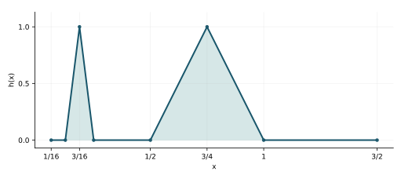

# ENS de Cachan — Économie-gestion option I — Mathématiques et statistiques 2007 · Corrigé brut

*Corrigé rédigé par IA, non officiel. Signalez toute erreur.*

**Rédaction** · GPT-6.2 Astra Ultra · vitesse non renseignée

**Révision (tour 1)** · GPT-6.2 Astra Ultra · vitesse non renseignée

La composition C1792 de quatre heures occupe les pages 15 à 19 du recueil. La pagination interne va de 1 à 5. Les trois exercices sont indépendants. La somme des rectangles s’arrête à l’indice $N-1$, tandis que l’urne entièrement rouge, de numéro $N$, participe aux observations.

## Exercice 1. Tirages successifs dans une urne inconnue

### Question 1.1.a

Pour $N\ge1$, $S_{1,N}=N^{-2}\sum_{k=0}^{N-1}k=(N-1)/(2N)$, par la somme des termes d’une progression arithmétique.

### Question 1.1.b

Pour $k=0,\ldots,N$, $(k+1)^3-k^3=3k^2+3k+1$. En sommant et en utilisant $\sum_{k=0}^Nk=N(N+1)/2$, on obtient $3\sum k^2=(N+1)^3-3N(N+1)/2-(N+1)$. La factorisation donne $\sum_{k=0}^N k^2=N(N+1)(2N+1)/6$.

### Question 1.1.c

$S_{2,N}=N^{-3}(N-1)N(2N-1)/6=(N-1)(2N-1)/(6N^2)$.

### Question 1.1.d

Pour $n\ge1$, $x\mapsto x^n$ est strictement croissante sur $[0,1]$. Sur chaque intervalle de longueur $1/N$, l’intégrale est strictement comprise entre sa largeur multipliée par les valeurs aux deux extrémités. En sommant, la somme à gauche vaut $S_{n,N}$, celle à droite $S_{n,N}+1/N$ puisqu’on échange les termes 0 et 1. L’intégrale vaut $1/(n+1)$, ce qui prouve les deux inégalités strictes.

### Question 1.2

Soit $A_n$ l’événement de $n$ rouges consécutives. L’urne est choisie une seule fois uniformément parmi $0,\ldots,N$. Dans l’urne $k$, les tirages avec remise donnent $P(A_n\mid X=k)=(k/N)^n$. Donc $P(A_n)=(NS_{n,N}+1)/(N+1)$, le terme supplémentaire venant de l’urne entièrement rouge $k=N$. Alors
$$p_{n,N}=\frac{P(A_{n+1})}{P(A_n)}=\frac{NS_{n+1,N}+1}{NS_{n,N}+1}.$$

### Question 1.3

Après une rouge, la probabilité d’une seconde rouge vaut $\sum_{k=0}^N k^2/(N\sum_{k=0}^N k)=(2N+1)/(3N)$. En particulier pour $N=1$ l’observation identifie l’unique urne à boule rouge.

### Question 1.4

Pour $n$ fixé, $S_{n,N}\to1/(n+1)$ et $S_{n+1,N}\to1/(n+2)$. En divisant le quotient précédent par $N$, on trouve $p_{n,N}\to(n+1)/(n+2)$.

### Question 1.5.a

$X$ est uniforme sur $\{0,\ldots,N\}$ : pour chaque entier $k$ de cette plage, $P(X=k)=1/(N+1)$.

### Question 1.5.b

Pour $0\le k\le N$, Bayes donne $P(X=k\mid A_n)=(k/N)^n/(NS_{n,N}+1)$. L’urne 0 a probabilité postérieure nulle dès la première rouge, et les poids croissent avec $k$.

### Question 1.5.c

Comme $k(k/N)^n=N(k/N)^{n+1}$,
$$\mathbb E[X\mid A_n]=N\frac{NS_{n+1,N}+1}{NS_{n,N}+1}=Np_{n,N}.$$
La probabilité prédictive est bien la proportion rouge moyenne selon la loi a posteriori.

## Exercice 2. Algèbres de parties et tribus

### Question 2.prél.1

Oui. L’ensemble vide est une partie de $\mathcal X$. Le complémentaire d’une partie dans $\mathcal X$ ainsi que l’union de deux parties sont encore des parties de $\mathcal X$.

### Question 2.prél.2

Oui. Pour $A,B$ dans une tribu, la suite $A,B,\varnothing,\varnothing,\ldots$ a pour union $A\cup B$, donc celle-ci appartient à la tribu. Les axiomes du vide et du complément sont déjà satisfaits.

### Question 2.prél.3

Oui. L’union dénombrable de parties de $\mathcal X$ est une partie de $\mathcal X$. Avec le vide et la stabilité par complément, cela fait de $\mathcal P(\mathcal X)$ une tribu.

### Question 2.prél.4

Oui. Si $A,B\in\mathcal A$, alors $A^c,B^c\in\mathcal A$, puis leur union appartient à $\mathcal A$. Son complément $A\cap B$ aussi.

### Question 2.prél.5

Oui. Toute algèbre contient $\varnothing$, donc son complémentaire $\mathcal X$.

### Question 2.prél.6

Oui. La tribu contient les $A_n^c$, leur union dénombrable et le complément de cette union, égal à $\bigcap_{n\ge1}A_n$.

### Question 2.appl.1.a

Pour $\mathcal X=\{-2,5\}$, la famille des parties est $\{\varnothing,\{-2\},\{5\},\mathcal X\}$.

### Question 2.appl.1.b

La famille $\mathcal A_1$ contient $\{-2\}$ mais omet son complément $\{5\}$. Elle n’est donc pas une algèbre.

### Question 2.appl.1.c

$\mathcal A_2=\{\varnothing,\mathcal X\}$ contient le vide, est fermée par complément et union, et omet les deux singletons. C’est l’exemple recherché.

### Question 2.appl.2.a

Pour $\mathcal Y=\{-5,0,3\}$, les parties sont le vide, les trois singletons $\{-5\}$, $\{0\}$, $\{3\}$, les trois paires $\{-5,0\}$, $\{-5,3\}$, $\{0,3\}$, puis $\mathcal Y$.

### Question 2.appl.2.b

Oui. Les blocs $\{-5,0\}$ et $\{3\}$ forment une partition de $\mathcal Y$. La famille $\mathcal B_1$ contient toutes les réunions de ces deux blocs, dont le vide. Un complément sélectionne les blocs restants et une union sélectionne les blocs de l’une ou l’autre partie.

### Question 2.appl.2.c

La famille $\{\varnothing,\mathcal Y\}$ est une algèbre. Ces deux éléments distincts sont imposés dans toute algèbre sur cet ensemble non vide, ce qui prouve sa minimalité.

### Question 2.appl.3.a

La trace $\overline{\mathcal C}$ contient $\varnothing=Y\cap\varnothing$. Pour $A=Y\cap T$, son complément relatif vaut $Y\setminus A=Y\cap T^c$. Enfin $\bigcup_n(Y\cap T_n)=Y\cap\bigcup_n T_n$. Les ensembles $T^c$ et $\bigcup_nT_n$ appartiennent à $\mathcal C$, donc les trois axiomes d’une tribu sur $Y$ sont satisfaits.

### Question 2.appl.3.b

Si $Y\in\mathcal C$, toute trace $T\cap Y$ est dans $\mathcal C$ par stabilité par intersection et est incluse dans $Y$. Inversement, pour $A\in\mathcal C$ avec $A\subseteq Y$, $A=Y\cap A$ appartient à la trace. Ainsi $\overline{\mathcal C}=\{A\in\mathcal C:A\subseteq Y\}$.

## Exercice 3. Oscillations, continuité et dérivabilité

### Question 3.1.a

Pour $x\ne0$, $|x\sin(1/x)|\le|x|$, et en 0 les deux côtés sont nuls. L’ensemble d’arrivée $[0,1]$ indiqué dans le texte est trop restrictif : en $x=2/(3\pi)$, la valeur est $-2/(3\pi)$. Les questions portent sur la formule réelle donnée.

### Question 3.1.b

Hors 0, le produit et la composition de fonctions continues sont continus. En 0, la majoration $|f(x)|\le|x|\to0=f(0)$ suffit.

### Question 3.1.c

Pour $x\ne0$, $f$ est dérivable et $f'(x)=\sin(1/x)-\cos(1/x)/x$.

### Question 3.1.d

Pour $x\ne0$, $g(x)=\sin(1/x)$. Prenons $x_k=1/(2k\pi+\pi/2)$ et $y_k=1/(2k\pi+3\pi/2)$. Les deux suites tendent vers 0, mais $g(x_k)=1$ et $g(y_k)=-1$. La limite n’existe donc pas.

### Question 3.1.e

Le quotient différentiel $(f(x)-f(0))/x$ est précisément $g(x)$ hors 0. Son absence de limite interdit la dérivabilité de $f$ en 0.

### Question 3.2.a

Posons $a_n=4^{-n}$ pour $n\ge1$. Les trois intervalles semi-ouverts $[a_n,2a_n[$, $[2a_n,3a_n[$ et $[3a_n,4a_n[$ partitionnent $[a_n,a_{n-1}[$ avec $a_0=1$. Lorsque $n$ parcourt les entiers positifs, leur réunion est $]0,1[$ sans chevauchement. Le texte couvre aussi 0 et $[1,+\infty[$. La prescription de parité donne ensuite toutes les valeurs négatives.

### Question 3.2.b

Sur $[1/16,1/4]$, relier successivement $(1/16,0),(2/16,0),(3/16,1),(4/16,0)$. Sur $[1/4,1]$, relier $(1/4,0),(1/2,0),(3/4,1),(1,0)$. Enfin prolonger horizontalement jusqu’à $3/2$. Le rapport des unités du tracé est de deux à un. Pour le reproduire sur la copie à l’échelle demandée, placer les sommets des deux dents à 1,875 cm et 7,5 cm à droite de l’origine, tous deux à 5 cm de hauteur. Le point final est à 15 cm de l’origine.

### Question 3.2.c

$h(3a_n)=1$. Les formules voisines donnent les mêmes valeurs 0, 1 et 0 aux raccords $2a_n,3a_n,4a_n$. En dehors de zéro, les points de raccord sont localement en nombre fini et la fonction est continue, aussi du côté négatif par parité. En revanche $3a_n\to0$ avec $h(3a_n)=1$ tandis que $h(0)=0$ : la continuité en zéro échoue.

### Question 3.2.d

Le triangle de base $[2a_n,4a_n]$ et de hauteur 1 a pour aire $a_n$. L’intervalle supplémentaire $[a_n,2a_n]$ contribue zéro. Ainsi les deux premières intégrales demandées valent chacune $4^{-n}$. Pour la troisième, on additionne les triangles de niveaux $1,\ldots,n$ :
$$\int_{4^{-n}}^1 h(x)\,dx=\sum_{j=1}^n4^{-j}=\frac{1-4^{-n}}3.$$

### Question 3.2.e

Pour $0<\delta<4^{-n}$, on a $0\le\int_\delta^{4^{-n}} h(x)\,dx\le4^{-n}-\delta$ puisque $0\le h\le1$ et que $h$ est continue loin de zéro. Le critère de Cauchy donne l’existence de l’intégrale à la borne zéro. En faisant $n\to\infty$ dans la troisième intégrale de 3.2.d, on obtient $\int_0^1h(x)\,dx=1/3$. La question suivante établit aussi l’intégrabilité au sens de Riemann sur le segment fermé.

### Question 3.2.f

Pour $y>0$, la fonction est continue sur chaque $[\delta,y]$ avec $0<\delta<y$. Sur $[0,\delta]$, son oscillation est au plus 1 et la différence des sommes de Darboux y vaut au plus $\delta$. En prenant $\delta$ arbitrairement petit puis une subdivision fine sur $[\delta,y]$, on obtient l’intégrabilité de Riemann sur $[0,y]$. Le cas $y=0$ est immédiat.

### Question 3.2.g.i

Pour $y<0$, utiliser l’intégrale orientée $\int_0^y h=-\int_y^0 h$, définie par parité et intégrabilité. Pour tout $y\ne0$, $h$ est continue en $y$. Le théorème fondamental du calcul intégral donne alors la dérivabilité de $H$ en ce point.

### Question 3.2.g.ii

Pour $y\ne0$, $H'(y)=h(y)$. On a $0\le H'(y)\le1$ et le majorant 1 est atteint, par exemple pour $y=3/4$.

### Question 3.2.g.iii

$H(a_n)=1/3-(1-4^{-n})/3=4^{-n}/3$. Sur $[a_n,2a_n]$, $h=0$ et donc $H(2a_n)=H(a_n)=4^{-n}/3$.

### Question 3.2.g.iv

Pour $\mathcal H(x)=H(x)/x$ on a $\mathcal H(a_n)=1/3$ et $\mathcal H(2a_n)=1/6$. Les deux suites d’arguments tendent vers zéro par valeurs positives. Ces deux valeurs distinctes empêchent toute limite en zéro.

### Question 3.2.h

Comme $H(0)=0$, son taux d’accroissement à l’origine est $H(x)/x$. La question précédente montre qu’il n’a même pas de limite à droite : $H$ n’est donc pas dérivable en 0.
