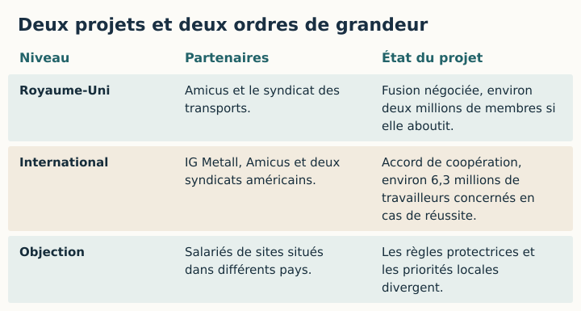

# ENS Rennes · D1 · Allemand 2007 — Corrigé guidé

*Corrigé rédigé par IA, non officiel. Signalez toute erreur.*

**Rédaction** · GPT-6.2 Astra Ultra · vitesse non renseignée

Écrit de l’ENS de Cachan, conservé dans les archives D1 de Rennes. « Zusammenschluss », Spiegel Online, 31 décembre 2006.

## Version française

**Rapprochement**

Les discussions n'en sont qu'à leurs débuts et les parties concernées ne cherchent pas encore à les porter sur la place publique. En coulisses, cependant, les négociations ont déjà bien avancé. Un premier accord est intervenu la semaine dernière. D'après le quotidien britannique *Observer*, IG Metall, Amicus, le premier syndicat britannique, et deux syndicats américains veulent désormais travailler plus étroitement ensemble. Ils entendent ainsi empêcher les multinationales de continuer à les dresser les uns contre les autres.

« Notre objectif est de faire naître un mouvement puissant qui, par-delà les frontières, relève les défis posés par un capital qui opère à l'échelle du monde », a déclaré au journal le secrétaire général d'Amicus, Derek Simpson. Amicus négocie actuellement sa fusion avec le syndicat des transports Transport & General Workers' Union. Le nouvel ensemble compterait alors environ deux millions de membres. Si la coopération avec les collègues allemands et américains aboutissait, quelque 6,3 millions de travailleurs seraient réunis sous un même toit.

Cependant, le chemin sera certainement difficile. Jusqu'à présent, les intérêts des travailleurs, qui se définissent à l'échelle nationale, sont loin de toujours converger. Ainsi, rapporte l'*Observer*, les syndicats anglais ont déploré à maintes reprises que les grands groupes commencent souvent par supprimer des emplois en Grande-Bretagne, parce que c'est là que les protections sont les plus faibles. Une chose est certaine, l'évolution en cours tend à faire des normes sociales les plus basses la règle pour tous.

## Expression en allemand

Les syndicats peuvent-ils encore jouer un rôle dans une économie mondialisée ? Répondre en allemand en 100 mots.

Gewerkschaften können heute wirksam handeln, wenn ihre Zusammenarbeit den Grenzen der Unternehmen folgt. Droht ein Konzern mit der Verlagerung einer Fabrik, geraten zwei Belegschaften leicht in Konkurrenz. Tauschen ihre Vertreter jedoch Informationen über Löhne, Aufträge und Arbeitsbedingungen aus, können sie gemeinsame Forderungen stellen. Damit verschwindet der Interessenkonflikt zwischen den Standorten keineswegs. Wer unmittelbar seinen Arbeitsplatz verlieren könnte, wird kaum auf ein abstraktes Versprechen internationaler Solidarität vertrauen. Deshalb brauchen gemeinsame Vereinbarungen überprüfbare Verpflichtungen und gewählte Ansprechpartner vor Ort. Die Stärke eines internationalen Bündnisses zeigt sich für mich daran, ob auch die Beschäftigten im schwächeren Betrieb tatsächlich an den Verhandlungen teilnehmen können.

*100 mots, comptés par espaces.*

## Comment construire la réponse

**Distinguer les deux projets.** Amicus négocie une fusion britannique qui porterait ses effectifs à deux millions. Les 6,3 millions supposent la réussite d'une coopération internationale plus large. Les conditionnels allemands protègent cette distinction.

**Lire la portée des adverbes.** Dans la phrase sur les suppressions d'emplois, *nicht selten* signifie « souvent » et *zuerst* porte sur la Grande-Bretagne. Le jury souligne également que les formes du discours rapporté attribuent le constat aux syndicats. *Den Herausforderungen begegnen* appelle en français « relever les défis ».

**Défendre une condition concrète.** L'essai part d'un problème commun, la menace de délocalisation, puis montre pourquoi les intérêts nationaux peuvent diverger. La proposition finale explique à quelle condition un accord international pourrait malgré tout fonctionner.

[Feuillet original, p. 3](https://www.ens-rennes.fr/medias/fichier/annales-2007-concours-d1_1423059780504-pdf#page=3) · [Rapport du jury, partie écrite](https://www.ens-rennes.fr/medias/fichier/rapports-2007-concours-d1_1423059785836-pdf#page=1)
