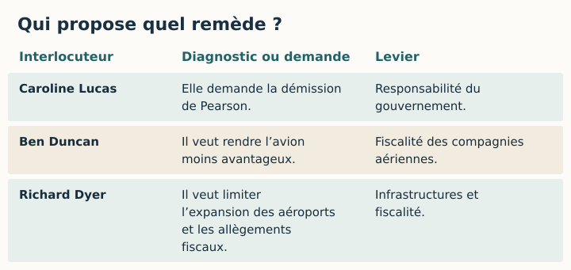

# ENS Rennes · D1 · Anglais 2007 — Corrigé brut

*Corrigé rédigé par IA, non officiel. Signalez toute erreur.*

**Rédaction** · GPT-6.2 Astra Ultra · vitesse non renseignée

Écrit de l’ENS de Cachan, conservé dans les archives D1 de Rennes. Tom Mellen, « Government ‘can’t rein in the airlines’ », adapté du Morning Star, 6 janvier 2007.

## Version française

**Le gouvernement « n'arrive pas à brider les compagnies aériennes »**

L'eurodéputée écologiste Caroline Lucas a demandé hier au ministre de l'Environnement Ian Pearson de démissionner, après qu'il eut reconnu que le gouvernement manquait de courage pour tenir tête au lobby de l'aviation.

M. Pearson a qualifié Ryanair, compagnie à bas prix hostile aux syndicats, de « visage irresponsable du capitalisme » en raison du refus de son patron combatif, Michael O'Leary, de prendre le changement climatique au sérieux. Le ministre s'est ensuite plaint que le lobby de l'aviation ne « joue pas le jeu » dans la lutte contre le changement climatique.

« Il est tout simplement inconcevable qu'il se lamente de la puissance des lobbyistes des compagnies aériennes, reconnaissant ainsi que le gouvernement n'est pas de taille à tenir tête à des avocats de l'industrie que personne n'a élus », a déclaré Mme Lucas.

Ben Duncan, porte-parole des Verts, a rappelé que le gouvernement avait les moyens de réduire immédiatement les émissions dues au transport aérien. « Une hausse des taxes sur les compagnies aériennes aurait un effet immédiat », a-t-il souligné, ajoutant que beaucoup d'hommes d'affaires prennent régulièrement l'avion pour leurs trajets parce qu'il revient moins cher que le train.

Richard Dyer, chargé des questions d'aviation chez les Amis de la Terre, a déclaré que « les projets visant à permettre l'agrandissement des aéroports britanniques devraient être abandonnés et les allègements fiscaux de plusieurs milliards de livres dont bénéficie le secteur doivent cesser. Les quatre cinquièmes des voyages à l'étranger au départ du Royaume-Uni ont pour destination un pays européen. Un grand nombre de ces destinations seraient facilement accessibles en train. »

## Expression en anglais

Discuter les avantages et les inconvénients du principe pollueur-payeur en anglais, en 100 mots.

Making polluters pay gives firms and passengers a reason to consider damage that ticket prices otherwise conceal. If a flight costs more because of its emissions, a traveller may take the train, while an airline may invest in cleaner equipment. Yet the price signal works only when alternatives exist. A rural household without reliable transport may face a larger bill, and a wealthy passenger may continue to fly. I would therefore use part of the revenue to improve public transport and return another share to households on low incomes. The charge would then reward change without making mobility a privilege.

*100 mots, comptés par espaces.*

[Feuillet original, p. 4](https://www.ens-rennes.fr/medias/fichier/annales-2007-concours-d1_1423059780504-pdf#page=4)
