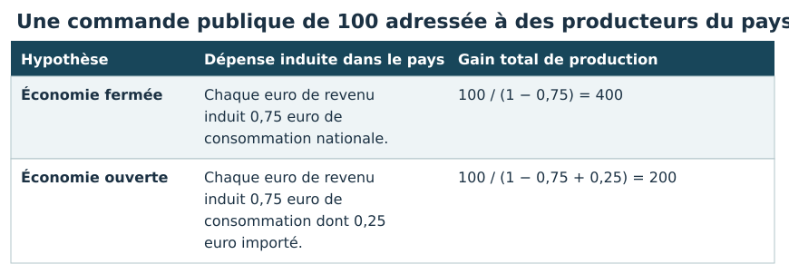

# ENS de Cachan D1 — Composition d’ordre économique 2007 · Corrigé guidé

*Corrigé rédigé par IA, non officiel. Signalez toute erreur.*

**Rédaction** · GPT-6.2 Astra Ultra · vitesse non renseignée

## L’action de l’État est-elle encore efficace ?

### Introduction

En 2006, la France exécute pour la première fois un budget entièrement présenté selon la loi organique relative aux lois de finances. La loi du 1er août 2001 prévoit pour un programme « des objectifs précis, définis en fonction de finalités d’intérêt général ». Voter une dépense et atteindre son objectif apparaissent ainsi comme deux opérations distinctes. Comment savoir, par exemple, si une aide à l’embauche réduit le chômage quand, dans le même temps, toutes les entreprises bénéficient d’une reprise des commandes ?

L’action économique de l’État emprunte les prélèvements, les dépenses, la réglementation, la production de services et les institutions qu’il contribue à mettre en place. Son efficacité se juge à sa capacité d’atteindre un objectif dans un délai donné, en comparant le résultat à ce qui serait arrivé sans intervention. Son efficience ajoute la question du coût consenti. L’adverbe « encore » invite à examiner des transformations identifiables : l’ouverture des économies, la mobilité de certaines assiettes fiscales et le partage de compétences en Europe. Ces changements réduisent la portée de certaines interventions nationales isolées. Ils rendent aussi plus importantes la qualité du choix de l’instrument et l’échelle à laquelle il est mis en œuvre.

> [!INDICATION]
> Pour une subvention à un secteur en expansion, observer les créations d’emplois ne suffit pas. Définir séparément l’objectif, l’indicateur, la période et l’évolution probable en l’absence de l’aide.

### I. L’État conserve des moyens de stabiliser l’activité, de corriger des défaillances et de protéger les revenus

#### A. La politique budgétaire peut amortir une contraction cumulative de la demande

En présence de capacités inutilisées, une chute des commandes conduit les entreprises à réduire la production et l’emploi. La baisse des revenus entraîne alors une nouvelle baisse de la consommation. Une commande publique qui mobilise des ressources disponibles soutient directement la production. Les revenus distribués alimentent ensuite d’autres dépenses. Les stabilisateurs automatiques jouent sans attendre une nouvelle décision politique : un ménage qui perd son emploi paie moins d’impôts sur ses revenus et peut bénéficier de prestations qui amortissent la baisse de ses achats. Le déficit conjoncturel correspondant est compatible avec une action efficace. Le juger par son seul montant ferait perdre de vue la chute d’activité que cette action a atténuée.

Dans un petit modèle à prix et taux d’intérêt fixes, sans impôt, posons $C=C_0+cY$, $M=mY$, où $C$ désigne la consommation, $M$ les importations et $Y$ le revenu. Avec l’investissement et les exportations donnés et une commande publique portant initialement sur des biens nationaux, la variation de production vaut $\Delta Y=\Delta G/(1-c+m)$. La figure montre pourquoi une partie de la relance bénéficie alors aux partenaires commerciaux. Un multiplicateur positif demeure compatible avec une efficacité plus faible de l’action isolée. Près de la saturation des capacités, un surcroît de dépense peut en revanche pousser surtout les prix à la hausse, évincer d’autres usages des ressources ou appeler un resserrement monétaire.

> [!INDICATION]
> Retrouver la première dépense induite dans chaque scénario. Sur les 100 euros de revenus créés, 75 sont redépensés auprès des entreprises nationales dans le premier cas, 50 dans le second. Les tours suivants prolongent cette différence.

#### B. L’allocation des ressources et la répartition des revenus répondent à d’autres critères de réussite

Un pollueur n’intègre pas spontanément toute la gêne que ses émissions imposent aux riverains. Une règle ou un prix appliqué à l’émission modifie son arbitrage. Si deux installations ont des coûts de dépollution différents, un marché de quotas transférables les incite à réaliser d’abord les réductions les moins coûteuses pour un même plafond global. Dans le système communautaire lancé en 2005, la directive européenne encadre des plans d’allocation et des contrôles nationaux. L’efficacité environnementale dépend du plafond et de la vérification des émissions. Un prix très faible peut provenir d’allocations trop généreuses. L’existence d’un marché de permis ne permet donc pas, à elle seule, de conclure que l’objectif climatique est atteint.

Une assurance contre le chômage ou la maladie lisse le revenu et mutualise des risques auxquels un ménage isolé peut difficilement faire face. Le financement obligatoire peut limiter la sélection qui se produirait si seuls les assurés les plus exposés cotisaient. La redistribution poursuit aussi un objectif collectif d’équité. Pour une allocation, la réussite se juge à la couverture des personnes visées et à l’évolution de leur niveau de vie. On peut concevoir un dispositif qui réduit effectivement la pauvreté à un coût budgétaire élevé et un dispositif peu coûteux parce que les bénéficiaires potentiels n’y recourent pas. Les deux constats appellent des évaluations distinctes de l’efficacité et de l’efficience.

> [!INDICATION]
> Comparer deux politiques de même coût budgétaire. Si l’une finance une assurance sociale et l’autre une dépollution, le montant dépensé ne permet pas de départager leurs résultats. Identifier un indicateur pertinent pour chacune.

### II. L’ouverture et les limites de l’action publique exigent des instruments évaluables et une coopération adaptée

#### A. Les réactions des agents et les frontières de la compétence nationale modifient la transmission des décisions

Dans la zone euro, un gouvernement national ne décide plus du taux directeur et ne peut dévaluer seul sa monnaie par rapport à celle d’un partenaire de l’union. La Banque centrale européenne définit la politique monétaire pour la zone. Un ralentissement national isolé peut donc coexister avec des conditions monétaires choisies pour une conjoncture d’ensemble différente. Le gouvernement conserve des moyens budgétaires, sous les contraintes du coût de la dette et des engagements européens, et des instruments sur la formation, les infrastructures ou la fiscalité. Il doit les choisir en fonction du choc : une pénurie d’ouvriers qualifiés et une insuffisance temporaire de commandes demandent des réponses différentes.

Les entreprises mobiles peuvent modifier l’implantation de leurs investissements lorsqu’un impôt change. La base taxée réagit alors à la mesure, et le produit supplémentaire peut être plus faible qu’un calcul à assiette constante. Le degré de mobilité importe. Un terrain bien situé et un actif financier aisément transférable n’offrent pas les mêmes possibilités de déplacement. De même, l’annonce d’une relance financée par emprunt peut susciter davantage d’épargne chez des ménages qui anticipent les impôts futurs. Cet effet dépend de leur accès au crédit, de leur horizon et de la crédibilité de l’annonce. Des ménages contraints par leur revenu courant peuvent au contraire dépenser une part importante d’une prestation. Le diagnostic exige donc d’identifier les agents effectivement touchés.

> [!INDICATION]
> Distinguer une compétence transférée de l’efficacité amoindrie d’une compétence conservée. Le taux directeur illustre la première situation ; la fuite d’une partie d’une relance dans les importations illustre la seconde.

#### B. L’évaluation et le bon partage des responsabilités rendent des marges d’action utilisables

L’État ne connaît parfaitement ni les comportements privés ni les coûts de ceux qu’il finance. Une aide versée à toute entreprise déclarant une embauche bénéficie aussi à celles qui auraient embauché de toute façon. Une création de poste aidé peut remplacer un autre emploi dans l’entreprise ou chez un concurrent. Pour approcher l’effet net, on peut comparer le changement d’emploi chez des employeurs éligibles à celui observé chez des employeurs comparables qui ne le sont pas, sous l’hypothèse que les évolutions auraient été parallèles sans la mesure. Les comportements d’anticipation, le choix sélectif des bénéficiaires et les déplacements entre entreprises limitent cette identification. Un indicateur d’activité administrative tel que le nombre de dossiers ouverts fournit une information sur l’exécution, mais peu sur l’effet causal.

L’échelle pertinente varie avec les effets externes. Une commune connaît mieux certains besoins de transport local. Une politique nationale peut mutualiser les risques sociaux entre régions. La lutte contre une pollution qui traverse les frontières ou une contraction simultanée de la demande appelle une coordination plus large. Si plusieurs partenaires relancent ensemble en période de sous-emploi, chacun bénéficie d’une partie des commandes qui auraient constitué pour son voisin une fuite à l’importation. La définition commune d’un plafond de pollution répond à la même question de périmètre, avec un autre instrument. Les négociations, les différences de situation nationale et le contrôle du respect de l’accord ont néanmoins un coût. L’action commune doit apporter des gains qui justifient ces contraintes.

### Conclusion

L’État peut encore amortir une récession, empêcher que des dommages collectifs restent sans prix et organiser des assurances que les marchés fournissent imparfaitement. L’efficacité de chaque action dépend du problème visé, de la réaction des agents et de la possibilité de mesurer ce qui se serait produit en son absence. La France de 2007 dispose ainsi de politiques nationales aux effets identifiables et participe à des décisions européennes dont dépend le rendement de ces mêmes politiques.

[Sujet de la session](https://www.ens-rennes.fr/medias/fichier/annales-2007-concours-d1_1423059780504-pdf#page=14) · [Loi organique du 1er août 2001 relative aux lois de finances](https://www.legifrance.gouv.fr/jorf/id/JORFTEXT000000394028/) · [Directive 2003/87/CE établissant un système d’échange de quotas d’émission](https://eur-lex.europa.eu/legal-content/FR/TXT/?uri=CELEX:32003L0087)
