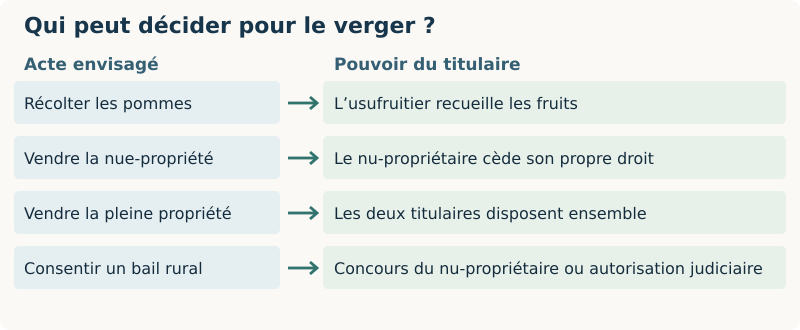

# ENS de Cachan D1 — Droit civil 2007 · Corrigé brut

*Corrigé rédigé par IA, non officiel. Signalez toute erreur.*

**Rédaction** · GPT-6.2 Astra Ultra · vitesse non renseignée

## Les prérogatives du propriétaire

### Introduction

Le propriétaire d’un hôtel particulier peut fermer sa porte au photographe qui veut entrer. Peut-il interdire à un éditeur de reproduire une photographie prise depuis la voie publique ? À propos de l’hôtel de Girancourt, l’Assemblée plénière a jugé le 7 mai 2004 que le propriétaire ne détient pas un droit exclusif sur l’image de son bien. Le pouvoir d’exclure existe sur la chose. Son extension à tous les profits que des tiers pourraient en tirer exige une justification distincte.

L’article 544 du Code civil définit la propriété comme « le droit de jouir et disposer des choses de la manière la plus absolue », sous la réserve des usages prohibés par les lois ou les règlements. Les prérogatives désignent les pouvoirs juridiques que le titre confère à son titulaire. Les étudier suppose donc d’aller au-delà des gestes qu’un occupant est matériellement capable d’accomplir. Un locataire habite les lieux, mais le titre en vertu duquel il les habite diffère de celui de son bailleur. Comment reconnaître la maîtrise propre au propriétaire lorsque plusieurs personnes peuvent se partager les utilités d’une même chose ? Le titre réserve au propriétaire l’initiative d’en déterminer le sort et d’en défendre l’intégrité. Son exercice varie ensuite avec la répartition des droits sur le bien et les exigences que le droit impose à leur coexistence.

### I. Le propriétaire décide du sort de la chose et peut opposer son titre à autrui

#### A. Choisir l’emploi du bien, recueillir ses produits et disposer du capital

Le propriétaire d’un verger peut en consommer les pommes, céder la récolte ou laisser la terre au repos. L’usage (*usus*) comprend ainsi la faculté d’employer personnellement la chose selon sa nature et, en principe, celle de s’abstenir de s’en servir. La jouissance (*fructus*) donne droit aux fruits. Les récoltes sont des fruits naturels ou industriels selon les conditions de leur production. Les loyers du bailleur sont des fruits civils. L’article 547 rattache ces revenus à la propriété par accession. La distinction avec les produits, dont le prélèvement entame la substance du bien, devient décisive lorsque la jouissance est séparée de la propriété. Couper périodiquement un taillis réglé et arracher les arbres du verger pour vendre le terrain nu ne mettent pas en jeu le même pouvoir.

Le pouvoir de disposition (*abusus*) porte sur le capital. La disposition matérielle permet de transformer une chose, de la consommer ou, sous réserve des prescriptions applicables, de la détruire. La disposition juridique permet d’en transférer la propriété, à titre onéreux ou gratuit, de l’hypothéquer s’il s’agit d’un immeuble, ou encore d’en détacher un usufruit. Un propriétaire conserve donc le droit de propriété en consentant un bail, alors qu’une donation de la pleine propriété le dessaisit. L’article 546 étend par ailleurs la propriété à ce que la chose produit et à ce qui s’y unit accessoirement. Pour un fonds, l’article 552 rattache en principe au sol le dessus et le dessous. Cette règle explique pourquoi une construction intéresse le propriétaire du sol même lorsqu’un tiers a fourni la main-d’œuvre ou les matériaux. Les articles relatifs à l’accession règlent séparément l’attribution et les indemnités éventuelles.

#### B. Défendre l’exclusivité permet au titre de produire ses effets contre tous

Le propriétaire peut autoriser l’entrée d’autrui et, sauf droit concurrent, la refuser. Il peut en principe clore son fonds (art. 647). En cas de contestation, l’action en revendication permet d’obtenir la reconnaissance du titre et la restitution de la chose par celui qui la détient sans droit opposable. Le demandeur doit établir sa propriété. En matière immobilière, titres, indices de possession et prescription acquisitive nourrissent cette preuve. La simple absence d’exploitation n’emporte pas à elle seule perte de la propriété. Cependant la possession prolongée d’un tiers peut lui permettre de prescrire si les conditions légales sont réunies. Le caractère durable du droit n’exonère donc pas le propriétaire de toute vigilance sur la possession d’autrui.

L’étendue du remède dépend de l’objet sur lequel porte le droit. En cas d’empiètement sur une parcelle, même minime, le propriétaire peut obtenir la suppression de ce qui empiète. L’indemnité offerte par l’auteur ne permet pas à celui-ci d’imposer la cession d’une bande de terrain. En revanche, la diffusion de l’image d’un immeuble laisse au propriétaire son fonds et sa maîtrise de l’accès. Dans l’arrêt du 7 mai 2004 (Ass. plén., n° 02-10.450), la Cour admet qu’il puisse s’opposer à l’usage de l’image lorsqu’il en résulte pour lui un trouble anormal. Ainsi, dans l’affaire d’un éditeur de prospectus, l’argument tiré du seul caractère commercial de la reproduction ne suffisait pas. L’exclusivité est forte à l’intérieur de son assiette et juridiquement délimitée à ses frontières.

### II. La répartition des utilités et la coexistence des intérêts commandent l’exercice des prérogatives

#### A. Plusieurs titulaires peuvent exercer sur la chose des pouvoirs complémentaires

L’usufruitier jouit des choses dont un autre a la propriété, à charge d’en conserver la substance (art. 578). S’il existe un usufruit sur le verger, les récoltes reviennent donc à l’usufruitier, alors que le nu-propriétaire peut vendre la nue-propriété. L’acquéreur la reçoit grevée de l’usufruit existant. Pour une aliénation amiable de la pleine propriété libre d’usufruit, le concours des deux titulaires est nécessaire. L’article 595 réserve également le bail d’un fonds rural ou d’un immeuble à usage commercial, industriel ou artisanal au concours du nu-propriétaire, sauf autorisation judiciaire accordée à l’usufruitier. Au terme de l’usufruit, notamment au décès de l’usufruitier personne physique, le propriétaire recouvre la plénitude des facultés de jouissance. C’est précisément cette vocation à la reconstitution qui permet de comprendre la position du nu-propriétaire pendant le démembrement.

L’indivision soulève une autre difficulté. Les indivisaires ont sur l’ensemble des droits de même nature, chacun à concurrence de sa quote-part. L’usage individuel doit être compatible avec la destination du bien et le droit des autres. La jouissance privative ouvre en principe droit à indemnité sauf convention contraire (art. 815-9). Dans le droit en vigueur depuis le 1er janvier 2007, chacun peut prendre les mesures nécessaires à la conservation du bien et les indivisaires titulaires d’au moins deux tiers des droits indivis peuvent accomplir les actes d’administration visés par l’article 815-3, à charge d’en informer les autres. La vente amiable ordinaire de l’immeuble indivis exige en principe l’accord de tous. Une même parcelle donne ainsi lieu à des règles de décision différentes selon que l’on doit réparer sa toiture, la gérer ou l’aliéner.

#### B. L’ordre juridique détermine les usages compatibles avec les droits voisins et l’intérêt collectif

La coexistence des fonds crée des pouvoirs de part et d’autre. Le propriétaire d’un fonds enclavé peut obtenir, dans les conditions de l’article 682, un passage suffisant sur les fonds voisins moyennant une indemnité proportionnée au dommage. Le voisin reste propriétaire de l’assiette du passage, et le bénéficiaire doit se tenir aux usages permis. La limite corrélative à la liberté de se clore a donc pour contrepartie une véritable utilité juridique pour le fonds dominant. D’autres restrictions s’attachent à la manière d’exercer une faculté. Dans l’affaire *Clément-Bayard* (Req., 3 août 1915), un propriétaire avait établi sur son fonds des dispositifs hérissés de pointes, dépourvus d’utilité pour lui et dirigés contre l’activité aéronautique du voisin. L’intention de nuire a permis de caractériser un abus et de justifier réparation et suppression des pointes dommageables. Le trouble anormal de voisinage obéit à une logique différente. Des nuisances excessives peuvent engager une responsabilité alors même que l’auteur tirait de son activité une réelle utilité et qu’aucune faute n’est prouvée.

Les prescriptions d’urbanisme peuvent subordonner une construction ou une démolition à autorisation. Elles portent sur l’acte projeté, sans attribuer à la collectivité les autres pouvoirs du propriétaire. La privation de la propriété a des conditions plus exigeantes. L’article 545 du Code civil subordonne la cession forcée à l’utilité publique et à une juste et préalable indemnité. L’article 17 de la Déclaration de 1789 garantit la propriété et encadre sa privation. Il faut donc qualifier la mesure concrète. Refuser une construction en application d’une règle d’urbanisme et transférer une parcelle à la collectivité pour établir une voie publique ont des objets et des régimes différents.

### Conclusion

Le titre de propriété donne à son titulaire le pouvoir de choisir les usages de la chose, d’en recueillir l’utilité, de la transmettre et d’en défendre l’intégrité. La portée de chaque décision se lit dans son objet et dans les droits déjà constitués. Une pomme peut appartenir à l’usufruitier, une quote-part à un indivisaire et une photographie être exploitée par un tiers sans que le propriétaire perde, pour ces seules raisons, son droit sur le fonds. La possibilité de disposer de son titre et la vocation à réunir les utilités que des droits temporaires en ont détachées expliquent l’unité de sa position.

[Sujet de la session](https://www.ens-rennes.fr/medias/fichier/annales-2007-concours-d1_1423059780504-pdf) · [Code civil en avril 2007](https://www.legifrance.gouv.fr/codes/texte_lc/LEGITEXT000006070721/2007-04-01/)
