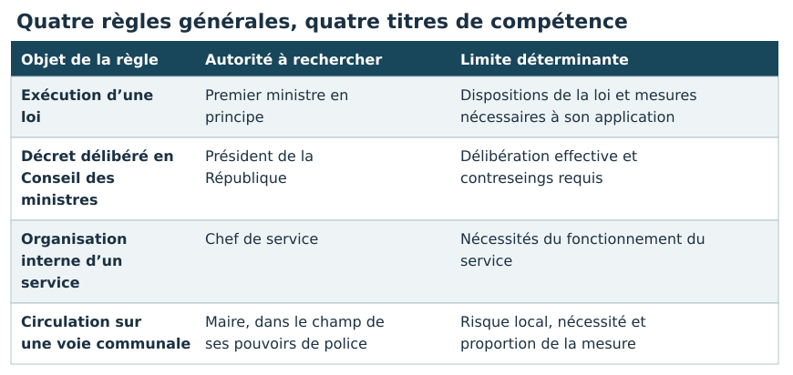

# ENS de Cachan D1 — Droit public 2007 · Corrigé brut

*Corrigé rédigé par IA, non officiel. Signalez toute erreur.*

**Rédaction** · GPT-6.2 Astra Ultra · vitesse non renseignée

## L’exercice du pouvoir réglementaire en France

### Introduction

Un décret fixe les modalités d’une loi et un arrêté municipal règle la circulation à proximité d’une école. Tous deux prescrivent une conduite à une catégorie ouverte de destinataires. Au contraire, la nomination d’un fonctionnaire par décret demeure une décision individuelle. C’est le contenu général et impersonnel de la règle qui caractérise l’acte réglementaire. Le nom de l’instrument et le rang de son signataire ne suffisent pas à le reconnaître.

Bien avant 1958, l’exécutif assurait l’application des lois et disposait de pouvoirs de police. La Constitution de la Ve République reconnaît en outre un domaine réglementaire propre. Comment cette capacité de produire des normes s’exerce-t-elle au sein d’un État qui confie le vote de la loi aux représentants de la Nation et répartit l’action administrative entre de nombreuses autorités ? Le rapport du jury ramène la question à « qui exerce le pouvoir réglementaire en France ? et comment ? ». Le droit concentre le pouvoir général et distribue des pouvoirs limités. Il soumet les uns comme les autres à des conditions de compétence, de procédure et de fond.

### I. Une compétence générale de l’exécutif national coexiste avec des compétences spécialisées

#### A. La compétence de principe du Premier ministre s’articule avec celle du président de la République

L’article 21 de la Constitution charge le Premier ministre d’assurer l’exécution des lois et de détenir le pouvoir réglementaire sous réserve des dispositions de l’article 13. Il signe donc en principe les décrets ordinaires. Les actes du Premier ministre sont contresignés, le cas échéant, par les ministres chargés de leur exécution. La participation du président de la République à la conduite politique de l’exécutif ne déplace pas à elle seule la compétence de signature.

L’article 13 attribue au président la signature des décrets délibérés en Conseil des ministres. L’arrêt *Meyet* du 10 septembre 1992 attache cette conséquence à la délibération effective, même lorsqu’aucun texte n’imposait le passage en Conseil. La modification doit alors en principe intervenir selon la même forme, sauf aménagement régulier des conditions de modification. Inversement, dans l’arrêt *Sicard* du 27 avril 1962, la présence de la signature du chef de l’État au bas d’un décret non délibéré en Conseil n’en fait pas un décret présidentiel. La signature du Premier ministre et les contreseings s’apprécient selon le régime applicable à son acte. Le président de la République n’est donc pas un supérieur réglementaire qui pourrait se substituer librement au Premier ministre.

#### B. Les autres titulaires disposent d’un pouvoir borné par leur mission

Les ministres ne disposent pas d’un pouvoir réglementaire général comparable à celui du Premier ministre. Un texte peut leur attribuer une compétence et le Premier ministre peut leur déléguer certains de ses pouvoirs. En outre, *Jamart*, le 7 février 1936, reconnaît à tout chef de service le pouvoir de prendre les mesures nécessaires au bon fonctionnement de l’administration placée sous son autorité. L’organisation de l’accès aux locaux du service relève ainsi, sous conditions, de son chef. Cette compétence interne ne l’autorise pas à imposer à l’ensemble de la population de nouvelles conditions d’exercice d’une profession. Les autorités administratives indépendantes peuvent recevoir de la loi une compétence réglementaire délimitée par la matière et la portée des mesures. Le régulateur audiovisuel peut ainsi préciser certaines règles dans le cadre défini par le législateur et sous le contrôle du juge.

Les autorités déconcentrées, en particulier le préfet, agissent au nom de l’État dans les matières que les textes leur attribuent. Les collectivités territoriales agissent en leur nom propre. L’article 72, dans sa rédaction issue de 2003, leur reconnaît un pouvoir réglementaire pour l’exercice de leurs compétences. L’histoire est plus ancienne : dès la loi municipale de 1884, le maire dispose d’attributions de police. Le conseil municipal peut arrêter les règles d’un service communal, tandis que le maire réglemente la circulation dans les limites de ses compétences. Les organes d’un établissement public disposent de compétences circonscrites par les textes et le principe de spécialité. Enfin, l’exercice d’une mission de service public peut conduire une personne privée à prendre des actes administratifs. Dans *Magnier* (Conseil d’État, 13 janvier 1961), le juge retient la mission de service public et les prérogatives conférées à des groupements de défense des cultures. La règle édictée par un tel organisme doit pouvoir se rattacher aux attributions publiques qui lui ont été confiées.

### II. Produire une norme réglementaire engage une compétence dont la loi et le juge garantissent les limites

#### A. Règlement d’application et règlement autonome obéissent à des rapports distincts avec la loi

Lorsqu’une loi institue une prestation et renvoie au décret pour ses modalités, l’autorité administrative peut organiser la procédure d’attribution dans le cadre ainsi tracé. Elle ne peut retrancher une catégorie de bénéficiaires qui satisfait aux conditions légales. Lorsque des mesures sont indispensables à l’application de la loi, elle doit les prendre dans un délai raisonnable. Dans *Association France Nature Environnement* du 28 juillet 2000, le Conseil d’État sanctionne le refus de prendre des mesures d’application et enjoint au Premier ministre d’agir. Le pouvoir réglementaire engage donc parfois l’administration par son abstention autant que par ses décisions positives.

Les articles 34 et 37 distinguent le domaine législatif des matières ayant un caractère réglementaire. Hors du domaine de la loi, l’autorité réglementaire peut intervenir directement, sous réserve des normes supérieures. Un texte de forme législative intervenu dans ce domaine ne s’efface pas de lui-même. L’article 37, alinéa 2, organise sa modification par décret après avis du Conseil d’État et, pour les textes intervenus après l’entrée en vigueur de la Constitution, après déclaration de leur caractère réglementaire par le Conseil constitutionnel. Le législateur qui empiète sur le domaine du règlement n’adopte donc pas, de ce seul fait, une disposition inconstitutionnelle, comme l’a jugé le Conseil constitutionnel le 30 juillet 1982 dans la décision *Blocage des prix et des revenus*. Les ordonnances de l’article 38 procèdent pour leur part d’une habilitation parlementaire limitée dans son objet et sa durée.

#### B. Le contrôle porte sur l’élaboration, la substance et le maintien de la règle

Consultations obligatoires, respect des contreseings et publication conditionnent selon les cas la régularité de l’élaboration ou l’opposabilité de la norme. La publication ne corrige pas un défaut de compétence. Le règlement respecte la Constitution, les engagements internationaux applicables, la loi et les principes généraux du droit. Dans *Syndicat général des ingénieurs-conseils* du 26 juin 1959, le Conseil d’État soumet même le pouvoir réglementaire autonome aux principes généraux du droit. Une autorité de police doit encore justifier une restriction aux libertés par la réalité du risque. Dans *Benjamin* (19 mai 1933), l’annulation d’une interdiction de conférence rappelle que l’autorité doit rechercher si des mesures moins sévères permettent de prévenir les troubles.

L’administré justifiant d’un intérêt peut former un recours pour excès de pouvoir contre le règlement. Il peut également invoquer son illégalité à l’occasion du recours contre une décision d’application. Dans *Compagnie Alitalia* (3 février 1989), le Conseil d’État impose à l’autorité compétente d’abroger le règlement illégal dès l’origine ou devenu illégal. L’abrogation met fin à son application pour l’avenir. Le pouvoir réglementaire doit ainsi suivre les changements de circonstances et des normes supérieures. Le contrôle juridictionnel protège à la fois les destinataires soumis à la règle et la répartition des compétences entre ses auteurs possibles.

### Conclusion

En 2007, l’unité de l’État n’implique pas l’unicité de l’auteur des règlements. Le Premier ministre détient le pouvoir de principe. Le président signe les décrets délibérés en Conseil et d’autres autorités disposent de compétences sectorielles, territoriales ou internes. Pour apprécier chaque règle, il faut partir de son objet, retrouver le titre de compétence, puis vérifier les conditions d’élaboration et la conformité du contenu aux normes supérieures. C’est ce chemin qui permet de concilier diversité des décideurs et soumission de l’administration au droit.

[Rapport du jury](https://www.ens-rennes.fr/medias/fichier/rapports-2007-concours-d1_1423059785836-pdf#page=4) · [Sujet de la session](https://www.ens-rennes.fr/medias/fichier/annales-2007-concours-d1_1423059780504-pdf#page=10) · [Constitution du 4 octobre 1958 en 2007](https://www.legifrance.gouv.fr/loda/id/JORFTEXT000000571356/2007-04-01/) · [Conseil d’État, Jamart, 7 février 1936](https://www.conseil-etat.fr/site/decisions-de-justice/jurisprudence/les-grandes-decisions-depuis-1873/conseil-d-etat-7-fevrier-1936-jamart) · [Conseil d’État, Meyet, 10 septembre 1992](https://www.conseil-etat.fr/fr/arianeweb/CE/decision/1992-09-10/140376)
