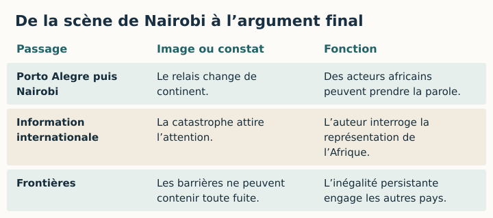

# ENS Rennes · D1 · Espagnol 2007 — Corrigé brut

*Corrigé rédigé par IA, non officiel. Signalez toute erreur.*

**Rédaction** · GPT-6.2 Astra Ultra · vitesse non renseignée

Écrit de l’ENS de Cachan, conservé dans les archives D1 de Rennes. Rafael Vilasanjuan, « Norte y Sur », El Periódico de Catalunya, 21 janvier 2007.

## Version française

Porto Alegre, ce porte-drapeau où quelques rêveurs nous ont rappelé que l'économie ne saurait être dissociée d'autres grands enjeux mondiaux, tels que la protection de l'environnement, les inégalités et le souci des droits humains, passe à présent le relais à Nairobi. Des voix s'élèvent déjà pour annoncer que le mouvement s'essouffle. Quoi qu'il en soit, puisque le monde actuel s'obstine à ne faire de nous les spectateurs que de lieux où nous jouons nous-mêmes un rôle peu glorieux, cette nouvelle scène au cœur de l'Afrique, vers laquelle affluent depuis hier des milliers de militants venus du monde entier, ouvre une fenêtre qui permettra de redonner la parole à un continent oublié et de le replacer au centre du débat politique.

Aussi injuste que cela puisse paraître, lorsque nous évoquons le continent noir en termes généraux, nous renvoyons à une représentation commune qui concentre une bonne part des tragédies de l'humanité contemporaine, de la pauvreté à la famine, en passant par les conflits, les exodes, l'immigration clandestine et le sida. La distance qui nous sépare de l'Afrique se mesure en siècles bien plus qu'en kilomètres. Ce continent a cessé de nous sembler proche dans la hiérarchie de nos préoccupations. C'est pourquoi il ne surgit au premier plan de l'actualité que lorsque les nouvelles sont mauvaises. Lorsqu'elles ne le sont pas, on voit peu l'Afrique dans les médias et elle reste dans des ombres aussi sombres que la peau de ses habitants. À l'ère de la mondialisation, à de rares exceptions près, aucun des pays autrefois colonisés n'a atteint un niveau de développement acceptable. En portons-nous une part de responsabilité ? Nous pensons que non, que leurs problèmes nous sont étrangers. Pourtant, tout indique que, si les inégalités économiques persistent, aucune barrière ne sera infranchissable pour ceux qui chercheront à fuir la catastrophe.

## Expression en espagnol

En 100 mots, donner son avis sur la responsabilité de l’Occident et préciser les raisons d’agir que donne le chroniqueur.

Occidente comparte una responsabilidad histórica por la colonización y otra presente por las reglas comerciales que contribuye a fijar. Sin embargo, atribuirle todas las decisiones tomadas en África volvería a silenciar a quienes el foro de Nairobi quiere escuchar. Vilasanjuan ofrece dos razones para actuar. La primera es moral: hombres y mujeres reclaman derechos y dignidad que reconocemos para nosotros mismos. La segunda nace de la interdependencia: ninguna frontera puede contener indefinidamente las consecuencias de desigualdades persistentes. Por eso apoyaría proyectos decididos con asociaciones locales y acuerdos comerciales revisables, para que la cooperación responda a prioridades expresadas desde el Sur.

*100 mots, comptés par espaces.*

[Feuillet original, p. 5](https://www.ens-rennes.fr/medias/fichier/annales-2007-concours-d1_1423059780504-pdf#page=5) · [Rapport du jury, partie écrite](https://www.ens-rennes.fr/medias/fichier/rapports-2007-concours-d1_1423059785836-pdf#page=2)
