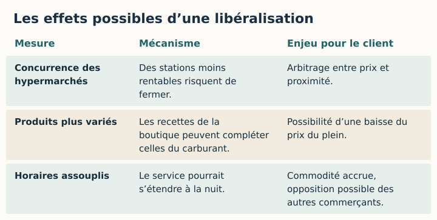

# ENS Rennes · D1 · Italien 2007 — Corrigé guidé

*Corrigé rédigé par IA, non officiel. Signalez toute erreur.*

**Rédaction** · GPT-6.2 Astra Ultra · vitesse non renseignée

Écrit de l’ENS de Cachan, conservé dans les archives D1 de Rennes. Jacopo Giliberto, IlSole24ore.com, 26 juin 2007, date imprimée sur le feuillet.

## Version française

Cela produira sur le marché des carburants le même effet que dans d'autres secteurs du commerce, où de nombreux commerces de proximité ont fermé ou changé d'activité, remplacés par les supermarchés du quartier et les hypermarchés. Ainsi, la concurrence rendra peu rentables bon nombre des plus petites stations-service. Cela ne signifie pas que tous les petits exploitants disparaîtront. Les petites stations plus chères resteront là où leur présence répond malgré tout à une demande.

Comme il le fait aujourd'hui pour le boulanger ou le marchand de fruits et légumes, le consommateur pourra demain opter pour la commodité et le service soigné de la station voisine, plus chère, ou faire des économies en allant faire le plein dans un hypermarché impersonnel, éloigné, mais bon marché.

L'élargissement des catégories de marchandises autorisées, autrement dit la possibilité de vendre autre chose que les habituels carburants, lubrifiants, désodorisants et peaux de chamois synthétiques, vise à répartir les sources de revenus de la station entre plusieurs services. On pourrait ainsi réduire la marge tirée des seuls carburants et faire baisser le prix du plein. On s'oriente vers la station-service à l'allemande. En Allemagne, la boutique de la station reste toujours ouverte et même au milieu de la nuit on peut y acheter du lait frais. Pour que la libéralisation soit complète, le ministre Bersani devrait mettre de côté toute timidité et affranchir les pompistes des contraintes qui pèsent aussi sur leurs horaires d'ouverture. Mais toutes les autres professions du commerce se dresseraient contre une telle mesure. Il faudra peut-être attendre encore huit ans pour parvenir à une libéralisation complète.

## Expression en italien

Évaluer les effets de la libéralisation. Répondre en italien en 100 mots.

La liberalizzazione dei distributori può favorire chi confronta i prezzi e sceglie dove fare il pieno. Un piccolo gestore potrebbe compensare un margine minore sulla benzina vendendo alimentari o offrendo altri servizi. Tuttavia la libertà di scegliere conta poco quando il distributore vicino chiude e quello più economico dista parecchi chilometri. Un risparmio apparente può allora tradursi in una maggiore spesa di tempo e carburante. Per valutare la riforma guarderei quindi sia ai prezzi sia alla presenza dei servizi nei piccoli comuni. La concorrenza funziona meglio quando il consumatore può conoscere le alternative e raggiungerle, anche lontano dalle grandi città.

*100 mots, comptés par espaces.*

## Comment construire la réponse

**Repérer l'antécédent de la première phrase.** Le passage à traduire commence par *Ciò produrrà*. Les paragraphes précédents expliquent que les enseignes de grande distribution peuvent acheter directement en raffinerie. Ce contexte permet de résoudre le démonstratif sans ajouter ces paragraphes à la version.

**Choisir un mot français selon le contexte.** *Benzinaio* peut renvoyer au pompiste ou à son établissement. *Rifornirsi* signifie ici faire le plein. Les *tabelle merceologiche* fixent les catégories de produits autorisées à la vente. L'exemple du lait montre très concrètement l'enjeu de leur extension.

**Suivre le raisonnement économique.** L'essai peut discuter les prix et l'accès territorial aux stations. Un prix affiché plus bas n'est avantageux pour un habitant que si la distance supplémentaire ne détruit pas le gain. Ce critère réunit les deux volets de l'article, concurrence et proximité.

[Feuillet original, p. 6](https://www.ens-rennes.fr/medias/fichier/annales-2007-concours-d1_1423059780504-pdf#page=6)
