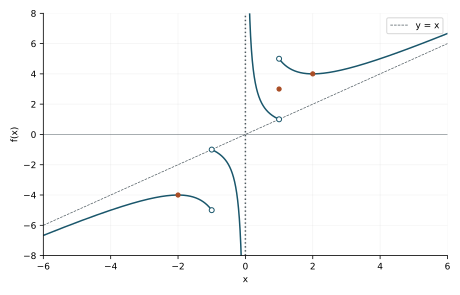

# ENS de Cachan D1 — Mathématiques appliquées et statistiques 2007 · Corrigé brut

*Corrigé rédigé par IA, non officiel. Signalez toute erreur.*

**Rédaction** · GPT-6.2 Astra Ultra · vitesse non renseignée

**Révision** · GPT-6.2 Astra Ultra · vitesse non renseignée

Le cahier C1783 réunit une limite par morceaux, une somme télescopique, un mélange de salaires et une inégalité de moyennes. La quatrième question est résolue en tenant compte de l’hypothèse manquante sur les exposants.

## Exercice 1. Une limite de fractions rationnelles

### Question 1.1

Si $0<|x|<1$, alors $x^n\to0$ et la limite vaut $1/x$. Si $|x|>1$, divisons le numérateur et le dénominateur par $x^n$ : $x^{-n}\to0$ et la limite vaut $(x^2+4)/x=x+4/x$. Enfin pour $x=1$ le quotient vaut constamment $(1+5)/2=3$. En $-1$, le dénominateur s’annule un rang sur deux, et en zéro il s’annule toujours. Ces deux valeurs sont exclues du domaine imprimé.

### Question 1.2

Sur $0<|x|<1$, $f'=-1/x^2<0$. Sur $|x|>1$, $f'=1-4/x^2$, positif pour $|x|>2$, négatif pour $1<|x|<2$. La branche extérieure gauche monte de $-\infty$ à $-4$ en $-2$, puis descend vers $-5$ en $-1^-$. La branche intérieure gauche descend de la limite $-1$ en $-1^+$ vers $-\infty$ en $0^-$. La branche intérieure droite descend de $+\infty$ en $0^+$ vers $1$ en $1^-$. En $1$ la valeur est $3$. À partir de la limite $5$ en $1^+$, la branche extérieure droite descend jusqu’à $4$ en $2$, puis monte vers $+\infty$. L’axe $x=0$ est asymptote verticale. Aux deux infinis $f(x)-x=4/x\to0$, donc $y=x$ est asymptote oblique.

## Exercice 2. Somme télescopique

### Question 2.1

Pour $k\ge1$, prenons le dénominateur $(k+1)!k(k+1)$. Les deux numérateurs de $1/(k!k)-1/((k+1)!(k+1))$ deviennent $(k+1)^2$ et $k$. Leur différence est $k^2+k+1$, exactement le numérateur annoncé.

### Question 2.2

Posons $a_k=1/(k!k)$. Le terme d’indice $k$ vaut $a_k-a_{k+1}$. En sommant de 1 à $n\ge1$, les termes intérieurs s’annulent. Il reste $a_1-a_{n+1}=1-1/((n+1)!(n+1))$.

## Exercice 3. Salaires et probabilités conditionnelles

### Question 3.a

Soit $S$ l’événement « syndiqué » et $H$ l’événement « salaire au moins égal à 40 000 ». Les symboles monétaires du feuillet varient. Les moyennes, les écarts-types et le seuil sont ici exprimés dans une même unité, conformément aux montants en euros des questions a à c. Si $\Phi$ est la fonction de répartition normale standard, $P(H\mid S)=1-\Phi((40000-35123)/4287)\simeq1-\Phi(1{,}13763)\simeq0{,}12764$.

### Question 3.b

Sur la table jointe, $\Phi(1{,}41)=0{,}9207$ et $\Phi(1{,}42)=0{,}9222$. Leur interpolation au rang $1{,}4135$ donne environ $0{,}9212$. En utilisant la loi normale sans arrondir le seuil réduit, on trouve $P(H\mid S^c)=1-\Phi((40000-51325)/8012)=\Phi(1{,}41350)\simeq0{,}92125$, par symétrie de la loi normale.

### Question 3.c

Par probabilités totales, $P(H)=0{,}9P(H\mid S)+0{,}1P(H\mid S^c)\simeq0{,}20700$, soit environ 20,70 %.

### Question 3.d

Par Bayes, $P(S\mid H^c)=0{,}9[1-P(H\mid S)]/[1-P(H)]\simeq0{,}99007$. Environ 99,01 % des employés sous le seuil sont syndiqués dans ce modèle. On peut contrôler le résultat sur 10 000 employés fictifs. Sur 9 000 syndiqués, environ 7 851 ont un salaire inférieur au seuil. Sur 1 000 non-syndiqués, environ 79 gagnent également moins que le seuil. La proportion cherchée est donc voisine de $7851/(7851+79)$.

## Exercice 4. Une inégalité à condition de conjugaison

### Question 4.1

Avec $0<\alpha<1$, $f'(x)=\alpha(x^{\alpha-1}-1)$ pour $x>0$. C’est positif pour $0<x<1$, nul en 1, négatif pour $x>1$. Ainsi $f$ croît de sa limite 0 jusqu’au maximum $1-\alpha$ puis décroît vers $-\infty$, car $x^\alpha/x\to0$.

### Question 4.2

L’inégalité imprimée n’est pas vraie pour deux réels quelconques $p,q>1$. Par exemple $A=B=1$, $p=q=3$ donneraient $1\le2/3$. La relation manquante pour l’énoncé usuel est $1/p+1/q=1$. Elle est même nécessaire si l’inégalité doit valoir pour tous $A,B>0$ : en prenant $A=B=t$, on obtient $t^s\le st$ pour tout $t>0$, avec $s=1/p+1/q$. Si $s>1$, c’est impossible aux grands $t$, et si $s<1$, aux petits $t$.

Sous cette condition, poser $x=A/B$ et $\alpha=1/p$, de sorte que $1-\alpha=1/q$. Le maximum trouvé à la question précédente donne $x^\alpha\le\alpha x+(1-\alpha)$. En multipliant par $B>0$, on obtient $A^{1/p}B^{1/q}\le A/p+B/q$. L’égalité a lieu exactement pour $x=1$, soit $A=B$.
