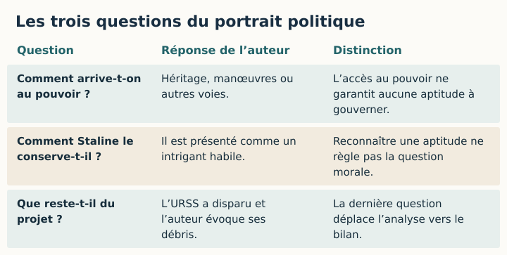

# ENS Rennes · D1 · Russe 2007 — Corrigé guidé

*Corrigé rédigé par IA, non officiel. Signalez toute erreur.*

**Rédaction** · GPT-6.2 Astra Ultra · vitesse non renseignée

Écrit de l’ENS de Cachan, conservé dans les archives D1 de Rennes. B. S. Ilizarov, « Образ Сталина. Взгляд из XXI века », Saint-Pétersbourg, 2006.

## Version française

**Staline**

Nous savons que les hommes politiques arrivent au pouvoir par des voies différentes. La plus simple est d'en hériter, mais souvent il n'en sort rien de bon. Car il ne suffit pas de parvenir au pouvoir, encore faut-il savoir en user convenablement. Gouverner un État est une activité qui exige un talent particulier, et le talent ne se transmet pas par héritage. Les exemples qui le confirment sont innombrables.

Je prendrai un autre exemple dans l'histoire russe. Au Temps des troubles, Grichka Otrepiev accéda au pouvoir et devint tsar. Et qu'en sortit-il ? Une farce ! En un autre « temps des troubles », Iossif Vissarionovitch Djougachvili arriva au pouvoir, et il en sortit une tragédie !

Autrement dit, celui qui cherche à s'emparer du pouvoir par tous les moyens doit posséder certaines qualités pour le conserver et en user à bon escient. À envisager Staline sous cet angle, avait-il le talent nécessaire pour parvenir au pouvoir et s'y maintenir ? De toute évidence, oui. Autre chose est de savoir par quels moyens il y est parvenu et quel usage il en a fait. Quelle était, en somme, la moralité de ce pouvoir ?

Staline réussit très vite à obtenir le pouvoir absolu. C'était un intrigant d'une habileté consommée, tel que, à mon sens, l'histoire de l'humanité n'en avait encore jamais connu… Il parvint ensuite à reconstruire le pays à lui seul, pratiquement à partir de rien.

Et sur quoi déboucha ce projet social grandiloquent et d'une extrême cruauté ? Sur ceci. Nous vivons aujourd'hui, vous et moi, dans un pays qui a perdu son nom encore retentissant dans un passé récent, celui d'URSS. Et nous-mêmes, comme ce qui nous entoure, ne sommes plus que les débris, de tailles diverses, d'une ancienne grande puissance.

## Expression en russe

Apprécier le rôle de Staline dans l’histoire du peuple russe. Répondre en russe en 100 mots.

Я считаю, что роль Сталина нельзя оценивать только по числу построенных заводов или по победе в войне. Индустриализация изменила страну, но насильственная коллективизация и массовые репрессии разрушили жизнь миллионов людей. Победа над нацизмом была достижением солдат, рабочих и граждан разных народов Советского Союза. Приписывать её одному руководителю значило бы забыть их труд и потери. Илизаров различает умение захватить власть и способность разумно ею пользоваться. Для меня это различие существенно. Государство может быстро сосредоточить огромные ресурсы, однако цена такого успеха становится неприемлемой, когда граждане лишены права возражать, а память о жертвах уступает место почитанию одного человека и мифу о его непогрешимости.

*100 mots, comptés par espaces.*

## Comment construire la réponse

**Écouter les changements de voix.** L'auteur alterne *мы*, « nous », et *на мой взгляд*, « à mon sens ». Le jugement sur l'habileté de l'intrigant ou sur la reconstruction solitaire du pays lui appartient. La version conserve ce point de vue, tandis que la réponse personnelle peut le discuter.

**Distinguer deux emplois d'une période historique.** *Смутное время* renvoie d'abord au Temps des troubles et au personnage d'Otrepiev, puis les guillemets transfèrent l'expression à l'époque de Djougachvili, nom de naissance de Staline. L'antithèse « farce » et « tragédie » donne sa force à la seconde occurrence.

**Construire son propre jugement.** Dans l'essai, attribuer la victoire à des acteurs précis évite de confondre le destin des peuples soviétiques avec l'action personnelle de Staline. Le critère proposé pour juger l'exercice du pouvoir est le sort réservé aux citoyens et à leur liberté de témoigner.

[Feuillet original, p. 7](https://www.ens-rennes.fr/medias/fichier/annales-2007-concours-d1_1423059780504-pdf#page=7)
