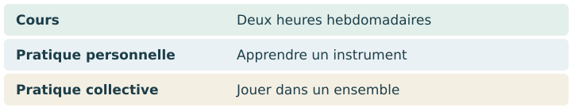

# ENS · MP-PC · Allemand (LV1) 2007 — Corrigé guidé

*Corrigé rédigé par IA, non officiel. Signalez toute erreur.*

**Rédaction** · GPT-6.2 Astra Ultra · vitesse non renseignée

**Faire de la musique à l’école.** La garde 71.12PM annonce deux heures pour les ENS de Paris, de Lyon et de Cachan. Le dictionnaire est interdit. La version compte pour 12 points et les deux réponses pour 8 points. La page 2 ne fixe pas de longueur pour les réponses.

D’après Die Zeit, numéro 49, 30 novembre 2006.

## Version · Faites de la musique !

> [!INDICATION]
> Le jury distingue wie guter Musikunterricht sein könnte (« à quoi un bon cours pourrait ressembler ») d’un jugement sur son degré de qualité. Les 82 % regroupent les cours annulés et ceux confiés à des non-spécialistes.

> [!INDICATION]
> Dazu ajoute l’apprentissage instrumental aux deux heures de cours. Les conditionnels du deuxième paragraphe évitent de transformer une possibilité ou les propos rapportés en un résultat affirmé sans réserve. À la fin, l’auteur qualifie lui-même d’erreur l’idée prêtée aux défenseurs des seules matières « dures ».

Écouter de la musique est le loisir préféré des jeunes de douze à vingt-cinq ans. Ils en emportent partout, écouteurs dans les oreilles et lecteur MP3 dans la poche de leur veste. À l’école, en revanche, la musique est loin de faire partie des matières favorites. Elle vient très bas dans l’estime d’élèves qui, pour la plupart, ignorent à quoi pourrait ressembler un bon cours de musique. Dans les écoles primaires allemandes, 82 % des heures de musique sont annulées ou assurées par des enseignants formés dans une autre discipline. La musique risque de disparaître de la conception que notre société se fait de l’éducation.

Pourtant, on sait depuis longtemps combien la musique favorise le développement de la personne. Un spécialiste renommé de psychologie cognitive affirme que l’univers sonore permet aux enfants de mieux comprendre leur environnement et de communiquer avec les autres. La pratique musicale favorise le développement des connexions entre les cellules nerveuses des deux hémisphères du cerveau, améliore la concentration et facilite la communication. L’important est de participer soi-même, de chanter, de jouer d’un instrument. Se contenter de consommer de la musique en l’écoutant n’apporte en revanche que peu de chose. Des enfants qui, dès l’âge de six ans, suivent régulièrement deux heures de musique par semaine, apprennent en plus un instrument et en jouent dans un ensemble pourraient, après trois ans, améliorer surtout leur capacité à se représenter l’espace. Ces élèves seraient également plus réceptifs et auraient davantage confiance en eux que les jeunes du même âge peu portés sur la musique.

Malgré ces résultats scientifiques, la musique peine à s’imposer face à des matières « dures » comme les mathématiques. Un peu de musique n’aiderait personne à obtenir le bac : voilà l’idée fausse communément admise. C’est ainsi qu’à l’école et dans la société s’affrontent les arts, beaux mais apparemment inutiles, et les sciences de la nature, censées compter bien davantage.

## Question 1 · La place des arts dans l’école française

> [!INDICATION]
> Kunstunterricht vise ici l’enseignement artistique. L’exemple d’une décision scolaire concrète permet d’examiner le sérieux reconnu à ce travail. Précisez la portée de votre expérience lorsque vous parlez du système français.

Meiner Erfahrung nach wird der Kunstunterricht auch in Frankreich oft weniger ernst genommen als andere Fächer. Besonders deutlich wird das, wenn zwei Arbeiten am selben Tag fällig sind. Viele Schüler halten es dann für selbstverständlich, zuerst für die Mathematikaufgabe zu lernen und das Bild erst spät am Abend fertigzustellen. Diese Entscheidung sagt viel über die Erwartungen aus, die sie in ihrem Umfeld wahrnehmen. Dabei kann gerade die Arbeit an einem Bild verlangen, dass man genau beobachtet, einen ersten Entwurf verwirft und seine Entscheidungen begründet. Wo eine Schule Arbeiten öffentlich zeigt und den Entstehungsprozess bespricht, bekommen solche Fähigkeiten Gewicht. Ich würde also zwischen der Stellung des Faches im Stundenplan und der Aufmerksamkeit unterscheiden, die seine Inhalte im Alltag tatsächlich erhalten.

## Question 2 · Écouter et jouer

> [!INDICATION]
> Le sujet autorise écoute et pratique. Une réponse personnelle peut comparer un moment d’écoute attentive avec une activité collective et expliquer ce que l’une change à l’autre.

Musik spielt in meinem Alltag zwei verschiedene Rollen. Wenn ich mit dem Bus fahre, höre ich oft dasselbe Stück mehrmals. Beim zweiten Mal fällt mir manchmal ein leiser Rhythmus auf, den ich zunächst überhört habe. Schon als Zuhörer kann ich also bewusst auf etwas achten. Das ist eine andere Erfahrung, als Musik nur im Hintergrund laufen zu lassen.

Noch deutlicher merke ich das beim gemeinsamen Singen. Sobald ich zu schnell einsetze, verändert sich der Klang der ganzen Gruppe. Ich muss auf die anderen hören und zugleich meine eigene Stimme führen. Mir gefällt daran, dass wir zusammen etwas zustande bringen, das keiner allein herstellen könnte. Auch wenn ich anschließend wieder nur zuhöre, nehme ich die Stimmen in einem Lied anders wahr.

Le rapport commun aux MP et PC traite la version sur la pratique de la musique et les deux questions.

[Cahier, allemand p. 2](https://banques-ecoles.fr/cms/wp-content/data/filiere-pc/annales-de-la-banque-pc/session-2007/sujet-ecrit-2007-mp-pc_langue_vivante_1.pdf#page=2) · [Rapport du jury](https://banques-ecoles.fr/cms/wp-content/data/filiere-pc/rapports-des-jurys-de-la-banque-pc/session-2007/rapport-2007-pc_ecrit_langue_vivante_1_allemand.pdf)
