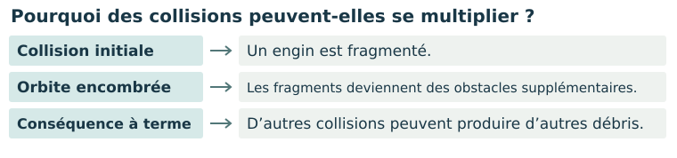
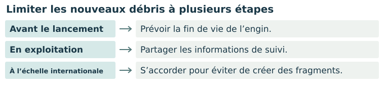

# ENS · MP-PC · Anglais (LV1) 2007 — Corrigé guidé

*Corrigé rédigé par IA, non officiel. Signalez toute erreur.*

**Rédaction** · GPT-6.2 Astra Ultra · vitesse non renseignée

Le cahier commun aux ENS de Paris, de Lyon et de Cachan dure deux heures. Dictionnaire et calculatrice interdits pour l’anglais. La version vaut 12 points, les deux questions 8 points au total.

## V. Version française

Le texte distingue les objets détectables de tous les débris présents. Les quatre pouces valent ici dix centimètres. Les huit cents à près de mille concernent le seul satellite détruit. Préserver le passage du conditionnel des premières prévisions à l’assurance plus marquée de la dernière phrase.

**Ces dangers qui tournoient en orbite**

**Un essai de missile chinois pourrait semer le chaos autour de la Terre**

Depuis des décennies, les spécialistes de l’espace redoutent qu’un débris orbital lancé à grande vitesse ne réduise un jour un gros engin spatial en centaines de morceaux et ne déclenche une réaction en chaîne, une lente cascade de collisions qui irait s’amplifiant pendant des siècles et sèmerait le chaos dans l’espace.

Depuis une dizaine d’années, leur inquiétude s’était accrue à mesure qu’un consensus se dégageait parmi les scientifiques. Le nombre d’objets en orbite avait dépassé une masse critique ou, pour reprendre leurs termes, atteint la densité spatiale critique, le seuil à partir duquel une réaction en chaîne devient inévitable.

Au début de cette année, après un demi-siècle d’allongement continu, la liste des objets détectables d’au moins quatre pouces, soit dix centimètres, de large a atteint dix mille entrées. On y trouve des satellites hors service, des étages de fusée usagés, un appareil photo, un outil à main et de véritables champs de débris tourbillonnants laissés par des explosions accidentelles et des essais destructeurs.

Or, selon les spécialistes, l’essai de fusée antisatellite effectué par la Chine le 11 janvier, qui a fait voler un vieux satellite en centaines de gros fragments, signifie que la réaction en chaîne débutera très probablement plus tôt. Si ces prévisions se vérifient, la cascade pourrait mettre en péril des satellites de pointe valant des milliards de dollars et finir par compromettre l’élan de l’humanité vers les étoiles.

Selon des spécialistes américains du secteur public et du secteur privé, les premières estimations de huit cents débris détectables issus du satellite détruit devraient passer à près de mille à mesure que se poursuivent les observations par radars de poursuite et caméras spatiales. Quel que soit le chiffre retenu, il s’agit du plus grave incident de ce type de toute l’histoire spatiale.

Aujourd’hui, l’an prochain ou au cours des dix prochaines années, un de ces débris en orbite déclenchera la cascade.

## 1. What are the problems posed by the increase of debris in space?

Expliquer le mécanisme cumulatif, puis distinguer les pertes immédiates des conséquences à longue échéance. Un inventaire de dix mille objets détectables ne recense pas nécessairement les plus petits.

The main difficulty is that one collision can make the next one more likely. A fragment travelling rapidly enough to damage a satellite may break it into many pieces. Each surviving piece then becomes another obstacle in a region already occupied by working spacecraft. Tracking the larger objects helps operators assess danger, but adding a name to a catalogue does not remove the object. The destruction of a single old satellite can therefore impose risks on many owners who had no part in the event. In the short term, they may lose expensive equipment and the services it provides on Earth. In the longer term, a crowded orbit could become too hazardous for useful missions, leaving future generations to pay for decisions taken today.

*124 mots.*

## 2. What kind of solution can be imagined to limit the multiplication of undesirable objects in space?

La question appelle une solution au moins développée. Distinguer le partage d’observations, qui limite certains risques de collision, des règles concernant la création de nouveaux débris. Une mesure coûteuse a besoin d’incitations communes.

Preventing additional debris is easier to justify than relying on someone else to clear it away later. A launch licence could require the operator to explain how a spacecraft will be retired and how the cost has been included in its budget. That would give engineers a reason to consider the whole lifetime of a mission before equipment leaves Earth. Operators could also share tracking information, so that one organisation's observation helps protect another's satellite. Such measures would have limited value if states continued carrying out destructive tests in the same orbits. An international commitment to avoid deliberate fragmentation would address that danger directly. Compliance would be easier to assess if observations and incident reports were available across borders. Space is shared, and an effective rule must apply even when it would be cheaper for an individual operator to leave the consequences to others.

*144 mots.*

Version de William J. Broad, International Herald Tribune, 7 février 2007. Les deux questions sont reproduites à la page 3 du cahier officiel. Le rapport spécifique à l’anglais LV1 2007 n’a pas été retrouvé.

[Version et consignes](https://banques-ecoles.fr/cms/wp-content/data/filiere-pc/annales-de-la-banque-pc/session-2007/sujet-ecrit-2007-mp-pc_langue_vivante_1.pdf#page=3)
