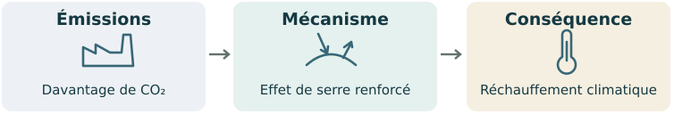

# ENS · MP-PC · Chinois LE2 2007 — Corrigé guidé

*Corrigé rédigé par IA, non officiel. Signalez toute erreur.*

**Rédaction** · GPT-6.2 Astra Ultra · vitesse non renseignée

**L’effet de serre et ses conséquences.** Écrit de deux heures commun aux ENS de Paris et de Cachan, option de langue étrangère II. La garde 71.10PM autorise les dictionnaires unilingues ou bilingues en chinois. La page 5 attribue 15 points à la version et 5 points à la question, à traiter en chinois en 100 mots minimum.

## I. Version française

> [!INDICATION]
> Conservez 0,027 %, valeur imprimée dans le passage de 2007, et la comparaison avec une cloche de verre. Celle-ci relève du texte à traduire. La réponse à la question peut ensuite préciser que seule une partie du rayonnement est retenue. Le groupe marqué par 由于 relie les combustions et les émissions à la hausse de la teneur en dioxyde de carbone.

> [!INDICATION]
> Le rapport d’A. Cheng-Wang distingue 温室效应, l’effet de serre, de son effet sur la température. Il relève la confusion entre les deux pôles et des traductions défectueuses de 二氧化碳. 面目全非 s’applique à l’aspect de la Terre entière et exprime ici une transformation radicale.

Notre Terre est entourée d’une atmosphère qui contient environ 0,027 % de dioxyde de carbone. Ces dernières décennies, les usines ont brûlé de grandes quantités de charbon et de pétrole, rejetant ainsi beaucoup de gaz résiduaires. Les automobiles, de leur côté, ont émis d’importantes quantités de gaz d’échappement. La teneur de l’atmosphère en dioxyde de carbone a donc sensiblement augmenté. Ce gaz forme alors comme une immense cloche de verre posée sur la Terre : la lumière du soleil peut y pénétrer, mais la chaleur à la surface de la Terre ne parvient plus à s’échapper. C’est ainsi que se produit l’« effet de serre ».

L’effet de serre entraîne un réchauffement du climat et perturbe la croissance normale des cultures. Avec ce réchauffement, les glaces de l’Antarctique fondront peu à peu, faisant monter le niveau des mers. De nombreuses villes côtières seront alors submergées et la Terre entière changera radicalement d’aspect.

Les pays du monde prennent activement des mesures pour atténuer l’effet de serre. D’une part, ils réduisent leur consommation de charbon, de pétrole et de gaz naturel. D’autre part, ils plantent des arbres à grande échelle pour constituer des forêts.

## II. Réponse en chinois

所谓“温室效应”是什么？

> [!INDICATION]
> Qu’appelle-t-on « effet de serre » ? Une définition précise dit ce qui est transmis, par quoi et dans quelle direction. La réponse peut ensuite distinguer le rôle du phénomène naturel et celui de son renforcement. 由此产生的后果 permet de revenir aux conséquences après avoir établi le mécanisme.

所谓温室效应，是指大气中的某些气体能够吸收地面向外发出的一部分热辐射，并向各个方向重新发出辐射。因此，地面附近比没有这些气体时更温暖。课文把大气比作一个玻璃罩，是为了让我们想象阳光能够到达地面，而热量没有那么容易全部散到太空。这个比喻很形象，但大气中并没有一层真正的玻璃。

自然的温室效应使地球适合生命生存。问题在于，人类大量燃烧煤和石油，使大气中的二氧化碳增加，原有的效应随之增强。气候变暖是这一变化的后果。为减缓这个过程，我们可以减少对化石燃料的依赖，也可以保护森林。这样就能把现象本身、它的增强和由此产生的后果分清楚。

Le découpage lexical indicatif donne environ 136 mots dans la réponse.

A. Cheng-Wang recense dix copies de MP et deux de PC. Elle signale aussi l’absence de candidats en BCPST. La garde du présent cahier est celle des MP et PC.

[Cahier de langue étrangère II, garde p. 1 et chinois p. 5](https://banques-ecoles.fr/cms/wp-content/data/filiere-pc/annales-de-la-banque-pc/session-2007/sujet-ecrit-2007-mp-pc_langue_etrangere_2.pdf#page=5) · [Rapport du jury, p. 1](https://banques-ecoles.fr/cms/wp-content/data/filiere-pc/rapports-des-jurys-de-la-banque-pc/session-2007/rapport-2007-pc_ecrit_langue_etrangere_2_chinois.pdf)
